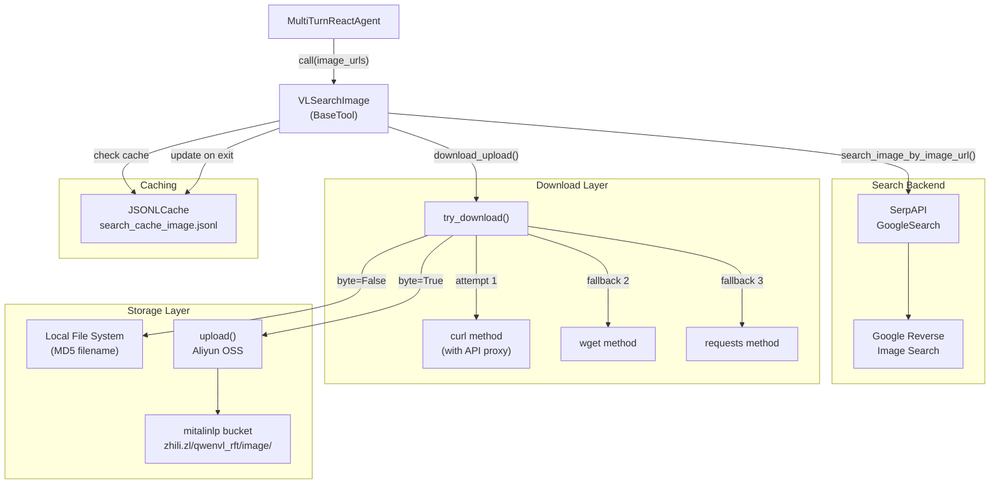

<!-- source: DeepWiki mcp.deepwiki.com · repo Alibaba-NLP/DeepResearch · page 2.7 Visual Search and Image Tools · fetched 2026-10-29 -->

# Visual Search and Image Tools

Relevant source files

The following files were used as context for generating this wiki page:

- [WebAgent/WebWatcher/browsecomp-vl/bc_vl_level1.jsonl](WebAgent/WebWatcher/browsecomp-vl/bc_vl_level1.jsonl)
- [WebAgent/WebWatcher/browsecomp-vl/bc_vl_level2.jsonl](WebAgent/WebWatcher/browsecomp-vl/bc_vl_level2.jsonl)
- [WebAgent/WebWatcher/browsecomp-vl/images/level1.tar](WebAgent/WebWatcher/browsecomp-vl/images/level1.tar)
- [WebAgent/WebWatcher/browsecomp-vl/images/level2.tar](WebAgent/WebWatcher/browsecomp-vl/images/level2.tar)
- [WebAgent/WebWatcher/infer/scripts_eval/images/hle_imgs.tar](WebAgent/WebWatcher/infer/scripts_eval/images/hle_imgs.tar)
- [WebAgent/WebWatcher/infer/scripts_eval/scripts/eval.sh](WebAgent/WebWatcher/infer/scripts_eval/scripts/eval.sh)
- [WebAgent/WebWatcher/infer/vl_search_r1/eval_data/hle.jsonl](WebAgent/WebWatcher/infer/vl_search_r1/eval_data/hle.jsonl)
- [WebAgent/WebWatcher/infer/vl_search_r1/qwen-agent-o1_search/qwen_agent/tools/private/visit.py](WebAgent/WebWatcher/infer/vl_search_r1/qwen-agent-o1_search/qwen_agent/tools/private/visit.py)
- [WebAgent/WebWatcher/infer/vl_search_r1/qwen-agent-o1_search/qwen_agent/tools/vl_search_image.py](WebAgent/WebWatcher/infer/vl_search_r1/qwen-agent-o1_search/qwen_agent/tools/vl_search_image.py)

This document describes the visual search and image processing capabilities of the Tongyi DeepResearch system, specifically focusing on the `VLSearchImage` tool that enables reverse image search, image downloading, and storage management. For general tool architecture, see [Tool System Architecture](#2.4). For web content retrieval without images, see [Web Tools: Search and Visit](#2.6).

## Purpose and Scope

The visual search system provides agents with the ability to:
- Perform reverse image search using Google's reverse image search API
- Download images from search results using multiple fallback methods
- Store images either locally or in cloud object storage (Aliyun OSS)
- Cache search results to reduce API calls and improve performance
- Parse and format image search results for agent consumption

This functionality is critical for vision-language tasks and multimodal reasoning in benchmarks like HLE (Humanity's Last Exam), BrowseComp-VL, and GAIA.

Sources: [WebAgent/WebWatcher/infer/vl_search_r1/qwen-agent-o1_search/qwen_agent/tools/vl_search_image.py:1-324]()

## Visual Search Architecture

**Figure 1: VLSearchImage Tool Data Flow**

This diagram shows the complete pipeline from agent invocation through search, download, and storage. The system implements multiple fallback mechanisms for robustness.

Sources: [WebAgent/WebWatcher/infer/vl_search_r1/qwen-agent-o1_search/qwen_agent/tools/vl_search_image.py

---

