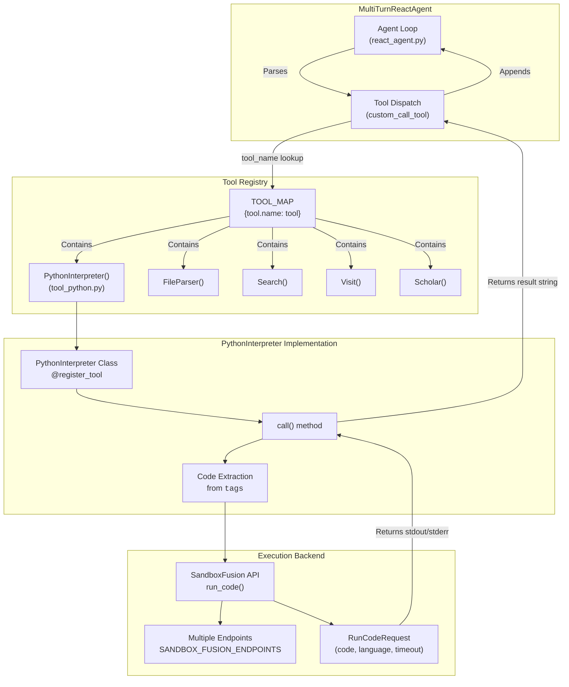
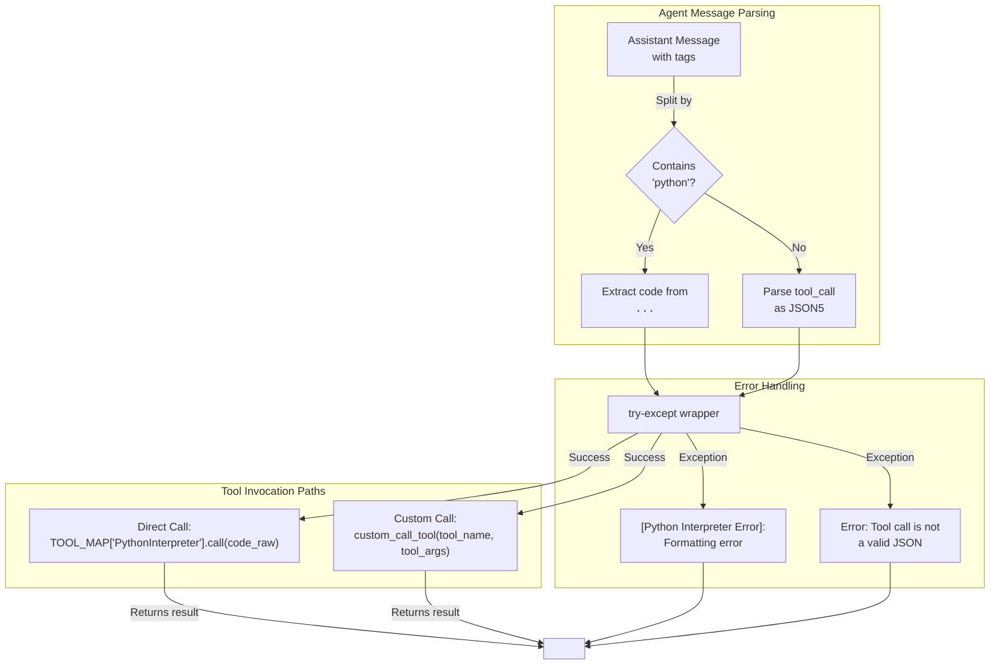
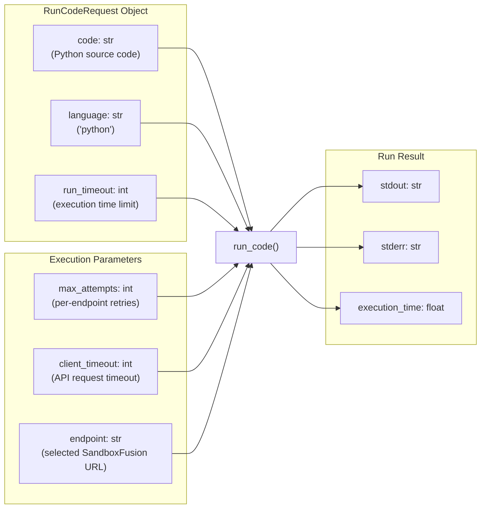
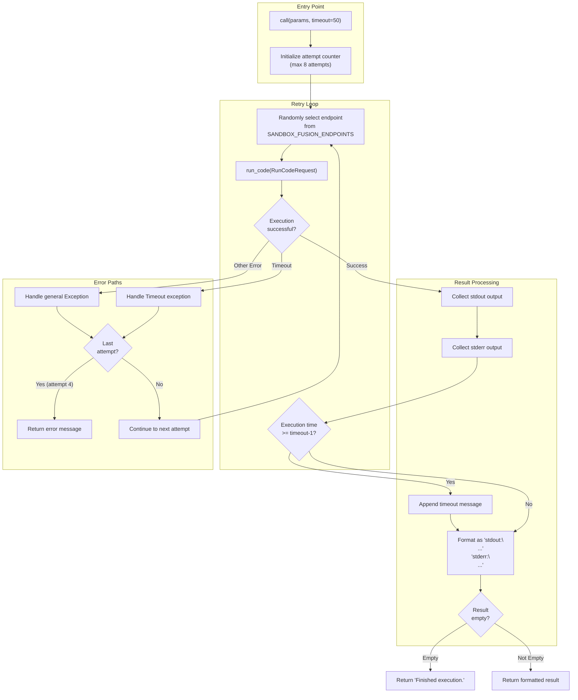
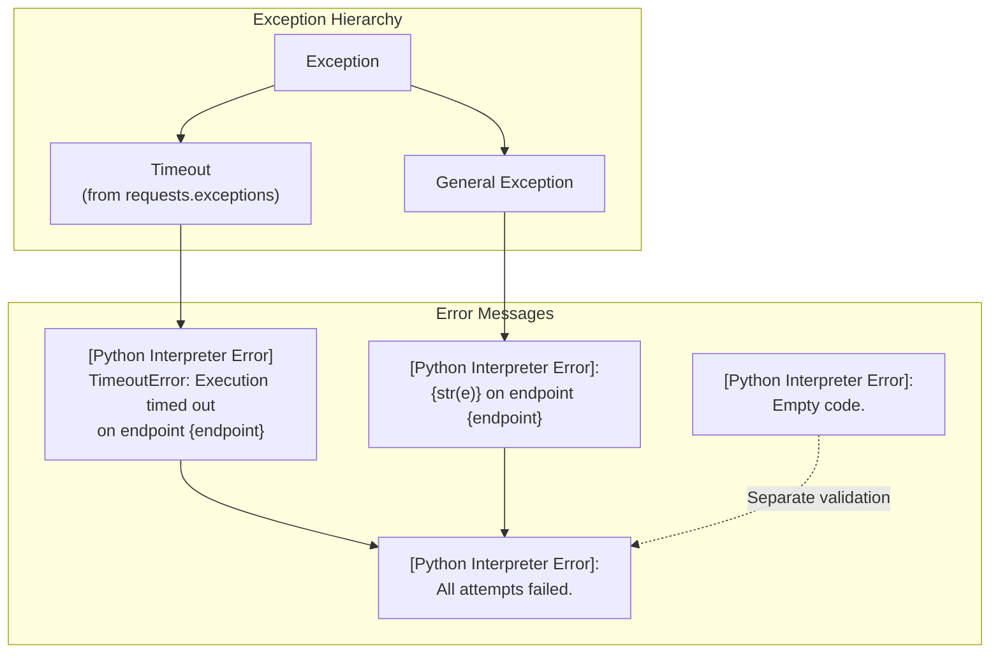
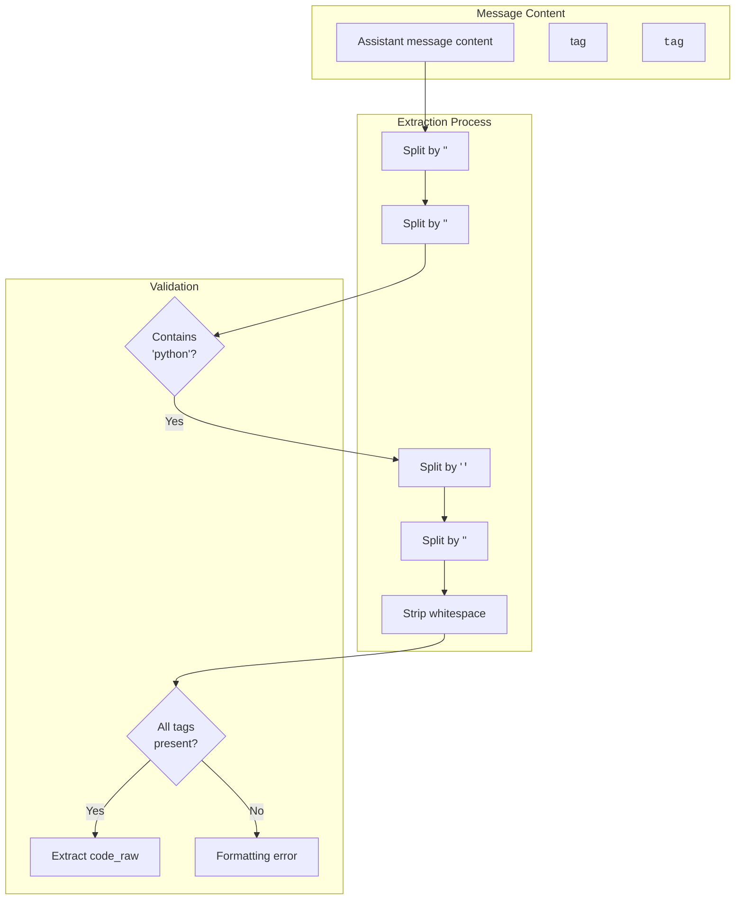
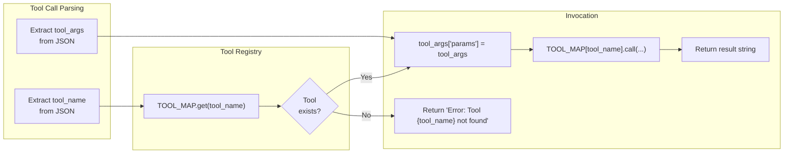

<!-- source: DeepWiki mcp.deepwiki.com · repo Alibaba-NLP/DeepResearch · page 2.8 Python Interpreter and Code Execution · fetched 2026-10-29 -->

# Python Interpreter and Code Execution

<details>
<summary>Relevant source files</summary>

The following files were used as context for generating this wiki page:

- [inference/react_agent.py](inference/react_agent.py)
- [inference/tool_python.py](inference/tool_python.py)

</details>


## Purpose and Scope

This document describes the Python code execution capabilities in the Tongyi DeepResearch inference system. The `PythonInterpreter` tool enables agents to execute Python code in a secure sandboxed environment during their reasoning process. This capability allows agents to perform computations, data analysis, file processing, and other programmatic tasks that cannot be achieved through web search or document parsing alone.

For information about other tools available to the agent, see [Tool System Architecture](#2.4), [Web Tools: Search and Visit](#2.6), and [File Parser and Document Processing](#2.5). For details on how the agent orchestrates tool calls, see [MultiTurnReactAgent Architecture](#2.1).

## System Integration Overview

The Python interpreter integrates into the agent execution loop as one of several available tools. The agent can invoke Python code during its reasoning process, receive execution results, and use those results to inform subsequent actions.



**Sources:** [inference/react_agent.py:31-38](), [inference/tool_python.py:28-32]()

## PythonInterpreter Tool Class

The `PythonInterpreter` class is registered as a tool in the agent's tool registry using the `@register_tool` decorator. It extends `BaseToolWithFileAccess` from the qwen_agent framework.

### Tool Definition

| Property | Value |
|----------|-------|
| **Class Name** | `PythonInterpreter` |
| **Tool Name** | `"PythonInterpreter"` |
| **Registration** | `@register_tool('PythonInterpreter', allow_overwrite=True)` |
| **Base Class** | `BaseToolWithFileAccess` |
| **File Location** | `inference/tool_python.py` |

### Tool Description and Parameters

The tool's description instructs the LLM on proper usage, emphasizing the need for `print()` statements and the `<code>` XML tag format:

```
Execute Python code in a sandboxed environment. Use this to run Python code and get the execution results.
**Make sure to use print() for any output you want to see in the results.**
For code parameters, use placeholders first, and then put the code within <code></code> XML tags
```

**Parameter Schema:**

```python
parameters = {
    "type": "object",
    "properties": {
        "code": {
            "type": "string",
            "description": "The Python code to execute. Must be provided within <code></code> XML tags."
        }
    },
    "required": ["code"]
}
```

**Sources:** [inference/tool_python.py:28-42]()

## Agent Tool Call Integration

The agent invokes the Python interpreter through a special parsing mechanism that handles the `<code>` XML tag format differently from JSON tool calls.



The agent uses two different invocation paths for Python code:

1. **Direct Code Extraction Path** (lines 162-167): When the tool call contains "python" (case-insensitive), the agent extracts code directly from `<code>` tags and calls the interpreter.

2. **JSON Tool Call Path** (lines 169-173, 231-232): Standard JSON-based tool invocation through `custom_call_tool()`.

**Code Snippet:**
```python
# From react_agent.py:162-167
if "python" in tool_call.lower():
    try:
        code_raw = content.split('<tool_call>')[1].split('</tool_call>')[0].split('<code>')[1].split('</code>')[0].strip()
        result = TOOL_MAP['PythonInterpreter'].call(code_raw)
    except:
        result = "[Python Interpreter Error]: Formatting error."
```

**Sources:** [inference/react_agent.py:159-177](), [inference/react_agent.py:228-244]()

## SandboxFusion Integration

The Python interpreter executes code through the SandboxFusion API, which provides secure, isolated execution environments. SandboxFusion is imported from the `sandbox_fusion` module and provides the `run_code()` function.

### Endpoint Configuration

The system supports multiple SandboxFusion endpoints for load balancing and fault tolerance:

```python
# Environment variable configuration
SANDBOX_FUSION_ENDPOINTS = []
if 'SANDBOX_FUSION_ENDPOINT' in os.environ:
    SANDBOX_FUSION_ENDPOINTS = os.environ['SANDBOX_FUSION_ENDPOINT'].split(',')
```

The `SANDBOX_FUSION_ENDPOINT` environment variable can contain a comma-separated list of endpoints. On each execution attempt, a random endpoint is selected.

**Sources:** [inference/tool_python.py:20-25]()

### RunCodeRequest Structure



**Sources:** [inference/tool_python.py:82-93]()

## Code Execution Flow

The complete execution flow includes retry logic, timeout handling, and result formatting.



### Execution Steps

1. **Code Extraction**: The `call()` method receives raw code as a string parameter
2. **Retry Loop**: Attempts execution up to 8 times (configurable)
3. **Endpoint Selection**: Random endpoint selected for each attempt
4. **Execution**: Code sent to SandboxFusion with timeout (default 50 seconds)
5. **Result Collection**: Stdout and stderr captured separately
6. **Timeout Detection**: Checks if execution time approached timeout limit
7. **Formatting**: Results formatted with "stdout:" and "stderr:" prefixes
8. **Return**: Returns formatted string or error message

**Sources:** [inference/tool_python.py:72-112]()

## Error Handling and Retry Mechanism

The implementation includes sophisticated error handling with multiple layers of fault tolerance.

### Retry Strategy

| Parameter | Value | Description |
|-----------|-------|-------------|
| **Max Attempts** | 8 | Total number of retry attempts |
| **Per-Endpoint Attempts** | 1 | Attempts per selected endpoint (forces endpoint rotation) |
| **Default Timeout** | 50 seconds | Execution time limit |
| **Last Attempt Check** | `attempt == 4` | Returns error on 5th attempt (note: appears to be hardcoded) |

### Error Types



**Error Handling Code Pattern:**
```python
# From tool_python.py:95-107
except Timeout as e:
    last_error = f'[Python Interpreter Error] TimeoutError: Execution timed out on endpoint {endpoint}.'
    print(f"Timeout on attempt {attempt + 1}: {last_error}")
    if attempt == 4:  # Last attempt
        return last_error
    continue

except Exception as e:
    last_error = f'[Python Interpreter Error]: {str(e)} on endpoint {endpoint}'
    print(f"Error on attempt {attempt + 1}: {last_error}")
    if attempt == 4:  # Last attempt
        return last_error
    continue
```

**Sources:** [inference/tool_python.py:76-112]()

## Result Formatting and Output

The Python interpreter returns results as a formatted string that includes both stdout and stderr, making it easy for the agent to parse execution outcomes.

### Output Format

**Successful Execution with Output:**
```
stdout:
<program output from print statements>
stderr:
<error messages if any>
```

**Empty Output:**
```
Finished execution.
```

**Timeout Detection:**
```
stdout:
<program output>
[PythonInterpreter Error] TimeoutError: Execution timed out.
```

### Result Assembly Logic

```python
# From tool_python.py:84-93
result = []
if code_result.run_result.stdout:
    result.append(f"stdout:\n{code_result.run_result.stdout}")
if code_result.run_result.stderr:
    result.append(f"stderr:\n{code_result.run_result.stderr}")
if code_result.run_result.execution_time >= timeout-1:
    result.append(f"[PythonInterpreter Error] TimeoutError: Execution timed out.")
result = '\n'.join(result)
return result if result.strip() else 'Finished execution.'
```

**Sources:** [inference/tool_python.py:84-93]()

## Tool Call Format in Agent Messages

The agent expects Python code to be formatted in a specific XML-based structure within tool calls. This format distinguishes Python execution from other tool invocations.

### Expected Format

```xml
<tool_call>
{"purpose": "<detailed purpose of this tool call>", "name": "PythonInterpreter", "arguments": {"code": ""}}
<code>
# Python code here
import numpy as np
result = np.array([1, 2, 3]).mean()
print(f"Mean: {result}")
</code>
</tool_call>
```

### Parsing Logic



**Sources:** [inference/react_agent.py:162-167](), [inference/tool_python.py:31]()

## Configuration and Environment Variables

The Python interpreter tool requires proper configuration of SandboxFusion endpoints through environment variables.

### Required Environment Variables

| Variable | Format | Example | Description |
|----------|--------|---------|-------------|
| `SANDBOX_FUSION_ENDPOINT` | Comma-separated URLs | `http://10.0.0.1:8000,http://10.0.0.2:8000` | List of SandboxFusion API endpoints |

### Configuration Loading

```python
# From tool_python.py:20-25
SANDBOX_FUSION_ENDPOINTS = []
if 'SANDBOX_FUSION_ENDPOINT' in os.environ:
    SANDBOX_FUSION_ENDPOINTS = os.environ['SANDBOX_FUSION_ENDPOINT'].split(',')
```

### Endpoint Selection Strategy

- **Load Balancing**: Random selection across all configured endpoints
- **Fault Tolerance**: Automatic retry with different endpoint on failure
- **No Sticky Sessions**: Each retry may use a different endpoint

**Sources:** [inference/tool_python.py:20-25](), [inference/tool_python.py:79]()

## Testing and Direct Endpoint Access

The `PythonInterpreter` class includes a `call_specific_endpoint()` method for testing individual endpoints directly. This is useful for debugging and health checks.

### Method Signature

```python
def call_specific_endpoint(self, params: Union[str, dict], endpoint: str, 
                          timeout: Optional[int] = 30, **kwargs) -> tuple
```

### Return Value

Returns a tuple: `(success: bool, result: str, execution_time: float or None)`

- **success**: `True` if execution completed without errors
- **result**: Execution output or error message
- **execution_time**: Time taken to execute (None on error)

### Code Extraction Logic

The method includes sophisticated code extraction that handles multiple input formats:

```python
# Handles JSON format with 'code' or 'raw' fields
code = params.get('code', '')
if not code:
    code = params.get('raw', '')

# Extracts code from triple backticks
triple_match = re.search(r'```[^\n]*\n(.+?)```', code, re.DOTALL)
if triple_match:
    code = triple_match.group(1)
```

**Sources:** [inference/tool_python.py:114-151]()

## Integration with Tool Registry

The Python interpreter is part of the global tool registry that the `MultiTurnReactAgent` uses for tool dispatch.

### Tool Registry Structure

```python
# From react_agent.py:31-38
TOOL_CLASS = [
    FileParser(),
    Scholar(),
    Visit(),
    Search(),
    PythonInterpreter(),  # Instantiated here
]
TOOL_MAP = {tool.name: tool for tool in TOOL_CLASS}
```

### Tool Lookup Flow



**Sources:** [inference/react_agent.py:31-38](), [inference/react_agent.py:228-247]()

## Security Considerations

The Python interpreter's integration with SandboxFusion provides several security guarantees:

### Isolation Features

1. **Sandboxed Execution**: All code runs in isolated containers via SandboxFusion
2. **Timeout Protection**: Execution time limits prevent infinite loops (default 50s)
3. **Network Isolation**: Sandbox environment controls network access
4. **Resource Limits**: Container-level resource restrictions (managed by SandboxFusion)

### Input Validation

- **Empty Code Detection**: Returns error for empty code strings
- **Format Validation**: Requires proper `<code>` tag formatting
- **Exception Handling**: Catches and reports all execution errors safely

### Output Sanitization

- **Structured Format**: Results always returned as formatted strings
- **Error Prefixing**: All errors prefixed with `[Python Interpreter Error]`
- **No Raw Exceptions**: Exceptions converted to error messages before returning to agent

**Sources:** [inference/tool_python.py:72-112](), [inference/tool_python.py:128-130]()

---

