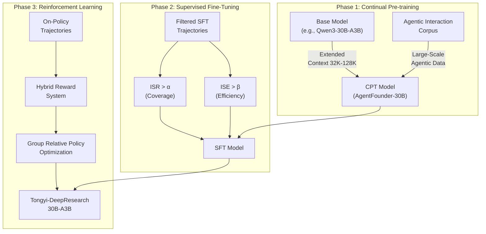
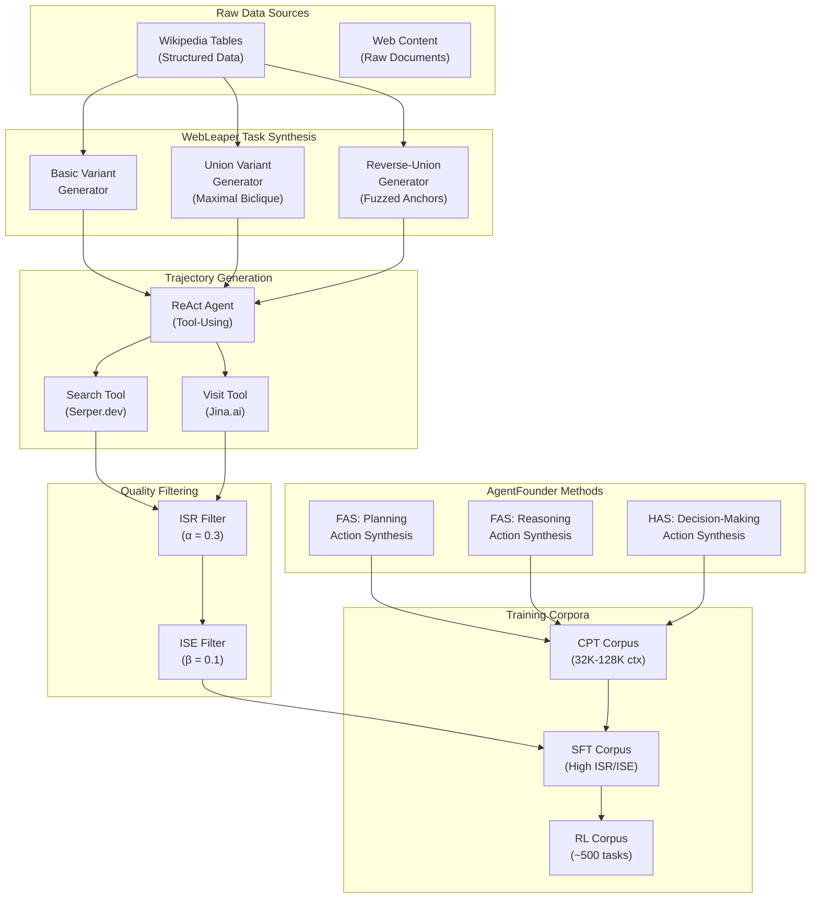
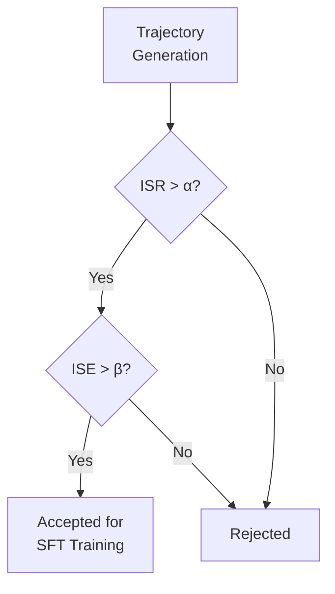
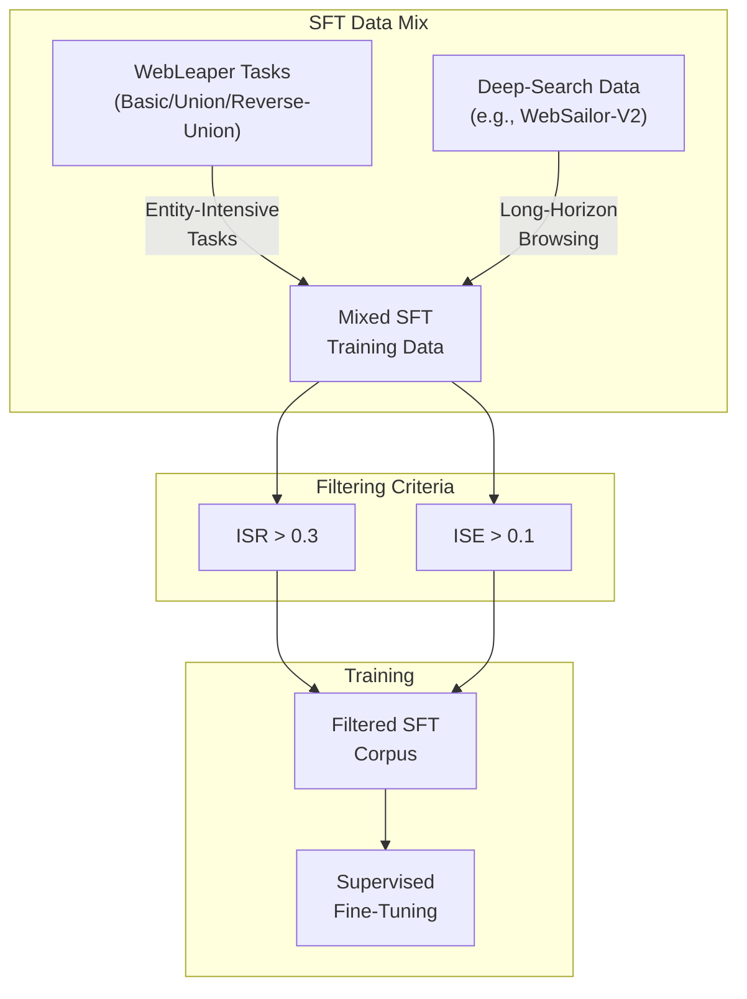
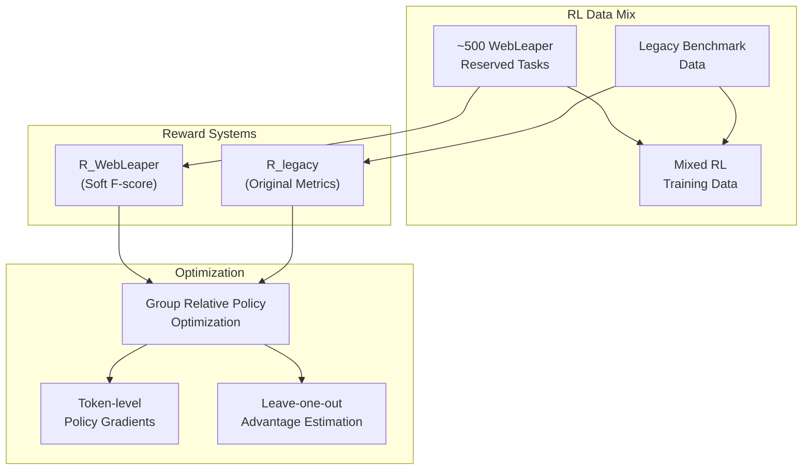
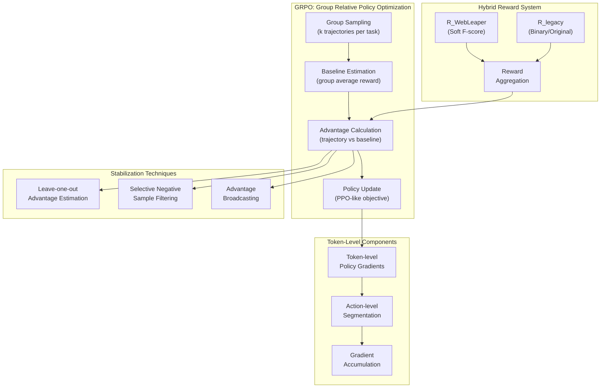
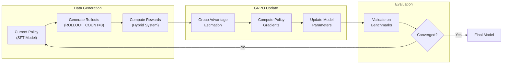
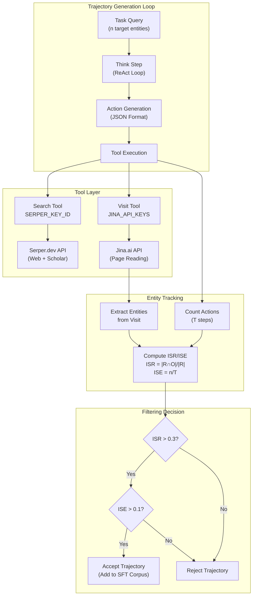
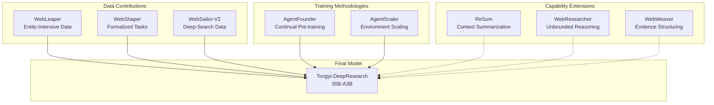

<!-- source: DeepWiki mcp.deepwiki.com · repo Alibaba-NLP/DeepResearch · page 3 Training and Data Pipeline · fetched 2026-10-29 -->

# Training and Data Pipeline

<details>
<summary>Relevant source files</summary>

The following files were used as context for generating this wiki page:

- [.env.example](.env.example)
- [.gitignore](.gitignore)
- [Agent/AgentFounder/README.md](Agent/AgentFounder/README.md)
- [Agent/AgentFounder/assets/logo.png](Agent/AgentFounder/assets/logo.png)
- [Agent/AgentFounder/assets/main_performance.png](Agent/AgentFounder/assets/main_performance.png)
- [Agent/AgentScaler/README.md](Agent/AgentScaler/README.md)
- [Agent/AgentScaler/assets/main.png](Agent/AgentScaler/assets/main.png)
- [README.md](README.md)
- [WebAgent/WebLeaper/README.md](WebAgent/WebLeaper/README.md)
- [WebAgent/WebLeaper/assets/overview.png](WebAgent/WebLeaper/assets/overview.png)
- [WebAgent/WebLeaper/assets/performance_summary.png](WebAgent/WebLeaper/assets/performance_summary.png)
- [WebAgent/WebLeaper/assets/webleaper.jpg](WebAgent/WebLeaper/assets/webleaper.jpg)
- [inference/run_react_infer.sh](inference/run_react_infer.sh)

</details>


## Purpose and Scope

This document provides an overview of the complete training and data pipeline for Tongyi DeepResearch, covering data generation, model training phases, and quality metrics. The pipeline transforms raw data through three major stages: agentic continual pre-training, supervised fine-tuning (SFT), and reinforcement learning (RL).

For implementation details of specific components:
- Development pipeline stages: see [Development Pipeline Overview](#3.1)
- Synthetic data generation: see [Synthetic Data Generation](#3.2)
- Entity-intensive training data: see [WebLeaper](#3.3)
- Continual pre-training methodology: see [AgentFounder](#3.4)
- Environment scaling strategies: see [AgentScaler](#3.5)
- RL optimization methods: see [Reinforcement Learning Methods](#3.6)

For inference and evaluation infrastructure: see [Core Inference Engine](#2) and [Evaluation and Benchmarks](#5).

Sources: [README.md:42-47](), [WebAgent/WebLeaper/README.md:1-17]()

---

## Training Architecture Overview

The training pipeline employs a three-phase approach that progressively refines the model's capabilities:

1. **Agentic Continual Pre-training (CPT)**: Extends the base model's capabilities using large-scale agentic interaction corpora
2. **Supervised Fine-Tuning (SFT)**: Filters trajectories using quality metrics (ISR/ISE) to train on high-quality demonstrations
3. **Reinforcement Learning (RL)**: Further optimizes the model using Group Relative Policy Optimization (GRPO) with hybrid rewards



**Figure 1: Three-Phase Training Pipeline**

Sources: [README.md:42-47](), [WebAgent/WebLeaper/README.md:12-15](), [WebAgent/WebLeaper/README.md:144-150]()

---

## Data Generation Ecosystem

The training pipeline sources data from multiple specialized systems, each contributing distinct capabilities. The data generation process is fully automated and scalable, producing diverse agentic interaction data.



**Figure 2: Data Generation and Filtering Pipeline**

### Data Variant Characteristics

| Variant | Description | Implementation | Key Characteristics |
|---------|-------------|----------------|---------------------|
| **Basic** | Single-source, high-density tasks from homogeneous Wikipedia tables | Single table → root entity → 2nd-layer entities → attributes | Compact contexts, maximal valid actions, high entity density |
| **Union** | Multi-source tasks requiring intersection/union across sources | Maximal biclique enumeration over shared relation sets | Structure-aligned fusion, cross-source reasoning, realistic synthesis |
| **Reverse-Union** | Fuzzed attribute clues requiring deduction before search | Attribute-level clues → deduce anchor → pivot → union search | Forces anchor deduction, prevents keyword shortcuts, anti-shortcut robustness |

### Tree-Structured Information Seeking

WebLeaper models information-seeking as tree-structured reasoning:
- **Root (layer 1)**: Question entity
- **2nd Layer**: Key entities to retrieve
- **3rd Layer**: Attributes and linked entities

Each 2nd-layer node + its attributes forms a subtree. Tasks require retrieving both final and intermediate entities, with the number of targets $n$ providing stable efficiency signals as $\text{Var}(\text{ISE}) = \mathcal{O}(1/n)$.

Sources: [README.md:44](), [WebAgent/WebLeaper/README.md:36-49](), [WebAgent/WebLeaper/README.md:124-141](), [WebAgent/WebLeaper/README.md:38-48]()

---

## Quality Metrics and Filtering

### Information-Seeking Rate (ISR)

Measures the fraction of required entities retrieved:

$$
\text{ISR} = \frac{|R \cap O|}{|R|}
$$

where $R$ is the set of required entities and $O$ is the set of retrieved entities.

### Information-Seeking Efficiency (ISE)

Measures target entities discovered per action step:

$$
\text{ISE} = \frac{n}{T}
$$

where $n$ is the number of target entities and $T$ is the number of action steps.

**Key Property**: As $n$ increases, $\text{Var}(\text{ISE}) = \mathcal{O}(1/n)$, providing reliable efficiency signals during training.

### SFT Trajectory Selection Criteria



**Figure 3: SFT Trajectory Filtering Pipeline**

Typical threshold values:
- Coverage threshold: α = 0.3
- Efficiency threshold: β = 0.1

Sources: [WebAgent/WebLeaper/README.md:52-63](), [WebAgent/WebLeaper/README.md:66-79](), [WebAgent/WebLeaper/README.md:147-148]()

---

## Training Data Mix

### SFT Phase Data Composition



**Figure 4: SFT Data Composition and Training Flow**

The SFT data mix balances:
- **Entity-intensive tasks** from WebLeaper for efficient information retrieval
- **Deep-search data** to maintain long-horizon browsing capabilities

### RL Phase Data Composition



**Figure 5: RL Data Composition and Optimization Components**

Sources: [WebAgent/WebLeaper/README.md:144-150](), [README.md:46]()

---

## Hybrid Reward System

The RL phase employs a hybrid reward system to address the challenges of entity-intensive tasks:

### WebLeaper Reward (R_WebLeaper)

For entity-intensive tasks, uses a granular soft F-score reward that handles semantic variations:

$$
\mathcal{R}_{\text{WebLeaper}} = (1 + \omega^2) \frac{P \cdot R_c}{\omega^2 P + R_c}
$$

where:
- $P$ is soft precision over retrieved entities
- $R_c$ is soft recall over ground-truth entities
- $\omega$ is a weighting parameter

**Key Advantage**: Handles entity variations (e.g., "USA" vs. "United States") through semantic similarity rather than exact matching.

### Legacy Reward (R_legacy)

For traditional benchmark data, uses original reward functions (e.g., binary success/failure).

### Training Performance Impact

| Model Configuration | BrowseComp | GAIA | xbench-DS | WideSearch (SR) | WideSearch (Row F1) | WideSearch (Item F1) |
|---------------------|------------|------|-----------|-----------------|---------------------|----------------------|
| SFT Only | 37.80 | 69.9 | 69.0 | 1.5 | 23.0 | 45.4 |
| SFT + RL | **38.8** (+1.0) | **73.2** (+3.3) | **72.0** (+3.0) | **4.0** (+2.5) | **31.0** (+8.0) | **48.8** (+3.4) |

Sources: [WebAgent/WebLeaper/README.md:82-97](), [WebAgent/WebLeaper/README.md:113-121]()

---

## Training Innovations and Implementation

The pipeline incorporates several key innovations implemented through the GRPO framework:



**Figure 6: GRPO Implementation Architecture**

### Key Innovation Components

#### 1. Strictly On-Policy RL
- Tight integration between trajectory generation and model updates
- Rollouts generated using current policy state
- `ROLLOUT_COUNT=3` rollouts per task for sample efficiency

#### 2. Group Relative Policy Optimization (GRPO)
- Samples multiple trajectories (group) per task
- Estimates advantage relative to group average reward
- More stable than individual trajectory-based methods
- Handles non-stationary environments through relative comparisons

#### 3. Token-Level Policy Gradients
- Fine-grained optimization at individual token level
- Action-level segmentation for long trajectories
- Gradient accumulation across trajectory segments

#### 4. Leave-One-Out Advantage Estimation
- Robust advantage estimation by excluding current sample
- Reduces variance in advantage calculations
- Improves training stability

#### 5. Selective Negative Sample Filtering
- Filters out extremely poor samples that could destabilize training
- Maintains on-policy property while improving sample efficiency
- Balances exploration and exploitation

### Training Workflow



**Figure 8: RL Training Workflow Loop**

### Parallel Trajectory Generation

The training pipeline uses parallel workers for efficient trajectory generation:

```python
# From .env configuration
MAX_WORKERS = 30  # Parallel workers for rollout generation
```

This enables:
- Concurrent trajectory generation across multiple tasks
- Efficient utilization of computational resources
- Faster iteration cycles during RL training

Sources: [README.md:46](), [.env.example:43]()

---

## Training Configuration

### Base Model and Backbone

- **Backbone**: `Qwen3-30B-A3B-Thinking-2507`
- **Total Parameters**: 30.5 billion
- **Activated Parameters**: 3.3 billion per token (MoE architecture)
- **Context Length Extension**: 32K → 128K tokens (via two-stage CPT)
- **Model Download**: Available via HuggingFace and ModelScope

```bash
# Model paths from .env configuration
MODEL_PATH=/your/model/path  # Points to downloaded model weights
```

### Inference Sampling Parameters

Different temperature settings are used for different training phases:

```python
# SFT trajectory generation (WebLeaper)
temperature = 0.6
top_p = 0.95

# RL rollout generation (from .env)
TEMPERATURE = 0.85
PRESENCE_PENALTY = 1.1
```

### Training Hyperparameters

Key hyperparameters from `.env.example`:

| Parameter | Value | Purpose |
|-----------|-------|---------|
| `ROLLOUT_COUNT` | 3 | Number of on-policy rollouts per task |
| `TEMPERATURE` | 0.85 | Sampling temperature for RL phase |
| `PRESENCE_PENALTY` | 1.1 | Penalty to encourage diverse generation |
| `MAX_WORKERS` | 30 | Parallel workers for trajectory generation |

### Multi-GPU Training Setup

The training infrastructure uses distributed training across multiple GPUs. Example VLLM server configuration from `run_react_infer.sh`:

```bash
# 8-GPU setup for inference (similar setup used during training)
CUDA_VISIBLE_DEVICES=0 vllm serve $MODEL_PATH --host 0.0.0.0 --port 6001 &
CUDA_VISIBLE_DEVICES=1 vllm serve $MODEL_PATH --host 0.0.0.0 --port 6002 &
# ... (6002-6008 for remaining GPUs)

# Distributed training environment variables
WORLD_SIZE=1  # Number of nodes
RANK=0        # Current node rank
```

### NCCL Configuration for Multi-GPU

From `.env.example`, the training setup includes optimized NCCL settings:

```bash
NCCL_IB_TC=16
NCCL_IB_SL=5
NCCL_IB_GID_INDEX=3
NCCL_SOCKET_IFNAME=eth
NCCL_IB_TIMEOUT=22
NCCL_MIN_NCHANNELS=4
```

Sources: [README.md:32](), [README.md:55](), [WebAgent/WebLeaper/README.md:150](), [.env.example:6-20](), [.env.example:36-43](), [inference/run_react_infer.sh:30-37]()

---

## Data Pipeline Implementation

### Tool-Based Trajectory Generation

Trajectories are generated using a ReAct-style agent with two primary tools, following the same architecture used for inference:

1. **Search Tool**: `Search(queries, filter_year)` → web results + snippets (via Serper.dev API)
2. **Visit Tool**: `Visit(urls, goal)` → summarized paragraphs with entity extraction (via Jina.ai API)

**ISE Computation Note**: ISE is computed primarily using entities from `Visit` actions, as entities found in `Search` snippets are often less precise and typically refined by subsequent `Visit` calls.



**Figure 7: Trajectory Generation and Filtering Pipeline**

### Configuration Requirements

The trajectory generation process requires API credentials configured in `.env`:

```bash
# Search capability
SERPER_KEY_ID=your_key

# Page reading capability  
JINA_API_KEYS=your_key

# Summarization for Visit tool
API_KEY=your_key
API_BASE=your_api_base
SUMMARY_MODEL_NAME=your_summary_model_name
```

Sources: [WebAgent/WebLeaper/README.md:73-78](), [.env.example:49-61](), [README.md:102-105]()

---

## Training Phases Summary

| Phase | Purpose | Input | Output | Key Metrics |
|-------|---------|-------|--------|-------------|
| **Continual Pre-training** | Extend capabilities, maintain freshness | Base model + Agentic corpus | CPT model | Context length, reasoning performance |
| **Supervised Fine-Tuning** | Learn from high-quality demonstrations | CPT model + Filtered trajectories | SFT model | ISR, ISE, task success rate |
| **Reinforcement Learning** | Optimize policy for task completion | SFT model + On-policy rollouts | Final model | Soft F-score, benchmark scores |

### Continual Pre-training Focus

- Large-scale diverse agentic interaction data
- Extended context window (32K-128K tokens)
- Maintains model freshness
- Strengthens reasoning performance

### SFT Focus

- High ISR (coverage) and ISE (efficiency)
- Balance between entity-intensive and deep-search tasks
- Quality over quantity through strict filtering

### RL Focus

- On-policy trajectory generation
- Hybrid reward system for diverse task types
- Token-level optimization
- Stabilization in non-stationary environments

Sources: [README.md:44-46]()

---

## Integration with Agent Family

The training pipeline leverages innovations from multiple projects in the Deep Research Agent Family:



**Figure 8: Integration with Deep Research Agent Family**

Each project contributes specialized capabilities:
- **WebLeaper**: Training framework and entity-intensive data variants
- **WebShaper**: Information-seeking formalization and data synthesis
- **WebSailor-V2**: Synthetic data generation and scalable RL techniques
- **AgentFounder**: Continual pre-training methodology with extended context
- **AgentScaler**: Principled environment scaling and two-phase fine-tuning

Sources: [README.md:190-210]()

---

