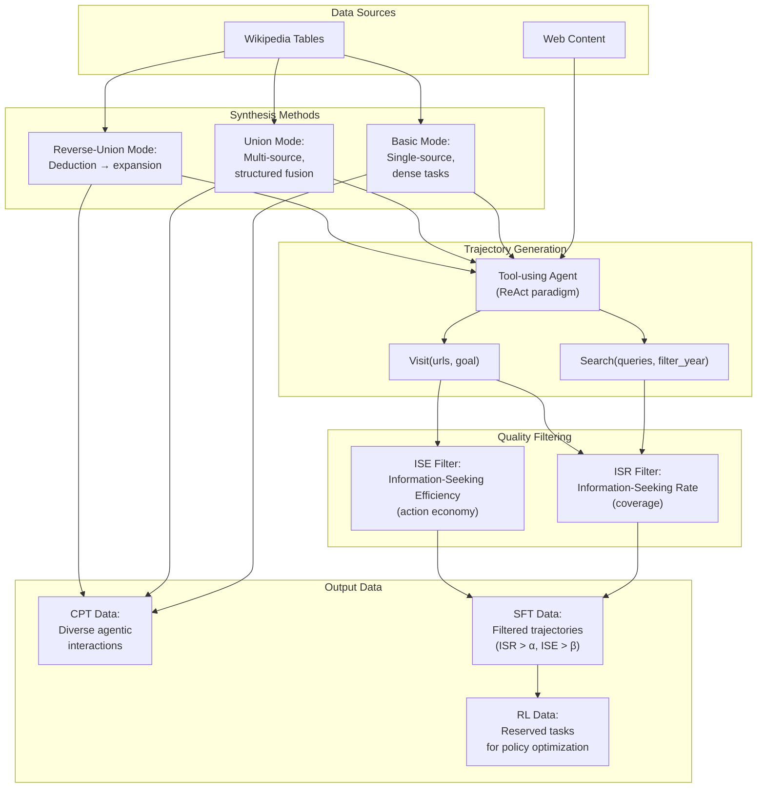
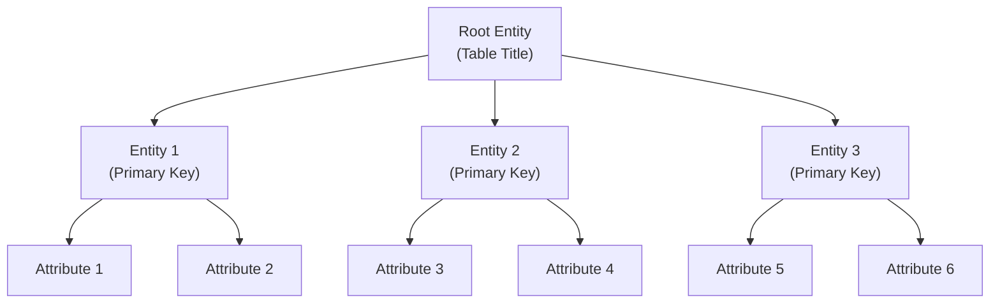
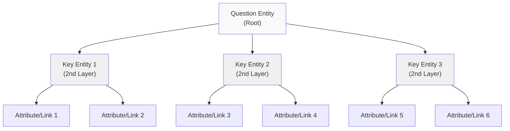
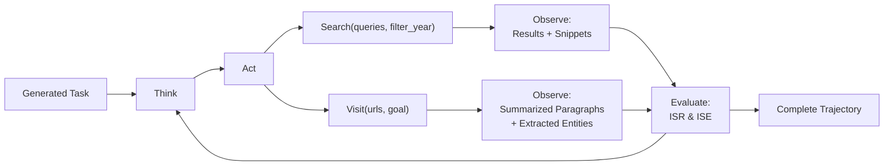
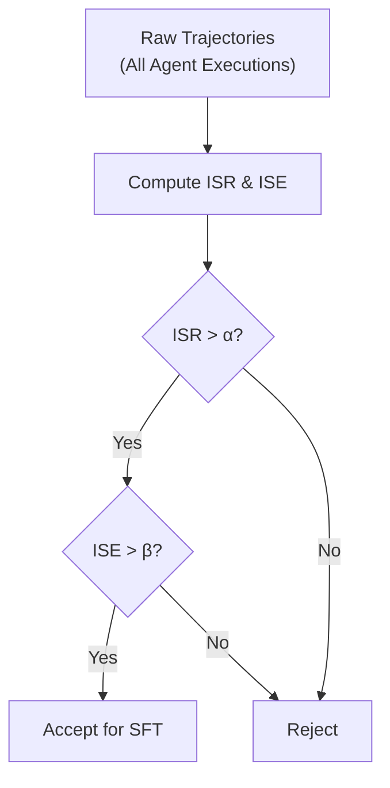
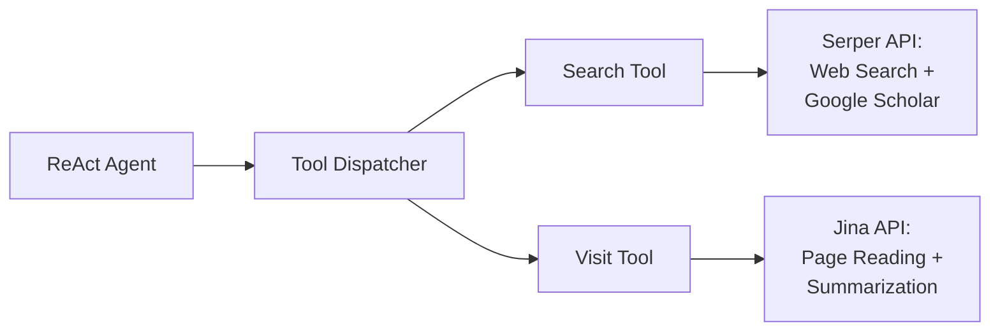
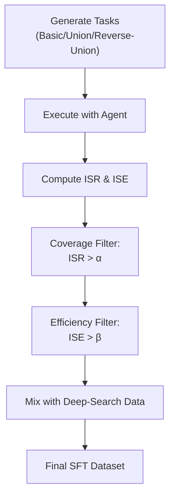

<!-- source: DeepWiki mcp.deepwiki.com · repo Alibaba-NLP/DeepResearch · page 3.1 Synthetic Data Generation Pipeline · fetched 2026-10-29 -->

# Synthetic Data Generation Pipeline

<details>
<summary>Relevant source files</summary>

The following files were used as context for generating this wiki page:

- [.env.example](.env.example)
- [.gitignore](.gitignore)
- [README.md](README.md)
- [WebAgent/WebLeaper/README.md](WebAgent/WebLeaper/README.md)
- [WebAgent/WebLeaper/assets/overview.png](WebAgent/WebLeaper/assets/overview.png)
- [WebAgent/WebLeaper/assets/performance_summary.png](WebAgent/WebLeaper/assets/performance_summary.png)
- [WebAgent/WebLeaper/assets/webleaper.jpg](WebAgent/WebLeaper/assets/webleaper.jpg)
- [inference/run_react_infer.sh](inference/run_react_infer.sh)

</details>


## Purpose and Scope

This document describes the fully automated and scalable synthetic data generation infrastructure that powers the training of Tongyi DeepResearch models. The pipeline produces high-quality agentic interaction data for continual pre-training (CPT), supervised fine-tuning (SFT), and reinforcement learning (RL). 

For information about the overall training architecture and how synthetic data flows through training stages, see [Training Pipeline Architecture](#3.7). For specific training methodologies that consume this data, see [WebLeaper: Entity-Intensive Training Framework](#3.2), [AgentFounder: Agentic CPT](#3.4), and [AgentScaler: Environment Scaling](#3.5).

The synthetic data generation system is designed to be:
- **Fully automatic**: No human annotation required
- **Scalable**: Can generate large volumes of diverse training data
- **Quality-controlled**: Filtering mechanisms ensure high-quality trajectories
- **Multi-stage**: Supports different data requirements for CPT, SFT, and RL

Sources: [README.md:44](), [WebAgent/WebLeaper/README.md:1-16]()

---

## Architecture Overview

The synthetic data generation pipeline consists of multiple synthesis methodologies that produce training data at different levels of complexity and for different training stages.



**Data Flow**: Raw sources (Wikipedia, web) → Synthesis methods generate tasks → Agent executes tasks using tools → Quality filters select high-quality trajectories → Output data for CPT/SFT/RL

Sources: [WebAgent/WebLeaper/README.md:36-49](), [WebAgent/WebLeaper/README.md:65-78](), [WebAgent/WebLeaper/README.md:82-96]()

---

## Data Synthesis Variants

The pipeline implements three synthesis modes that progressively increase task complexity, entity density, and resistance to shortcut learning.

### Basic Mode: Single-Source Dense Tasks

Basic mode constructs information-seeking tasks from individual Wikipedia tables, creating high-density entity retrieval tasks within constrained contexts.

**Methodology**:
1. Mine large, homogeneous Wikipedia tables
2. Extract root entity from table title
3. Map primary key columns to 2nd-layer entities
4. Map other columns to 3rd-layer attributes
5. Generate questions requiring retrieval of multiple entities

**Characteristics**:
- Single data source per task
- High entity density (multiple targets per task)
- Compact context for efficient exploration
- Maximizes valid action-to-reward ratio



**Tree Structure**: Root (question entity) → 2nd layer (key entities) → 3rd layer (attributes/linked entities). Tasks require retrieving both intermediate and final entities.

Sources: [WebAgent/WebLeaper/README.md:40-43](), [WebAgent/WebLeaper/README.md:126-130]()

### Union Mode: Multi-Source Structured Fusion

Union mode identifies maximal unions between multiple data sources that share relation sets, creating realistic multi-source information-seeking tasks.

**Methodology**:
1. Detect maximal unions among trees sharing relations
2. Model as maximal biclique enumeration problem
3. Synthesize questions requiring intersection/union across sources
4. Example: "authors who won both Prize A and Prize B"

**Characteristics**:
- Multi-source data integration
- Cross-table reasoning required
- Structure-aligned fusion
- Realistic synthesis patterns

**Alignment Detection**: Two tables can be unified if they share relation sets (e.g., `has_nationality`, `has_name`). The algorithm identifies maximal sets of tables that can be joined through shared relations.

Sources: [WebAgent/WebLeaper/README.md:44-46](), [WebAgent/WebLeaper/README.md:132-135]()

### Reverse-Union Mode: Deduction Before Expansion

Reverse-Union mode forces agents to deduce hidden anchor entities from attribute-level clues before launching cross-source searches, eliminating keyword shortcuts.

**Methodology**:
1. Provide fuzzed attribute-level clues (no direct entity names)
2. Agent must deduce the anchor entity
3. Use pivot attribute (e.g., country) from deduced anchor
4. Launch Union-style search over related tables

**Characteristics**:
- No direct keyword shortcuts
- Requires deductive reasoning
- Two-phase process: deduction → expansion
- Highest performance in benchmarks

**Example Process**:
```
Input: "Find scientists with the same nationality as the person who 
       discovered [attribute1] and won [attribute2]"
→ Deduce anchor: Marie Curie
→ Pivot: French nationality
→ Search: Other French scientists
```

Sources: [WebAgent/WebLeaper/README.md:47-48](), [WebAgent/WebLeaper/README.md:137-140]()

---

## Task Design Methodology

### Tree-Structured Information Seeking

Tasks are structured as hierarchical trees that model realistic information-seeking behavior:



**Tree Properties**:
- **Root**: Question entity (starting point)
- **2nd Layer**: Key entities that must be retrieved
- **3rd Layer**: Attributes or linked entities for each key entity
- **Subtrees**: Each 2nd-layer node + its attributes forms a subtree

**Target Entities**: Tasks require retrieving both intermediate (2nd layer) and final (3rd layer) entities, encouraging thorough exploration rather than superficial keyword matching.

Sources: [WebAgent/WebLeaper/README.md:40-43]()

### Quality Metrics

The pipeline uses two complementary metrics to ensure data quality:

| Metric | Formula | Purpose | Stability |
|--------|---------|---------|-----------|
| **ISR** (Information-Seeking Rate) | $\text{ISR} = \frac{\|R \cap O\|}{\|R\|}$ | Measures coverage: fraction of required entities retrieved | Standard |
| **ISE** (Information-Seeking Efficiency) | $\text{ISE} = \frac{n}{T}$ | Measures efficiency: entities discovered per action step | $\text{Var}(\text{ISE}) = \mathcal{O}(1/n)$ |

Where:
- $R$ = set of required entities
- $O$ = set of retrieved entities  
- $n$ = number of target entities
- $T$ = number of action steps

**ISE Computation**: Primarily uses entities from `Visit` actions rather than `Search` snippets, as `Visit` actions provide more precise entity extraction after page reading.

**Stability Property**: As the number of targets $n$ increases, the variance of ISE decreases at $\mathcal{O}(1/n)$, providing reliable efficiency signals during training.

Sources: [WebAgent/WebLeaper/README.md:52-62](), [WebAgent/WebLeaper/README.md:78]()

---

## Trajectory Generation and Filtering

### Trajectory Construction

Trajectories are generated using a tool-equipped agent operating in the ReAct paradigm:



**Available Tools**:

| Tool | Signature | Output |
|------|-----------|--------|
| `Search` | `Search(queries, filter_year)` | Web results + snippets |
| `Visit` | `Visit(urls, goal)` | Summarized paragraphs with extracted entities |

**Entity Extraction**: The `Visit` tool processes web pages and extracts entities that are then used for ISE computation. Entities from `Search` snippets are considered less precise and typically refined by subsequent `Visit` actions.

Sources: [WebAgent/WebLeaper/README.md:65-78]()

### SFT Trajectory Filtering

Only trajectories meeting strict quality criteria are retained for supervised fine-tuning:

**Filtering Criteria**:
- **Coverage**: $\text{ISR} > \alpha$ (e.g., $\alpha = 0.3$)
- **Efficiency**: $\text{ISE} > \beta$ (e.g., $\beta = 0.1$)

**Threshold Tuning**: Values of $\alpha$ and $\beta$ are tuned to balance coverage and efficiency requirements. Higher thresholds produce smaller but higher-quality datasets.



**Result**: Only trajectories demonstrating both high coverage and high efficiency are used for SFT, ensuring the model learns effective and efficient information-seeking strategies.

Sources: [WebAgent/WebLeaper/README.md:65-78](), [WebAgent/WebLeaper/README.md:144-150]()

---

## Integration with Training Stages

The synthetic data pipeline produces different data distributions for each training stage:

### Continual Pre-Training (CPT)

**Data Characteristics**:
- Large-scale diverse agentic interactions
- All three synthesis modes (Basic, Union, Reverse-Union)
- No filtering applied (maximizes diversity)
- Extends model capabilities and maintains freshness

**Purpose**: Expose model to wide variety of agentic interaction patterns before fine-tuning.

Sources: [README.md:45](), [WebAgent/WebLeaper/README.md:144-150]()

### Supervised Fine-Tuning (SFT)

**Data Composition**:
```
SFT Data = WebLeaper (Basic/Union/Reverse-Union) + Deep-Search Data
           |______ Filtered by ISR & ISE ______|   |___ Retain long-horizon
                                                      browsing capability
```

**Filtering Process**:
1. Generate trajectories using tool-equipped agent
2. Compute ISR and ISE for each trajectory
3. Apply thresholds: ISR > $\alpha$, ISE > $\beta$
4. Mix with small set of deep-search data for capability retention

**Data Mix Strategy**: Primarily WebLeaper tasks for entity-intensive training, supplemented with deep-search data (e.g., from WebSailor-V2) to preserve long-horizon browsing capabilities.

Sources: [WebAgent/WebLeaper/README.md:144-150]()

### Reinforcement Learning (RL)

**Data Composition**:
```
RL Data = Reserved WebLeaper Tasks (~500) + Legacy Benchmark Data
          |_______ Evaluated with R_WebLeaper _______|   |___ Original rewards
```

**Reserved Set**: A held-out set of approximately 500 WebLeaper tasks is reserved specifically for RL, ensuring the policy optimization doesn't overfit to SFT data.

**Hybrid Reward System**:
- **WebLeaper tasks**: Evaluated using $\mathcal{R}_{\text{WebLeaper}}$ (soft F-score based)
- **Legacy tasks**: Evaluated using $\mathcal{R}_{\text{legacy}}$ (original benchmark rewards)

**Optimization**: Uses Group Relative Policy Optimization (GRPO) to further refine the agent's policy based on these hybrid rewards.

Sources: [WebAgent/WebLeaper/README.md:82-96](), [WebAgent/WebLeaper/README.md:144-150]()

---

## Hybrid Reward System for RL

The pipeline includes a sophisticated reward system designed for entity-intensive tasks:

### Challenge

Standard binary (success/fail) rewards are too sparse for tasks requiring retrieval of dozens of entities. Simple automated metrics (F1, exact match) are brittle, and LLM-as-judge is too slow/unreliable for many-entity tasks.

### Solution: Soft F-Score Reward

For WebLeaper tasks, the system uses $\mathcal{R}_{\text{WebLeaper}}$, a granular reward based on semantic similarity:

$$\mathcal{R}_{\text{WebLeaper}} = (1 + \omega^2) \frac{P \cdot R_c}{\omega^2 P + R_c}$$

Where:
- $P$ = Soft precision over retrieved entities
- $R_c$ = Soft recall over ground-truth entities
- $\omega$ = Weighting parameter

**Semantic Matching**: Uses semantic similarity rather than exact string matching, handling variations like "USA" vs. "United States".

**Granularity**: Provides fine-grained signal for each entity, enabling stable policy learning even with many targets.

### Reward Assignment by Task Type

| Task Type | Reward Function | Characteristics |
|-----------|----------------|-----------------|
| WebLeaper Tasks | $\mathcal{R}_{\text{WebLeaper}}$ | Soft F-score, semantic matching, granular |
| Legacy Benchmark Tasks | $\mathcal{R}_{\text{legacy}}$ | Original binary/scoring functions |

Sources: [WebAgent/WebLeaper/README.md:82-96]()

---

## Data Variants Performance

The three synthesis modes show distinct performance characteristics:

### Benchmark Results

| Variant | Design | Key Property | Performance |
|---------|--------|--------------|-------------|
| **Basic** | Single-source | High entity density | Baseline |
| **Union** | Multi-source, aligned | Cross-table reasoning | Strong |
| **Reverse-Union** | Deduction → expansion | Anti-shortcut, deductive | **Best** |

**Ablation Findings**: 
- Union and Reverse-Union significantly outperform Basic mode
- Reverse-Union provides strongest performance by forcing deductive reasoning
- All variants outperform standard deep-search data on entity-intensive benchmarks

### Task Statistics

**Stability Analysis**: As the number of target entities $n$ increases:
- ISR variance remains controlled
- ISE variance decreases: $\text{Var}(\text{ISE}) = \mathcal{O}(1/n)$
- Reliable metric estimation for large-scale training

Sources: [WebAgent/WebLeaper/README.md:100-109](), [WebAgent/WebLeaper/README.md:52-62]()

---

## Configuration and Hyperparameters

### SFT Filtering Thresholds

Configured in training scripts:
- $\alpha$ (ISR threshold): Typically 0.3 (30% coverage minimum)
- $\beta$ (ISE threshold): Typically 0.1 (0.1 entities per action minimum)

**Tuning Strategy**: Thresholds are tuned for balanced coverage and efficiency. Higher thresholds reduce dataset size but increase quality.

### Inference Sampling

During trajectory generation:
- `temperature = 0.6`
- `top_p = 0.95`

**Purpose**: Controlled sampling produces diverse but reasonable trajectories for filtering.

Sources: [WebAgent/WebLeaper/README.md:144-150]()

---

## Tools and Infrastructure

### Tool Registry

The trajectory generation system uses a standardized tool interface:



**Tool Specifications**:

```
Search(queries: List[str], filter_year: Optional[int]) -> SearchResults
  - Returns: Web results with snippets
  - Provider: Serper.dev API
  - Features: Web search, Google Scholar

Visit(urls: List[str], goal: str) -> VisitResults
  - Returns: Summarized paragraphs with extracted entities
  - Provider: Jina.ai API
  - Features: Page reading, entity extraction
```

For detailed tool implementation, see [Tool System Architecture](#2.4) and [Web Tools: Search and Visit](#2.6).

Sources: [README.md:102-106](), [WebAgent/WebLeaper/README.md:73-77]()

---

## Data Quality Assurance

### Multi-Level Filtering

The pipeline implements multiple quality control stages:



### Metrics Validation

**ISR (Coverage)**:
- Ensures trajectories retrieve sufficient required entities
- Prevents incomplete or superficial searches
- Typical threshold: > 30% coverage

**ISE (Efficiency)**:
- Ensures trajectories avoid wasteful actions
- Promotes efficient information seeking
- Typical threshold: > 0.1 entities per action

**Combined Effect**: Filters select trajectories that are both accurate (high ISR) and fast (high ISE), teaching the model to be both effective and efficient.

Sources: [WebAgent/WebLeaper/README.md:65-78]()

---

## Related Systems

The synthetic data generation pipeline integrates with and supports multiple other systems:

**Training Methodologies**:
- [WebLeaper: Entity-Intensive Training Framework](#3.2) - Primary consumer of synthetic data
- [AgentFounder: Agentic CPT](#3.4) - Uses synthetic data for continual pre-training
- [AgentScaler: Environment Scaling](#3.5) - Alternative data generation approach

**Evaluation**:
- [Benchmark Datasets](#5.2) - Validates synthetic data quality
- [Performance Metrics and Analysis](#5.3) - Measures training effectiveness

**Additional Data Agents** (mentioned in architecture but not detailed in provided files):
- WebShaper: Agentic data synthesis
- AgentFrontier: ZPD-guided data synthesis

Sources: [README.md:196-215]()

---

