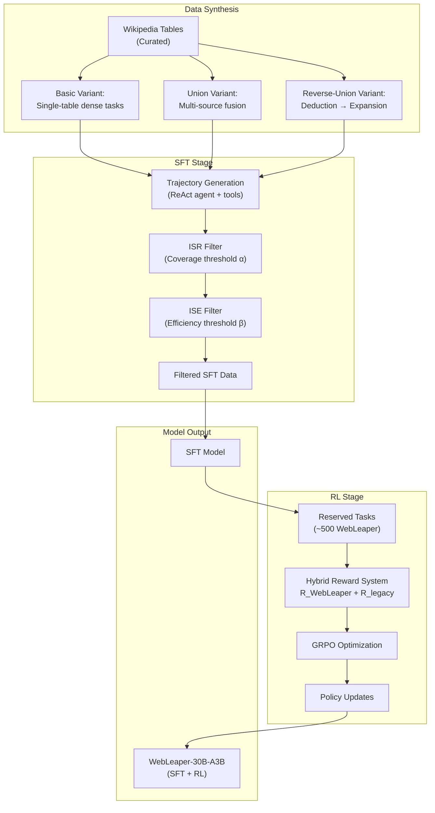
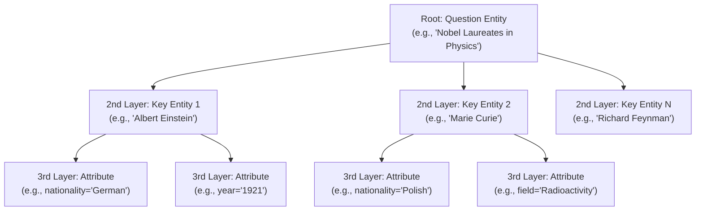
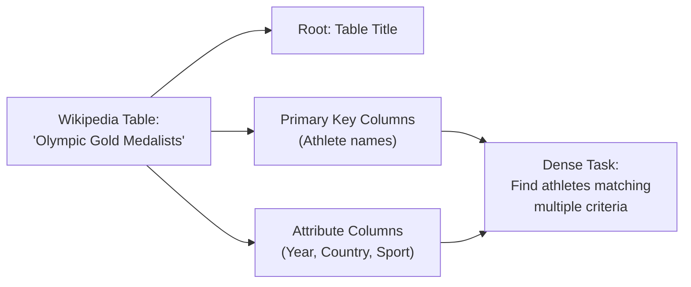
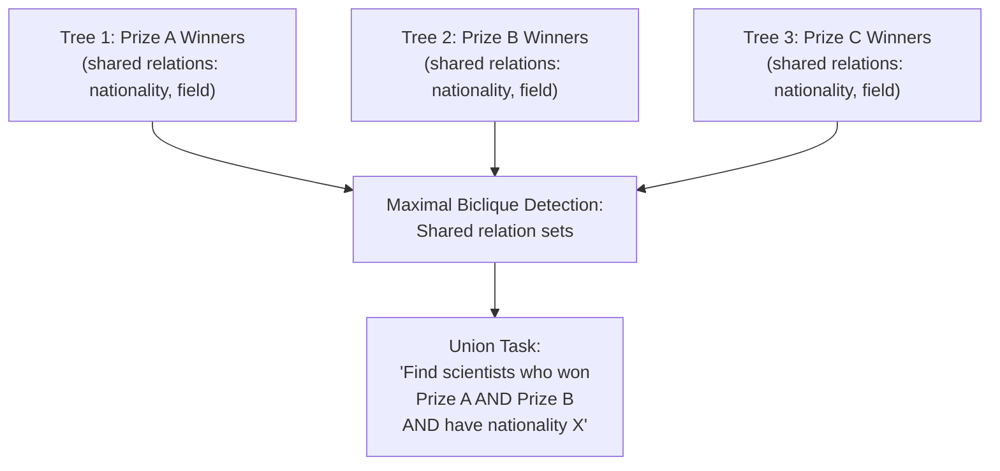
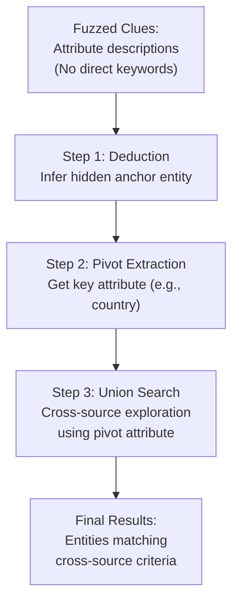
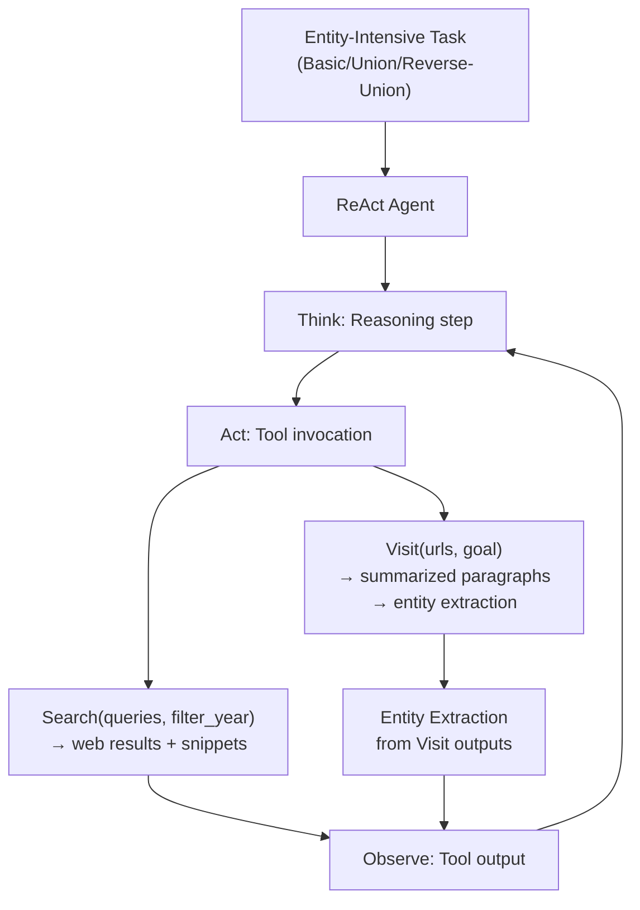
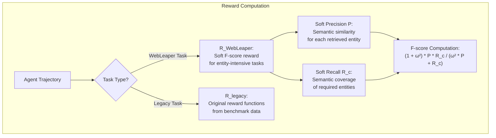
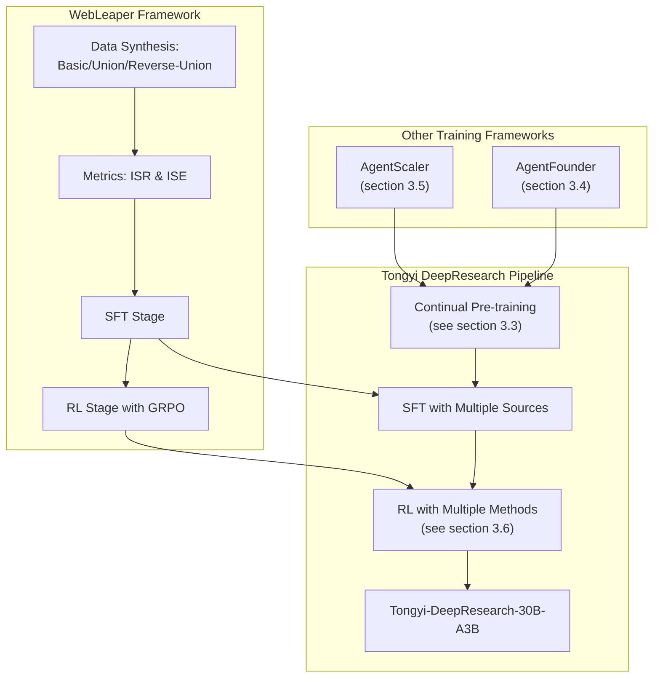

<!-- source: DeepWiki mcp.deepwiki.com · repo Alibaba-NLP/DeepResearch · page 3.2 WebLeaper: Entity-Intensive Training Framework · fetched 2026-10-29 -->

# WebLeaper: Entity-Intensive Training Framework

<details>
<summary>Relevant source files</summary>

The following files were used as context for generating this wiki page:

- [.env.example](.env.example)
- [.gitignore](.gitignore)
- [WebAgent/WebLeaper/README.md](WebAgent/WebLeaper/README.md)
- [WebAgent/WebLeaper/assets/overview.png](WebAgent/WebLeaper/assets/overview.png)
- [WebAgent/WebLeaper/assets/performance_summary.png](WebAgent/WebLeaper/assets/performance_summary.png)
- [WebAgent/WebLeaper/assets/webleaper.jpg](WebAgent/WebLeaper/assets/webleaper.jpg)
- [inference/run_react_infer.sh](inference/run_react_infer.sh)

</details>


## Purpose and Scope

This document describes the WebLeaper training framework, which addresses the efficiency and effectiveness challenges in training web information-seeking agents. WebLeaper introduces entity-intensive tasks and efficiency-aware training to prevent agents from learning shallow, meandering search behaviors.

For the overall training pipeline architecture, see [Training Pipeline Architecture](#3.7). For details on continual pre-training and other training stages, see [Continual Pre-training Strategy](#3.3) and [Reinforcement Learning Methods](#3.6). For deployment and inference, see [MultiTurnReactAgent Architecture](#2.1).

**Sources:** [WebAgent/WebLeaper/README.md:1-16]()

---

## Overview: The WebLeaper Approach

WebLeaper is a data generation and training framework designed to make web agents both effective and efficient at information seeking. Traditional training tasks contain sparse targets, leading agents to learn inefficient exploration patterns. WebLeaper solves this by creating **entity-intensive tasks** where multiple information targets are densely packed in compact contexts, forcing agents to learn efficient retrieval strategies.

The framework operates through two key training stages:

1. **Supervised Fine-Tuning (SFT)**: Trajectories are generated using tool-calling agents and filtered based on Information-Seeking Rate (ISR) for coverage and Information-Seeking Efficiency (ISE) for action economy
2. **Reinforcement Learning (RL)**: A hybrid reward system provides dense, granular signals optimized with Group Relative Policy Optimization (GRPO)



**Diagram: WebLeaper Training Pipeline**

The framework demonstrates consistent improvements across multiple benchmarks (BrowseComp, GAIA, Seal-0, WideSearch, xbench-DeepSearch), achieving higher success rates with fewer actions per task.

**Sources:** [WebAgent/WebLeaper/README.md:7-29]()

---

## Core Concepts

### Tree-Structured Information Seeking

WebLeaper models information seeking as tree-structured reasoning with three layers:

1. **Root Layer**: Question entity (e.g., a category like "Nobel Prize winners")
2. **Second Layer**: Key entities (individual entities matching the query)
3. **Third Layer**: Attributes and linked entities (details about each entity)

Each second-layer node and its attributes form a subtree. Tasks require retrieving both final target entities and intermediate entities along the path.



**Diagram: Tree-Structured Information Seeking Hierarchy**

This structure ensures that agents must navigate through multiple levels of information rather than making direct keyword matches.

**Sources:** [WebAgent/WebLeaper/README.md:38-42]()

---

### Entity-Intensive Task Design

Traditional information-seeking tasks suffer from **sparse target distribution**, where only a few entities are required from large knowledge spaces. This leads to inefficient exploration patterns. WebLeaper creates **entity-intensive tasks** by packing many target entities into compact contexts, ensuring high information density.

**Key Properties:**

| Property | Description | Benefit |
|----------|-------------|---------|
| **High Entity Density** | Multiple required entities per subtree | Forces efficient retrieval strategies |
| **Cross-Source Reasoning** | Entities span multiple information sources | Prevents keyword shortcuts |
| **Deductive Requirements** | Hidden anchors require inference first | Builds reasoning capabilities |
| **Metric Stability** | Variance decreases as O(1/n) with target count | Reliable training signals |

The three data variants progressively increase complexity:

**Sources:** [WebAgent/WebLeaper/README.md:10-11, 19-26, 43-48]()

---

## Data Synthesis Pipeline

### Basic Variant: Single-Source Dense Tasks

The Basic variant constructs tasks from individual Wikipedia tables with high entity density:

**Construction Process:**
1. Mine large, homogeneous Wikipedia tables
2. Extract root entity from table title
3. Map primary key columns to second-layer entities
4. Map remaining columns to third-layer attributes
5. Generate questions requiring multiple entities from the tree

**Example:** From a table of "Olympic Gold Medalists", create a task asking for all athletes who won in specific years with specific nationalities.



**Diagram: Basic Variant Construction from Wikipedia Tables**

**Characteristics:**
- High coverage in constrained context
- Maximizes valid actions per step
- Foundation for more complex variants

**Sources:** [WebAgent/WebLeaper/README.md:44-45, 126-130]()

---

### Union Variant: Multi-Source Structured Fusion

The Union variant identifies maximal unions between trees that share relation sets, modeled as maximal biclique enumeration:

**Construction Process:**
1. Identify trees with shared relation sets (e.g., `has_nationality`, `has_name`)
2. Find maximal unions (modeled as biclique enumeration)
3. Synthesize questions requiring intersection/union operations across sources
4. Example: "Find authors who won both Prize A and Prize B"



**Diagram: Union Variant via Maximal Biclique Enumeration**

**Characteristics:**
- Requires cross-source integration
- Structure-aligned fusion prevents random entity mixing
- Realistic multi-hop reasoning scenarios

**Sources:** [WebAgent/WebLeaper/README.md:24, 45-46, 132-135]()

---

### Reverse-Union Variant: Deduction Before Expansion

The Reverse-Union variant is the most challenging, requiring deductive reasoning before cross-source search:

**Construction Process:**
1. Provide **fuzzed attribute-level clues** instead of direct entity keywords
2. Agent must deduce hidden anchor entity first
3. Use pivot attribute (e.g., nationality) from deduced anchor
4. Launch Union-style search across other trees
5. Example: "Find entities related to [description of X] who also have property Y"



**Diagram: Reverse-Union Requires Deduction → Pivot → Expansion**

**Characteristics:**
- Forces deduction before search (no keyword shortcuts)
- Most robust against metric gaming
- Highest reasoning complexity
- Best performance in evaluations

**Sources:** [WebAgent/WebLeaper/README.md:25-26, 46, 137-140]()

---

## Training Metrics

### Information-Seeking Rate (ISR)

ISR measures **coverage** as the fraction of required entities successfully retrieved:

$$
\text{ISR} = \frac{|R \cap O|}{|R|}
$$

Where:
- `R`: Set of required entities (ground truth)
- `O`: Set of observed/retrieved entities
- `|R ∩ O|`: Count of correctly retrieved entities

**Usage in Training:**
- SFT filtering threshold: `ISR > α` (e.g., α = 0.3)
- Ensures trajectories have adequate coverage
- Binary signal: trajectory kept or discarded

**Sources:** [WebAgent/WebLeaper/README.md:54-57, 70]()

---

### Information-Seeking Efficiency (ISE)

ISE measures **efficiency** as target entities discovered per action step:

$$
\text{ISE} = \frac{n}{T}
$$

Where:
- `n`: Number of target entities retrieved
- `T`: Total action steps taken

**Key Property - Stability:**

As the number of targets `n` increases, the variance of ISE decreases:

$$
\text{Var}(\text{ISE}) = \mathcal{O}(1/n)
$$

This stability is critical for reliable training signals. With more targets, ISE becomes a more consistent measure of efficiency.

**Computing ISE:**
ISE primarily uses entities extracted from `Visit` actions rather than `Search` snippets, since `Visit` provides more precise entity information:

```
ISE Calculation:
- Count entities from Visit(url, goal) calls
- Search snippets are less precise (refined by subsequent Visit)
- Total steps T includes all tool calls
- ISE = (Visit-extracted entities) / T
```

**Usage in Training:**
- SFT filtering threshold: `ISE > β` (e.g., β = 0.1)
- Ensures trajectories are action-efficient
- Combined with ISR for quality control

| Metric | Measures | Formula | SFT Threshold |
|--------|----------|---------|---------------|
| **ISR** | Coverage | \|R ∩ O\| / \|R\| | α (e.g., 0.3) |
| **ISE** | Efficiency | n / T | β (e.g., 0.1) |

**Sources:** [WebAgent/WebLeaper/README.md:58-62, 78]()

---

## Supervised Fine-Tuning Stage

### Trajectory Generation with ReAct

Trajectories are generated using a tool-using agent operating in the ReAct (Reasoning-Acting-Observing) paradigm:



**Diagram: Trajectory Generation Process with Tool Integration**

**Available Tools:**

| Tool | Signature | Output | Used for ISE |
|------|-----------|--------|--------------|
| **Search** | `Search(queries, filter_year)` | Web results + snippets | No (less precise) |
| **Visit** | `Visit(urls, goal)` | Summarized paragraphs | Yes (entity extraction) |

**Note:** Entities found in `Search` snippets are often imprecise and require refinement by subsequent `Visit` calls. Therefore, ISE is computed primarily from entities extracted during `Visit` actions.

**Sources:** [WebAgent/WebLeaper/README.md:66-78]()

---

### Filtering Criteria: ISR and ISE Thresholds

Generated trajectories undergo strict filtering to ensure quality:

```python
# Pseudocode for SFT trajectory filtering
def filter_trajectory(trajectory, R_required, alpha, beta):
    """
    Filter trajectory based on ISR and ISE thresholds.
    
    Args:
        trajectory: Generated trajectory with actions and observations
        R_required: Set of required entities (ground truth)
        alpha: ISR threshold (coverage)
        beta: ISE threshold (efficiency)
    
    Returns:
        bool: True if trajectory passes both filters
    """
    # Extract retrieved entities from Visit actions
    O_retrieved = extract_entities_from_visits(trajectory)
    
    # Compute ISR (coverage)
    ISR = len(R_required & O_retrieved) / len(R_required)
    
    # Compute ISE (efficiency)
    T_steps = count_action_steps(trajectory)
    n_entities = len(R_required & O_retrieved)
    ISE = n_entities / T_steps
    
    # Apply thresholds
    return (ISR > alpha) and (ISE > beta)
```

**Typical Threshold Values:**
- `α = 0.3`: Minimum 30% coverage of required entities
- `β = 0.1`: Minimum 0.1 entities per action step

**Effect:** Only trajectories that are both accurate (high ISR) and efficient (high ISE) are retained for training, preventing the model from learning meandering search behaviors.

**Sources:** [WebAgent/WebLeaper/README.md:68-71, 148]()

---

## Reinforcement Learning Stage

### The Challenge: Sparse Binary Rewards Fail

Standard reinforcement learning approaches use binary (success/fail) rewards, which are **too sparse** for entity-intensive tasks where dozens of entities must be retrieved. Additionally:

- Simple automated metrics (F1, Exact Match) are too brittle
- LLM-as-a-judge is too slow and unreliable for many entities
- Need granular, stable signals for effective policy optimization

**Sources:** [WebAgent/WebLeaper/README.md:84-86]()

---

### Hybrid Reward System Architecture

WebLeaper introduces a hybrid reward system that combines task-specific rewards:



**Diagram: Hybrid Reward System Components**

**Sources:** [WebAgent/WebLeaper/README.md:88-96]()

---

### R_WebLeaper: Soft F-Score Reward

For WebLeaper entity-intensive tasks, the reward uses a **soft F-score** that handles entity variations:

$$
\mathcal{R}_{\text{WebLeaper}} = (1 + \omega^2) \frac{P \cdot R_c}{\omega^2 P + R_c}
$$

Where:
- **P**: Soft precision over retrieved entities `O`
- **R_c**: Soft recall over required entities `R`
- **ω**: Weighting parameter (balances precision vs. recall)

**Semantic Similarity:**
Instead of exact string matching, soft precision and recall use semantic similarity:
- "USA" ≈ "United States"
- "Marie Curie" ≈ "Marie Skłodowska-Curie"

This handles natural language variations without requiring perfect string matches.

**Granular Signal:** Unlike binary rewards, this provides continuous feedback proportional to partial success, enabling more effective policy updates.

**Sources:** [WebAgent/WebLeaper/README.md:90-93]()

---

### R_legacy: Benchmark Rewards

For non-WebLeaper tasks (e.g., existing benchmark data mixed into training), the original reward functions are used:

- Binary success/fail for completion tasks
- Task-specific metrics from benchmark definitions
- Maintains compatibility with diverse training data

**Sources:** [WebAgent/WebLeaper/README.md:94]()

---

### GRPO: Group Relative Policy Optimization

The hybrid reward signals are used to optimize the agent's policy via **Group Relative Policy Optimization (GRPO)**:

**GRPO Algorithm:**

1. **Sample Group**: Generate multiple trajectories (group) for each task
2. **Compute Rewards**: Apply R_WebLeaper or R_legacy based on task type
3. **Estimate Advantages**: Calculate advantage for each trajectory relative to group's average reward
4. **PPO Update**: Update policy using PPO-like objective with estimated advantages


**Diagram: GRPO Optimization Process**

**Benefits:**
- Stable learning from dense reward signals
- Relative advantages prevent reward scale issues
- Effective with hybrid reward system

**Sources:** [WebAgent/WebLeaper/README.md:96]()

---

## Training Configuration

### Model Architecture and Data Mix

**Backbone Model:**
- `Qwen3-30B-A3B-Thinking-2507` serves as the base model
- 30B parameters with 3B active per token (Mixture of Experts)

**SFT Data Mix:**

| Component | Description | Purpose |
|-----------|-------------|---------|
| **WebLeaper Tasks** | Basic / Union / Reverse-Union variants | Entity-intensive training |
| **Deep-Search Data** | Small set (e.g., WebSailor-V2) | Retain long-horizon browsing capability |

The mix ensures the model learns efficient information seeking while maintaining general web navigation abilities.

**RL Data Mix:**

| Component | Count | Reward Function |
|-----------|-------|-----------------|
| **WebLeaper Tasks** | ~500 reserved | R_WebLeaper |
| **Legacy Benchmark Data** | Variable | R_legacy |

Reserved tasks prevent overfitting on seen data during RL stage.

**Sources:** [WebAgent/WebLeaper/README.md:146-149]()

---

### Hyperparameters

**SFT Filtering Thresholds:**
- `α = 0.3` (ISR threshold for coverage)
- `β = 0.1` (ISE threshold for efficiency)

**Inference Sampling:**
- `temperature = 0.6`
- `top_p = 0.95`

These settings balance exploration with coherent generation during inference.

**Sources:** [WebAgent/WebLeaper/README.md:148-150]()

---

## Performance Results

### Benchmark Improvements

WebLeaper demonstrates consistent gains across five information-seeking benchmarks:

| Benchmark | Metric | Improvement |
|-----------|--------|-------------|
| **BrowseComp** | Accuracy | Consistent gains over baselines |
| **GAIA** | Task completion | Strong improvements |
| **Seal-0** | Success rate | Higher efficiency-effectiveness trade-off |
| **WideSearch** | Multiple metrics | Significant gains |
| **xbench-DeepSearch** | Overall performance | Outperforms competitive baselines |

**Key Finding:** Reverse-Union data variant provides the strongest performance, confirming the value of forcing deductive reasoning before search.

**Sources:** [WebAgent/WebLeaper/README.md:100-109]()

---

### SFT vs. SFT+RL Performance

The RL stage with hybrid rewards consistently improves over SFT-only baseline:

| Model | BrowseComp | GAIA | xbench-DS | WideSearch (SR) | WideSearch (Row F1) | WideSearch (Item F1) |
|-------|------------|------|-----------|-----------------|---------------------|----------------------|
| **SFT only** | 37.80 | 69.9 | 69.0 | 1.5 | 23.0 | 45.4 |
| **SFT + RL** | **38.8** (+1.0) | **73.2** (+3.3) | **72.0** (+3.0) | **4.0** (+2.5) | **31.0** (+8.0) | **48.8** (+3.4) |

**Gains are particularly significant on complex tasks like GAIA and WideSearch**, demonstrating the effectiveness of the hybrid reward system and GRPO optimization.

**Sources:** [WebAgent/WebLeaper/README.md:113-121]()

---

## Integration with Tongyi DeepResearch

### Data Contribution to Training Pipeline

WebLeaper contributes to the Tongyi DeepResearch training pipeline in multiple ways:

1. **SFT Data Generation**: Entity-intensive tasks provide high-quality supervised fine-tuning data
2. **Efficiency Metrics**: ISR/ISE filtering ensures only efficient trajectories are used
3. **RL Optimization**: Hybrid reward system enables policy refinement beyond SFT



**Diagram: WebLeaper Integration in Tongyi DeepResearch Training Pipeline**

**Sources:** [WebAgent/WebLeaper/README.md:146-150](), [README.md:1-179]()

---

### Complementary Training Methods

WebLeaper operates alongside other training frameworks:

| Framework | Focus | Contribution to Pipeline |
|-----------|-------|-------------------------|
| **WebLeaper** | Entity-intensive efficient IS | SFT filtering + RL rewards |
| **AgentScaler** | Environment scaling | CPT data diversity |
| **AgentFounder** | Open-world memory & context | 32K→128K context extension |

Each framework contributes specialized training methodologies that combine in the final Tongyi DeepResearch model.

**Sources:** High-level diagrams from context, [WebAgent/WebLeaper/README.md:146-147]()

---

## File References

### Key Files

The WebLeaper framework documentation is primarily contained in:

- **Main Documentation**: [WebAgent/WebLeaper/README.md:1-156]() - Complete framework description
- **Performance Visualizations**: [WebAgent/WebLeaper/assets/performance_summary.png]() - Benchmark results
- **Architecture Overview**: [WebAgent/WebLeaper/assets/overview.png]() - Visual summary
- **Project Logo**: [WebAgent/WebLeaper/assets/webleaper.jpg]() - Framework branding

### Related Configuration

Environment variables relevant to training may be found in:
- [.env.example:1-151]() - Training hyperparameters and API keys

**Note:** The actual implementation code for data synthesis, trajectory generation, and training loops is not included in the provided files but would typically reside in the `WebAgent/WebLeaper/` directory structure.

---

