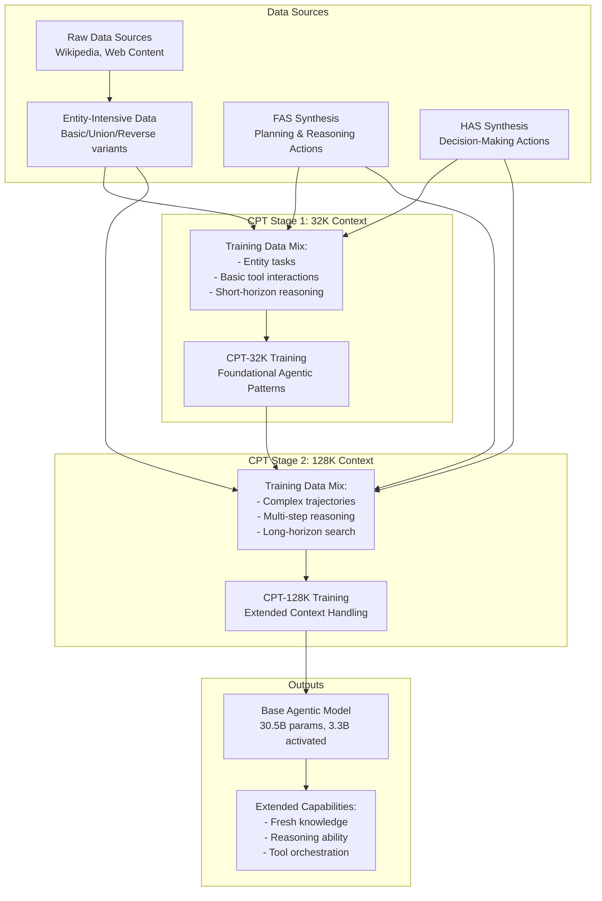
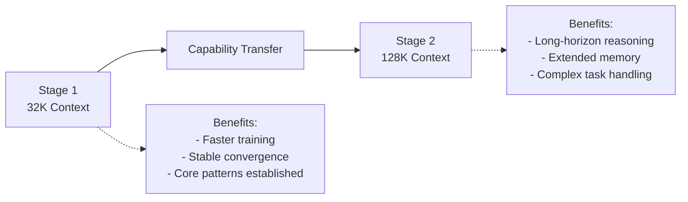
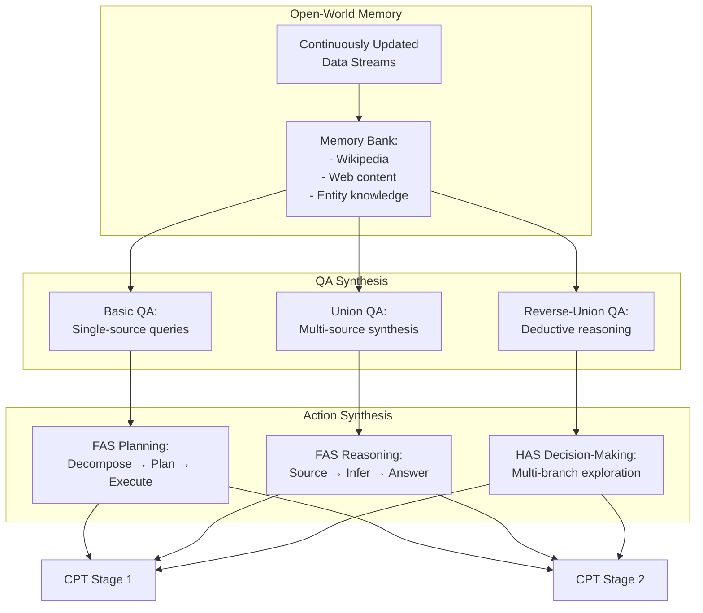
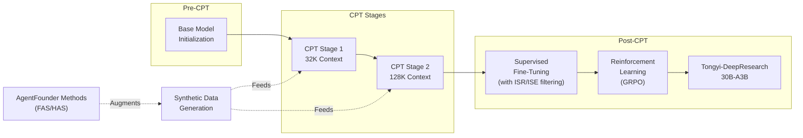

<!-- source: DeepWiki mcp.deepwiki.com · repo Alibaba-NLP/DeepResearch · page 3.3 Continual Pre-training Strategy · fetched 2026-10-29 -->

# Continual Pre-training Strategy

Relevant source files

The following files were used as context for generating this wiki page:

- [Agent/AgentFounder/README.md](Agent/AgentFounder/README.md)
- [Agent/AgentFounder/assets/logo.png](Agent/AgentFounder/assets/logo.png)
- [Agent/AgentFounder/assets/main_performance.png](Agent/AgentFounder/assets/main_performance.png)
- [Agent/AgentScaler/README.md](Agent/AgentScaler/README.md)
- [Agent/AgentScaler/assets/main.png](Agent/AgentScaler/assets/main.png)
- [README.md](README.md)

This document explains the two-stage continual pre-training (CPT) approach employed in Tongyi DeepResearch for extending model capabilities and maintaining data freshness. The CPT methodology represents a foundational innovation that distinguishes deep research agents from standard post-training approaches by incorporating large-scale agentic interaction data at the pre-training level.

**Scope**: This page focuses specifically on the continual pre-training strategy and stages. For information about the synthetic data generation methods that feed into CPT, see [Synthetic Data Generation Pipeline](#3.1). For details about AgentFounder's agentic CPT methods (FAS and HAS), see [AgentFounder: Agentic Continual Pre-training](#3.4). For reinforcement learning applied after CPT, see [Reinforcement Learning Methods](#3.6).

---

## Overview

Continual pre-training bridges the gap between general language model capabilities and specialized agentic behaviors by training on large-scale agentic interaction data. Unlike traditional supervised fine-tuning which operates on relatively small datasets, CPT leverages diverse, high-quality agentic data streams to fundamentally extend the model's reasoning capabilities, update its knowledge base, and strengthen its decision-making abilities.

The Tongyi DeepResearch training pipeline implements a **two-stage CPT strategy** with progressively increasing context lengths:

| Stage | Context Length | Primary Focus | Data Characteristics |
|-------|---------------|---------------|---------------------|
| Stage 1 | 32K tokens | Training efficiency & foundational agentic patterns | Entity-intensive tasks, basic reasoning-action sequences |
| Stage 2 | 128K tokens | Long-horizon reasoning & extended context handling | Complex multi-step trajectories, deep research scenarios |

This staged approach balances computational efficiency with performance gains, enabling the model to first establish core agentic behaviors before extending to more complex, long-context scenarios.

**Sources**: [README.md:45-46](), [Agent/AgentFounder/README.md:19-21]()

---

## Two-Stage CPT Architecture

The following diagram illustrates how the two CPT stages integrate with the broader training pipeline:

**Diagram: Two-Stage Continual Pre-training Pipeline**

The architecture demonstrates how different data sources are strategically distributed across CPT stages to maximize training efficiency while building progressively more sophisticated capabilities.

**Sources**: [README.md:45-46](), [Agent/AgentFounder/README.md:9-13]()

---

## Stage 1: 32K Context Pre-training

### Purpose and Scope

The first CPT stage operates with a **32K token context window** and focuses on establishing foundational agentic behaviors. This stage is designed for computational efficiency while ensuring the model learns core patterns of:

- **Tool invocation sequences**: Proper formatting and execution of Search, Visit, File Parser, and Python tools
- **Entity-centric reasoning**: Information-seeking patterns focused on retrieving and synthesizing entity-related facts
- **Basic action synthesis**: Simple reasoning → action → observation loops

### Data Composition

The 32K stage primarily consumes data from:

1. **Entity-Intensive Tasks** (from WebLeaper methodology):
   - Basic variant: Single-source entity queries
   - Union variant: Multi-source information aggregation
   - Reverse-Union variant: Deductive reasoning from entities

2. **FAS Planning Actions**: Questions paired with structured planning steps that decompose complex queries into tool-invocable sub-goals

3. **HAS Decision-Making Actions**: Reformulated agent trajectories showing optimal decision points at each reasoning step

### Training Characteristics

| Characteristic | Value/Description |
|----------------|-------------------|
| Context Window | 32,768 tokens |
| Training Focus | Foundational patterns & tool usage |
| Data Scale | Large-scale agentic interaction streams |
| Optimization Goal | Establish core reasoning-action mappings |

The 32K stage serves as the foundation upon which extended capabilities are built, ensuring the model has robust basic agentic skills before tackling longer, more complex scenarios.

**Sources**: [Agent/AgentFounder/README.md:19-21](), [README.md:45-46]()

---

## Stage 2: 128K Context Pre-training

### Purpose and Scope

The second CPT stage extends the context window to **128K tokens**, enabling the model to handle:

- **Long-horizon research tasks**: Multi-step investigations requiring dozens of tool calls
- **Complex trajectory reasoning**: Understanding and generating extended reasoning chains
- **Extended context management**: Maintaining coherence across lengthy conversations and observations

### Data Composition

The 128K stage incorporates more sophisticated data types:

1. **Complex Multi-Step Trajectories**: Full agent execution traces from deep research scenarios with 10+ tool invocations

2. **Extended FAS Reasoning**: Long-form logical inference chains that connect multiple knowledge sources

3. **HAS Multi-Step Decision Trees**: Decision-making processes that explore multiple action branches at each step

4. **Long-Context Entity Tasks**: Union and Reverse-Union variants requiring synthesis across many sources

### Context Length Progression

The staged increase in context length is critical for training stability and efficiency:

**Diagram: Context Length Progression Strategy**

By first training on 32K contexts, the model learns fundamental agentic patterns efficiently. The transition to 128K then extends these learned patterns to longer contexts without requiring the model to simultaneously learn both basic behaviors and long-context management.

**Sources**: [README.md:55](), [Agent/AgentFounder/README.md:19-21]()

---

## Agentic Data Characteristics

The data used in continual pre-training differs fundamentally from standard pre-training corpora. Agentic CPT data exhibits specific structural and semantic properties:

### Open-World Memory Integration

AgentFounder introduces the concept of **open-world memory** for CPT data synthesis:

**Diagram: Open-World Memory to CPT Data Flow**

### Data Diversity Dimensions

| Dimension | Description | Impact on CPT |
|-----------|-------------|---------------|
| **Task Variants** | Basic, Union, Reverse-Union | Ensures diverse reasoning patterns |
| **Action Types** | Planning (FAS), Reasoning (FAS), Decision-Making (HAS) | Covers full spectrum of agentic behaviors |
| **Context Lengths** | Short (32K) to Long (128K) | Progressive capability building |
| **Tool Combinations** | Search, Visit, FileParser, Python, Scholar | Comprehensive tool orchestration skills |
| **Knowledge Freshness** | Continuously updated streams | Maintains current world knowledge |

**Sources**: [Agent/AgentFounder/README.md:22-27]()

---

## Integration with Training Pipeline

Continual pre-training occupies a critical position between base model initialization and downstream fine-tuning:

**Diagram: CPT Position in Overall Training Pipeline**

### Pipeline Flow

1. **Base Initialization**: Start with a general-purpose language model (e.g., Qwen3-30B-A3B architecture)

2. **CPT Stage 1 (32K)**: Transform the base model into an agentic model through exposure to large-scale agentic interaction data

3. **CPT Stage 2 (128K)**: Extend the agentic model's capabilities to handle long-context scenarios

4. **Supervised Fine-Tuning**: Refine specific behaviors using trajectory filtering (ISR/ISE metrics)

5. **Reinforcement Learning**: Optimize for task-specific rewards using GRPO

The CPT stages provide the foundational agentic capabilities that subsequent stages refine and optimize. Without CPT, the model would lack the deep understanding of tool orchestration and multi-step reasoning required for effective deep research.

**Sources**: [README.md:43-48]()

---

## Capabilities Extended by CPT

Continual pre-training on agentic data extends model capabilities in several critical dimensions:

### Knowledge Freshness

By incorporating continuously updated data streams, CPT maintains the model's knowledge currency. Unlike static pre-training corpora, the agentic CPT data includes:

- Recent web content
- Updated Wikipedia articles
- Current event information
- Fresh entity relationships

### Reasoning Ability

The structured reasoning-action patterns in CPT data strengthen:

- **Decomposition**: Breaking complex queries into manageable sub-problems
- **Synthesis**: Combining information from multiple sources
- **Inference**: Deriving conclusions from available evidence
- **Planning**: Structuring multi-step investigation strategies

### Tool Orchestration

CPT teaches the model to:

- Select appropriate tools for different information needs
- Format tool calls with correct syntax and parameters
- Interpret tool observations and extract relevant information
- Chain multiple tool calls to achieve research objectives

### Long-Horizon Behavior

The 128K CPT stage specifically enables:

- Maintaining task context across dozens of interactions
- Tracking information gaps throughout extended searches
- Avoiding redundant tool calls in long trajectories
- Synthesizing conclusions from accumulated evidence

**Comparison Table: Pre-CPT vs. Post-CPT Capabilities**

| Capability | Pre-CPT (Base Model) | Post-CPT Stage 1 (32K) | Post-CPT Stage 2 (128K) |
|------------|---------------------|----------------------|------------------------|
| Tool Usage | Generic function calling | Proper tool orchestration | Complex tool chains |
| Context Handling | Up to 128K tokens | Efficient 32K usage | Full 128K utilization |
| Reasoning Depth | Basic QA | Multi-step reasoning | Long-horizon inference |
| Knowledge Currency | Static cutoff date | Updated entity knowledge | Fresh web information |
| Agentic Patterns | None | Foundational behaviors | Advanced strategies |

**Sources**: [README.md:45-46](), [Agent/AgentFounder/README.md:1-8]()

---

## Implementation Details

### Model Architecture

The CPT process operates on the **Qwen3-30B-A3B** architecture:

- **Total Parameters**: 30.5 billion
- **Activated Parameters**: 3.3 billion per token (via Mixture of Experts)
- **Context Window**: Extended to 128K through CPT stages

This architecture provides a balance between model capacity and inference efficiency, with the sparse activation pattern enabling deployment at scale.

### Training Configuration

While specific hyperparameters are not detailed in the provided documentation, the CPT strategy emphasizes:

- **Staged progression**: Sequential 32K → 128K training rather than direct 128K training
- **Data mixing**: Combining entity-intensive, FAS, and HAS data within each stage
- **Scale**: Large-scale data streams enabling comprehensive coverage of agentic patterns

### Data Flow Code Reference

The synthetic data generation pipeline that feeds CPT is documented in the data synthesis components (see [Synthetic Data Generation Pipeline](#3.1)), while the specific FAS and HAS methods are detailed in the AgentFounder implementation (see [AgentFounder: Agentic Continual Pre-training](#3.4)).

**Sources**: [README.md:32-33](), [README.md:55]()

---

## Benefits and Outcomes

The two-stage CPT strategy yields measurable improvements across deep research benchmarks:

### Performance Gains

From the AgentFounder results, CPT contributes to:

- **BrowseComp-EN**: 40.0% (vs. 0.5% for base Qwen3-30B-A3B)
- **BrowseComp-ZH**: 43.3% (vs. 13.5% for base)
- **GAIA**: 72.8% (vs. 35.9% for base)
- **xbench-DeepSearch**: 73.0% (vs. 32.0% for base)
- **WebWalkerQA**: 71.9% (vs. 46.9% for base)

These gains demonstrate that CPT, combined with downstream fine-tuning and RL, enables dramatic improvements in agentic task performance.

### Efficiency Benefits

The staged approach provides:

1. **Training Efficiency**: 32K stage trains faster than direct 128K training
2. **Stable Learning**: Foundational patterns learned before complexity increase
3. **Resource Optimization**: Computational costs balanced against capability gains

### Generalization

CPT-trained models demonstrate stronger generalization to:

- Novel tool combinations
- Unseen task types
- Domain-specific research scenarios
- Cross-lingual information seeking

The foundational agentic patterns learned during CPT transfer effectively to diverse downstream applications.

**Sources**: [Agent/AgentFounder/README.md:46-245]()

---

## Summary

The two-stage continual pre-training strategy represents a fundamental innovation in deep research agent development. By systematically exposing models to large-scale agentic interaction data at progressively increasing context lengths, CPT:

- Establishes foundational tool orchestration and reasoning patterns (32K stage)
- Extends capabilities to long-horizon research scenarios (128K stage)
- Maintains knowledge freshness through continuous data stream integration
- Provides the base upon which downstream SFT and RL refinements build

This approach distinguishes Tongyi DeepResearch from pure post-training methods, enabling the model to internalize agentic behaviors at a fundamental level rather than learning them as surface-level patterns.

**Sources**: [README.md:43-48](), [Agent/AgentFounder/README.md:1-44]()

---

