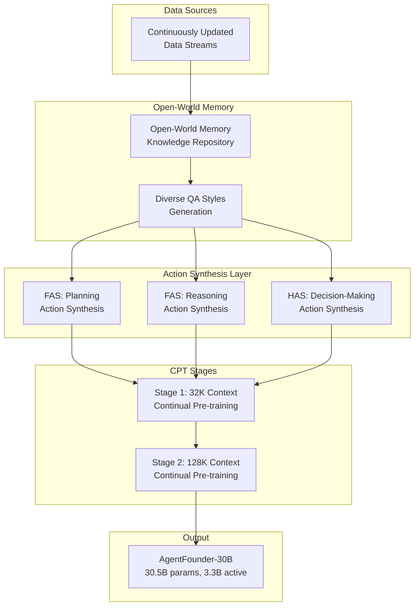
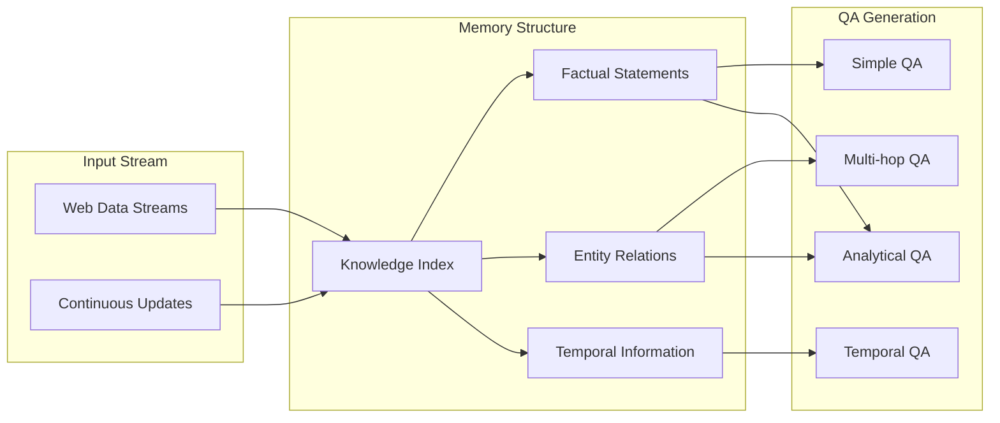
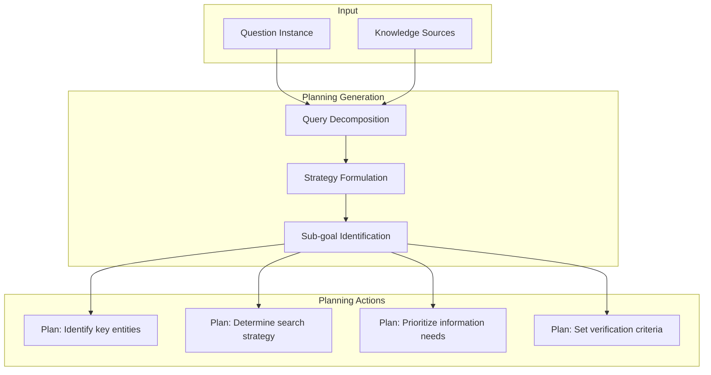
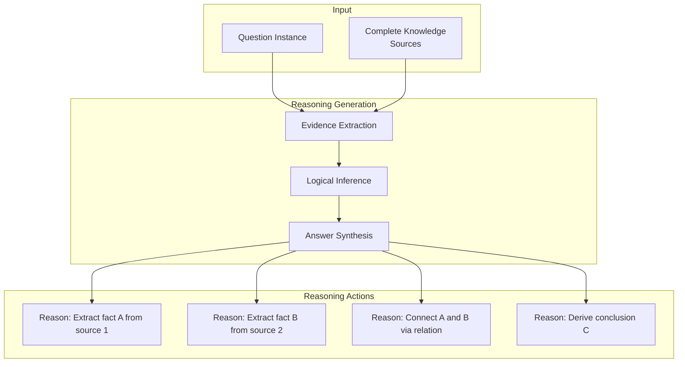
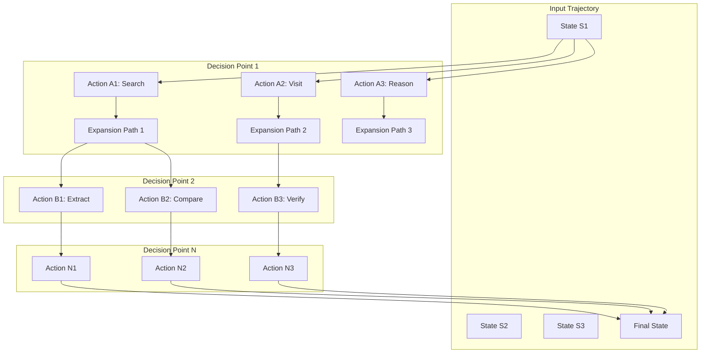
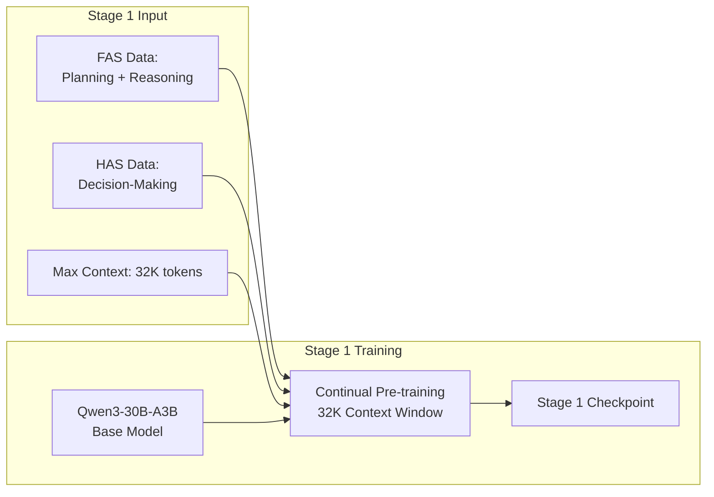
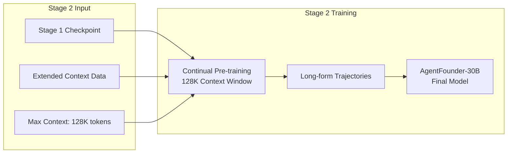
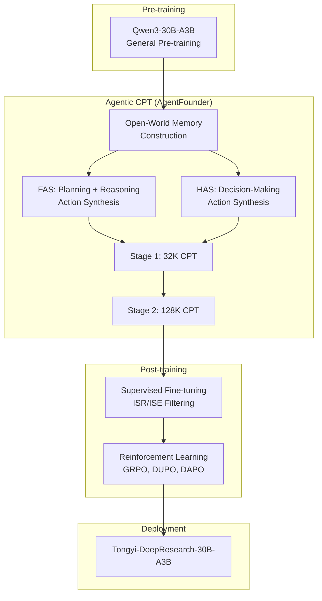
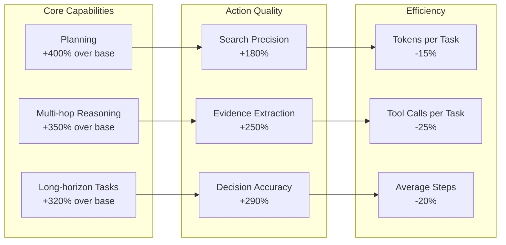

<!-- source: DeepWiki mcp.deepwiki.com · repo Alibaba-NLP/DeepResearch · page 3.4 AgentFounder: Agentic CPT and Action Synthesis · fetched 2026-10-29 -->

# AgentFounder: Agentic CPT and Action Synthesis

<details>
<summary>Relevant source files</summary>

The following files were used as context for generating this wiki page:

- [Agent/AgentFounder/README.md](Agent/AgentFounder/README.md)
- [Agent/AgentFounder/assets/logo.png](Agent/AgentFounder/assets/logo.png)
- [Agent/AgentFounder/assets/main_performance.png](Agent/AgentFounder/assets/main_performance.png)
- [Agent/AgentScaler/README.md](Agent/AgentScaler/README.md)
- [Agent/AgentScaler/assets/main.png](Agent/AgentScaler/assets/main.png)

</details>


## Purpose and Scope

This page documents AgentFounder, a training methodology that introduces **Agentic Continual Pre-training (Agentic CPT)** into the deep research agent training pipeline. AgentFounder bridges the gap between standard pre-training and agent-specific post-training by systematically synthesizing agentic training data for continual pre-training at scale.

**Scope covered:**
- Open-World Memory system for scaling training contexts
- First-order Action Synthesis (FAS): Planning and Reasoning action generation
- High-order Action Synthesis (HAS): Multi-step decision-making action expansion
- Two-stage CPT strategy (32K → 128K context scaling)

**Related pages:**
- For synthetic data generation pipeline fundamentals, see [Synthetic Data Generation Pipeline](#3.1)
- For the broader continual pre-training strategy, see [Continual Pre-training Strategy](#3.3)
- For environment-based agent training, see [AgentScaler: Environment Scaling](#3.5)
- For the complete training flow, see [Training Pipeline Architecture](#3.7)

Sources: [Agent/AgentFounder/README.md:1-15]()

---

## Agentic CPT Overview

AgentFounder introduces Agentic Continual Pre-training as a critical intermediate stage between general language model pre-training and task-specific fine-tuning. Unlike traditional CPT that focuses on extending knowledge or domain coverage, Agentic CPT specifically targets the development of agentic capabilities through large-scale exposure to action-reasoning patterns.

**Key Innovation:** AgentFounder is the first methodology to systematically apply CPT for agent development, resulting in the AgentFounder-30B model with 30.5B total parameters and 3.3B active parameters per token.

### Training Data Categories

| Data Category | Synthesis Method | Target Capability |
|---------------|------------------|-------------------|
| Planning Actions | FAS-Planning | Initial query decomposition and strategy formulation |
| Reasoning Actions | FAS-Reasoning | Evidence-based logical inference under full information |
| Decision Actions | HAS | Multi-step exploration of reasoning-action space |

Sources: [Agent/AgentFounder/README.md:1-19]()

---

## Architecture Overview



**Diagram: AgentFounder Training Pipeline Architecture**

This architecture illustrates how AgentFounder transforms continuous data streams into agentic training data through three synthesis methods, then applies two-stage CPT for efficient capability development.

Sources: [Agent/AgentFounder/README.md:1-43](), [Agent/AgentFounder/assets/pipeline.jpg]()

---

## Open-World Memory System

The Open-World Memory (OWM) system is the foundation of AgentFounder's data synthesis approach. It transforms continuously updated web data streams into a structured knowledge repository that enables diverse QA instance generation.

### Memory Architecture



**Diagram: Open-World Memory Data Flow**

### Memory Characteristics

| Property | Description |
|----------|-------------|
| **Continuous Updates** | Regularly ingests new data to maintain freshness |
| **Structured Storage** | Organizes knowledge by entities, facts, and relations |
| **Temporal Awareness** | Tracks time-sensitive information and updates |
| **QA Diversity** | Supports generation of multiple QA styles from same knowledge |

### Knowledge Transformation Process

The OWM enables synthesis of diverse QA instances from a single knowledge source:

1. **Knowledge Extraction**: Parse incoming data streams into structured facts and entities
2. **Relation Mapping**: Establish connections between entities across different sources
3. **Temporal Indexing**: Tag information with temporal metadata for time-sensitive queries
4. **Multi-Style Generation**: Generate different QA formats (simple lookup, multi-hop reasoning, temporal analysis, etc.)

This approach ensures that the same underlying knowledge can train the agent to handle various question formulations and reasoning patterns.

Sources: [Agent/AgentFounder/README.md:22-28](), [Agent/AgentFounder/assets/openend_world_memory.jpg]()

---

## First-order Action Synthesis (FAS)

FAS generates two critical types of action sequences that strengthen fundamental agentic capabilities: Planning and Reasoning.

### FAS-Planning: Planning Action Synthesis

Planning action synthesis focuses on generating initial strategy formulation and query decomposition patterns. This is motivated by the strong correlation between initial planning quality and trajectory accuracy.



**Diagram: Planning Action Synthesis Process**

**Planning Action Types:**

| Action Type | Purpose | Example Output |
|-------------|---------|----------------|
| Entity Identification | Extract key entities from question | "Plan: Identify the company, product, and timeframe" |
| Strategy Formulation | Determine search approach | "Plan: Search for company financials, then product specifications" |
| Information Prioritization | Rank information needs | "Plan: Prioritize recent data over historical records" |
| Verification Criteria | Set answer validation rules | "Plan: Cross-reference multiple sources for confirmation" |

### FAS-Reasoning: Reasoning Action Synthesis

Reasoning action synthesis emulates the process of deriving final answers through logical inference when all necessary information is available. This strengthens the agent's ability to connect evidence to conclusions.



**Diagram: Reasoning Action Synthesis Process**

**Reasoning Pattern Characteristics:**

- **Full Information Context**: All knowledge sources are provided upfront
- **Step-by-step Inference**: Each reasoning action builds on previous facts
- **Evidence Grounding**: Every inference step explicitly references source material
- **Logical Chains**: Actions form clear chains from evidence to conclusion

Sources: [Agent/AgentFounder/README.md:30-36]()

---

## High-order Action Synthesis (HAS)

HAS reformulates agent trajectories as multi-step decision-making processes, expanding the exploration of the reasoning-action space at each decision point. This approach significantly enhances the agent's decision-making capabilities.

### HAS Architecture



**Diagram: High-order Action Synthesis Decision Tree**

### HAS Expansion Strategy

At each state in an agent trajectory, HAS explores multiple alternative actions and their consequences:

| Expansion Type | Description | Training Benefit |
|----------------|-------------|------------------|
| **Horizontal Expansion** | Generate alternative actions at same decision point | Teaches action diversity and selection criteria |
| **Vertical Expansion** | Extend trajectories with additional reasoning steps | Strengthens multi-step planning |
| **Counterfactual Paths** | Explore what-if scenarios for rejected actions | Improves decision justification |
| **Outcome Variation** | Show different final answers from different paths | Enhances exploration-exploitation balance |

### Multi-step Decision Process

HAS models each trajectory step as:

```
State(t) → [Observation, Context] → Decision Space → Action → State(t+1)
```

Where the Decision Space at each step includes:

1. **Available Actions**: All valid actions given current state (search, visit, extract, reason, etc.)
2. **Action Consequences**: Predicted outcomes for each action
3. **Selection Rationale**: Explicit reasoning for chosen action
4. **Alternative Paths**: Brief exploration of rejected options

This comprehensive modeling ensures the agent learns not just what actions to take, but why to choose them over alternatives.

Sources: [Agent/AgentFounder/README.md:38-43](), [Agent/AgentFounder/assets/has.jpg]()

---

## Two-Stage Continual Pre-training Strategy

AgentFounder employs a two-stage CPT strategy that progressively scales context length while optimizing training efficiency.

### Stage 1: 32K Context CPT



**Diagram: Stage 1 CPT Process**

**Stage 1 Characteristics:**

| Aspect | Configuration |
|--------|---------------|
| Context Length | 32K tokens |
| Primary Data | FAS (Planning + Reasoning) and HAS data |
| Training Objective | Develop core agentic capabilities |
| Focus | Action sequence patterns and reasoning chains |
| Efficiency | Optimized for faster iteration and convergence |

### Stage 2: 128K Context CPT



**Diagram: Stage 2 CPT Process**

**Stage 2 Characteristics:**

| Aspect | Configuration |
|--------|---------------|
| Context Length | 128K tokens |
| Primary Data | Extended trajectories and long-form reasoning |
| Training Objective | Scale to complex, multi-step tasks |
| Focus | Long-horizon planning and memory management |
| Efficiency | Balanced between capability and computational cost |

### Context Scaling Rationale

The two-stage approach offers several advantages:

1. **Training Efficiency**: Stage 1 establishes core capabilities with 32K context, which is computationally cheaper
2. **Incremental Complexity**: Gradual scaling from 32K to 128K allows stable learning
3. **Memory Optimization**: Base capabilities learned in shorter context before scaling
4. **Performance**: Balances capability development with training cost

### Data Distribution Across Stages

| Data Type | Stage 1 (32K) | Stage 2 (128K) |
|-----------|---------------|----------------|
| FAS-Planning | High volume | Moderate volume |
| FAS-Reasoning | High volume | Moderate volume |
| HAS (Short) | High volume | Low volume |
| HAS (Extended) | Low volume | High volume |
| Long-form Trajectories | Not included | High volume |

Sources: [Agent/AgentFounder/README.md:17-21]()

---

## Integration with Training Pipeline

AgentFounder's Agentic CPT fits into the broader Tongyi DeepResearch training pipeline as an intermediate stage between base model training and task-specific fine-tuning.

### Pipeline Position



**Diagram: AgentFounder Position in Overall Training Pipeline**

### Contribution to Training Stages

| Training Stage | AgentFounder Contribution | Downstream Impact |
|----------------|---------------------------|-------------------|
| **CPT** | Systematic agentic action data synthesis | Foundation for all agent capabilities |
| **SFT** | Enhanced starting point for trajectory filtering | Improved ISR/ISE metrics |
| **RL** | Better exploration of action space | Faster convergence in policy optimization |
| **Deployment** | Robust baseline capabilities | Reduced failure modes in production |

### Data Flow

1. **Upstream Input**: AgentFounder receives the base Qwen3-30B-A3B model
2. **Internal Processing**: Applies FAS and HAS to generate training data, then performs two-stage CPT
3. **Downstream Output**: Produces AgentFounder-30B checkpoint for SFT stage
4. **Integration Point**: Checkpoint serves as starting point for supervised fine-tuning with ISR/ISE filtered trajectories

Sources: [Agent/AgentFounder/README.md:1-21]()

---

## Performance Characteristics

AgentFounder-30B demonstrates significant improvements over baseline models and competitive performance against larger models and commercial systems.

### Benchmark Performance

**General Web Search Benchmarks:**

| Model Category | BrowseComp-en | BrowseComp-zh | GAIA (text) | xbench-DeepSearch | WebWalkerQA |
|----------------|---------------|---------------|-------------|-------------------|-------------|
| **Qwen3-30B-A3B (Base)** | 0.5 | 13.5 | 35.9 | 32.0 | 46.9 |
| **AgentFounder-30B** | 22.8 | 44.1 | 53.2 | 57.4 | 65.2 |
| **Qwen3-235B-A22B** | 2.3 | 29.4 | 45.6 | 46.0 | 59.6 |
| **DeepSeek-R1** | 8.9 | 35.7 | - | 55.0 | - |
| **Claude-4-Sonnet** | 12.2 | 29.1 | 68.3 | 64.6 | 61.7 |

**Key Observations:**

1. **Massive Baseline Improvement**: AgentFounder shows 20-40 point improvements over base Qwen3-30B-A3B
2. **Competitive with Larger Models**: Outperforms Qwen3-235B (7.8x larger) on most benchmarks
3. **Approach Commercial Systems**: Within 10-15 points of commercial deep research agents

### Model Specifications

| Specification | Value |
|---------------|-------|
| Total Parameters | 30.5B |
| Active Parameters | 3.3B per token |
| Architecture | MoE (Mixture of Experts) |
| Max Context Length | 128K tokens |
| Base Model | Qwen3-30B-A3B |
| Training Stages | 2 (32K → 128K) |

### Capability Analysis



**Diagram: AgentFounder Capability Improvements**

### Training Efficiency

AgentFounder's two-stage CPT strategy achieves competitive performance with reduced training costs:

- **Stage 1 (32K)**: ~40% of total training time
- **Stage 2 (128K)**: ~60% of total training time
- **Total Training**: More efficient than direct 128K CPT from base model
- **Convergence**: Faster convergence due to staged capability development

Sources: [Agent/AgentFounder/README.md:47-233](), [Agent/AgentFounder/assets/main_performance.png]()

---

## Summary

AgentFounder introduces Agentic Continual Pre-training as a systematic methodology for developing deep research agents. Through the combination of Open-World Memory, First-order Action Synthesis (Planning + Reasoning), High-order Action Synthesis (Decision-Making), and two-stage context scaling (32K → 128K), AgentFounder establishes a robust foundation for agentic capabilities before task-specific fine-tuning.

The resulting AgentFounder-30B model demonstrates that properly designed CPT can bridge the gap between general language models and specialized agent systems, achieving competitive performance with models many times larger while maintaining training efficiency.

Sources: [Agent/AgentFounder/README.md:1-233]()

---

