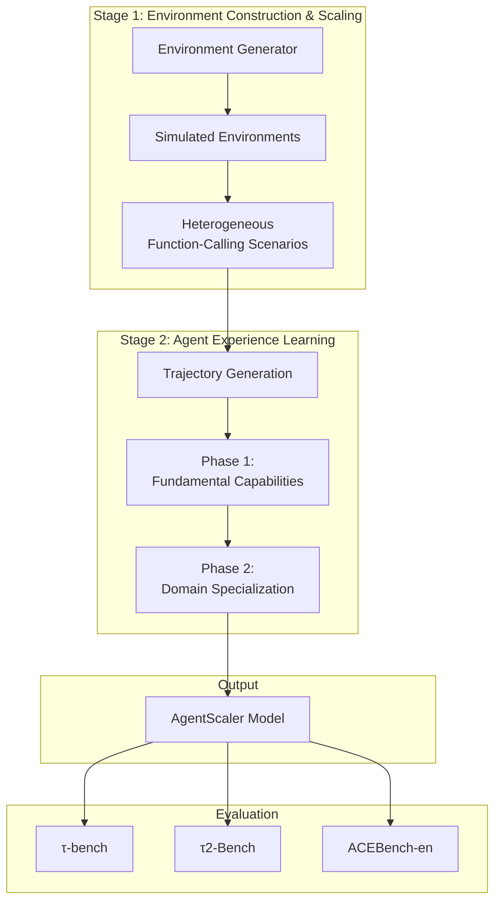
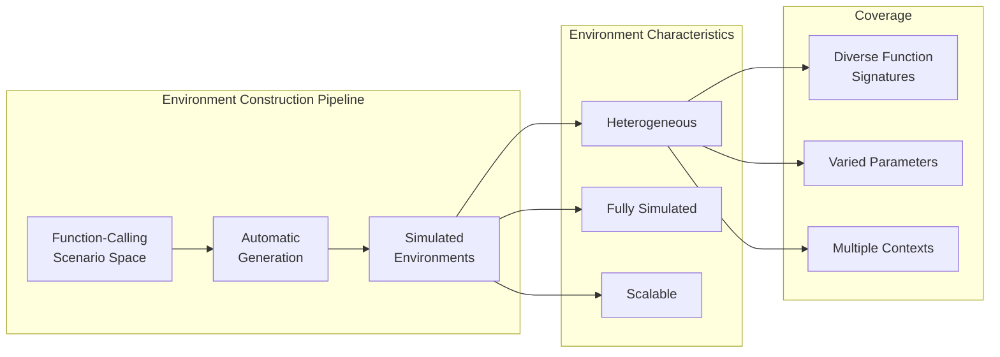
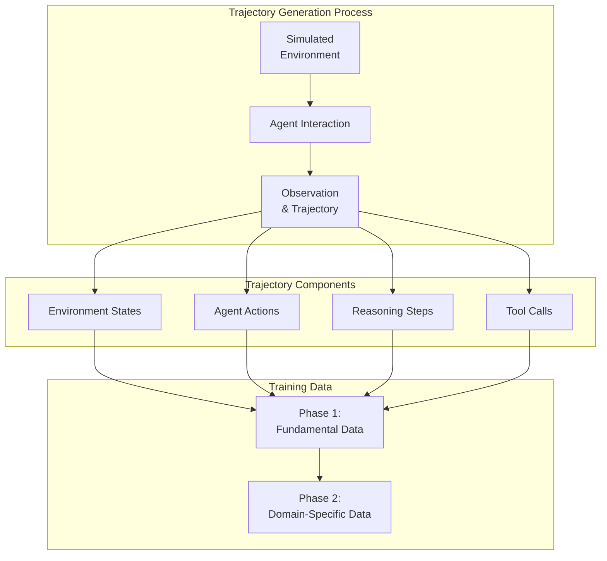
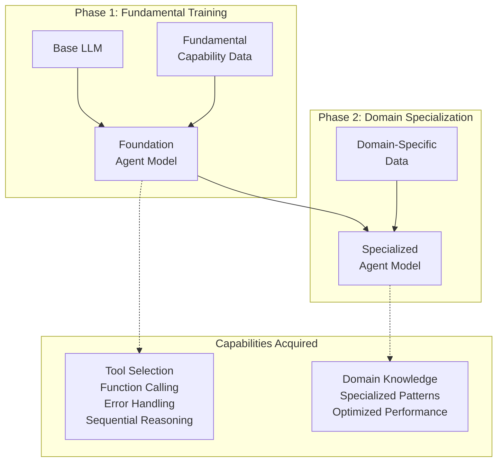
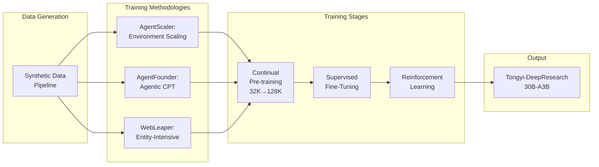
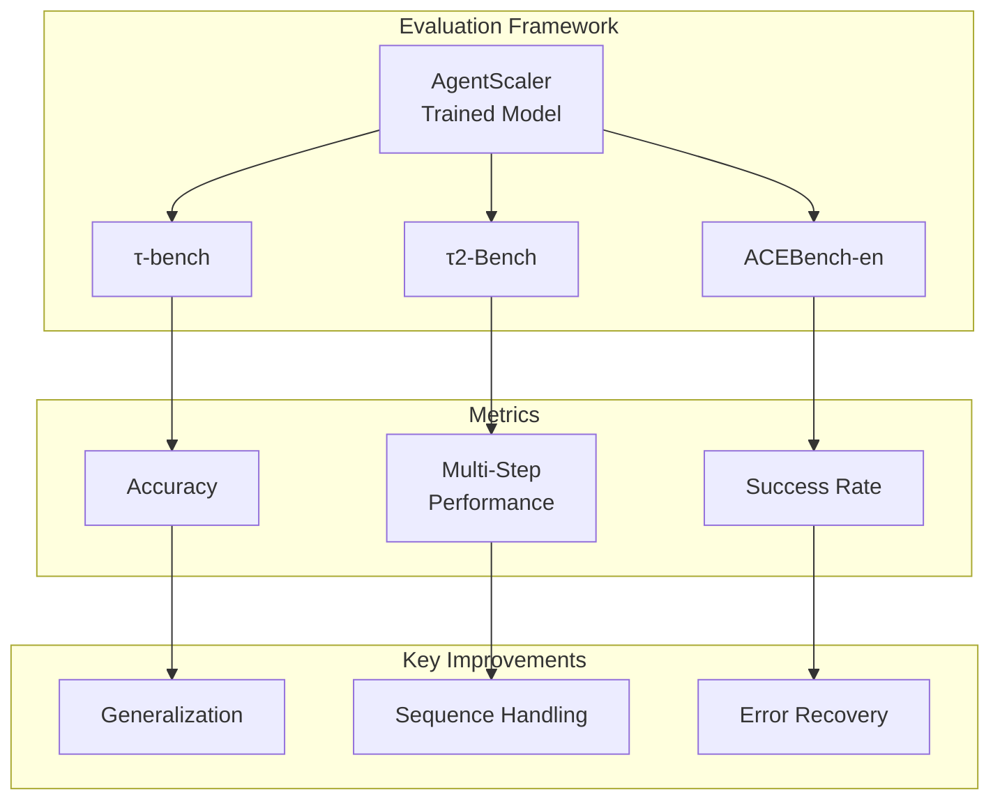

<!-- source: DeepWiki mcp.deepwiki.com · repo Alibaba-NLP/DeepResearch · page 3.5 AgentScaler: Environment Scaling · fetched 2026-10-29 -->

# AgentScaler: Environment Scaling

Relevant source files

The following files were used as context for generating this wiki page:

- [Agent/AgentFounder/README.md](Agent/AgentFounder/README.md)
- [Agent/AgentFounder/assets/logo.png](Agent/AgentFounder/assets/logo.png)
- [Agent/AgentFounder/assets/main_performance.png](Agent/AgentFounder/assets/main_performance.png)
- [Agent/AgentScaler/README.md](Agent/AgentScaler/README.md)
- [Agent/AgentScaler/assets/main.png](Agent/AgentScaler/assets/main.png)

## Purpose and Scope

This page documents **AgentScaler**, a training framework that automatically constructs heterogeneous simulated environments and implements a two-phase fine-tuning strategy for developing general agentic intelligence. AgentScaler is one of three major training methodologies (alongside AgentFounder [#3.4](#3.4) and WebLeaper [#3.2](#3.2)) that contribute to the Continual Pre-training (CPT) stage [#3.3](#3.3) of the Tongyi DeepResearch training pipeline.

For information about the complete training pipeline architecture, see [Training Pipeline Architecture](#3.7). For synthetic data generation that feeds into AgentScaler, see [Synthetic Data Generation Pipeline](#3.1).

Sources: [Agent/AgentScaler/README.md:1-46]()

---

## Overview

AgentScaler addresses a fundamental question in agentic AI: how to systematically scale up training environments to advance general agentic intelligence. Traditional agent training often relies on limited, hand-crafted environments, which constrains the diversity of scenarios agents can learn from. AgentScaler solves this by automatically constructing **fully simulated, heterogeneous environments** that systematically broaden the space of function-calling scenarios.

The framework tackles two core challenges:

1. **Environment Scaling**: How to scale environments in a principled, automatic manner
2. **Experience Learning**: How to effectively train agentic capabilities from experiences derived through interactions with these environments

The resulting model demonstrates significant performance improvements on agentic benchmarks including τ-bench, τ2-Bench, and ACEBench.

Sources: [Agent/AgentScaler/README.md:7-9]()

---

## Framework Architecture

AgentScaler consists of two central stages that work together to produce capable agentic models:

**Figure: AgentScaler Two-Stage Framework Architecture**

The framework operates in two distinct stages: first constructing diverse simulated environments, then leveraging these environments to train agentic capabilities through a two-phase fine-tuning approach.

Sources: [Agent/AgentScaler/README.md:11-18]()

---

## Stage 1: Fully Simulated Environment Construction and Scaling

### Environment Generation Process

AgentScaler automatically constructs heterogeneous environments that are fully simulated, eliminating the need for real-world interaction during training. This approach offers several advantages:

- **Scalability**: Environments can be generated programmatically at scale
- **Safety**: No risk of unintended real-world consequences during training
- **Reproducibility**: Identical scenarios can be replayed for consistent training
- **Diversity**: Systematic coverage of the function-calling scenario space

**Figure: Environment Construction and Characteristics**

The automatic construction process systematically broadens the space of function-calling scenarios, ensuring that agents are exposed to diverse situations during training. Each environment is self-contained and fully simulated, allowing for rapid iteration and experimentation.

Sources: [Agent/AgentScaler/README.md:11-14]()

---

## Stage 2: Agent Experience Learning

### Trajectory Generation

Once environments are constructed, AgentScaler generates agent trajectories by having agents interact with these simulated environments. This process captures the agent's decision-making process, tool invocations, and reasoning steps.

**Figure: Agent Trajectory Generation Pipeline**

The trajectory generation process captures rich interaction data that serves as training material for both phases of fine-tuning.

Sources: [Agent/AgentScaler/README.md:17-18]()

---

## Two-Phase Fine-Tuning Strategy

AgentScaler employs a carefully designed two-phase fine-tuning strategy that progressively builds agent capabilities:

### Phase 1: Fundamental Agentic Capabilities

In the first phase, the model is trained to acquire fundamental agentic capabilities that are domain-agnostic. These capabilities include:

| Capability | Description |
|------------|-------------|
| **Tool Selection** | Identifying which tools are relevant for a given task |
| **Function Calling** | Properly formatting and executing function calls |
| **Error Handling** | Recovering from failed actions or invalid states |
| **Sequential Reasoning** | Chaining multiple actions to achieve goals |
| **State Tracking** | Maintaining awareness of environment state |

The training data for this phase is derived from diverse simulated environments, ensuring broad coverage of fundamental patterns.

### Phase 2: Domain-Specific Specialization

After establishing fundamental capabilities, the second phase specializes the agent for specific domain contexts. This phase:

- Refines tool usage patterns for specific domains
- Adapts reasoning strategies to domain-specific challenges
- Learns domain-specific knowledge and constraints
- Optimizes performance for target benchmarks

**Figure: Two-Phase Fine-Tuning Strategy**

This staged approach ensures that agents first develop robust general capabilities before specializing, leading to better generalization and more stable training.

Sources: [Agent/AgentScaler/README.md:11-14]()

---

## Integration with the Training Pipeline

AgentScaler integrates into the broader Tongyi DeepResearch training pipeline as a contributor to the Continual Pre-training (CPT) stage. It works alongside other training methodologies to produce the final model:

**Figure: AgentScaler in the Training Pipeline**

AgentScaler's environment scaling methodology specifically contributes to the CPT stage by providing diverse, simulated interaction data that helps the model learn fundamental agentic patterns. This complements:

- **AgentFounder**: Which focuses on open-world memory and action synthesis
- **WebLeaper**: Which provides entity-intensive training scenarios

Together, these methodologies ensure comprehensive coverage of agentic capabilities during the CPT phase.

Sources: [Agent/AgentScaler/README.md:1-46]()

---

## Evaluation and Results

AgentScaler is evaluated on three major agentic benchmarks that test function-calling and tool-use capabilities:

### Benchmark Overview

| Benchmark | Focus Area | Evaluation Metrics |
|-----------|------------|-------------------|
| **τ-bench** | Tool use and function calling | Accuracy, success rate |
| **τ2-Bench** | Extended tool sequences | Multi-step success rate |
| **ACEBench-en** | Agentic capabilities (English) | Task completion, correctness |

### Performance Results

The AgentScaler model demonstrates significant enhancements in function-calling capability across all evaluated benchmarks. The fully simulated environment approach and two-phase fine-tuning strategy lead to:

- Improved generalization to unseen function signatures
- Better handling of complex multi-step tool sequences
- More robust error recovery and retry logic
- Enhanced reasoning about tool selection and usage

**Figure: Evaluation Framework and Key Improvements**

The results demonstrate that systematic environment scaling, combined with structured two-phase training, is an effective approach for developing general agentic intelligence.

Sources: [Agent/AgentScaler/README.md:21-23]()

---

## Technical Implementation Notes

### Environment Simulation

The simulated environments are designed to be:

- **Deterministic**: Given the same inputs, environments produce consistent outputs
- **Composable**: Environments can be combined to create more complex scenarios
- **Parameterizable**: Environment complexity can be adjusted through configuration
- **Isolated**: Each environment runs independently without side effects

### Training Data Format

Training data generated from environment interactions follows a structured format that captures:

1. **Initial State**: The starting configuration of the environment
2. **Action Sequence**: The sequence of actions taken by the agent
3. **Observations**: Feedback from the environment after each action
4. **Reasoning**: The agent's internal reasoning process (when available)
5. **Outcome**: Success/failure and final state

This structured format enables both supervised learning (from successful trajectories) and reinforcement learning (from success/failure signals).

### Scalability Considerations

The automatic environment construction approach allows AgentScaler to scale to large numbers of training scenarios without manual intervention. Key scalability features include:

- Programmatic generation of environment configurations
- Parallel execution of trajectory collection
- Efficient storage of interaction data
- Incremental training data augmentation

Sources: [Agent/AgentScaler/README.md:1-46]()

---

## Relationship to Other Training Components

AgentScaler's environment scaling methodology complements other components of the training pipeline:

### With Synthetic Data Generation

AgentScaler consumes synthetic data from the generation pipeline [#3.1](#3.1) and transforms it into simulated environments. The diversity of synthetic data directly influences the heterogeneity of constructed environments.

### With AgentFounder

While AgentFounder [#3.4](#3.4) focuses on open-world memory and action synthesis (FAS/HAS), AgentScaler provides the environmental context in which these synthesized actions can be validated and trained.

### With WebLeaper

WebLeaper [#3.2](#3.2) provides entity-intensive scenarios, while AgentScaler ensures broad coverage of function-calling patterns. Together, they ensure comprehensive training coverage.

### With CPT and SFT

The two-phase fine-tuning strategy of AgentScaler aligns with the broader CPT→SFT progression:
- Phase 1 (Fundamental Capabilities) occurs during or immediately after CPT
- Phase 2 (Domain Specialization) occurs during or after SFT

This alignment ensures smooth integration into the overall training workflow.

Sources: [Agent/AgentScaler/README.md:1-46]()

---

## Summary

AgentScaler represents a principled approach to scaling agent training through automatic environment construction and staged fine-tuning. By systematically broadening the space of function-calling scenarios and employing a two-phase training strategy, it enables the development of agents with strong general agentic capabilities that can be specialized for specific domains. The framework's fully simulated environments provide a safe, scalable, and reproducible training ground that significantly enhances model performance on agentic benchmarks.

Sources: [Agent/AgentScaler/README.md:1-46]()

---

