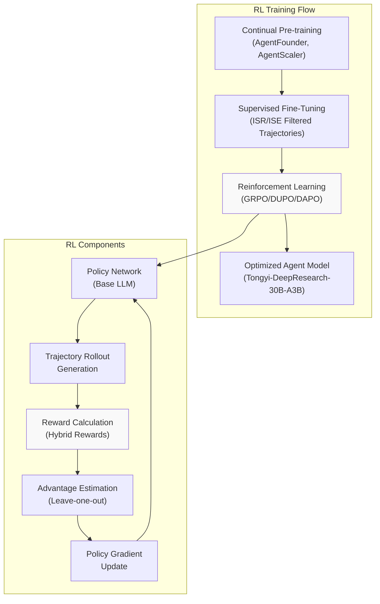
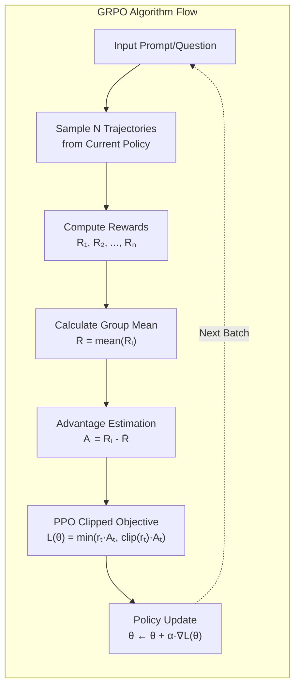
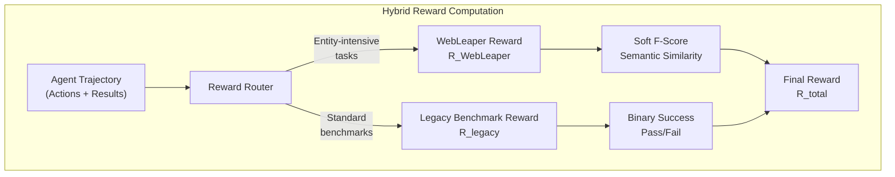
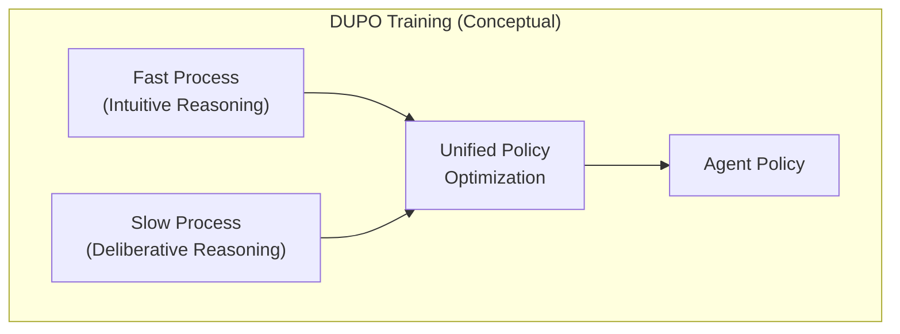
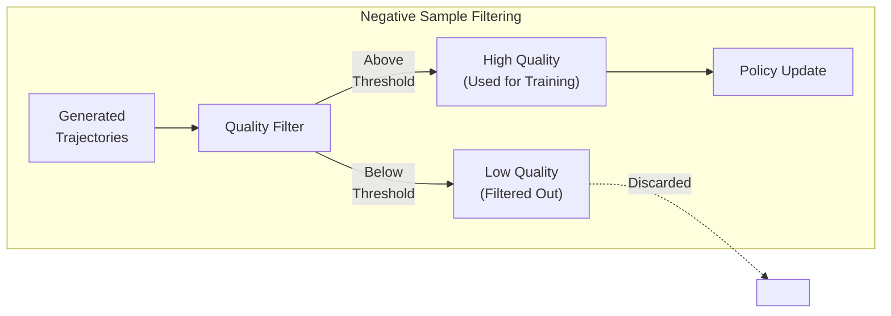
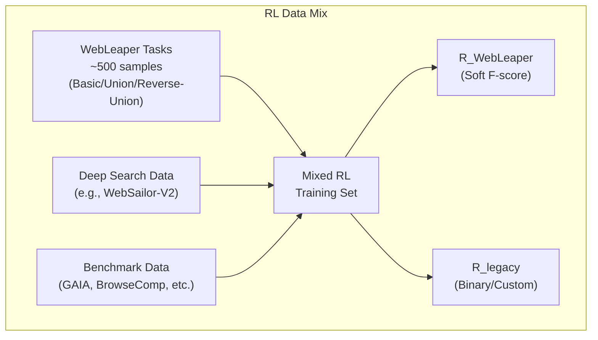
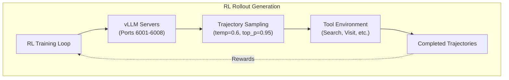

<!-- source: DeepWiki mcp.deepwiki.com · repo Alibaba-NLP/DeepResearch · page 3.6 Reinforcement Learning Methods · fetched 2026-10-29 -->

# Reinforcement Learning Methods

<details>
<summary>Relevant source files</summary>

The following files were used as context for generating this wiki page:

- [.env.example](.env.example)
- [.gitignore](.gitignore)
- [Agent/AgentFounder/README.md](Agent/AgentFounder/README.md)
- [Agent/AgentFounder/assets/logo.png](Agent/AgentFounder/assets/logo.png)
- [Agent/AgentFounder/assets/main_performance.png](Agent/AgentFounder/assets/main_performance.png)
- [Agent/AgentScaler/README.md](Agent/AgentScaler/README.md)
- [Agent/AgentScaler/assets/main.png](Agent/AgentScaler/assets/main.png)
- [README.md](README.md)
- [WebAgent/WebLeaper/README.md](WebAgent/WebLeaper/README.md)
- [WebAgent/WebLeaper/assets/overview.png](WebAgent/WebLeaper/assets/overview.png)
- [WebAgent/WebLeaper/assets/performance_summary.png](WebAgent/WebLeaper/assets/performance_summary.png)
- [WebAgent/WebLeaper/assets/webleaper.jpg](WebAgent/WebLeaper/assets/webleaper.jpg)
- [inference/run_react_infer.sh](inference/run_react_infer.sh)

</details>


## Purpose and Scope

This document describes the reinforcement learning (RL) algorithms and techniques used to optimize agentic policies in the Tongyi DeepResearch training pipeline. The primary methods include **Group Relative Policy Optimization (GRPO)**, **Dual-Process Unified Policy Optimization (DUPO)**, and **Dynamic Advantage Policy Optimization (DAPO)**. These algorithms build upon supervised fine-tuning (SFT) to further enhance agent performance through policy gradient optimization with carefully designed reward functions.

For information about the supervised fine-tuning stage that precedes RL training, see [Training Pipeline Architecture](#3.7). For details on synthetic data generation used in RL, see [Synthetic Data Generation Pipeline](#3.1).

## Overview of RL in the Training Pipeline

The reinforcement learning stage follows continual pre-training and supervised fine-tuning, serving as the final optimization step for agentic models. The core approach employs **strictly on-policy RL** with token-level policy gradients, leave-one-out advantage estimation, and selective filtering of negative samples to stabilize training in non-stationary environments.



**RL Training Loop Architecture**

Sources: [README.md:46](), [WebLeaper/README.md:82-97]()

## Group Relative Policy Optimization (GRPO)

GRPO is the foundational RL algorithm used across the Deep Research training framework. It optimizes policies by sampling groups of trajectories and computing advantages relative to the group's average reward, providing stable learning signals through PPO-like objectives.

### Core Mechanism

GRPO operates by:
1. **Group Sampling**: Generate multiple trajectories for each prompt/question
2. **Relative Advantage**: Estimate advantage for each trajectory relative to the group mean
3. **PPO Objective**: Update policy using clipped surrogate objective
4. **Token-Level Gradients**: Apply policy gradients at the token level for fine-grained optimization



**GRPO Training Flow**

The key innovation is the **leave-one-out advantage estimation**, where each trajectory's advantage is computed relative to other trajectories in the group, providing a more stable baseline than value function estimation.

Sources: [README.md:46](), [WebLeaper/README.md:96]()

### Hyperparameters

| Parameter | Typical Value | Description |
|-----------|---------------|-------------|
| `ROLLOUT_COUNT` | 3 | Number of trajectories sampled per prompt |
| `TEMPERATURE` | 0.85 | Sampling temperature during rollout |
| `PRESENCE_PENALTY` | 1.1 | Penalty for token repetition |

Sources: [.env.example:40-42]()

## Hybrid Reward System

The training employs a **hybrid reward system** that combines task-specific rewards with legacy benchmark rewards, providing dense training signals for complex multi-entity tasks.

### Reward Types



**Hybrid Reward Architecture**

### WebLeaper Reward (R_WebLeaper)

For entity-intensive information seeking tasks, a **soft F-score reward** measures semantic similarity between retrieved and ground-truth entities:

```
R_WebLeaper = (1 + ω²) · (P · Rc) / (ω² · P + Rc)
```

Where:
- **P** (Precision): Soft precision over retrieved entities O
- **Rc** (Recall): Soft recall over ground-truth entities R  
- **ω**: Weighting factor (typically β for F-β score)

This handles variations like "USA" vs "United States" through semantic similarity rather than exact matching, providing denser gradients than binary rewards.

Sources: [WebLeaper/README.md:86-94]()

### Legacy Task Reward (R_legacy)

For standard benchmarks (GAIA, BrowseComp, etc.), the original reward functions are used:
- **Binary Success**: 1.0 for correct answer, 0.0 for incorrect
- **Task-Specific Metrics**: Some benchmarks use custom evaluation metrics

This mixed approach allows the model to maintain performance on existing benchmarks while optimizing for new entity-intensive tasks.

Sources: [WebLeaper/README.md:94]()

## DUPO: Dual-Process Unified Policy Optimization

DUPO (referenced in WebSailor) represents an advanced RL technique for achieving super-human reasoning capabilities. While specific implementation details are not provided in the available files, DUPO is mentioned as a key component of the WebSailor training paradigm.



**DUPO Conceptual Architecture**

Sources: [README.md:206]()

## DAPO: Dynamic Advantage Policy Optimization

DAPO is mentioned as another RL algorithm in the system overview but specific implementation details are not provided in the available documentation.

Sources: [README.md:46]()

## Training Stability Mechanisms

### Selective Negative Sample Filtering

To stabilize training in non-stationary environments, the system employs **selective filtering of negative samples**:



**Negative Sample Filtering Flow**

This prevents the policy from being updated with low-quality or harmful trajectories that could destabilize learning.

Sources: [README.md:46]()

### Token-Level Policy Gradients

Unlike sequence-level REINFORCE, the system applies **token-level policy gradients**, allowing for:
- Finer-grained credit assignment
- Better handling of long trajectories with mixed quality
- More stable gradient estimates

### Leave-One-Out Advantage Estimation

The advantage for trajectory `i` in a group of `N` trajectories is computed as:

```
A_i = R_i - (Σ_{j≠i} R_j) / (N-1)
```

This leave-one-out baseline provides more stable advantage estimates than value function baselines, especially early in training when value functions are unreliable.

Sources: [README.md:46]()

## Data Mix for RL Training

The RL training uses a carefully curated data mix:

| Data Source | Approximate Count | Reward Type | Purpose |
|-------------|-------------------|-------------|---------|
| WebLeaper Tasks | ~500 | R_WebLeaper | Entity-intensive optimization |
| Deep Search Data | Variable | R_legacy | Maintain browsing capability |
| Benchmark Data | Variable | R_legacy | Performance on standard tasks |



**RL Training Data Mix**

Sources: [WebLeaper/README.md:149]()

## Performance Gains from RL

Applying RL after SFT consistently improves performance across benchmarks:

| Model Stage | BrowseComp | GAIA | xbench-DS | WideSearch (SR) |
|-------------|------------|------|-----------|-----------------|
| SFT Only | 37.80 | 69.9 | 69.0 | 1.5 |
| SFT + RL | **38.8** (+1.0) | **73.2** (+3.3) | **72.0** (+3.0) | **4.0** (+2.5) |

The RL stage shows particularly strong gains on complex tasks like GAIA (+3.3 points) and WideSearch (+2.5 points success rate), demonstrating the effectiveness of the hybrid reward approach.

Sources: [WebLeaper/README.md:115-121]()

## Integration with vLLM Inference

During RL training, rollout generation uses vLLM servers for efficient trajectory sampling:



**RL Rollout Infrastructure**

The inference configuration uses:
- **Temperature**: 0.6 (for exploration)
- **Top-p**: 0.95 (nucleus sampling)
- **Multiple Rollouts**: Configured by `ROLLOUT_COUNT` environment variable

Sources: [WebLeaper/README.md:150](), [run_react_infer.sh:30-37](), [.env.example:40]()

## Training Configuration

Key environment variables controlling RL training behavior:

```bash
# From .env configuration
ROLLOUT_COUNT=3              # Number of trajectories per prompt
TEMPERATURE=0.85             # Sampling temperature  
PRESENCE_PENALTY=1.1         # Token repetition penalty
MAX_WORKERS=30              # Parallel worker processes
```

Sources: [.env.example:40-43]()

## Summary

The reinforcement learning methods in Tongyi DeepResearch employ a sophisticated combination of:

1. **GRPO** as the core on-policy optimization algorithm with group-based advantage estimation
2. **Hybrid reward systems** combining soft F-score (R_WebLeaper) for entity-intensive tasks and binary/custom rewards (R_legacy) for standard benchmarks
3. **Stability mechanisms** including leave-one-out baselines, token-level gradients, and negative sample filtering
4. **Careful data mixing** balancing entity-intensive and standard deep-search tasks

This RL framework consistently delivers 1-3+ point improvements over SFT-only baselines while maintaining stability across diverse agentic benchmarks.

Sources: [README.md:46](), [WebLeaper/README.md:82-121](), [.env.example:40-43]()

---

