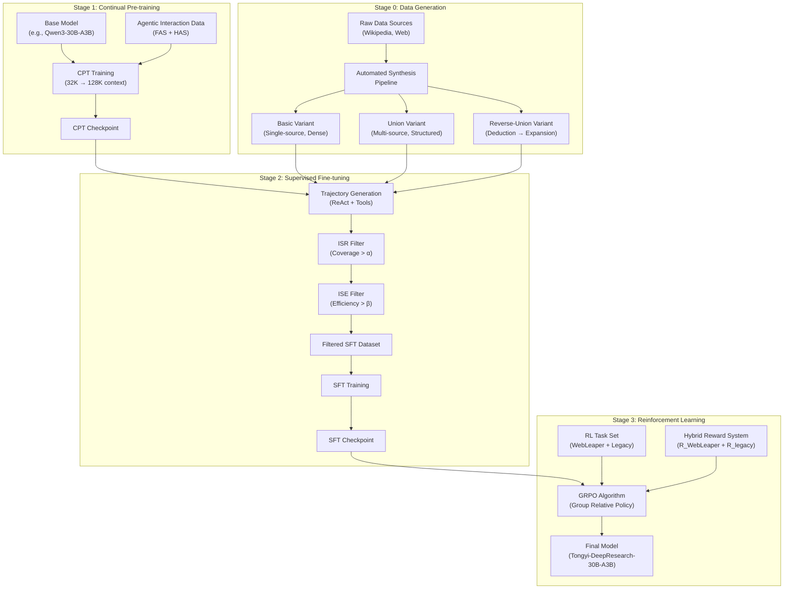
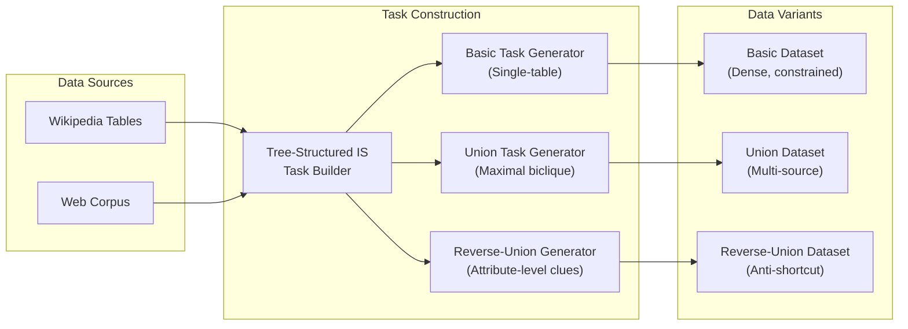
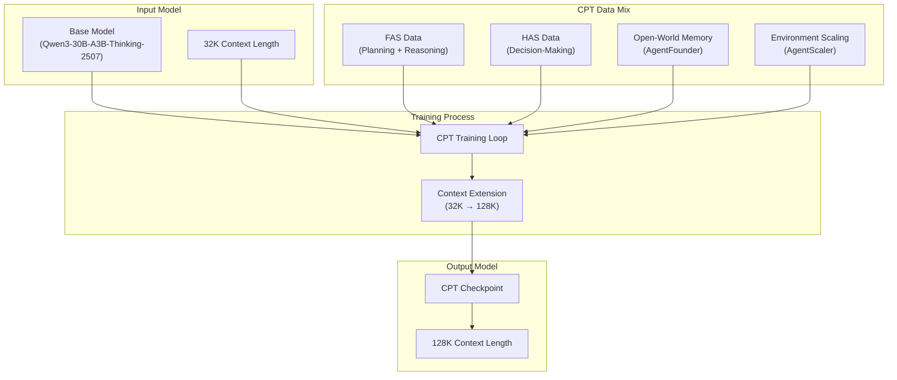
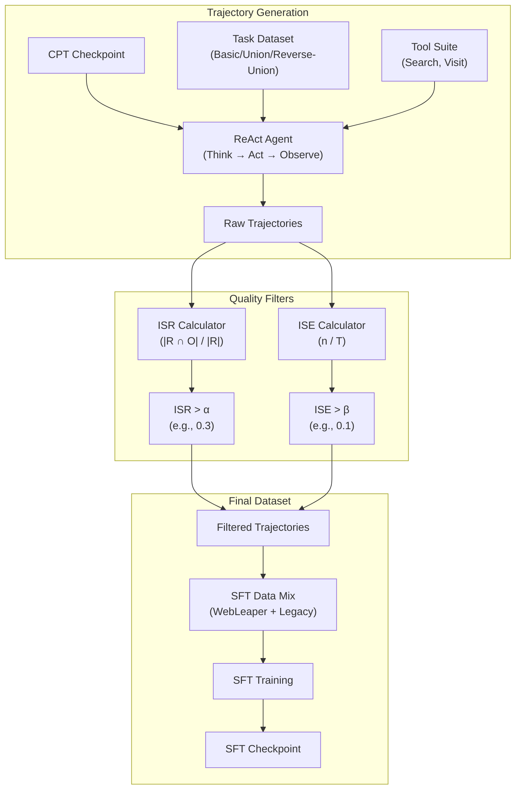
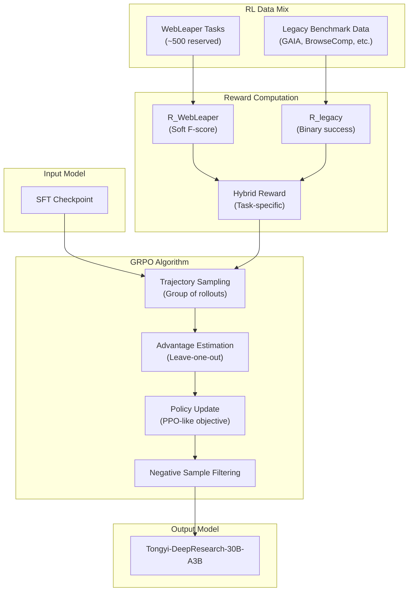
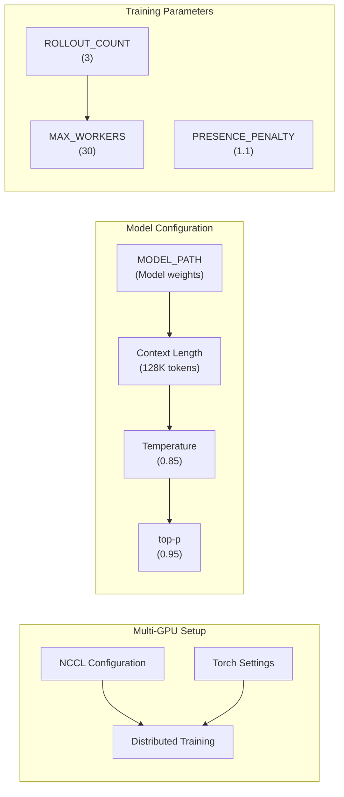
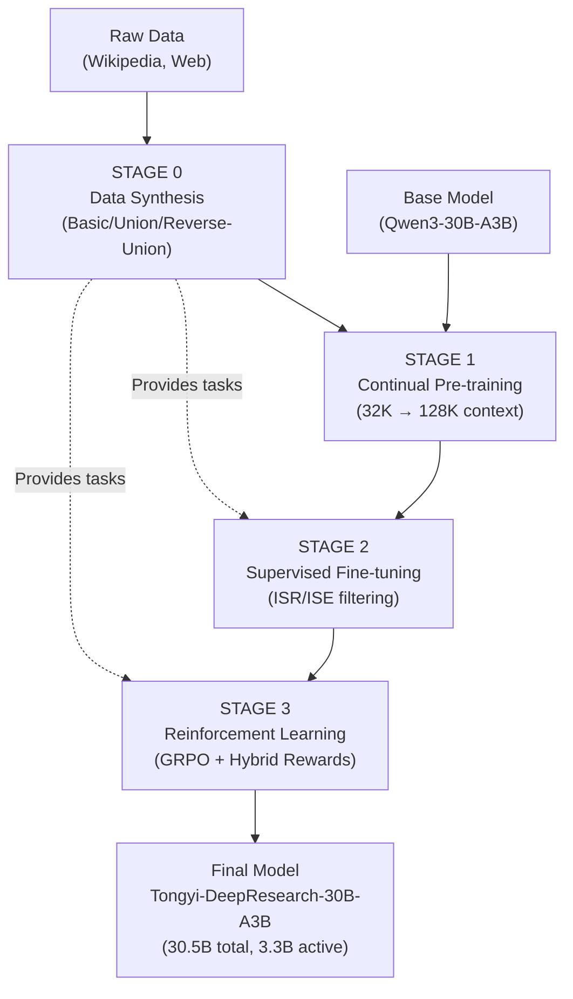

<!-- source: DeepWiki mcp.deepwiki.com · repo Alibaba-NLP/DeepResearch · page 3.7 Training Pipeline Architecture · fetched 2026-10-29 -->

# Training Pipeline Architecture

<details>
<summary>Relevant source files</summary>

The following files were used as context for generating this wiki page:

- [.env.example](.env.example)
- [.gitignore](.gitignore)
- [README.md](README.md)
- [WebAgent/WebLeaper/README.md](WebAgent/WebLeaper/README.md)
- [WebAgent/WebLeaper/assets/overview.png](WebAgent/WebLeaper/assets/overview.png)
- [WebAgent/WebLeaper/assets/performance_summary.png](WebAgent/WebLeaper/assets/performance_summary.png)
- [WebAgent/WebLeaper/assets/webleaper.jpg](WebAgent/WebLeaper/assets/webleaper.jpg)
- [inference/run_react_infer.sh](inference/run_react_infer.sh)

</details>


## Purpose and Scope

This page provides a comprehensive technical overview of the end-to-end training pipeline that produces Tongyi DeepResearch and related agent models. The pipeline consists of three major stages: Continual Pre-training (CPT), Supervised Fine-tuning (SFT), and Reinforcement Learning (RL), each fed by a fully automated synthetic data generation system.

For details about specific training methodologies, see:
- Data synthesis specifics: [Synthetic Data Generation Pipeline](#3.1)
- Entity-intensive task design: [WebLeaper: Entity-Intensive Training Framework](#3.2)
- CPT techniques: [Continual Pre-training Strategy](#3.3), [AgentFounder: Agentic CPT](#3.4), [AgentScaler: Environment Scaling](#3.5)
- RL algorithms: [Reinforcement Learning Methods](#3.6)

---

## Training Pipeline Overview

The Tongyi DeepResearch training pipeline transforms raw Wikipedia and web data into state-of-the-art agentic models through a systematic three-stage process. The pipeline emphasizes efficiency-aware training, entity-intensive task synthesis, and policy optimization with custom reward functions.



**Key Pipeline Characteristics:**
- **Fully Automated**: End-to-end data synthesis with no manual annotation
- **Efficiency-Aware**: Trajectory filtering based on Information-Seeking Rate (ISR) and Efficiency (ISE)
- **Entity-Intensive**: Tasks designed to maximize information density and discourage shortcuts
- **Scalable**: Supports large-scale distributed training across multiple GPUs

Sources: [README.md:44-46](), [WebAgent/WebLeaper/README.md:9-15]()

---

## Stage 0: Data Generation and Preparation

### Synthetic Data Pipeline

The pipeline begins with a fully automated data synthesis system that constructs entity-intensive information-seeking tasks from curated Wikipedia tables and web sources.



### Task Variants

| Variant | Description | Key Property | Use Case |
|---------|-------------|--------------|----------|
| **Basic** | Single-source tree from one well-formed table | Dense targets in constrained context | Foundation for efficient exploration |
| **Union** | Multi-source synthesis via maximal biclique enumeration | Cross-source reasoning required | Realistic multi-document synthesis |
| **Reverse-Union** | Attribute-level clues require deduction before search | No keyword shortcuts | Forces genuine reasoning |

**Tree Structure:**
- **Root**: Question entity
- **2nd Layer**: Key entities to retrieve
- **3rd Layer**: Attributes and linked entities
- Each 2nd-layer node + attributes forms a subtree

Sources: [WebAgent/WebLeaper/README.md:36-49]()

---

## Stage 1: Continual Pre-training (CPT)

Continual pre-training extends the base model's capabilities by training on diverse, high-quality agentic interaction data while maintaining freshness and strengthening reasoning performance.

### CPT Configuration



**CPT Objectives:**
1. **Capability Extension**: Incorporate agentic reasoning patterns (FAS: Planning/Reasoning, HAS: Decision-Making)
2. **Context Scaling**: Extend context window from 32K to 128K tokens
3. **Data Freshness**: Maintain up-to-date knowledge through continuous training
4. **Generalization**: Train on heterogeneous simulated environments (AgentScaler)

**Key Methodologies:**
- **AgentFounder**: Action synthesis through Forward Action Synthesis (FAS) and Hierarchical Action Synthesis (HAS)
- **AgentScaler**: Automatic construction of heterogeneous simulated environments for two-phase fine-tuning

Sources: [README.md:45](), [WebAgent/WebLeaper/README.md:146]()

---

## Stage 2: Supervised Fine-tuning (SFT)

SFT curates high-quality trajectories through strict filtering based on coverage and efficiency metrics, ensuring the model learns only from optimal demonstrations.

### SFT Trajectory Construction and Filtering



### SFT Metrics and Thresholds

| Metric | Formula | Purpose | Typical Threshold |
|--------|---------|---------|-------------------|
| **ISR** (Information-Seeking Rate) | ISR = \|R ∩ O\| / \|R\| | Coverage: Fraction of required entities retrieved | α = 0.3 |
| **ISE** (Information-Seeking Efficiency) | ISE = n / T | Efficiency: Entities discovered per action step | β = 0.1 |

Where:
- **R**: Required entities (ground truth)
- **O**: Retrieved entities (from agent output)
- **n**: Number of target entities
- **T**: Number of action steps taken

**ISE Stability Property:**
As the number of targets n increases, Var(ISE) = O(1/n), providing reliable efficiency signals during training.

### Tool Integration

**Available Tools:**
- `Search(queries, filter_year)`: Returns web results + snippets
- `Visit(urls, goal)`: Returns summarized paragraphs from which entities are extracted

**ISE Computation Note:**
ISE is computed primarily using entities from `Visit` actions, as entities found in `Search` snippets are often less precise and require subsequent `Visit` refinement.

Sources: [WebAgent/WebLeaper/README.md:52-79](), [WebAgent/WebLeaper/README.md:145-149]()

---

## Stage 3: Reinforcement Learning (RL)

The RL stage further enhances the agent using Group Relative Policy Optimization (GRPO) with a hybrid reward system designed for entity-intensive tasks.

### RL Training Architecture



### Hybrid Reward System

The RL stage addresses the sparsity problem of binary rewards through a hybrid approach:

**For WebLeaper Tasks (R_WebLeaper):**

The soft F-score reward measures semantic similarity (not exact match) for each entity, handling variations like "USA" vs. "United States":

```
P = Precision over retrieved entities
R_c = Recall over ground-truth entities

R_WebLeaper = (1 + ω²) × (P × R_c) / (ω² × P + R_c)
```

Where ω is a weighting parameter (typically ω² = 1 for balanced F1-score).

**For Legacy Tasks (R_legacy):**
Binary success indicators from original benchmark definitions (e.g., exact match, pass/fail).

### GRPO (Group Relative Policy Optimization)

GRPO provides stable training in the non-stationary environment created by entity-intensive tasks:

1. **Group Sampling**: Sample multiple trajectories per prompt
2. **Relative Advantage**: Estimate advantage relative to group's average reward
3. **Token-Level Gradients**: Apply policy gradients at the token level
4. **Selective Filtering**: Filter negative samples to stabilize training
5. **PPO-like Objective**: Use clipped surrogate objective to prevent large policy shifts

Sources: [README.md:46](), [WebAgent/WebLeaper/README.md:82-97](), [WebAgent/WebLeaper/README.md:145-150]()

---

## Training Infrastructure and Configuration

### Environment Configuration

Training infrastructure is configured through environment variables and model hyperparameters:



### Key Configuration Parameters

| Category | Parameter | Default Value | Purpose |
|----------|-----------|---------------|---------|
| **Distributed Training** | `NCCL_MIN_NCHANNELS` | 4 | Minimum NCCL channels |
| **Distributed Training** | `NCCL_IB_TIMEOUT` | 22 | InfiniBand timeout |
| **Model** | `MODEL_PATH` | `/your/model/path` | Path to model weights |
| **Inference** | `TEMPERATURE` | 0.85 | Sampling temperature |
| **Inference** | `top-p` | 0.95 | Nucleus sampling threshold |
| **RL Training** | `ROLLOUT_COUNT` | 3 | Trajectories per prompt |
| **RL Training** | `PRESENCE_PENALTY` | 1.1 | Token repetition penalty |
| **System** | `MAX_WORKERS` | 30 | Concurrent worker threads |

### SFT Filter Thresholds

Thresholds for trajectory filtering are tuned for balanced coverage and efficiency:

| Dataset Variant | ISR Threshold (α) | ISE Threshold (β) | Notes |
|-----------------|-------------------|-------------------|-------|
| **Basic** | 0.3 | 0.1 | Higher density, lower threshold |
| **Union** | 0.3 | 0.1 | Multi-source complexity |
| **Reverse-Union** | 0.3 | 0.1 | Anti-shortcut design |

These thresholds ensure that:
- At least 30% of required entities are retrieved (ISR > 0.3)
- At least 0.1 entities are discovered per action step (ISE > 0.1)
- Trajectories demonstrate both coverage and efficiency

Sources: [.env.example:35-43](), [.env.example:6-20](), [WebAgent/WebLeaper/README.md:145-150]()

---

## Training Data Mix Strategy

The training pipeline carefully balances multiple data sources across stages:

### CPT Data Mix
- Agentic interaction data (FAS + HAS)
- Open-world memory data (AgentFounder)
- Environment scaling data (AgentScaler)
- Maintains data freshness and diversity

### SFT Data Mix
- **Primary**: WebLeaper tasks (Basic/Union/Reverse-Union)
- **Supplementary**: Small set of deep-search data (e.g., WebSailor-V2)
- **Purpose**: Retain long-horizon browsing capability while focusing on entity-intensive tasks

### RL Data Mix
- **WebLeaper Tasks**: ~500 reserved tasks evaluated with R_WebLeaper
- **Legacy Benchmarks**: Existing benchmark data evaluated with R_legacy
- **Evaluation**: Mixed distribution maintains generalization across task types

Sources: [WebAgent/WebLeaper/README.md:145-150]()

---

## Model Outputs and Performance

### Training Progression: SFT vs. RL

The RL stage consistently improves performance over SFT-only baseline across all benchmarks:

| Model Stage | BrowseComp | GAIA | xbench-DS | WideSearch (SR) | WideSearch (Row F1) | WideSearch (Item F1) |
|-------------|------------|------|-----------|-----------------|---------------------|---------------------|
| **SFT Only** | 37.80 | 69.9 | 69.0 | 1.5 | 23.0 | 45.4 |
| **SFT + RL** | **38.8** (+1.0) | **73.2** (+3.3) | **72.0** (+3.0) | **4.0** (+2.5) | **31.0** (+8.0) | **48.8** (+3.4) |

**Key Observations:**
- Consistent gains across all metrics
- Largest improvements on complex tasks (GAIA +3.3, WideSearch Row F1 +8.0)
- RL effectively refines policy beyond supervised demonstrations

### Final Model Specifications

**Tongyi-DeepResearch-30B-A3B:**
- **Total Parameters**: 30.5 billion
- **Active Parameters**: 3.3 billion per token (Mixture-of-Experts architecture)
- **Context Length**: 128K tokens
- **Training Stages**: CPT → SFT → RL
- **Base Model**: Qwen3-30B-A3B-Thinking-2507
- **Primary Training Framework**: WebLeaper entity-intensive methodology

Sources: [README.md:32](), [README.md:54-55](), [WebAgent/WebLeaper/README.md:113-121]()

---

## End-to-End Pipeline Summary



The complete training pipeline produces state-of-the-art agentic models through:
1. **Automated Data Synthesis**: Fully scalable, no manual annotation
2. **Capability Extension**: CPT with agentic interaction data
3. **Quality Curation**: Strict trajectory filtering (ISR/ISE)
4. **Policy Optimization**: GRPO with entity-intensive rewards
5. **Efficiency-Aware Training**: Maximum information gain per action

Sources: [README.md:44-47](), [WebAgent/WebLeaper/README.md:1-156]()

---

