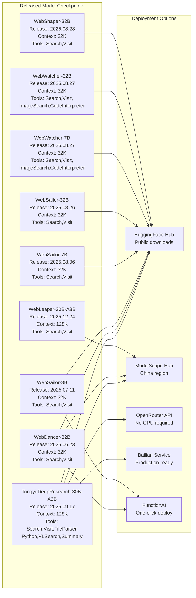
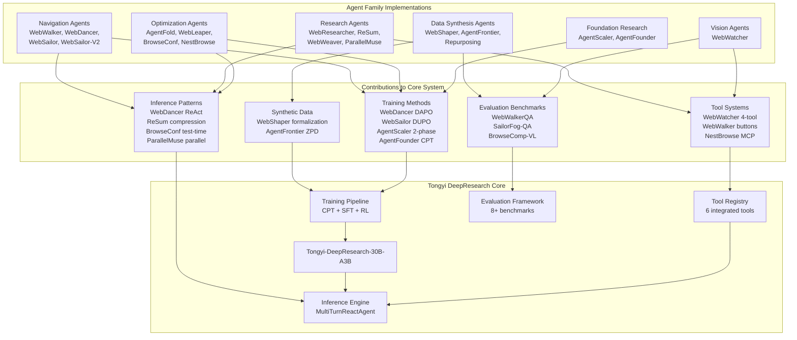
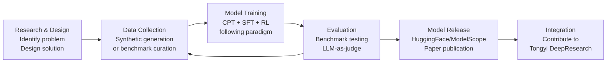

<!-- source: DeepWiki mcp.deepwiki.com · repo Alibaba-NLP/DeepResearch · page 4 Agent Implementations · fetched 2026-10-29 -->

# Agent Implementations

<details>
<summary>Relevant source files</summary>

The following files were used as context for generating this wiki page:

- [README.md](README.md)
- [WebAgent/README.md](WebAgent/README.md)

</details>


This page provides technical documentation of the specific agent implementations that comprise the Deep Research Agent Family. These agents represent specialized research systems that contribute methodologies, training techniques, and architectural innovations to the core Tongyi DeepResearch model.

For information about the core inference engine and runtime components, see [Core Inference Engine](#2). For training pipeline details, see [Training and Data Pipeline](#3). For evaluation methodologies, see [Evaluation and Benchmarks](#5).

## Overview

The Deep Research Agent Family consists of 18+ specialized research agents, each addressing specific challenges in agentic information-seeking. These agents are organized into five functional categories and collectively contribute to the unified Tongyi DeepResearch system through shared methodologies, training data, and architectural patterns.

**Key characteristics of agent implementations:**
- Each agent represents a complete research project with models, training code, and evaluation scripts
- Agents share common infrastructure including tool systems, training frameworks, and evaluation benchmarks
- Models range from 3B to 72B parameters with 32K-128K context windows
- Most agents support the ReAct paradigm with specialized tool configurations

Sources: [README.md:30-32](), [README.md:190-216](), [WebAgent/README.md:1-48]()

## Agent Family Taxonomy

The following diagram organizes all agents by their functional specializations:

```mermaid
graph TB
    subgraph Navigation["Navigation & Traversal Agents"]
        WW["WebWalker<br/>Web traversal benchmark<br/>+ multi-agent framework"]
        WD["WebDancer<br/>Native search reasoning<br/>4-stage training"]
        WS1["WebSailor<br/>Super-human reasoning<br/>DUPO algorithm"]
        WS2["WebSailor-V2<br/>Synthetic data + RL<br/>scaling"]
    end
    
    subgraph Research["Research & Reasoning Agents"]
        WR["WebResearcher<br/>Long-horizon reasoning<br/>unbounded capability"]
        RS["ReSum<br/>Context summarization<br/>unlimited exploration"]
        WW2["WebWeaver<br/>Dynamic outlines<br/>web-scale evidence"]
        PM["ParallelMuse<br/>Parallel thinking<br/>reasoning aggregation"]
    end
    
    subgraph DataSynth["Data Synthesis & Training Agents"]
        WSh["WebShaper<br/>Formalization-driven<br/>data synthesis"]
        AFr["AgentFrontier<br/>ZPD-guided synthesis<br/>capability expansion"]
        RepS["Repurposing Synthetic Data<br/>Fine-grained supervision<br/>search agent training"]
    end
    
    subgraph Vision["Vision & Multimodal Agents"]
        WWa["WebWatcher<br/>Vision-language agent<br/>4-tool integration"]
    end
    
    subgraph Optimization["Optimization & Efficiency Agents"]
        AFo["AgentFold<br/>Proactive context mgmt<br/>long-horizon tasks"]
        WL["WebLeaper<br/>Entity-intensive seeking<br/>efficient info retrieval"]
        BC["BrowseConf<br/>Confidence-guided<br/>test-time scaling"]
        NB["NestBrowse<br/>Nested browser learning<br/>MCP integration"]
    end
    
    subgraph Foundation["Foundation Research"]
        AS["AgentScaler<br/>Environment scaling<br/>general agentic intelligence"]
        AF["AgentFounder<br/>Continual pre-training<br/>action synthesis"]
    end
    
    TD["Tongyi DeepResearch<br/>Core Model<br/>30B-A3B"]
    
    WW --> TD
    WD --> TD
    WS1 --> TD
    WS2 --> TD
    WR --> TD
    RS --> TD
    WW2 --> TD
    PM --> TD
    WSh --> TD
    AFr --> TD
    RepS --> TD
    WWa --> TD
    AFo --> TD
    WL --> TD
    BC --> TD
    NB --> TD
    AS --> TD
    AF --> TD
```



**Taxonomy Breakdown:**

| Category | Agents | Primary Focus | Key Innovation |
|----------|--------|---------------|----------------|
| Navigation & Traversal | 4 agents | Web page navigation, autonomous search | Native search reasoning, trajectory optimization |
| Research & Reasoning | 4 agents | Long-horizon reasoning, evidence gathering | Context management, parallel exploration |
| Data Synthesis | 3 agents | Training data generation | Formalization-driven synthesis, curriculum learning |
| Vision & Multimodal | 1 agent | Visual information seeking | Vision-language integration |
| Optimization | 4 agents | Efficiency, test-time scaling | Context compression, confidence-guided sampling |
| Foundation | 2 agents | Theoretical frameworks | Environment scaling, continual pre-training |

Sources: [README.md:190-216](), [WebAgent/README.md:27-32]()

## Released Models and Specifications

The following diagram maps agent research to their released model checkpoints:



**Model Release Timeline and Specifications:**

| Model | Parameters | Release Date | Context | Tool Configuration |
|-------|------------|--------------|---------|-------------------|
| `WebDancer-32B` | 32B | 2025.06.23 | 32K | Search, Visit |
| `WebSailor-3B` | 3B | 2025.07.11 | 32K | Search, Visit |
| `WebSailor-7B` | 7B | 2025.08.06 | 32K | Search, Visit |
| `WebSailor-32B` | 32B | 2025.08.26 | 32K | Search, Visit |
| `WebWatcher-7B` | 7B | 2025.08.27 | 32K | Search, Visit, ImageSearch, CodeInterpreter |
| `WebWatcher-32B` | 32B | 2025.08.27 | 32K | Search, Visit, ImageSearch, CodeInterpreter |
| `WebShaper-32B` | 32B | 2025.08.28 | 32K | Search, Visit |
| `Tongyi-DeepResearch-30B-A3B` | 30B-A3B | 2025.09.17 | 128K | Search, Visit, FileParser, Python, VLSearch, Summary |
| `WebLeaper-30B-A3B` | 30B-A3B | 2025.12.24 | 128K | Search, Visit |

Sources: [README.md:49-56](), [WebAgent/README.md:49-57](), [README.md:59-61]()

## Navigation & Traversal Agents

### WebWalker

WebWalker introduces both a benchmark for evaluating LLM web traversal capabilities and a multi-agent framework for information seeking. The system features:

- **WebWalkerQA Benchmark**: Evaluation dataset for web traversal tasks
- **Button Extraction**: Identifies clickable elements for navigation
- **Streamlit UI**: Interactive demonstration interface
- **Multi-Agent Framework**: Coordinates multiple specialized agents

Technical implementation details are documented in [WebWalker: Web Traversal and Navigation](#4.1).

### WebDancer

WebDancer implements native agentic search reasoning using the ReAct framework. Core innovations:

- **4-Stage Training Paradigm**: 
  1. Browsing data construction
  2. Trajectory sampling
  3. Supervised fine-tuning for cold start
  4. Reinforcement learning (DAPO) for generalization
- **Native Search Reasoning**: Model autonomously acquires search and reasoning skills
- **Data-Centric Approach**: Integrates trajectory-level SFT and RL for scalable training

**Performance**: Pass@3 of 64.1% on GAIA, 62.0% on WebWalkerQA

### WebSailor Family

WebSailor develops super-human reasoning capabilities through advanced post-training:

- **Extended Thinking**: Models engage in long-form reasoning during information seeking
- **SailorFog-QA Dataset**: Scalable benchmark with high uncertainty via graph sampling and information obfuscation
- **Two-Stage Training**:
  1. RFT cold start with high-quality trajectory reconstruction
  2. DUPO (Duplicating Sampling Policy Optimization) for efficient agentic RL
- **WebSailor-V2**: Enhanced version with synthetic data and scalable RL

**Performance**: 12.0% on BrowseComp-en, 30.1% on BrowseComp-zh, 55.4% on GAIA (WebSailor-72B)

Detailed documentation in [WebDancer and WebSailor](#4.3).

Sources: [WebAgent/README.md:87-92](), [WebAgent/README.md:79-85](), [README.md:198-206]()

## Research & Reasoning Agents

### WebResearcher

WebResearcher focuses on long-horizon reasoning with unbounded capability for complex information-seeking tasks. Key features:

- **Long-Horizon Reasoning**: Maintains coherent reasoning chains across extended interactions
- **Unbounded Capability**: No fixed limits on exploration depth or duration

### ReSum

ReSum (Research Summarization) enables unlimited exploration through context compression:

- **Conversation Compression**: Summarizes context to prevent overflow
- **ReSumTool-30B**: Specialized summarization model
- **Unlimited Exploration**: Removes practical limits on interaction length

Technical details in [Context Management and ReSum Paradigm](#2.9).

### WebWeaver

WebWeaver structures web-scale evidence with dynamic outlines:

- **Dynamic Outline Generation**: Creates structured evidence hierarchies
- **Web-Scale Evidence**: Handles massive information volumes
- **Open-Ended Deep Research**: Supports exploratory research tasks

### ParallelMuse

ParallelMuse implements parallel thinking for deep information seeking:

- **Compressed Reasoning Aggregation**: Combines multiple reasoning paths
- **State Report Generation**: Produces structured status updates
- **Information Integration**: Merges parallel exploration results

Detailed documentation in [ParallelMuse: Parallel Reasoning Aggregation](#4.5).

Sources: [README.md:203-213]()

## Data Synthesis & Training Agents

### WebShaper

WebShaper introduces formalization-driven data synthesis for information-seeking agents:

- **Task Formalization**: Grounds synthesis in formal task definitions
- **Agentic Expander**: Iteratively generates and validates questions aligned with formalization
- **WebShaper Dataset**: Systematic generation of IS instances

**Performance**: State-of-the-art 60.19% on GAIA, 52.50% on WebWalkerQA

**Key Innovation**: Formalization-driven approach ensures high-quality, task-aligned synthetic data

### AgentFrontier

AgentFrontier uses ZPD-guided synthesis to expand capability frontiers:

- **Zone of Proximal Development (ZPD)**: Curriculum learning approach
- **Capability Expansion**: Systematically pushes model boundaries
- **Data Synthesis**: Generates progressively challenging training data

### Repurposing Synthetic Data

This work introduces fine-grained supervision techniques for search agents:

- **Fine-Grained Supervision**: Detailed annotations for agent training
- **Search Agent Training**: Specialized techniques for information-seeking models
- **Synthetic Data Repurposing**: Efficient reuse of generated data

Sources: [WebAgent/README.md:73-77](), [README.md:212-215]()

## Vision & Multimodal Agents

### WebWatcher

WebWatcher breaks new frontiers in vision-language deep research:

- **4-Tool Integration**: Search, Visit, ImageSearch, CodeInterpreter
- **Vision-Language Understanding**: Processes both text and images
- **VL Evaluation Datasets**: HLE and BrowseComp-VL benchmarks
- **Multimodal Information Seeking**: Handles visual QA tasks

**Tool Configuration:**
```
Tools: [Search, Visit, ImageSearch, CodeInterpreter]
Context: 32K tokens
Models: WebWatcher-7B, WebWatcher-32B
```

Comprehensive documentation in [WebWatcher: Vision-Language Agent](#4.2).

Sources: [README.md:202](), [WebAgent/README.md:55-56]()

## Optimization & Efficiency Agents

### AgentFold

AgentFold implements proactive context management for long-horizon web agents:

- **Proactive Context Management**: Anticipates and manages context needs
- **Long-Horizon Task Support**: Handles extended interaction sequences
- **Memory Optimization**: Efficient context window utilization

### WebLeaper

WebLeaper empowers efficient, info-rich seeking for web agents:

- **Entity-Intensive Tasks**: Focuses on entity-centric information seeking
- **Tree-Structured Information Seeking (IS)**: Hierarchical exploration strategy
- **Data Variants**: Basic, Union, Reverse-Union for diverse training
- **ISR/ISE Metrics**: Information Seeking Reward/Efficiency evaluation
- **Hybrid Reward System**: Combines multiple reward signals

Detailed documentation in [WebLeaper: Entity-Intensive Training Framework](#3.2).

### BrowseConf

BrowseConf implements confidence-guided test-time scaling:

- **Confidence-Guided Sampling**: Uses model confidence for decision-making
- **Test-Time Scaling**: Adjusts computation based on task difficulty
- **Web Agent Optimization**: Improves browsing efficiency

### NestBrowse

NestBrowse introduces nested browser learning for agentic information seeking:

- **Agentic Loop Implementation**: Recursive agent execution
- **MCP Client Integration**: Model Context Protocol support
- **Browser Automation Tools**: Comprehensive browser control

Detailed documentation in [NestBrowse: Nested Browser Learning](#4.4).

Sources: [README.md:209-215]()

## Foundation Research

### AgentScaler: Environment Scaling

AgentScaler addresses general agentic intelligence through environment scaling:

- **Automatic Environment Construction**: Builds heterogeneous simulated environments
- **Two-Phase Fine-Tuning**: Structured training strategy
- **Environment Scaling Methodology**: Systematic approach to diverse training environments

**Contribution to Training Pipeline**: Provides CPT methodology and environment diversity

Detailed in [AgentScaler: Environment Scaling](#3.5).

### AgentFounder: Continual Pre-training

AgentFounder develops agentic CPT and action synthesis:

- **Open-World Memory**: Maintains persistent state across interactions
- **FAS (Forward Action Synthesis)**: Planning and reasoning components
- **HAS (Hindsight Action Synthesis)**: Decision-making components
- **32K→128K Context Scaling**: Extends model context capabilities

**Contribution to Training Pipeline**: Provides CPT strategy and action synthesis methods

Detailed in [AgentFounder: Agentic CPT and Action Synthesis](#3.4).

Sources: [README.md:207-208]()

## Integration Architecture

The following diagram shows how agent implementations integrate with the core Tongyi DeepResearch system:



**Integration Mechanisms:**

1. **Training Data**: WebShaper formalization and AgentFrontier ZPD contribute to synthetic data generation
2. **Training Algorithms**: DAPO (WebDancer), DUPO (WebSailor), 2-phase (AgentScaler), CPT (AgentFounder)
3. **Inference Paradigms**: ReAct (WebDancer), ReSum compression, test-time scaling (BrowseConf), parallel reasoning (ParallelMuse)
4. **Tool Systems**: Vision tools (WebWatcher), navigation (WebWalker), MCP (NestBrowse)
5. **Evaluation**: WebWalkerQA, SailorFog-QA, BrowseComp-VL benchmarks

Sources: [README.md:30-48](), [README.md:190-216]()

## Shared Infrastructure

All agent implementations share common infrastructure components:

### Base Agent Framework

Many agents utilize the `qwen-agent` framework as a foundation:

- **Base Agent Classes**: Standardized agent interfaces
- **Tool Registration System**: Unified tool integration
- **Memory Management**: Conversation and state tracking
- **RAG Capabilities**: Retrieval-augmented generation support

Documentation in [Qwen-Agent Framework](#4.6).

### Common Tool Integration

Agents integrate with shared tool systems:

| Tool | Purpose | API Integration | Used By |
|------|---------|-----------------|---------|
| `Search` | Web search | Serper API | All agents |
| `Visit` | Page reading | Jina API | All agents |
| `VLSearchImage` | Reverse image search | Google Images + OSS | WebWatcher |
| `PythonInterpreter` | Code execution | SandboxFusion | WebWatcher |
| `SingleFileParser` | Document parsing | Dashscope IDP | Tongyi DeepResearch |
| `Summary` | Context compression | OpenAI-compatible | ReSum |

### Evaluation Infrastructure

All agents use standardized evaluation:

- **LLM-as-Judge**: Qwen2.5-72B-Instruct for answer evaluation
- **Shared Benchmarks**: GAIA, BrowseComp, HLE, WebWalkerQA
- **Metrics**: Pass@k, token usage, tool statistics
- **JSONL Format**: Standardized input/output format

See [Evaluation and Benchmarks](#5) for details.

Sources: [README.md:102-107](), [README.md:182-184]()

## Research Project Organization

Each agent implementation follows a consistent directory structure:

```
WebAgent/
├── WebWalker/          # Web traversal benchmark + framework
├── WebDancer/          # Native search reasoning
├── WebSailor/          # Super-human reasoning
├── WebShaper/          # Data synthesis
├── WebWatcher/         # Vision-language agent
└── ...

Agent/
├── AgentScaler/        # Environment scaling
└── AgentFounder/       # Continual pre-training

Each project contains:
├── README.md           # Project documentation
├── requirements.txt    # Dependencies
├── scripts/            # Training and inference scripts
├── dataset/            # Training/evaluation data
├── benchmark/          # Evaluation datasets
└── infer/              # Inference code
```

**Common Patterns:**
- Each agent has a dedicated subdirectory with complete implementation
- Training scripts typically in `scripts/` directory
- Evaluation data in `benchmark/` or `dataset/`
- Inference code in `infer/` or main directory
- Model deployment scripts use `sglang` or `vLLM`

Sources: [WebAgent/README.md:96-129]()

## Agent Development Workflow

The typical workflow for agent development follows this pattern:



**Development Stages:**

1. **Research & Design**: Identify specific challenge in agentic information-seeking
2. **Data Collection**: Generate synthetic data or curate benchmark datasets
3. **Model Training**: Apply CPT, SFT, and/or RL based on agent-specific methodology
4. **Evaluation**: Test on relevant benchmarks using standardized evaluation
5. **Model Release**: Publish models to HuggingFace/ModelScope with paper
6. **Integration**: Contribute methodologies and techniques to core system

Sources: [README.md:42-48](), [WebAgent/README.md:34-47]()

## Other Agent Projects

Additional agents in the family with specialized contributions:

### AgentFold
Long-horizon web agents with proactive context management for maintaining coherent state across extended interactions.

### BrowseConf
Confidence-guided test-time scaling for web agents, adjusting computational resources based on task difficulty.

### WebResearcher
Unleashing unbounded reasoning capability in long-horizon agents through novel architectural innovations.

### WebWeaver
Structuring web-scale evidence with dynamic outlines for open-ended deep research tasks.

Documentation for these and other agents in [Other Research Projects](#4.7).

Sources: [README.md:203-215]()

---

