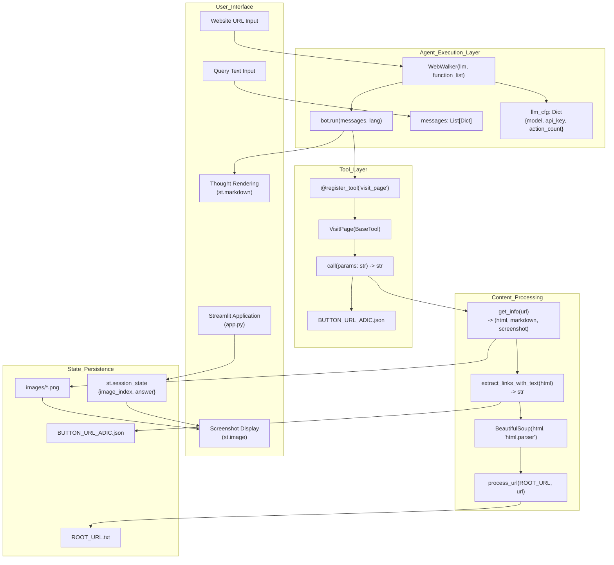
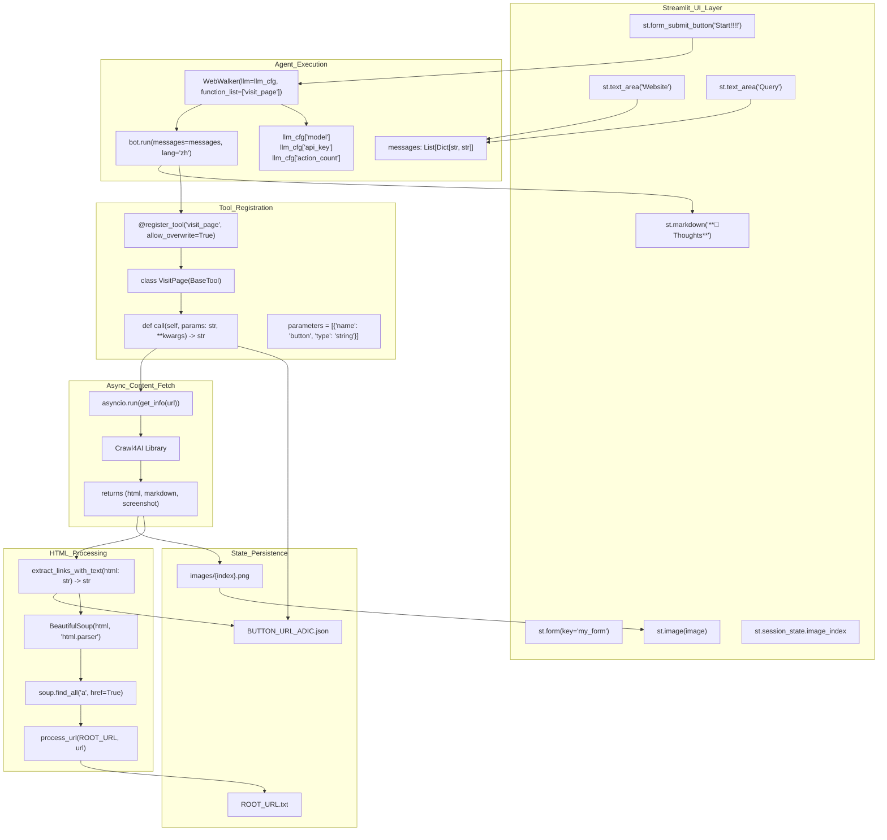

<!-- source: DeepWiki mcp.deepwiki.com · repo Alibaba-NLP/DeepResearch · page 4.1 WebWalker: Web Traversal and Navigation · fetched 2026-10-29 -->

# WebWalker: Web Traversal and Navigation

<details>
<summary>Relevant source files</summary>

The following files were used as context for generating this wiki page:

- [WebAgent/README.md](WebAgent/README.md)
- [WebAgent/WebWalker/README.md](WebAgent/WebWalker/README.md)
- [WebAgent/WebWalker/requirements.txt](WebAgent/WebWalker/requirements.txt)
- [WebAgent/WebWalker/src/app.py](WebAgent/WebWalker/src/app.py)

</details>


## Overview

WebWalker is a web navigation agent system built on the ReAct paradigm, consisting of a Streamlit demonstration application [WebAgent/WebWalker/src/app.py](), an HTML button extraction pipeline, and the WebWalkerQA benchmark dataset. The system enables LLM-driven multi-hop web traversal through iterative observation-action cycles.

### Core Components

| Component | Implementation | Function |
|-----------|---------------|----------|
| **Agent Orchestrator** | `WebWalker` class from `agent.py` | Executes ReAct loop with LLM reasoning and tool invocation |
| **Navigation Tool** | `VisitPage(BaseTool)` [WebAgent/WebWalker/src/app.py:210-271]() | Maps button text to URL visits via `BUTTON_URL_ADIC.json` |
| **HTML Parser** | `extract_links_with_text(html)` [WebAgent/WebWalker/src/app.py:56-126]() | Extracts clickable elements using BeautifulSoup |
| **Content Fetcher** | `asyncio.run(get_info(url))` | Returns `(html, markdown, screenshot)` tuple via Crawl4AI |
| **Benchmark** | WebWalkerQA dataset | 680 multi-hop queries across 1,373 webpages |

### System Architecture



The agent follows a vertical exploration strategy: starting from a root URL, it iteratively selects buttons to navigate deeper into website hierarchies, accumulating observations until sufficient information is gathered to answer complex queries. This contrasts with horizontal RAG approaches that retrieve content from multiple websites in parallel.

**Sources:** [WebAgent/WebWalker/README.md:1-56](), [WebAgent/WebWalker/src/app.py:1-272]()

---

## WebWalkerQA Benchmark Dataset

WebWalkerQA is a multi-hop web traversal benchmark comprising **680 queries** spanning **1,373 webpages** across four real-world scenarios:

| Characteristic | Description |
|----------------|-------------|
| **Size** | 680 questions + ~14K silver QA pairs |
| **Domains** | Conference, Academic, Government, Commercial |
| **Languages** | English and Chinese |
| **Hop Types** | Single-source and multi-source |
| **Difficulty Levels** | Easy, Medium, Hard |

### Dataset Structure

Each WebWalkerQA instance follows this schema:

```json
{
  "Question": "When is the paper submission deadline for the ACL 2025 Industry Track, and what is the venue address for the conference?",
  "Answer": "The paper submission deadline for the ACL 2025 Industry Track is March 21, 2025. The conference will be held in Brune-Kreisky-Platz 1.",
  "Root_Url": "https://2025.aclweb.org/",
  "Info": {
    "Hop": "multi-source",
    "Domain": "Conference",
    "Language": "English",
    "Difficulty_Level": "Medium",
    "Source_Website": [
      "https://2025.aclweb.org/calls/industry_track/",
      "https://2025.aclweb.org/venue/"
    ],
    "Golden_Path": ["root->call>student_research_workshop", "root->venue"]
  }
}
```

The dataset can be loaded via HuggingFace Datasets:

```python
from datasets import load_dataset
ds = load_dataset("callanwu/WebWalkerQA", split="main")
```

A leaderboard tracking model performance is maintained at HuggingFace Spaces.

**Sources:** [WebAgent/WebWalker/README.md:61-94]()

---

## Streamlit Application Architecture

The WebWalker demonstration system is implemented in [WebAgent/WebWalker/src/app.py]() as a Streamlit web application. The architecture orchestrates agent-based web traversal through three layers: UI rendering, agent execution, and tool invocation.

### System Architecture: Code Entity Mapping



### Core Classes and Functions

| Component | Type | Purpose |
|-----------|------|---------|
| `WebWalker` | Class | Agent orchestrator imported from `agent.py`, initialized with LLM config and tool list |
| `VisitPage` | Class | `BaseTool` subclass registered with `@register_tool('visit_page')` decorator |
| `extract_links_with_text(html)` | Function | Parses HTML with BeautifulSoup, returns button list string |
| `get_info(url)` | Async Function | Crawl4AI wrapper returning `(html, markdown, screenshot)` tuple |
| `st.session_state` | Object | Streamlit state manager for `image_index` and `answer` persistence |

### State Persistence

Three files maintain navigation state across tool invocations:

- **ROOT_URL.txt** [app.py:64-65](): Base URL for `process_url()` relative link resolution
- **BUTTON_URL_ADIC.json** [app.py:114-122](): Dictionary mapping button text to absolute URLs
- **images/** [app.py:177-186](): PNG screenshots indexed by step number

### LLM Configuration

Two LLM providers are supported via environment variable detection [app.py:17-42]():

| Provider | Environment Variables | Model | Context Window |
|----------|----------------------|-------|----------------|
| Dashscope | `DASHSCOPE_API_KEY` | `qwen-plus` | 120K tokens |
| OpenAI | `OPENAI_API_KEY` + `OPENAI_MODEL_SERVER` | `gpt-4o` | 120K tokens |

Both configurations share parameters:
- `top_p`: 0.8
- `max_input_tokens`: 120000
- `max_retries`: 20

The `llm_cfg` dictionary is passed to `WebWalker()` constructor [app.py:157-161]():

```python
llm_cfg["query"] = query
llm_cfg["action_count"] = MAX_ROUNDS
bot = WebWalker(llm=llm_cfg, function_list=tools)
```

**Sources:** [WebAgent/WebWalker/src/app.py:17-161]()

---

## Button Extraction Pipeline

The `extract_links_with_text(html)` function [app.py:56-126]() parses HTML to identify clickable navigation elements. It employs five extraction strategies, filters results by URL characteristics, and outputs a formatted button list.

### Button Extraction: Function Call Flow

```mermaid
graph TB
    extract_links_call["extract_links_with_text(html: str)"]
    
    open_ROOT_URL["with open('ROOT_URL.txt', 'r') as f:<br/>ROOT_URL = f.read()"]
    
    BeautifulSoup_init["soup = BeautifulSoup(html, 'html.parser')"]
    
    links_list["links = []"]
    
    subgraph "Five_Extraction_Strategies"
        find_a_href["soup.find_all('a', href=True)"]
        find_a_onclick["soup.find_all('a', onclick=True)"]
        find_a_data_url["soup.find_all('a', attrs={'data-url': True})"]
        find_a_herf_mask["soup.find_all('a', class_='herf-mask')"]
        find_button_onclick["soup.find_all('button', onclick=True)"]
    end
    
    subgraph "Per_Element_Processing"
        extract_url["url = a_tag['href']"]
        extract_text["text = ''.join(a_tag.stripped_strings)"]
        regex_match["re.search(r\"window\\.location\\.href='([^']*)''\", onclick_text)"]
    end
    
    subgraph "Validation_Chain"
        check_js["'javascript' not in url"]
        check_ext["not url.endswith(('.jpg','.png','.gif','.jpeg','.pdf'))"]
        check_domain["process_url(ROOT_URL, url).startswith(ROOT_URL)"]
        append_link["links.append({'url': url, 'text': text})"]
    end
    
    unique_links_dedupe["unique_links = {f\"{item['url']}_{item['text']}\": item}"]
    
    load_dict["with open('BUTTON_URL_ADIC.json', 'r') as f:<br/>BUTTON_URL_ADIC = json.load(f)"]
    
    update_dict["BUTTON_URL_ADIC[temp['text']] = temp['url']"]
    
    save_dict["with open('BUTTON_URL_ADIC.json', 'w') as f:<br/>json.dump(BUTTON_URL_ADIC, f)"]
    
    format_output["info += '<button>' + i['text'] + '<button>' + '\\n'"]
    
    return_str["return info"]
    
    extract_links_call --> open_ROOT_URL
    open_ROOT_URL --> BeautifulSoup_init
    BeautifulSoup_init --> links_list
    links_list --> find_a_href
    links_list --> find_a_onclick
    links_list --> find_a_data_url
    links_list --> find_a_herf_mask
    links_list --> find_button_onclick
    
    find_a_href --> extract_url
    find_a_onclick --> regex_match
    find_a_data_url --> extract_url
    find_a_herf_mask --> extract_url
    find_button_onclick --> regex_match
    
    extract_url --> extract_text
    regex_match --> extract_text
    extract_text --> check_js
    check_js --> check_ext
    check_ext --> check_domain
    check_domain --> append_link
    
    append_link --> unique_links_dedupe
    unique_links_dedupe --> load_dict
    load_dict --> update_dict
    update_dict --> save_dict
    save_dict --> format_output
    format_output --> return_str
```

### Extraction Strategies

The function implements five distinct extraction patterns:

1. **Standard `<a href>` Tags** [WebAgent/WebWalker/src/app.py:69-75]():
   ```python
   for a_tag in soup.find_all('a', href=True):
       url = a_tag['href']
       text = ''.join(a_tag.stripped_strings)
       # Filter and process
   ```

2. **JavaScript `onclick` Attributes** [WebAgent/WebWalker/src/app.py:77-86]():
   ```python
   for a_tag in soup.find_all('a', onclick=True):
       onclick_text = a_tag['onclick']
       match = re.search(r"window\.location\.href='([^']*)'", onclick_text)
   ```

3. **Custom `data-url` Attributes** [WebAgent/WebWalker/src/app.py:88-93](): Handles modern SPA frameworks

4. **CSS Class Selectors** [WebAgent/WebWalker/src/app.py:95-100](): Targets `herf-mask` class with title fallback

5. **Button Elements** [WebAgent/WebWalker/src/app.py:102-110](): Extracts navigation from `<button onclick>` tags

### Filtering Logic

Each extracted link undergoes three validation checks:

| Check | Condition | Purpose |
|-------|-----------|---------|
| JavaScript Filter | `"javascript" not in url` | Exclude inline scripts |
| File Extension Filter | `not url.endswith(('.jpg', '.png', '.gif', '.jpeg', '.pdf'))` | Exclude media/document files |
| Domain Scope Filter | `process_url(ROOT_URL, url).startswith(ROOT_URL)` | Restrict to same-domain navigation |

The `process_url()` utility (from `utils.py`) handles relative URL resolution.

### Output Format

The function returns two artifacts:

1. **Button Dictionary** stored in `BUTTON_URL_ADIC.json` [WebAgent/WebWalker/src/app.py:114-122](): Maps button text to absolute URLs
2. **Formatted String** [WebAgent/WebWalker/src/app.py:123-126](): Each button wrapped in `<button>` tags for LLM consumption

Example output:
```
<button>Call for Papers<button>
<button>Important Dates<button>
<button>Registration<button>
```

**Sources:** [WebAgent/WebWalker/src/app.py:56-126]()

---

## VisitPage Tool Implementation

The `VisitPage` class [app.py:210-271]() extends `BaseTool` from `qwen_agent.tools.base` and is registered with the `@register_tool('visit_page', allow_overwrite=True)` decorator. It implements button-based navigation by translating button text into URL visits.

### Tool Definition

```python
@register_tool('visit_page', allow_overwrite=True)
class VisitPage(BaseTool):
    description = 'A tool analyzes the content of a webpage...'
    parameters = [{
        'name': 'button',
        'type': 'string',
        'description': 'the button you want to click',
        'required': True
    }]
    
    def call(self, params: str, **kwargs) -> str:
        # Implementation
```

### VisitPage.call() Method Execution Flow

```mermaid
graph TB
    call_method_entry["def call(self, params: str, **kwargs) -> str"]
    
    subgraph "JSON_Parameter_Parsing"
        check_closing_brace["params.strip().endswith('}')?"]
        contains_brace["'}' in params.strip()?"]
        get_between_braces["params = '{' + get_content_between_a_b('{', '}', params) + '}'"]
        check_closing_quote["not params.strip().endswith('\"')?"]
        add_quote_brace["params = params.strip() + '\"}'"]
        add_brace["params = params.strip() + '}'"]
    end
    
    subgraph "Button_Text_to_URL_Mapping"
        open_json["with open('BUTTON_URL_ADIC.json', 'r') as f:<br/>BUTTON_URL_ADIC = json.load(f)"]
        parse_json5["json5.loads(params)"]
        check_button_field["'button' in parsed_params?"]
        extract_button_text["button_text = parsed_params['button'].replace('<button>', '')"]
        lookup_url["button_text in BUTTON_URL_ADIC?"]
        get_url["url = BUTTON_URL_ADIC[button_text]"]
    end
    
    subgraph "Streamlit_UI_Updates"
        st_markdown_click["st.markdown('**👆Click Button**')"]
        st_write_button["st.write(button_text)"]
        st_markdown_visit["st.markdown('**🌐Now Visit**')"]
        st_write_url["st.write(url)"]
    end
    
    subgraph "Page_Content_Retrieval"
        asyncio_run["html, markdown, screenshot = asyncio.run(get_info(url))"]
        check_screenshot["if screenshot:"]
        increment_index["st.session_state.image_index += 1"]
        write_png["with open(f'images/{index+1}.png', 'wb') as f:<br/>f.write(base64.b64decode(screenshot))"]
        open_image["image = Image.open(f'images/{index}.png')"]
        st_image_display["st.image(image, caption=f'Step {index} Observation', width=400)"]
    end
    
    subgraph "Extract_New_Buttons"
        call_extract_links["response_buttons = extract_links_with_text(html)"]
        format_response["response = 'The web information is:\\n\\n' + markdown"]
        append_buttons["response += 'Clickable buttons are wrapped in <button> tag' + response_buttons"]
        return_response["return response"]
    end
    
    error_button_not_found["return 'The button can not be clicked, please retry a new button!'"]
    error_invalid_input["return 'Your input is invalid, please output the action input correctly!'"]
    
    call_method_entry --> check_closing_brace
    check_closing_brace -->|"No"| contains_brace
    contains_brace -->|"Yes"| get_between_braces
    contains_brace -->|"No"| check_closing_quote
    check_closing_quote -->|"Yes"| add_quote_brace
    check_closing_quote -->|"No"| add_brace
    check_closing_brace -->|"Yes"| get_between_braces
    
    get_between_braces --> open_json
    add_quote_brace --> open_json
    add_brace --> open_json
    
    open_json --> parse_json5
    parse_json5 --> check_button_field
    check_button_field -->|"Yes"| extract_button_text
    check_button_field -->|"No"| error_invalid_input
    extract_button_text --> lookup_url
    lookup_url -->|"Found"| get_url
    lookup_url -->|"Not Found"| error_button_not_found
    
    get_url --> st_markdown_click
    st_markdown_click --> st_write_button
    st_write_button --> asyncio_run
    asyncio_run --> st_markdown_visit
    st_markdown_visit --> st_write_url
    st_write_url --> check_screenshot
    check_screenshot -->|"True"| write_png
    write_png --> increment_index
    increment_index --> open_image
    open_image --> st_image_display
    
    check_screenshot --> call_extract_links
    st_image_display --> call_extract_links
    call_extract_links --> format_response
    format_response --> append_buttons
    append_buttons --> return_response
```

### Parameter Parsing Logic

The `call()` method implements defensive JSON parsing [app.py:229-238]() to handle malformed LLM outputs:

| Input State | Fix Applied |
|-------------|-------------|
| Missing closing `}` | Extract content between first `{` and last `}` |
| No `}` at all | Append `"}` if missing closing quote, else `}` |
| Partial JSON | Use `get_content_between_a_b()` to extract valid portion |

This recovers from common LLM generation errors where JSON terminates prematurely.

### URL Resolution Sequence

Button-to-URL lookup follows this sequence [app.py:239-246]():

1. Parse `params` with `json5.loads()` to extract `button` field
2. Load `BUTTON_URL_ADIC.json` dictionary
3. Strip `<button>` tags from button text
4. Look up URL in dictionary
5. Display navigation UI with `st.markdown()` and `st.write()`

### Content Retrieval

The `get_info(url)` call [app.py:246]() returns a three-tuple unpacked as:

```python
html, markdown, screenshot = asyncio.run(get_info(url))
```

- **html**: BeautifulSoup input for `extract_links_with_text()`
- **markdown**: Clean text for LLM observation
- **screenshot**: Base64-encoded PNG saved to `images/{index}.png` [app.py:254-259]()

The `st.session_state.image_index` counter increments after each save to maintain sequential numbering.

### Response Format

Return value structure [app.py:260-267]():

```
The web information is:

{markdown_content}

Clickable buttons are wrapped in <button> tag
<button>Button Text 1<button>
<button>Button Text 2<button>
...
```

Error cases return:
- `"The button can not be clicked, please retry a new button!"` - Button not in dictionary
- `"Your input is invalid, please output the action input correctly!"` - Missing `button` field

**Sources:** [WebAgent/WebWalker/src/app.py:210-271]()

---

## ReAct Loop and Memory Management

WebWalker implements a ReAct (Reasoning + Acting) loop [app.py:166-205]() to handle multi-step web traversal. The system manages conversation history and extracts structured responses from LLM outputs.

### Initial Observation Construction

The first user message combines query, website, and initial page content [app.py:166-192]():

```python
messages = []  # List[Dict[str, str]] - chat history
visited_links = []  # Unused in current implementation

# Fetch initial page
html, markdown, screenshot = asyncio.run(get_info(website))
buttons = extract_links_with_text(html)

# Build prompt
start_prompt = f"query:\n{query} \nofficial website:\n{website}"
start_prompt += "\nObservation:" + "website information:\n\n" + markdown
start_prompt += "\n\nclickable button:\n\n" + buttons
start_prompt += "\n\nEach button is wrapped in a <button> tag"

messages.append({'role': 'user', 'content': start_prompt})
```

### Agent Execution Loop

The `bot.run()` method returns a generator yielding response messages [app.py:193-205]():

```python
response = bot.run(messages=messages, lang="zh")
for i in response:
    content = i[0]["content"]
    
    # Parse response type
    if "\"}" in content and "Memory" not in content:
        # Reasoning step
        st.markdown('**💭Thoughts**')
        st.markdown(content.split("Action")[0])
    
    elif "\"}" in content and "Memory" in content:
        # Memory update
        st.text_area('**🤯Memory Update**', content[:-2])
    
    if "Final Answer" in content:
        # Terminal state
        st.session_state.answer = content
        st.markdown('**🙋Answer**')
```

### Response Type Detection

The UI categorizes LLM responses using string matching:

| Pattern | Category | UI Rendering |
|---------|----------|-------------|
| `"\"}"` in content AND `"Memory"` not in content | Thought | Display text before `"Action"` as reasoning |
| `"\"}"` in content AND `"Memory"` in content | Memory Update | Display full content in text area |
| `"Final Answer"` in content | Terminal Answer | Store in `st.session_state.answer` and display |

### Session State Persistence

Streamlit session state maintains [app.py:136-140, 175-186]():

| Key | Type | Purpose |
|-----|------|---------|
| `st.session_state.form_1_text` | str | Memory display content (unused) |
| `st.session_state.form_2_text` | str | Additional state (unused) |
| `st.session_state.image_index` | int | Screenshot counter for sequential naming |
| `st.session_state.answer` | str | Final answer from agent |

### Hyperparameter Configuration

Sidebar controls [app.py:141-144]():

```python
MAX_ROUNDS = st.number_input('Max Count Count:', 
                             min_value=1, max_value=15, 
                             value=10, step=1)
```

The `MAX_ROUNDS` parameter is passed to the agent as `llm_cfg["action_count"]` [app.py:158]() to limit navigation steps.

**Sources:** [WebAgent/WebWalker/src/app.py:136-205]()

---

## Deployment and Usage

### Dependencies

WebWalker requires the following core dependencies [WebAgent/WebWalker/requirements.txt:1-13]():

| Package | Purpose |
|---------|---------|
| `crawl4ai` | Web page content extraction in Markdown format |
| `requests` | HTTP client for web requests |
| `json5` | Robust JSON parsing for malformed inputs |
| `pillow` | Image processing for screenshots |
| `beautifulsoup4` | HTML parsing and button extraction |
| `qwen-agent` | Agent framework and tool registration |
| `datasets` | HuggingFace dataset loading |
| `tenacity` | Retry logic and error handling |
| `streamlit` | Web application UI framework |
| `langchain` / `langchain-community` / `langchain-core` | RAG system components |

### Environment Setup

```bash
conda create -n webwalker python=3.10
git clone https://github.com/alibaba-nlp/WebWalker.git
cd WebWalker

# Install requirements
pip install -r requirements.txt

# Post-installation setup for crawl4ai
crawl4ai-setup

# Verify installation
crawl4ai-doctor
```

### API Key Configuration

WebWalker supports two LLM providers via environment variables [WebAgent/WebWalker/src/app.py:17-18]():

**Option 1: Dashscope (Qwen)**
```bash
export DASHSCOPE_API_KEY=YOUR_API_KEY
```

**Option 2: OpenAI-Compatible**
```bash
export OPENAI_API_KEY=YOUR_API_KEY
export OPENAI_MODEL_SERVER=YOUR_API_BASE_URL
```

If neither environment variable is set, the application raises `ValueError` at startup.

### Running the Streamlit Demo

```bash
cd src
streamlit run app.py
```

The application launches on `http://localhost:8501` with an interactive interface for:
- Entering target website and query
- Monitoring agent thoughts and memory updates
- Viewing navigation paths and observations
- Examining screenshots at each step

### Online Demos

Hosted versions are available:
- **ModelScope**: https://www.modelscope.cn/studios/iic/WebWalker/
- **HuggingFace**: https://huggingface.co/spaces/callanwu/WebWalker

### Evaluation and Baselines

**Evaluation Script**

Assess model outputs against WebWalkerQA ground truth using GPT-4 as judge:

```bash
cd WebAgent/WebWalker/src
python evaluate.py --input_path [INPUT_PATH] --output_path [OUTPUT_PATH]
```

**RAG Baseline**

Compare against retrieval-augmented generation without interactive navigation:

```bash
cd WebAgent/WebWalker/src
python rag_system.py --api_name [API_NAME] --output_file [OUTPUT_PATH]
```

RAG systems retrieve all page content upfront instead of step-by-step exploration. Results show vertical exploration outperforms RAG on multi-hop queries (see [README.md:96-112]()).

**Sources:** [WebAgent/WebWalker/README.md:116-172](), [WebAgent/WebWalker/requirements.txt:1-13]()

---

## Integration with Tongyi DeepResearch

WebWalker serves as a foundational benchmark and exploration framework within the broader Tongyi DeepResearch ecosystem. While WebWalker itself uses external LLMs (Qwen-Plus or GPT-4o), its benchmark evaluates the web traversal capabilities of the production Tongyi DeepResearch model.

The WebWalkerQA benchmark is one of the evaluation suites used to assess Tongyi DeepResearch's performance on multi-hop information seeking tasks. The vertical exploration strategy validated in WebWalker experiments informed the design of navigation tools in the production inference engine (see [Web Tools: Search, Visit, and Scholar](#2.6)).

For information about how WebWalkerQA is used in model evaluation, see [Benchmark Datasets](#5.2). For training data generation inspired by web traversal patterns, see [WebLeaper: Entity-Intensive Training Data](#3.3).

**Sources:** [WebAgent/README.md:30-32](), [WebAgent/WebWalker/README.md:1-56]()

---

