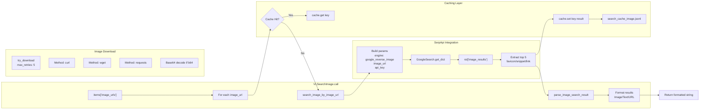
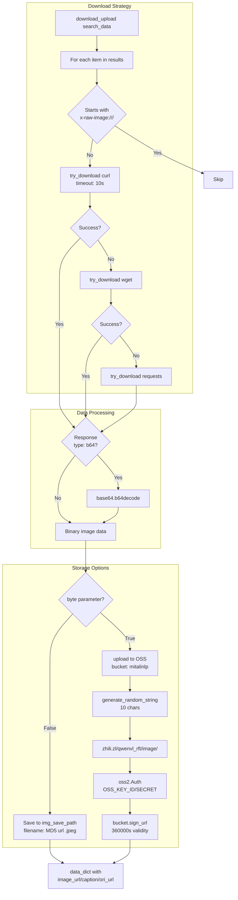
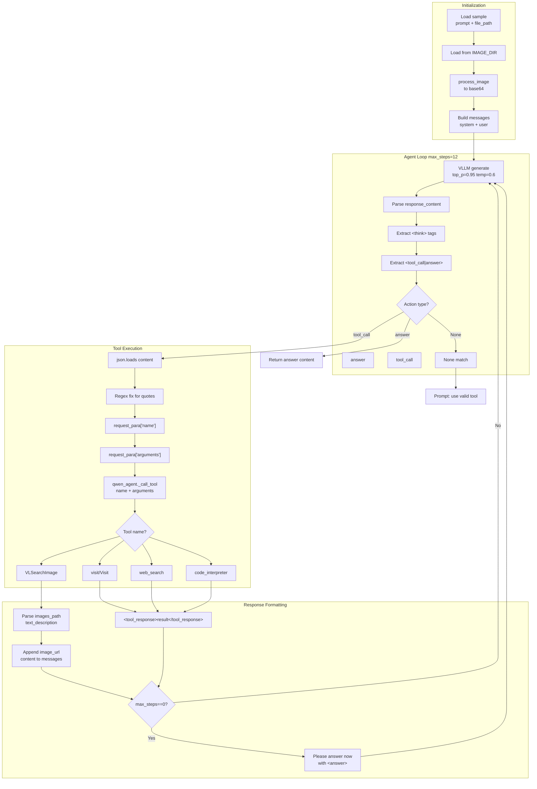
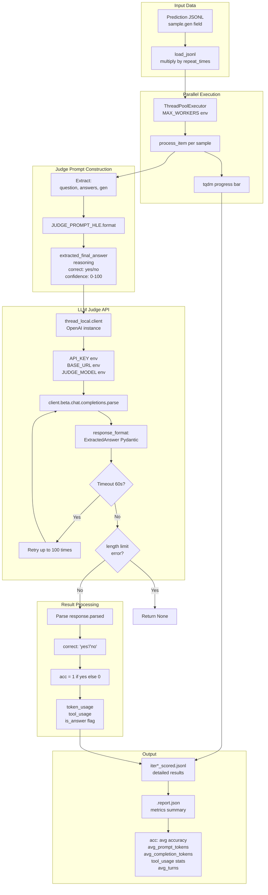
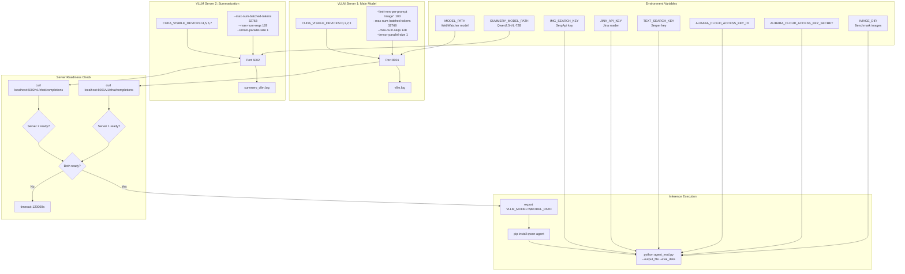

<!-- source: DeepWiki mcp.deepwiki.com · repo Alibaba-NLP/DeepResearch · page 4.2 WebWatcher: Vision-Language Agent · fetched 2026-10-29 -->

# WebWatcher: Vision-Language Agent

<details>
<summary>Relevant source files</summary>

The following files were used as context for generating this wiki page:

- [WebAgent/README.md](WebAgent/README.md)
- [WebAgent/WebWatcher/browsecomp-vl/bc_vl_level1.jsonl](WebAgent/WebWatcher/browsecomp-vl/bc_vl_level1.jsonl)
- [WebAgent/WebWatcher/browsecomp-vl/bc_vl_level2.jsonl](WebAgent/WebWatcher/browsecomp-vl/bc_vl_level2.jsonl)
- [WebAgent/WebWatcher/browsecomp-vl/images/level1.tar](WebAgent/WebWatcher/browsecomp-vl/images/level1.tar)
- [WebAgent/WebWatcher/browsecomp-vl/images/level2.tar](WebAgent/WebWatcher/browsecomp-vl/images/level2.tar)
- [WebAgent/WebWatcher/infer/evaluation/evaluate_hle_official.py](WebAgent/WebWatcher/infer/evaluation/evaluate_hle_official.py)
- [WebAgent/WebWatcher/infer/evaluation/prompt.py](WebAgent/WebWatcher/infer/evaluation/prompt.py)
- [WebAgent/WebWatcher/infer/evaluation/run_eval.sh](WebAgent/WebWatcher/infer/evaluation/run_eval.sh)
- [WebAgent/WebWatcher/infer/scripts_eval/agent_eval.py](WebAgent/WebWatcher/infer/scripts_eval/agent_eval.py)
- [WebAgent/WebWatcher/infer/scripts_eval/download_image.py](WebAgent/WebWatcher/infer/scripts_eval/download_image.py)
- [WebAgent/WebWatcher/infer/scripts_eval/images/hle_imgs.tar](WebAgent/WebWatcher/infer/scripts_eval/images/hle_imgs.tar)
- [WebAgent/WebWatcher/infer/vl_search_r1/eval_data/hle.jsonl](WebAgent/WebWatcher/infer/vl_search_r1/eval_data/hle.jsonl)
- [WebAgent/WebWatcher/infer/vl_search_r1/qwen-agent-o1_search/qwen_agent/tools/private/jialong_visit.py](WebAgent/WebWatcher/infer/vl_search_r1/qwen-agent-o1_search/qwen_agent/tools/private/jialong_visit.py)

</details>


WebWatcher extends the Tongyi DeepResearch agent system with vision-language capabilities, enabling multimodal information-seeking through reverse image search, visual question answering, and integrated web content analysis. This document covers the VLSearchImage tool, multimodal agent orchestration, vision-language benchmarks (HLE, bc_vl), and evaluation infrastructure specific to visual tasks.

For general agent inference and tool architecture, see [MultiTurnReactAgent Architecture](#2.1). For web search and visit tools used alongside visual search, see [Web Tools: Search, Visit, and Image Search](#2.6). For evaluation infrastructure shared across benchmarks, see [Evaluation Framework and LLM Judge](#5.1).

---

## System Architecture

WebWatcher integrates three core components into the Tongyi DeepResearch agent framework: (1) the `VLSearchImage` tool for reverse image search via SerpApi/GoogleSearch, (2) enhanced `Visit` tool with vision-aware content extraction, and (3) a specialized inference pipeline (`OmniSearch`) that handles multimodal inputs and multi-step reasoning.

```mermaid
graph TB
    subgraph "Input Processing"
        UserQuery[User Query + Image]
        ImageProc[Image Processor<br/>AutoProcessor]
        Base64Enc[Base64 Encoding<br/>max_pixels: 1024×28×28]
    end
    
    subgraph "Agent Core: OmniSearch"
        VLLM[VLLM Server<br/>Port 8001<br/>Main Model]
        AgentLoop[Agent Loop<br/>max_steps: 12]
        ToolDispatch[Tool Dispatch<br/>qwen_agent._call_tool]
    end
    
    subgraph "Vision Tools"
        VLSearch[VLSearchImage<br/>@register_tool]
        ImgCache[JSONLCache<br/>search_cache_image.jsonl]
        SerpAPI[SerpApi/GoogleSearch<br/>IMG_SEARCH_KEY]
        OSS[Alibaba OSS Upload<br/>OSS_KEY_ID/SECRET]
    end
    
    subgraph "Web Tools"
        Visit[Visit Tool<br/>Jina + Summarization]
        WebSearch[Web Search<br/>Serper API]
        CodeInterp[Code Interpreter<br/>Python Sandbox]
    end
    
    subgraph "Summarization Service"
        SummaryVLLM[VLLM Server<br/>Port 6002<br/>SUMMERY_MODEL_PATH]
        ExtractorPrompt[EXTRACTOR_PROMPT<br/>rational/evidence/summary]
    end
    
    subgraph "Output"
        ThinkTags["&lt;think&gt; tags"]
        ToolCallTags["&lt;tool_call&gt; JSON"]
        AnswerTags["&lt;answer&gt; tags"]
    end
    
    UserQuery --> ImageProc
    ImageProc --> Base64Enc
    Base64Enc --> VLLM
    
    VLLM --> AgentLoop
    AgentLoop --> ToolDispatch
    
    ToolDispatch --> VLSearch
    ToolDispatch --> Visit
    ToolDispatch --> WebSearch
    ToolDispatch --> CodeInterp
    
    VLSearch --> ImgCache
    ImgCache -.cache miss.-> SerpAPI
    SerpAPI --> OSS
    
    Visit --> SummaryVLLM
    SummaryVLLM --> ExtractorPrompt
    
    AgentLoop --> ThinkTags
    AgentLoop --> ToolCallTags
    AgentLoop --> AnswerTags
```

**Sources**: WebAgent/WebWatcher/infer/scripts_eval/agent_eval.py:132-173, WebAgent/WebWatcher/infer/vl_search_r1/qwen-agent-o1_search/qwen_agent/tools/vl_search_image.py:58-73, WebAgent/WebWatcher/infer/vl_search_r1/qwen-agent-o1_search/qwen_agent/tools/private/visit.py:39-63

---

## VLSearchImage Tool: Reverse Image Search

The `VLSearchImage` tool performs reverse image search using Google's image search API, retrieving visually similar images and associated metadata. It implements caching, multiple download strategies, and optional Alibaba Cloud OSS upload for persistent storage.

### Core Functionality

The tool is registered via `@register_tool("VLSearchImage", allow_overwrite=True)` and accepts an array of image URLs. For each URL, it performs reverse image search and returns up to 5 results containing image paths, snippets, and source URLs.



**Key Implementation Details**:

| Component | Configuration | Purpose |
|-----------|--------------|---------|
| `search_cache_decorator` | Lines 41-55 | Wraps search function to check/update cache |
| `cache` | `JSONLCache` instance | Persistent JSONL-based cache at exit |
| `VL_IMG_SEARCH_ENABLE_CACHE` | Environment variable | Toggle caching on/off |
| `IMG_SEARCH_KEY` | SerpApi key | Authentication for Google reverse search |
| `max_retries` | 10 attempts | Retry logic for API failures |

**Sources**: WebAgent/WebWatcher/infer/vl_search_r1/qwen-agent-o1_search/qwen_agent/tools/vl_search_image.py:41-108

### Image Download and Upload Pipeline

When images need to be stored (controlled by `byte` parameter), the tool downloads image data using a fallback strategy: curl → wget → requests. Downloaded images can be uploaded to Alibaba Cloud OSS or saved locally.



**Download Implementation**: The `try_download` method [vl_search_image.py:114-157]() implements three fallback methods with base64 decoding support for curl responses. For curl, if the response is JSON with `type: 'b64'`, it extracts and decodes `file_b64` field.

**Upload Configuration**:
- OSS Bucket: `mitalinlp`
- OSS Endpoint: `http://oss-cn-hangzhou.aliyuncs.com`
- Target Path: `zhili.zl/qwenvl_rft/image/{random_string}.jpeg`
- Image validation: Minimum size 1024 bytes

**Sources**: WebAgent/WebWatcher/infer/vl_search_r1/qwen-agent-o1_search/qwen_agent/tools/vl_search_image.py:114-257

### Output Format

The tool returns formatted strings with either images and text, or text only:

```
Image: /path/to/image1.jpeg, Text: Description text 1, Webpage Url: https://source1.com

Image: /path/to/image2.jpeg, Text: Description text 2, Webpage Url: https://source2.com
```

If image download fails or no images are found, it returns text-only format:

```
Text: Description text, Webpage Url: https://source.com
```

**Sources**: WebAgent/WebWatcher/infer/vl_search_r1/qwen-agent-o1_search/qwen_agent/tools/vl_search_image.py:259-314

---

## Enhanced Visit Tool with Vision-Aware Summarization

The `Visit` tool in WebWatcher extends the standard webpage reading capability with a dedicated summarization service that extracts structured information aligned with user goals. This is crucial for vision-language tasks where web content provides context for visual queries.

### Architecture and Workflow

```mermaid
graph TB
    subgraph "Visit Tool Entry"
        CallParams["params: url, goal"]
        URLType{URL type?}
        SingleURL[String: single URL]
        MultiURL[List: parallel fetch]
        ThreadPool[ThreadPoolExecutor<br/>max_workers: 3]
    end
    
    subgraph "Content Fetching"
        ReadPage[readpage url goal]
        JinaRetry[Max 10 attempts<br/>alternate jina]
        JinaAPI["GET https://r.jina.ai/url<br/>JINA_API_KEY header"]
        ContentCheck{Valid content?}
        TruncateContent["content[:WEBCONTENT_MAXLENGTH]<br/>150000 chars"]
    end
    
    subgraph "Summarization Service"
        ExtractPrompt[EXTRACTOR_PROMPT.format<br/>webpage_content + goal]
        CallServer[call_server messages<br/>Port 6002]
        VLLM6002["OpenAI client<br/>127.0.0.1:6002<br/>SUMMERY_MODEL_PATH"]
        
        ResponseCheck{Response valid?}
        JSONParse[json.loads raw]
        ExtractJSON[Extract between '&#123;' and '&#125;']
        RetryParse{Parse retries<br/>< 3?}
    end
    
    subgraph "Length Handling"
        LengthCheck{len raw < 10?}
        TruncateRetry[Truncate to 70%<br/>or 25000 final]
        SummaryRetries{Retries<br/>< 3?}
    end
    
    subgraph "Output Formatting"
        BuildOutput["useful_information:<br/>url + goal"]
        AddEvidence["Evidence: raw['evidence']"]
        AddSummary["Summary: raw['summary']"]
        FailureMsg["Evidence: Could not be accessed<br/>Summary: Not processed"]
    end
    
    CallParams --> URLType
    URLType -->|Single| SingleURL
    URLType -->|Multiple| MultiURL
    MultiURL --> ThreadPool
    ThreadPool --> ReadPage
    SingleURL --> ReadPage
    
    ReadPage --> JinaRetry
    JinaRetry --> JinaAPI
    JinaAPI --> ContentCheck
    ContentCheck -->|No| JinaRetry
    ContentCheck -->|Yes| TruncateContent
    
    TruncateContent --> ExtractPrompt
    ExtractPrompt --> CallServer
    CallServer --> VLLM6002
    VLLM6002 --> ResponseCheck
    
    ResponseCheck -->|Yes| LengthCheck
    ResponseCheck -->|No| CallServer
    
    LengthCheck -->|Yes| TruncateRetry
    TruncateRetry --> SummaryRetries
    SummaryRetries -->|Yes| ExtractPrompt
    LengthCheck -->|No| JSONParse
    
    JSONParse --> RetryParse
    RetryParse -->|No| BuildOutput
    RetryParse -->|Yes| CallServer
    
    BuildOutput --> AddEvidence
    AddEvidence --> AddSummary
    AddSummary --> FinalOutput[Return string]
    
    SummaryRetries -->|No| FailureMsg
    RetryParse -->|No after 3| FailureMsg
    FailureMsg --> FinalOutput
```



**Sources**: WebAgent/WebWatcher/infer/vl_search_r1/qwen-agent-o1_search/qwen_agent/tools/private/visit.py:39-239

### EXTRACTOR_PROMPT Structure

The prompt instructs the summarization model to produce structured JSON with three fields:

| Field | Purpose | Content Guidelines |
|-------|---------|-------------------|
| `rational` | Context identification | Locate specific sections/data related to user goal |
| `evidence` | Key extraction | Full original context, can be multiple paragraphs |
| `summary` | Synthesis | Concise paragraph with logical flow and contribution assessment |

**Prompt Template** [visit.py:22-36]():
```
## **Webpage Content** 
{webpage_content}

## **User Goal**
{goal}

## **Task Guidelines**
1. **Content Scanning for Rational**: Locate the **specific sections/data** directly related to the user's goal
2. **Key Extraction for Evidence**: Identify and extract the **most relevant information**, output the **full original context** as far as possible
3. **Summary Output for Summary**: Organize into a concise paragraph with logical flow

**Final Output Format using JSON format has "rational", "evidence", "summary" fields**
```

### Summarization Service Configuration

The `call_server` method [visit.py:88-119]() connects to a separate VLLM server running the summarization model:

| Parameter | Value | Notes |
|-----------|-------|-------|
| `openai_api_base` | `http://127.0.0.1:6002/v1` | Local VLLM server |
| `model` | `SUMMERY_MODEL_PATH` env var | Typically Qwen2.5-VL-72B |
| `max_tries` | 10 | Retry attempts for connection |
| `stop` | `["\n<tool_response>", "<tool_response>"]` | Stop tokens |
| `temperature` | 0.7 | Sampling temperature |

**Content Truncation Strategy**: If summarization fails (response length < 10), the system progressively truncates content:
- Retry 1: 70% of original length
- Retry 2: 49% of original length (70% of 70%)
- Retry 3: 25,000 characters (hard limit)

**Sources**: WebAgent/WebWatcher/infer/vl_search_r1/qwen-agent-o1_search/qwen_agent/tools/private/visit.py:88-232

---

## Vision-Language Agent Pipeline: OmniSearch

The `OmniSearch` class orchestrates multimodal inference by managing image processing, tool execution, and multi-step reasoning. It bridges the VLLM model with vision and web tools, handling the complete lifecycle from image input to final answer.

### Image Processing Pipeline

```mermaid
graph LR
    subgraph "Image Input"
        ImageInput[Image source]
        TypeCheck{Type?}
        DictPath[Dict with 'bytes']
        StrPath[String file path]
        PILImage[PIL.Image.open]
    end
    
    subgraph "Dimension Validation"
        CalcPixels[width × height]
        MaxCheck{> max_pixels<br/>1024×28×28?}
        MinCheck{< min_pixels<br/>256×28×28?}
        ResizeUp[Resize up to min_pixels]
        ResizeDown[Resize down to max_pixels]
    end
    
    subgraph "Format Conversion"
        RGBCheck{Mode == RGB?}
        Convert[Convert to RGB]
        ByteStream[BytesIO buffer]
        SaveJPEG[Save as JPEG]
        Base64Enc[base64.b64encode]
        DataURI["data:image;base64,string"]
    end
    
    ImageInput --> TypeCheck
    TypeCheck -->|dict| DictPath
    TypeCheck -->|str| StrPath
    DictPath --> PILImage
    StrPath --> PILImage
    
    PILImage --> CalcPixels
    CalcPixels --> MaxCheck
    MaxCheck -->|Yes| ResizeDown
    MaxCheck -->|No| MinCheck
    MinCheck -->|Yes| ResizeUp
    
    ResizeDown --> RGBCheck
    ResizeUp --> RGBCheck
    MinCheck -->|No| RGBCheck
    
    RGBCheck -->|No| Convert
    RGBCheck -->|Yes| ByteStream
    Convert --> ByteStream
    
    ByteStream --> SaveJPEG
    SaveJPEG --> Base64Enc
    Base64Enc --> DataURI
```



**Image Size Constraints**:
- `max_pixels`: 1024 × 28 × 28 = 802,816 pixels
- `min_pixels`: 256 × 28 × 28 = 200,704 pixels
- Aspect ratio preserved during resizing
- All images converted to RGB mode

**Sources**: WebAgent/WebWatcher/infer/scripts_eval/agent_eval.py:146-172

### Multi-Step Reasoning Loop

The `run_main` method implements the core agent loop with tool execution and answer extraction:



**Key Configuration**:
- `max_steps`: 12 iterations (configurable)
- Generation retries: 10 attempts with exception handling
- Tool dispatch via `qwen_agent._call_tool(name, arguments, img_save_path, byte)`
- VLSearchImage returns both images and text in tool response
- Other tools return text-only responses wrapped in `<tool_response>` tags

**Sources**: WebAgent/WebWatcher/infer/scripts_eval/agent_eval.py:182-401

### System Prompt Design

The system prompt emphasizes three key principles for vision-language tasks:

```
You are a Web Information Seeking Master. Your task is to thoroughly seek the internet for information and provide accurate answers to visual questions.

As you proceed, adhere to the following principles:

1. Decompose the original visual question into sub-questions and solve them step by step. 
   Summarize the knowledge obtained from the previous round of dialogue, then think about what is next sub-question.
   
2. Whether you can answer the question or not, you should describe the image in detail. 
   If the image includes multiple sub-image, you should describe each one separately.
   
3. You should provide the final answer within 10 turns, regardless of whether all valid information has been collected.
```

**Tool Descriptions** [agent_eval.py:30-128]():
- `web_search`: Batched web searches returning top 10 text excerpts
- `VLSearchImage`: Top 10 images with descriptions, **can only search input image once**
- `visit`: Webpage summarization with specific information goal
- `code_interpreter`: Python code execution for calculations/analysis

**Sources**: WebAgent/WebWatcher/infer/scripts_eval/agent_eval.py:21-128

### Inference with Timeout and Retry

The `infer_with_timeout_retry` wrapper provides fault tolerance:

| Parameter | Value | Purpose |
|-----------|-------|---------|
| `max_retry` | 2 | Maximum retry attempts |
| `timeout_seconds` | 300 | 5-minute timeout per attempt |
| Concurrency | `ThreadPoolExecutor` max_workers=1 | Isolated execution |

On timeout or exception, the method logs the error and retries. After exhausting retries, it returns a sample with `response: 'Timeout/Error'` and `gen: 'Timeout/Error'`.

**Parallel Evaluation**: The `eval` method processes multiple samples concurrently with `max_workers=20`, maintaining result ordering and appending to output file incrementally.

**Sources**: WebAgent/WebWatcher/infer/scripts_eval/agent_eval.py:418-454

---

## Vision-Language Benchmarks

WebWatcher is evaluated on specialized vision-language benchmarks that require visual understanding, web search, and complex reasoning. The two primary benchmark families are HLE (Humanity's Last Exam) and BrowseComp Vision-Language (bc_vl).

### Benchmark Coverage

| Benchmark | Samples | Domains | Task Type | Image Requirement |
|-----------|---------|---------|-----------|-------------------|
| **HLE** | ~200 | Science, Math, History | Expert-level QA | Required for all |
| **bc_vl_v1** | 100 | 10+ domains | Level 1: Direct lookup | Required for all |
| **bc_vl_v2** | 100 | 10+ domains | Level 2: Multi-hop reasoning | Required for all |
| **GAIA** | Variable | General | Real-world tasks | Optional images |
| **LiveVQA** | Variable | Current events | Up-to-date knowledge | Required for all |
| **InfoSeek** | Variable | Entities | Entity-centric queries | Required for all |
| **SimpleVQA** | Variable | General | Simple visual QA | Required for all |
| **MMSearch** | Variable | Search | Multimodal search | Required for all |

**Sources**: WebAgent/WebWatcher/infer/scripts_eval/scripts/eval.sh:89-115, WebAgent/WebWatcher/infer/scripts_eval/agent_eval.py:466-481

### BrowseComp Vision-Language Structure

The bc_vl benchmarks test visual information retrieval across multiple complexity levels:

**Level 1 (bc_vl_level1.jsonl)**: Direct lookup questions requiring visual recognition and single web search:
```json
{
  "question": "Which country produced the movie that won the most Oscars according to the data on this website in the image?",
  "image_path": "https://mitalinlp.oss-cn-hangzhou.aliyuncs.com/browsecomp_vl/level1/level1_1.jpg",
  "answers": ["United States"],
  "domain": "TV"
}
```

**Level 2 (bc_vl_level2.jsonl)**: Multi-hop reasoning requiring visual analysis, entity extraction, and chained web searches:
```json
{
  "question": "In the image, a music project followed up an earlier release from the mid-2020s with a new album. This new album was produced with the help of a renowned producer known for his distinctive production style, which contributed to the album's unique sound. On the tracks numbered 4, 5, and 8 of this new album, what additional instruments did the band member responsible for a variety of roles play?",
  "image_path": "https://mitalinlp.oss-cn-hangzhou.aliyuncs.com/browsecomp_vl/level2/level2_3.jpg",
  "answers": ["Percussion and synthesizer."],
  "domain": "Music"
}
```

**Domain Distribution** (Level 2 sample):
- Music: 9 questions
- Social Science: 4 questions
- Art: 6 questions
- Geography: 10 questions
- History: 15 questions
- Other: 12 questions
- Politics: 10 questions
- Sports: 10 questions
- TV: 9 questions
- Games: 4 questions
- Computer Science: 4 questions
- Engineering: 2 questions
- Math: 2 questions
- Biology: 2 questions
- Physics: 2 questions
- Chemistry: 1 question

**Sources**: WebAgent/WebWatcher/benchmark/bc_vl_level1.jsonl:1-200, WebAgent/WebWatcher/benchmark/bc_vl_level2.jsonl:1-98

### Image Directory Management

Each benchmark requires a dedicated image directory specified via `IMAGE_DIR` environment variable:

```bash
if [ "$benchmark" = "hle" ]; then
  export IMAGE_DIR=scripts_eval/images/hle
elif [ "$benchmark" = "bc_vl_v1" ]; then
  export IMAGE_DIR=scripts_eval/images/bc_vl_v1
elif [ "$benchmark" = "bc_vl_v2" ]; then
  export IMAGE_DIR=scripts_eval/images/bc_vl_v2
# ... other benchmarks
fi
```

The agent loads images from `IMAGE_DIR` by extracting the basename from `sample['file_path']` and constructing the full path:
```python
test_image_dir = os.getenv("IMAGE_DIR")
test_image_name = os.path.basename(sample['file_path'])
image_raw = Image.open(os.path.join(test_image_dir, test_image_name))
```

**Sources**: WebAgent/WebWatcher/infer/scripts_eval/scripts/eval.sh:89-115, WebAgent/WebWatcher/infer/scripts_eval/agent_eval.py:186-188

---

## Evaluation Infrastructure

WebWatcher's evaluation pipeline uses LLM judges (Qwen2.5-32B-Instruct) to assess answer correctness for vision-language tasks, with specialized prompts for different benchmarks.

### HLE Evaluation Pipeline

The HLE benchmark uses a structured JSON output format for judging:



**Sources**: WebAgent/WebWatcher/infer/evaluation/evaluate_hle_official.py:1-245

### Judge Prompts by Benchmark

Different benchmarks require different evaluation criteria encoded in specialized prompts:

**HLE (Humanity's Last Exam)** [evaluate_hle_official.py:40-65]():
- Extracts final answer from response
- Compares against precise correct_answer
- Requires reasoning for match/mismatch
- Outputs confidence score from response
- JSON schema: `{extracted_final_answer, reasoning, correct, confidence, strict: true}`

**BrowseComp (Chinese)** [prompt.py:110-177]():
- Detailed Chinese language evaluation
- Handles multiple correct answer variants in brackets `[[option1, option2]]`
- Multi-aspect answers require all aspects present
- Numeric tolerance for precision matching
- Binary output: `【正确】` or `【错误】`, returned as A or B

**BrowseComp (English)** [prompt.py:180-247]():
- English version of BrowseComp criteria
- Same multi-answer and multi-aspect logic
- Handles hedging and guessing in responses
- Binary output: `[CORRECT]` or `[INCORRECT]`, returned as A or B

**GAIA / General QA** [prompt.py:98-107]():
- Simple template: "Question, Labeled Answer, Predicted Answer"
- Asks if answers are equivalent
- Binary output: "Correct" or "Incorrect"

**Sources**: WebAgent/WebWatcher/infer/evaluation/prompt.py:1-439

### Evaluation Metrics

The evaluation reports compute comprehensive metrics across multiple dimensions:

| Metric Category | Metrics | Description |
|----------------|---------|-------------|
| **Accuracy** | `acc`, `metrics` | Percentage of correct answers |
| **Token Usage** | `avg_prompt_tokens`, `avg_completion_tokens` | Average tokens per sample |
| **Cost Estimates** | `avg_dollars_o4mini`, `avg_dollars_claude` | Estimated API costs |
| **Tool Usage** | `tool_usage`, `tool_usage_correct` | Average tool calls per sample / correct samples |
| **Trajectory** | `avg_turns`, `avg_turns_correct` | Average reasoning steps |
| **Answer Rate** | `is_answer_rate` | Percentage providing final answer |
| **Distribution** | `turns_dist` | Histogram of turns to answer |

**Token Cost Calculation**:
- GPT-4o-mini: `prompt_tokens/1M × $1.10 + completion_tokens/1M × $4.40`
- Claude: `prompt_tokens/1M × $3.00 + completion_tokens/1M × $15.00`

**Sources**: WebAgent/WebWatcher/infer/evaluation/evaluate_hle_official.py:169-244

---

## Deployment and Configuration

WebWatcher requires two separate VLLM servers: one for the main vision-language model and one for webpage summarization. The deployment script orchestrates server startup, environment configuration, and inference execution.

### Server Configuration



**Sources**: WebAgent/WebWatcher/infer/scripts_eval/scripts/eval.sh:1-149

### GPU Allocation Strategy

The 8-GPU split allocates resources based on model size and throughput requirements:

| Server | GPUs | Model Size | Purpose | Concurrency |
|--------|------|------------|---------|-------------|
| Main Model | 0,1,2,3 | 7B+ VL model | Multimodal inference | 128 sequences |
| Summarization | 4,5,6,7 | Qwen2.5-VL-72B | Webpage extraction | 128 sequences |

**Rationale**: The summarization model (72B) requires more GPU memory but processes shorter sequences (webpage content up to 150K chars). The main model handles longer conversations with image inputs but is smaller, enabling higher throughput.

**Sources**: WebAgent/WebWatcher/infer/scripts_eval/scripts/eval.sh:35-38

### Startup and Readiness Protocol

The `eval.sh` script implements a polling-based readiness check:

```bash
timeout=120000  # 120 seconds
start_time=$(date +%s)
server1_ready=false
server2_ready=false

while true; do
    if ! $server1_ready && curl -s http://localhost:8001/v1/chat/completions > /dev/null; then
        echo "Local model (port 8001) is ready!"
        server1_ready=true
    fi
    
    if ! $server2_ready && curl -s http://localhost:6002/v1/chat/completions > /dev/null; then
        echo "Summary model (port 6002) is ready!"
        server2_ready=true
    fi
    
    if $server1_ready && $server2_ready; then
        echo "Both servers are ready for inference!"
        break
    fi
    
    current_time=$(date +%s)
    elapsed=$((current_time - start_time))
    if [ $elapsed -gt $timeout ]; then
        echo "Warning: Server startup timeout after ${timeout} seconds"
        exit 1
    fi
    
    printf 'Waiting for servers to start .....'
    sleep 10
done
```

**Startup Sequence**:
1. Launch both VLLM servers in background
2. Poll endpoints every 10 seconds
3. Timeout after 120 seconds if either server fails
4. Proceed to inference only when both servers respond

**Sources**: WebAgent/WebWatcher/infer/scripts_eval/scripts/eval.sh:44-79

### API Key Configuration

WebWatcher requires five API keys passed as positional arguments to `eval.sh`:

```bash
bash eval.sh <benchmark> <experiment_name> <model_path> <summary_model_path> \
    $IMG_SEARCH_KEY \      # SerpApi for reverse image search
    $JINA_API_KEY \        # Jina.ai for webpage reading
    $TEXT_SEARCH_KEY \     # Serper for text search
    $ALIBABA_CLOUD_ACCESS_KEY_ID \     # OSS upload
    $ALIBABA_CLOUD_ACCESS_KEY_SECRET   # OSS upload
```

These are exported as environment variables before agent execution:

```bash
export IMG_SEARCH_KEY=$5
export JINA_API_KEY=$6
export TEXT_SEARCH_KEY=$7
export ALIBABA_CLOUD_ACCESS_KEY_ID=$8
export ALIBABA_CLOUD_ACCESS_KEY_SECRET=$9
```

**Sources**: WebAgent/WebWatcher/infer/scripts_eval/scripts/eval.sh:18-23

### Qwen-Agent Installation

The script reinstalls qwen-agent from the local modified version before each run:

```bash
pip uninstall qwen-agent
pip install -e vl_search_r1/qwen-agent-o1_search --no-deps
pip install "qwen-agent[code_interpreter]"
```

The `--no-deps` flag prevents dependency conflicts, and the `[code_interpreter]` extra enables Python sandbox execution.

**Sources**: WebAgent/WebWatcher/infer/scripts_eval/scripts/eval.sh:118-120

### Output File Management

Evaluation results are organized by date and benchmark:

```bash
date=$(date +%Y%m%d)
PROJECT_NAME=${date}
SAVE_PATH=scripts_eval/results/${PROJECT_NAME}_${benchmark}
SAVE_FILE=scripts_eval/results/${PROJECT_NAME}_${benchmark}/${EXPERIMENT_NAME}.jsonl
```

Example: Running `bash eval.sh hle exp1 model1 model2 ...` on April 16, 2025 creates:
- Directory: `scripts_eval/results/20250416_hle/`
- Output: `scripts_eval/results/20250416_hle/exp1.jsonl`
- VLLM log: `scripts_eval/results/20250416_hle/exp1_vllm.log`

**Sources**: WebAgent/WebWatcher/infer/scripts_eval/scripts/eval.sh:1-30, 132-135

### Cleanup and Shutdown

After inference completes, the script attempts graceful server shutdown:

```bash
if kill ${vllm_pid}; then
    echo "Successfully shut down VLLM service (PID: ${vllm_pid})"
else
    echo "Warning: Could not shut down VLLM service (PID: ${vllm_pid})"
fi

if kill ${summery_pid}; then
    echo "Successfully shut down Summary VLLM service (PID: ${summery_pid})"
else
    echo "Warning: Could not shut down Summary VLLM service (PID: ${summery_pid})"
fi
```

The `kill` command sends SIGTERM to gracefully terminate VLLM processes. Warnings are logged but do not prevent script completion if processes are already terminated.

**Sources**: WebAgent/WebWatcher/infer/scripts_eval/scripts/eval.sh:138-148

---

## Performance Analysis

WebWatcher's effectiveness depends on the quality of visual search results, summarization accuracy, and multi-step reasoning coherence. The evaluation infrastructure provides detailed breakdowns across these dimensions.

### Key Performance Indicators

| Metric | Description | Calculation |
|--------|-------------|-------------|
| **Pass@1** | Single-attempt accuracy | Percentage of samples with correct first answer |
| **Average Turns** | Reasoning depth | Mean number of tool calls before answer |
| **Tool Usage Distribution** | Tool effectiveness | Calls per tool type (search, visit, VLSearch, code) |
| **Token Efficiency** | Cost-effectiveness | Tokens per correct answer |
| **Is Answer Rate** | Task completion | Percentage reaching final answer vs timeout |

**Trajectory Analysis**: The `turns_dist` counter tracks how many samples require N steps to answer, revealing whether the agent efficiently converges (low turns) or exhaustively explores (high turns).

**Tool Usage Patterns**:
- `tool_usage`: Average calls per tool across all samples
- `tool_usage_correct`: Average calls per tool only for correct answers
- Comparison reveals whether certain tools correlate with success

**Sources**: WebAgent/WebWatcher/infer/evaluation/evaluate_hle_official.py:180-220

### Vision-Language Specific Challenges

The bc_vl Level 2 benchmark exposes common failure modes:

1. **Visual Entity Recognition**: Extracting names, dates, or text from images
2. **Multi-hop Reasoning**: Chaining visual clues to web search results
3. **Context Integration**: Combining image content with webpage information
4. **Temporal Reasoning**: Understanding historical sequences from visual cues

Example Level 2 question requiring all four capabilities:
```
"In the image, a music project followed up an earlier release from the mid-2020s with a new album. 
This new album was produced with the help of a renowned producer known for his distinctive production style. 
On tracks 4, 5, and 8, what additional instruments did the band member play?"
```

This requires:
1. Recognizing album cover in image
2. Searching for album metadata
3. Identifying producer and their style
4. Finding specific track instrumentation

**Sources**: WebAgent/WebWatcher/benchmark/bc_vl_level2.jsonl:3-3

### Comparison with Text-Only Agents

WebWatcher extends standard ReAct agents (see [ReAct and IterResearch Inference Modes](#2.2)) with visual capabilities:

| Feature | Text-Only ReAct | WebWatcher |
|---------|----------------|------------|
| Input Modality | Text only | Text + Images |
| Tool Set | Search, Visit, Code | +VLSearchImage |
| Context Encoding | Token sequences | Token sequences + image embeddings |
| Benchmarks | GAIA, BrowseComp | +HLE, bc_vl |
| Max Context | 110K tokens | 110K tokens + 100 images |

The `--limit-mm-per-prompt '{"image": 100}'` VLLM flag allows up to 100 images per conversation, enabling extensive visual exploration through VLSearchImage results.

**Sources**: WebAgent/WebWatcher/infer/scripts_eval/scripts/eval.sh:35

---

