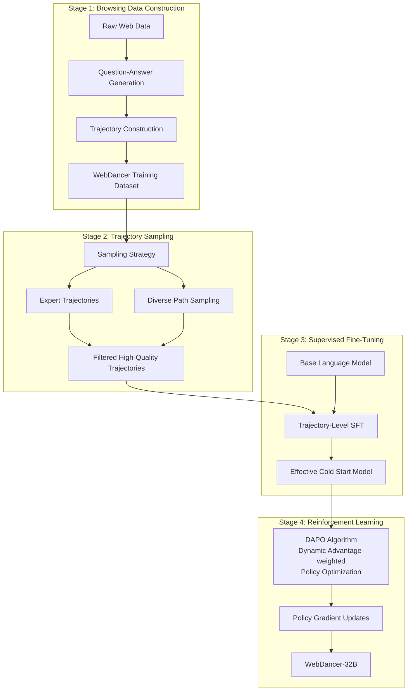
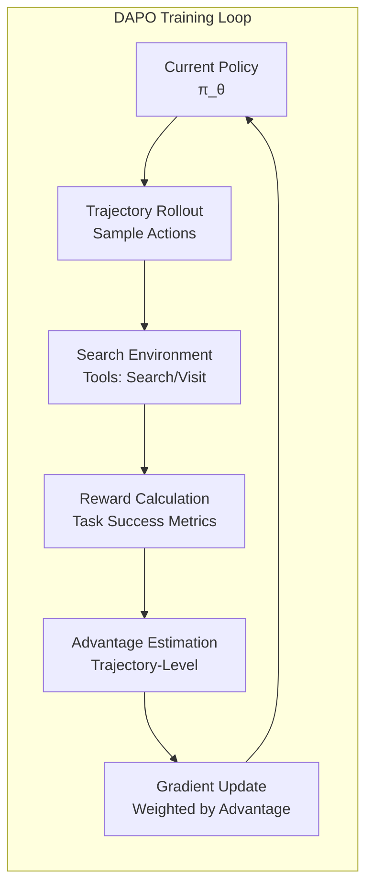
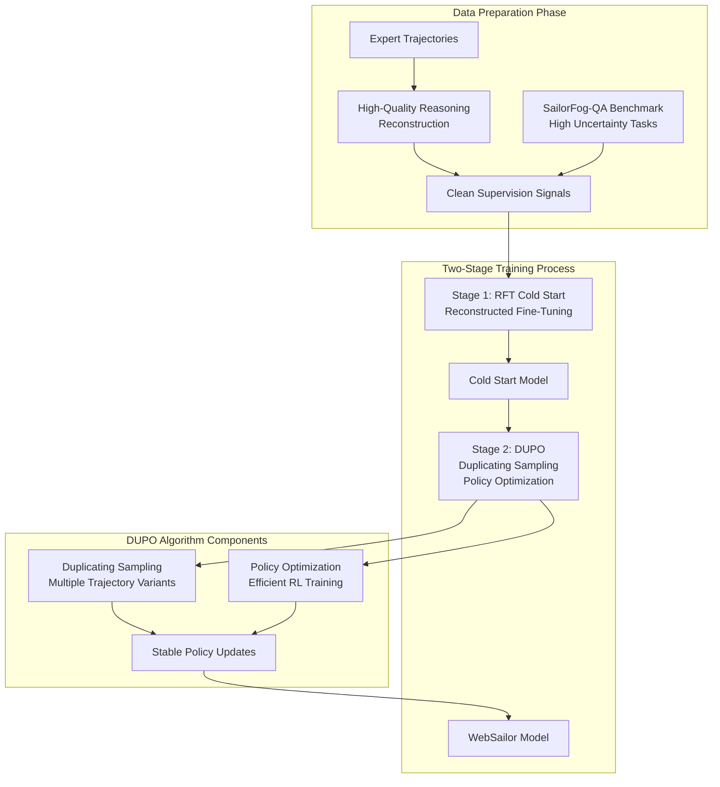
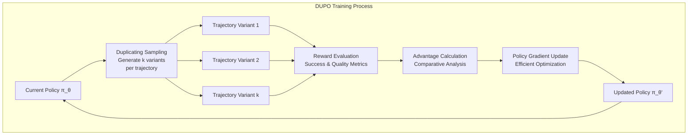
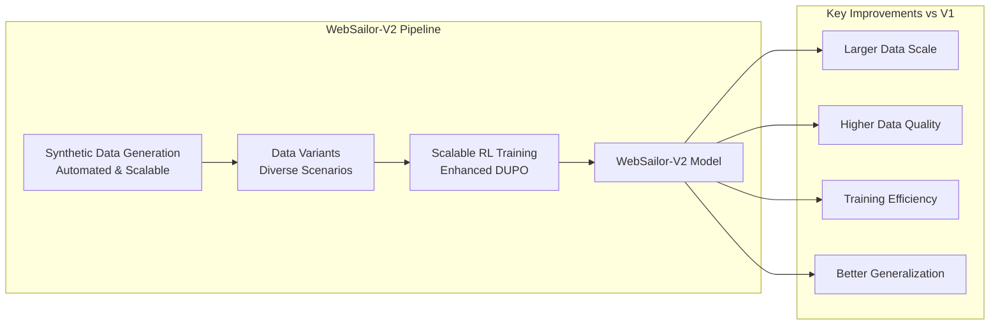
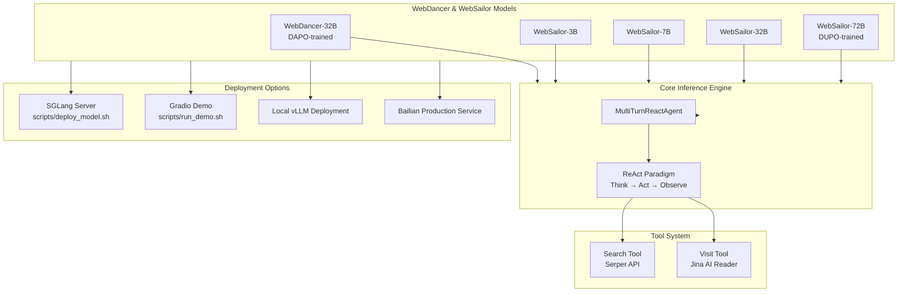

<!-- source: DeepWiki mcp.deepwiki.com · repo Alibaba-NLP/DeepResearch · page 4.3 WebDancer and WebSailor · fetched 2026-10-29 -->

# WebDancer and WebSailor

<details>
<summary>Relevant source files</summary>

The following files were used as context for generating this wiki page:

- [README.md](README.md)
- [WebAgent/README.md](WebAgent/README.md)

</details>


## Purpose and Scope

This document describes **WebDancer** and **WebSailor**, two navigation and information-seeking agents in the Deep Research Agent Family. These agents represent distinct approaches to autonomous web search reasoning:

- **WebDancer**: A native agentic search model trained with a four-stage paradigm using trajectory-level supervision and the DAPO (Dynamic Advantage-weighted Policy Optimization) reinforcement learning algorithm
- **WebSailor**: An agent specialized in super-human reasoning through extended thinking, trained using DUPO (Duplicating Sampling Policy Optimization) and the SailorFog-QA benchmark
- **WebSailor-V2**: An evolution of WebSailor incorporating synthetic data generation and scalable reinforcement learning

Both agents are designed for long-horizon information-seeking tasks and integrate with the core inference system described in [Section 2](#2). For information about other navigation agents like WebWalker, see [Section 4.1](#4.1). For vision-language capabilities, see WebWatcher in [Section 4.2](#4.2).

Sources: [README.md:199-206](), [WebAgent/README.md:1-47]()

---

## WebDancer: Native Search Reasoning Agent

### Overview and Architecture

WebDancer is a 32B-parameter model that implements native agentic search reasoning using the ReAct framework. It is designed for autonomous information-seeking agency, enabling the model to conduct "Deep Research"-like exploration without external orchestration.

**Key Characteristics:**
- **Model Size**: 32B parameters
- **Context Length**: 32K tokens
- **Tool Suite**: Search and Visit tools only
- **Inference Paradigm**: ReAct (Reasoning and Acting)
- **Deployment**: Compatible with SGLang inference engine

Sources: [WebAgent/README.md:31-32](), [WebAgent/README.md:49-57]()

### Four-Stage Training Paradigm

WebDancer's training methodology follows a systematic four-stage approach that progressively builds the agent's autonomous capabilities.



**Stage 1: Browsing Data Construction**
- Automated generation of information-seeking question-answer pairs from web data
- Construction of multi-step search and browsing trajectories
- Creation of task-specific datasets aligned with web navigation objectives

**Stage 2: Trajectory Sampling**
- Strategic sampling of expert trajectories to maximize data quality
- Diverse path exploration to prevent overfitting to specific search patterns
- Filtering mechanisms to retain only high-quality reasoning chains

**Stage 3: Supervised Fine-Tuning (SFT)**
- Trajectory-level supervision fine-tuning for effective cold start
- Training on complete reasoning sequences rather than isolated steps
- Establishes baseline autonomous search capabilities

**Stage 4: Reinforcement Learning with DAPO**
- **DAPO (Dynamic Advantage-weighted Policy Optimization)**: A trajectory-level RL algorithm designed for agentic systems
- Policy gradient updates based on task success and reasoning quality
- Improved generalization through reward-driven exploration

Sources: [WebAgent/README.md:87-92](), [README.md:199]()

### DAPO: Dynamic Advantage-weighted Policy Optimization



DAPO is WebDancer's core RL algorithm that enables scalable training of agentic systems. Key features include:

- **Trajectory-Level Optimization**: Evaluates complete search sessions rather than individual actions
- **Dynamic Advantage Weighting**: Adjusts learning rates based on trajectory quality
- **Stable Training**: Designed for the non-stationary environment of web search
- **Generalization Focus**: Encourages exploration of novel search strategies

Sources: [WebAgent/README.md:91]()

### Performance Metrics

| Benchmark | Metric | Score |
|-----------|--------|-------|
| GAIA | Pass@3 | 64.1% |
| WebWalkerQA | Pass@3 | 62.0% |

WebDancer demonstrates strong performance on complex multi-step reasoning tasks, particularly when multiple attempts (Pass@3) are allowed.

Sources: [WebAgent/README.md:92]()

### Deployment and Usage

WebDancer can be deployed using the provided scripts in the `WebDancer/scripts/` directory:

**Model Deployment:**
```bash
# Deploy using SGLang
bash scripts/deploy_model.sh WebDancer_PATH
```

**Running the Demo:**
```bash
# Configure API keys in run_demo.sh:
# - GOOGLE_SEARCH_KEY (from serper.dev)
# - JINA_API_KEY (from jina.ai)
# - DASHSCOPE_API_KEY (from dashscope.aliyun.com)
bash scripts/run_demo.sh
```

The demo provides a Gradio interface for interactive exploration of WebDancer's capabilities.

Sources: [WebAgent/README.md:94-129]()

---

## WebSailor: Super-human Reasoning Agent

### Overview and Model Variants

WebSailor is a family of models designed to achieve super-human reasoning capabilities through extended thinking and multi-step information seeking. Unlike WebDancer's native search focus, WebSailor emphasizes reconstruction of high-quality reasoning from expert trajectories.

**Model Variants:**

| Model | Parameters | Release Date | Context Length | Performance Highlights |
|-------|-----------|--------------|----------------|----------------------|
| WebSailor-3B | 3B | 2025.07.11 | 32K | Efficient deployment option |
| WebSailor-7B | 7B | 2025.08.06 | 32K | Balanced performance/cost |
| WebSailor-32B | 32B | 2025.08.26 | 32K | SOTA open-source performance |
| WebSailor-72B | 72B | TBD | 32K | 12.0% BrowseComp-en, 30.1% BrowseComp-zh, 55.4% GAIA |

All WebSailor models use the same tool suite: **Search** and **Visit** tools.

Sources: [WebAgent/README.md:49-57](), [WebAgent/README.md:79-85]()

### Post-Training Methodology

WebSailor introduces a complete post-training methodology that enables models to engage in extended thinking and information seeking for extremely complex tasks.



**Key Components:**

1. **Reasoning Reconstruction**: 
   - Extracts concise, high-quality reasoning chains from verbose expert trajectories
   - Filters out noise and redundant information
   - Creates clean supervision signals for training

2. **SailorFog-QA Benchmark**:
   - Scalable QA benchmark with high uncertainty and difficulty
   - Curated through graph sampling and information obfuscation
   - Forces models to conduct extensive information seeking
   - Dataset location: `WebSailor/dataset/sailorfog-QA.jsonl`

3. **Two-Stage Training**:
   - **Stage 1 (RFT Cold Start)**: Reconstructed Fine-Tuning on cleaned expert trajectories
   - **Stage 2 (DUPO)**: Reinforcement learning for generalization and robustness

Sources: [WebAgent/README.md:79-85]()

### DUPO: Duplicating Sampling Policy Optimization

DUPO is WebSailor's core RL algorithm, designed for efficient agentic reinforcement learning with superior effectiveness.



**DUPO Key Features:**

- **Duplicating Sampling**: Generates multiple trajectory variants from the same initial state, enabling more stable advantage estimation
- **Comparative Learning**: Evaluates variants against each other to identify superior strategies
- **Efficient RL**: Reduces sample complexity compared to traditional RL algorithms
- **Effectiveness**: Excels in both effectiveness (task success) and efficiency (training speed)

The duplicating sampling approach allows WebSailor to explore the action space more thoroughly while maintaining stable training dynamics, critical for the high-variance environment of web search.

Sources: [WebAgent/README.md:83]()

### Performance Characteristics

WebSailor-72B (largest variant) demonstrates state-of-the-art performance among open-source agents:

| Benchmark | WebSailor-72B Score | Notes |
|-----------|-------------------|-------|
| BrowseComp-en | 12.0% | English web browsing comprehension |
| BrowseComp-zh | 30.1% | Chinese web browsing comprehension |
| GAIA | 55.4% | General agentic intelligence assessment |

WebSailor-72B significantly outperforms all open-source agents and frameworks while closing the performance gap with leading proprietary systems.

Sources: [WebAgent/README.md:84]()

---

## WebSailor-V2: Synthetic Data and Scalable RL

### Overview

WebSailor-V2 represents an evolution of the original WebSailor methodology, focusing on bridging the chasm to proprietary agents through improved data synthesis and scalable reinforcement learning.



**Key Innovations:**

1. **Synthetic Data Generation**:
   - Fully automated data synthesis pipeline
   - Scales to large volumes without manual curation
   - Generates diverse information-seeking scenarios

2. **Scalable Reinforcement Learning**:
   - Enhanced DUPO algorithm for larger-scale training
   - Improved sample efficiency
   - Better handling of complex reward signals

3. **Performance Target**:
   - Aims to close the gap with proprietary systems (e.g., GPT-4, Claude)
   - Focuses on extremely difficult tasks previously considered unsolvable

Sources: [README.md:206](), [WebAgent/README.md:23]()

---

## Training Methodologies Comparison

The following table compares the training approaches of WebDancer, WebSailor, and WebSailor-V2:

| Aspect | WebDancer | WebSailor | WebSailor-V2 |
|--------|-----------|-----------|--------------|
| **Core Philosophy** | Native search reasoning | Extended thinking reconstruction | Scalable synthetic training |
| **Training Stages** | 4 stages (Data → Sample → SFT → RL) | 2 stages (RFT cold start → DUPO) | 2 stages (Enhanced synthesis → Scalable RL) |
| **RL Algorithm** | DAPO (Dynamic Advantage-weighted) | DUPO (Duplicating Sampling) | Enhanced DUPO |
| **Data Source** | Browsing data construction | Expert trajectory reconstruction | Synthetic data generation |
| **SFT Approach** | Trajectory-level supervision | Reconstructed fine-tuning (RFT) | Synthetic trajectory fine-tuning |
| **Key Innovation** | Autonomous search agency | Super-human reasoning via reconstruction | Bridging to proprietary agents |
| **Benchmark Dataset** | Generic web tasks | SailorFog-QA (high uncertainty) | Enhanced synthetic benchmarks |
| **Model Sizes** | 32B only | 3B, 7B, 32B, 72B | TBD |
| **Pass@k Strategy** | Pass@3 focus | Single-attempt focus | TBD |

Sources: [WebAgent/README.md:79-92](), [README.md:199-206]()

---

## Integration with Core System

Both WebDancer and WebSailor integrate seamlessly with the core Tongyi DeepResearch inference system described in [Section 2](#2).



**Integration Points:**

1. **Model Deployment**:
   - Both agents deploy via SGLang or vLLM servers
   - Scripts: `WebDancer/scripts/deploy_model.sh`, `WebSailor/scripts/deploy_model.sh`

2. **Inference Paradigm**:
   - Compatible with ReAct paradigm (see [Section 2.2](#2.2))
   - Use `MultiTurnReactAgent` class for orchestration (see [Section 2.1](#2.1))

3. **Tool Usage**:
   - Both agents use Search and Visit tools exclusively
   - Tool configuration in `.env` file (see [Section 6.2](#6.2))
   - Search tool via Serper API (see [Section 2.6](#2.6))
   - Visit tool via Jina AI (see [Section 2.6](#2.6))

4. **API Keys Required**:
   - `GOOGLE_SEARCH_KEY`: For Serper.dev search functionality
   - `JINA_API_KEY`: For Jina.ai page reading
   - `DASHSCOPE_API_KEY`: For document parsing (optional)

Sources: [WebAgent/README.md:94-129](), [README.md:102-107]()

---

## Deployment Scripts and Configuration

### WebDancer Deployment

**File Locations:**
- Model deployment: `WebDancer/scripts/deploy_model.sh`
- Demo launch: `WebDancer/scripts/run_demo.sh`
- Requirements: `WebDancer/requirements.txt`

**Configuration Steps:**

1. **Environment Setup**:
   ```bash
   conda create -n webdancer python=3.12
   pip install -r WebDancer/requirements.txt
   ```

2. **Model Deployment**:
   ```bash
   cd WebDancer/scripts
   bash deploy_model.sh /path/to/WebDancer-32B
   ```

3. **API Configuration** (in `run_demo.sh`):
   - Set `GOOGLE_SEARCH_KEY`
   - Set `JINA_API_KEY`
   - Set `DASHSCOPE_API_KEY`

4. **Launch Demo**:
   ```bash
   bash run_demo.sh
   ```

Sources: [WebAgent/README.md:94-129]()

### WebSailor Deployment

WebSailor models can be deployed using similar scripts, with additional support for multiple model sizes:

- **WebSailor-3B**: Can be deployed with Alibaba Cloud's FunctionAI for one-click deployment
- **WebSailor-7B**: Standard deployment via SGLang/vLLM
- **WebSailor-32B**: Standard deployment via SGLang/vLLM
- **WebSailor-72B**: Requires multi-GPU setup (checkpoint coming soon)

The deployment process follows the same pattern as WebDancer, with model-specific paths.

Sources: [WebAgent/README.md:39-43](), [WebAgent/README.md:49-57]()

---

## Performance Benchmarks Summary

### Comparative Performance

The following table summarizes the performance of WebDancer and WebSailor across key benchmarks:

| Model | GAIA | WebWalkerQA | BrowseComp-en | BrowseComp-zh |
|-------|------|-------------|---------------|---------------|
| WebDancer-32B (Pass@3) | 64.1% | 62.0% | - | - |
| WebSailor-72B | 55.4% | - | 12.0% | 30.1% |

**Key Observations:**

1. **WebDancer's Strength**: Excels in multi-attempt scenarios (Pass@3), demonstrating strong sampling diversity
2. **WebSailor's Strength**: Achieves higher single-attempt success on extremely difficult tasks (BrowseComp)
3. **Task Complexity**: BrowseComp benchmarks represent more challenging scenarios requiring extended reasoning
4. **Open-Source Leadership**: WebSailor-72B achieves SOTA performance among open-source agents on BrowseComp

Sources: [WebAgent/README.md:84](), [WebAgent/README.md:92]()

---

## Use Cases and Applications

Both WebDancer and WebSailor are designed for long-horizon information-seeking tasks but excel in different scenarios:

### WebDancer Optimal Use Cases
- Tasks requiring autonomous exploration with minimal guidance
- Scenarios where multiple search attempts can be parallelized (Pass@k)
- Native search reasoning without complex orchestration
- Rapid prototyping of information-seeking applications

### WebSailor Optimal Use Cases
- Extremely complex tasks requiring extended thinking
- High-uncertainty scenarios with incomplete information
- Single-attempt success critical applications
- Tasks requiring super-human reasoning quality
- Production systems where close-to-proprietary performance is needed

### Model Selection Guide

| Requirement | Recommended Model |
|-------------|------------------|
| Low latency, efficient deployment | WebSailor-3B |
| Balanced performance/cost | WebSailor-7B |
| High performance, available GPUs | WebDancer-32B or WebSailor-32B |
| Maximum performance, multi-GPU available | WebSailor-72B |
| Autonomous search agency focus | WebDancer-32B |
| Extended reasoning focus | WebSailor-32B/72B |

Sources: [WebAgent/README.md:79-92]()

---

## Related Projects and Future Work

### SailorFog-QA Dataset

The SailorFog-QA benchmark introduced by WebSailor represents a significant contribution to agentic evaluation:

- **Location**: `WebSailor/dataset/sailorfog-QA.jsonl`
- **Characteristics**: High uncertainty, high difficulty, requires extensive information seeking
- **Construction Method**: Graph sampling and information obfuscation
- **Purpose**: Forces models to engage in deep exploration rather than surface-level retrieval

Sources: [WebAgent/README.md:82]()

### Integration with Other Agents

WebDancer and WebSailor methodologies influence other agents in the family:

1. **WebShaper** ([Section 4.7](#4.7)): Uses similar data synthesis approaches
2. **WebWatcher** ([Section 4.2](#4.2)): Extends WebSailor's reasoning to vision-language tasks
3. **WebLeaper** ([Section 3.2](#3.2)): Incorporates training insights from both agents
4. **Tongyi DeepResearch** ([Section 1](#1)): Integrates techniques from both paradigms

Sources: [README.md:190-216](), [WebAgent/README.md:1-47]()

---

## Conclusion

WebDancer and WebSailor represent complementary approaches to autonomous information-seeking:

- **WebDancer**: Emphasizes native search reasoning through a four-stage training paradigm with DAPO
- **WebSailor**: Focuses on super-human reasoning via trajectory reconstruction and DUPO
- **WebSailor-V2**: Extends the approach with synthetic data and scalable RL for proprietary-level performance

Both agents integrate seamlessly with the core Tongyi DeepResearch system and serve as foundations for the broader Deep Research Agent Family. Their distinct training methodologies and performance characteristics make them suitable for different application scenarios, with model sizes ranging from 3B to 72B parameters to accommodate various deployment constraints.

Sources: [README.md:190-216](), [WebAgent/README.md:1-92]()

---

