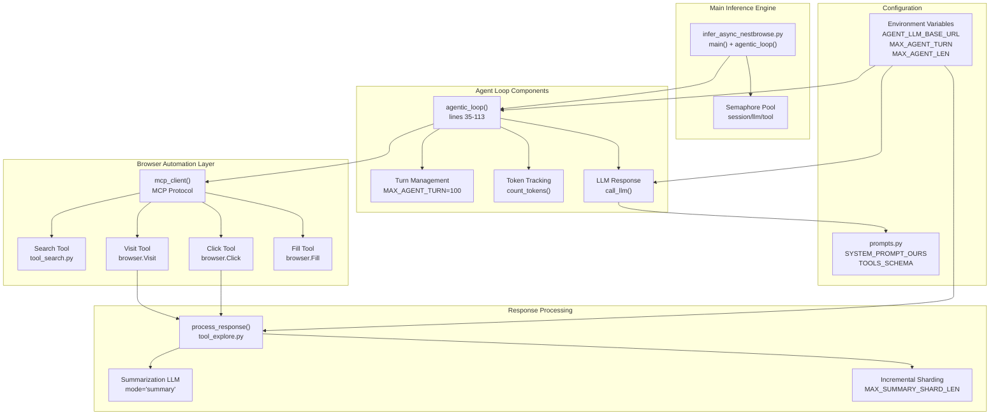
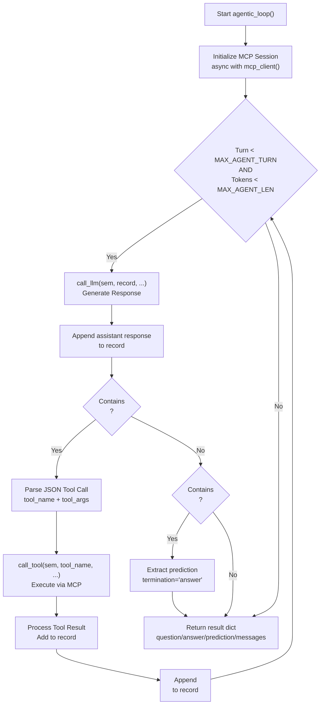
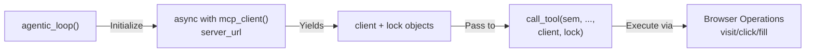
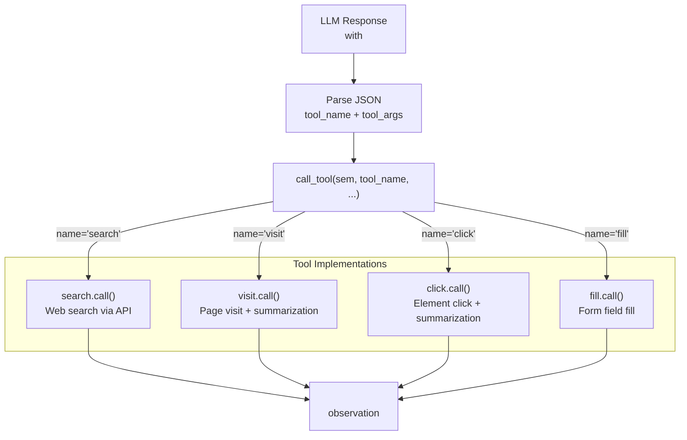
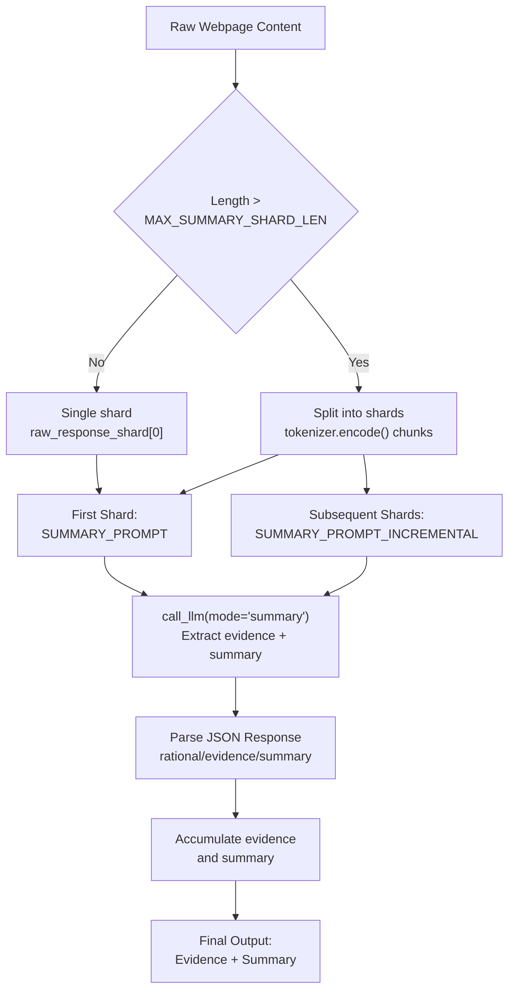
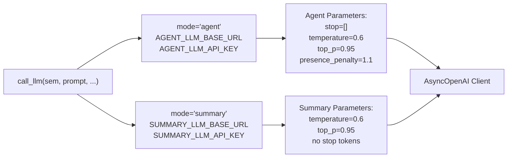
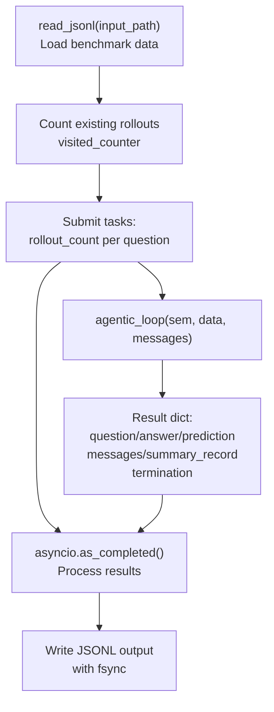

<!-- source: DeepWiki mcp.deepwiki.com · repo Alibaba-NLP/DeepResearch · page 4.4 NestBrowse: Nested Browser Learning · fetched 2026-10-29 -->

# NestBrowse: Nested Browser Learning

<details>
<summary>Relevant source files</summary>

The following files were used as context for generating this wiki page:

- [WebAgent/NestBrowse/data/.gitkeep](WebAgent/NestBrowse/data/.gitkeep)
- [WebAgent/NestBrowse/infer_async_nestbrowse.py](WebAgent/NestBrowse/infer_async_nestbrowse.py)
- [WebAgent/NestBrowse/prompts.py](WebAgent/NestBrowse/prompts.py)
- [WebAgent/NestBrowse/results/.gitkeep](WebAgent/NestBrowse/results/.gitkeep)
- [WebAgent/NestBrowse/toolkit/tool_explore.py](WebAgent/NestBrowse/toolkit/tool_explore.py)
- [WebAgent/NestBrowse/toolkit/tool_search.py](WebAgent/NestBrowse/toolkit/tool_search.py)
- [WebAgent/NestBrowse/utils.py](WebAgent/NestBrowse/utils.py)
- [WebAgent/NestBrowse/vllm_deploy.sh](WebAgent/NestBrowse/vllm_deploy.sh)
- [WebAgent/ParallelMuse/compressed_reasoning_aggregation.py](WebAgent/ParallelMuse/compressed_reasoning_aggregation.py)

</details>


## Purpose and Scope

NestBrowse is an agentic learning system that enables LLMs to interact with web browsers through a nested, iterative exploration pattern. It implements an asynchronous agent loop that can perform web searches, visit pages, click elements, and fill forms through browser automation. The system uses the Model Context Protocol (MCP) for browser control and incorporates intelligent response summarization to handle long webpage content within token limits.

This page documents the technical implementation of NestBrowse's inference pipeline, including its agentic loop, browser automation tools, and response processing mechanisms. For general agent architecture, see [MultiTurnReactAgent Architecture](#2.1). For other optimization agents in the family, see [Other Research Projects](#4.7).

---

## System Architecture Overview

NestBrowse consists of an asynchronous agent loop that orchestrates browser interactions through MCP, manages token budgets, and processes webpage responses through summarization.

**Architecture Diagram: NestBrowse System Components**



Sources: [WebAgent/NestBrowse/infer_async_nestbrowse.py:1-203](), [WebAgent/NestBrowse/utils.py:1-81](), [WebAgent/NestBrowse/toolkit/tool_explore.py:1-47]()

---

## Agentic Loop Implementation

The core inference logic is implemented in the `agentic_loop` function, which maintains a conversation state and iteratively calls tools until a final answer is produced or limits are exceeded.

**Agentic Loop Flow Diagram**



Sources: [WebAgent/NestBrowse/infer_async_nestbrowse.py:35-113]()

### Turn Management and Termination

The agent loop enforces several termination conditions:

| Termination Reason | Condition | Line Reference |
|-------------------|-----------|----------------|
| `answer` | `<answer>` tags found in response | [infer_async_nestbrowse.py:105-107]() |
| `max_turn_exceeded` | Turn count reaches `MAX_AGENT_TURN` (default: 100) | [infer_async_nestbrowse.py:43-44]() |
| `max_length_exceeded` | Token count exceeds `MAX_AGENT_LEN` (default: 128K) | [infer_async_nestbrowse.py:49-51]() |
| `llm_response_error` | LLM response is None or malformed | [infer_async_nestbrowse.py:55-56]() |
| `server_side_error` | MCP server returns error | [infer_async_nestbrowse.py:99-100]() |

The conversation state is maintained in the `record` list, which contains message dictionaries with `role` and `content` fields. Each tool call and response is appended to this list, allowing the LLM to maintain context across turns.

Sources: [WebAgent/NestBrowse/infer_async_nestbrowse.py:35-113]()

### Token Budget Management

Token counting is performed using a tokenizer instance to ensure conversations stay within context limits:

```python
# From utils.py
def count_tokens(text, tokenizer):
    if isinstance(text, str):
        return len(tokenizer.encode(text))
    
    tokens = tokenizer.apply_chat_template(text, tokenize=True)
    return len(tokens)
```

The system checks token count before each turn and terminates if `MAX_AGENT_LEN` is exceeded. The tokenizer is initialized globally in the main script.

Sources: [WebAgent/NestBrowse/utils.py:76-81](), [WebAgent/NestBrowse/infer_async_nestbrowse.py:49-51](), [WebAgent/NestBrowse/infer_async_nestbrowse.py:167-172]()

---

## MCP Client Integration

NestBrowse uses the Model Context Protocol (MCP) to communicate with a browser automation server. The MCP client is implemented as an async context manager that establishes a persistent connection to the browser server.

**MCP Integration Pattern**



The client and lock objects are passed to tool functions to ensure thread-safe browser operations. The connection is maintained for the entire agent session and automatically cleaned up when the context exits.

Sources: [WebAgent/NestBrowse/infer_async_nestbrowse.py:47](), [WebAgent/NestBrowse/infer_async_nestbrowse.py:14](), [WebAgent/NestBrowse/infer_async_nestbrowse.py:162]()

---

## Browser Automation Tools

NestBrowse provides four core tools for browser interaction, each defined with a JSON schema in the system prompt.

### Tool Schemas and Dispatch

**Tool Dispatch Architecture**



Sources: [WebAgent/NestBrowse/infer_async_nestbrowse.py:19-33](), [WebAgent/NestBrowse/infer_async_nestbrowse.py:60-96]()

### Search Tool

The `Search` tool performs web searches and returns formatted results. Configuration is obtained from the main DeepResearch inference folder.

**Tool Definition:**
```json
{
  "name": "search",
  "description": "Perform Google web searches then returns a string of the top search results. Accepts multiple queries.",
  "parameters": {
    "query": {
      "type": "array",
      "items": {"type": "string"},
      "description": "The list of search queries."
    }
  }
}
```

Sources: [WebAgent/NestBrowse/prompts.py:72](), [WebAgent/NestBrowse/toolkit/tool_search.py:1-5](), [WebAgent/NestBrowse/infer_async_nestbrowse.py:196]()

### Visit Tool

The `Visit` tool navigates to a URL and returns a summarized version of the page content based on the specified goal.

**Tool Definition:**
```json
{
  "name": "visit",
  "description": "Visit the webpage and return a summary of its content.",
  "parameters": {
    "url": {"type": "string"},
    "goal": {"type": "string", "description": "what information you want to extract"}
  }
}
```

The visit operation integrates with the response processing pipeline to handle long content through summarization.

Sources: [WebAgent/NestBrowse/prompts.py:73](), [WebAgent/NestBrowse/infer_async_nestbrowse.py:197]()

### Click Tool

The `Click` tool interacts with clickable elements identified by reference IDs from previous visit/click results.

**Tool Definition:**
```json
{
  "name": "click",
  "description": "Click an identified element based on its reference index and return a summary of the content after clicking.",
  "parameters": {
    "ref": {"type": "string", "description": "Must come from [ref=XXX] notation"},
    "goal": {"type": "string"}
  }
}
```

Elements must be identified from the "Evidence in page" section of previous tool responses, ensuring the agent only clicks on valid, currently visible elements.

Sources: [WebAgent/NestBrowse/prompts.py:74](), [WebAgent/NestBrowse/infer_async_nestbrowse.py:198]()

### Fill Tool

The `Fill` tool enters text into input fields identified by reference IDs.

**Tool Definition:**
```json
{
  "name": "fill",
  "description": "Enter text content into an input field and return the filled state.",
  "parameters": {
    "ref": {"type": "string", "description": "Must come from [ref=XXX] notation"},
    "text": {"type": "string"}
  }
}
```

Sources: [WebAgent/NestBrowse/prompts.py:75](), [WebAgent/NestBrowse/infer_async_nestbrowse.py:199]()

---

## Response Processing and Summarization

Long webpage content is processed through an incremental summarization pipeline to extract relevant information while staying within token limits.

**Summarization Pipeline**



Sources: [WebAgent/NestBrowse/toolkit/tool_explore.py:7-47]()

### Incremental Summarization Strategy

The `process_response` function handles long content by:

1. **Shard Detection**: If content exceeds `MAX_SUMMARY_SHARD_LEN` (default: 64K tokens), it's split into chunks
2. **First Pass**: The first shard is processed with `SUMMARY_PROMPT` to extract initial evidence and summary
3. **Incremental Passes**: Subsequent shards use `SUMMARY_PROMPT_INCREMENTAL`, which includes existing evidence/summary in the prompt
4. **Consolidation**: Each pass updates the accumulated evidence and summary

The output format is structured as:
```
Evidence in page:
[Extracted evidence text]

Summary:
[Consolidated summary text]
```

Sources: [WebAgent/NestBrowse/toolkit/tool_explore.py:7-47]()

### Summarization Prompts

Two distinct prompts are used for response processing:

| Prompt Type | Purpose | Fields Extracted | Line Reference |
|-------------|---------|------------------|----------------|
| `SUMMARY_PROMPT` | Initial extraction from first shard | rational, evidence, summary | [prompts.py:2-17]() |
| `SUMMARY_PROMPT_INCREMENTAL` | Incremental processing with existing context | rational, evidence, summary | [prompts.py:21-44]() |

The system prompt for summarization (`SYSTEM_PROMPT_SUMMARY_OURS`) enforces strict JSON output format with no extraneous text, wrapped in `<useful_info>` tags.

Sources: [WebAgent/NestBrowse/prompts.py:2-59]()

---

## LLM Communication

NestBrowse uses separate LLM endpoints for agent reasoning and summarization, configurable through environment variables.

**LLM Call Modes**



Sources: [WebAgent/NestBrowse/utils.py:9-63]()

### Retry Logic and Error Handling

The `call_llm` function implements robust retry logic:

- **Retry Count**: Up to 10 attempts per call
- **Token Reduction**: On non-timeout errors, `max_tokens` is halved
- **URL Pool**: Can randomly select from multiple base URLs if configured as a list
- **Semaphore Control**: Enforces concurrency limits via `sem['llm']`

Sources: [WebAgent/NestBrowse/utils.py:26-63]()

---

## Inference Configuration

NestBrowse requires several configuration parameters set through environment variables and script constants.

### Configuration Parameters

| Parameter | Default Value | Purpose | Line Reference |
|-----------|---------------|---------|----------------|
| `BROWSER_SERVER_URL` | User-defined | MCP browser server endpoint | [infer_async_nestbrowse.py:162]() |
| `AGENT_LLM_BASE_URL` | `http://localhost:8000/v1` | Agent LLM API endpoint | [infer_async_nestbrowse.py:164]() |
| `AGENT_LLM_API_KEY` | `EMPTY` | Authentication key | [infer_async_nestbrowse.py:165]() |
| `MAX_AGENT_TURN` | `100` | Maximum turns per episode | [infer_async_nestbrowse.py:171]() |
| `MAX_AGENT_LEN` | `128 * 1024` | Maximum context tokens | [infer_async_nestbrowse.py:172]() |
| `MAX_SINGLE_GEN_TOKENS` | `32 * 1024` | Maximum tokens per generation | [infer_async_nestbrowse.py:173]() |
| `MAX_SUMMARY_SHARD_LEN` | `64 * 1024` | Shard size for summarization | [infer_async_nestbrowse.py:174]() |
| `MAX_WORKERS` | `16` | Concurrent session limit | [infer_async_nestbrowse.py:177]() |

Sources: [WebAgent/NestBrowse/infer_async_nestbrowse.py:161-190]()

### Concurrency Control with Semaphores

NestBrowse uses three semaphore pools to manage concurrent operations:

```python
sem = {
    'session': asyncio.Semaphore(MAX_WORKERS),  # MCP sessions
    'llm': asyncio.Semaphore(MAX_WORKERS),      # LLM calls
    'tool': asyncio.Semaphore(MAX_WORKERS),     # Tool executions
}
```

This ensures controlled parallelism across different operation types, preventing resource exhaustion.

Sources: [WebAgent/NestBrowse/infer_async_nestbrowse.py:178-182]()

---

## Rollout Generation and Output Format

The main script orchestrates multiple rollouts per question, tracking completion and writing results incrementally.

**Rollout Orchestration Flow**



Sources: [WebAgent/NestBrowse/infer_async_nestbrowse.py:116-159]()

### Output Schema

Each line in the output JSONL file contains:

| Field | Type | Description |
|-------|------|-------------|
| `question` | string | Original question from dataset |
| `answer` | string | Ground truth answer from dataset |
| `prediction` | string | Agent's final prediction (or `[No Prediction]`) |
| `messages` | list[dict] | Full conversation history including tool calls/responses |
| `summary_record` | list[dict] | Summarization call history for debugging |
| `termination` | string | Reason for episode termination |

The `messages` field contains the complete trajectory with roles (`system`, `user`, `assistant`) and tool metadata.

Sources: [WebAgent/NestBrowse/infer_async_nestbrowse.py:113](), [WebAgent/NestBrowse/infer_async_nestbrowse.py:145-158]()

### Rollout Count Management

The system tracks existing rollouts by question to avoid duplication:

1. Load existing output file (if exists)
2. Count rollouts per question using `Counter`
3. Calculate remaining rollouts needed: `rollout_count - (visited + pending)`
4. Submit only the required number of tasks

This allows resuming interrupted evaluation runs without wasting computation.

Sources: [WebAgent/NestBrowse/infer_async_nestbrowse.py:118-141]()

---

## Model Deployment

NestBrowse models are deployed using vLLM for efficient inference.

### vLLM Deployment Script

The deployment script configures a vLLM server with appropriate parameters:

```bash
MODEL_PATH="[MODEL_PATH]"
python -m vllm.entrypoints.openai.api_server \
    --model $MODEL_PATH \
    --port 8000 \
    --max-model-len 131072 \
    --tensor-parallel-size 4 \
    --gpu-memory-utilization 0.8
```

**Configuration Parameters:**
- `max-model-len`: 131072 tokens (128K context)
- `tensor-parallel-size`: 4 GPUs for distributed inference
- `gpu-memory-utilization`: 0.8 (80% of available GPU memory)
- `port`: 8000 (matches default `AGENT_LLM_BASE_URL`)

The server exposes an OpenAI-compatible API that the inference script connects to via `AsyncOpenAI` client.

Sources: [WebAgent/NestBrowse/vllm_deploy.sh:1-7]()

---

## System Prompt and Tool Schema

The system prompt defines the agent's behavior and available tools.

### Agent System Prompt Structure

The `SYSTEM_PROMPT_OURS` establishes the agent as a browser-use agent with specific capabilities:

1. **Core Function**: "Conduct thorough, multi-source investigations into any topic"
2. **Response Format**: Final answer must be wrapped in `<answer></answer>` tags
3. **Tool Schema**: Four tools defined in XML format (search, visit, click, fill)
4. **Tool Call Format**: JSON objects wrapped in `<tool_call></tool_call>` tags

The prompt is injected as the system message at the start of each conversation.

Sources: [WebAgent/NestBrowse/prompts.py:63-82](), [WebAgent/NestBrowse/infer_async_nestbrowse.py:136-137]()

### Tool Call Format Requirements

Tool calls must follow strict JSON formatting:

```json
{
  "name": "tool_name",
  "arguments": {
    "param1": "value1",
    "param2": "value2"
  }
}
```

The agent response is parsed to extract this JSON, and arguments can be either a JSON object or a JSON string (which is then parsed again).

Sources: [WebAgent/NestBrowse/infer_async_nestbrowse.py:60-95]()

---

## Comparison with ParallelMuse Integration

While NestBrowse focuses on browser automation, it can be integrated with ParallelMuse's compressed reasoning aggregation for ensemble approaches.

**Integration Pattern:**
1. Generate multiple NestBrowse rollouts per question
2. Extract trajectories from rollout outputs
3. Use ParallelMuse's `call_state_report` to generate reports from each trajectory
4. Aggregate reports with `call_info_integrate` to produce final answer

This pattern is implemented in [WebAgent/ParallelMuse/compressed_reasoning_aggregation.py]() and can consume NestBrowse's JSONL output format directly.

Sources: [WebAgent/ParallelMuse/compressed_reasoning_aggregation.py:236-250]()

---

