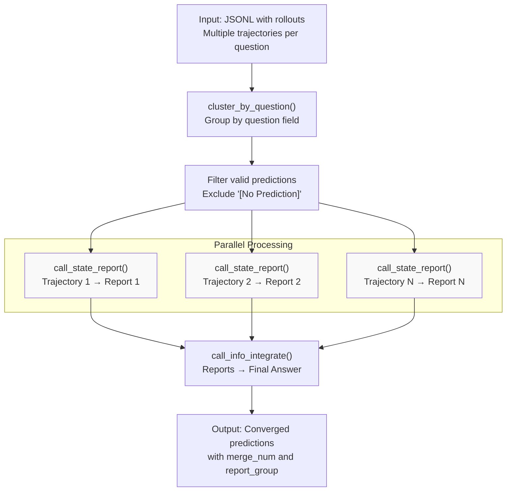
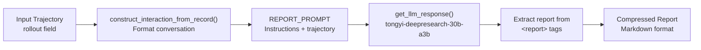
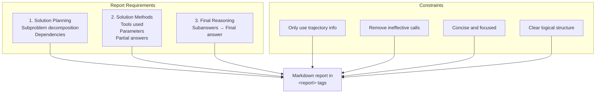
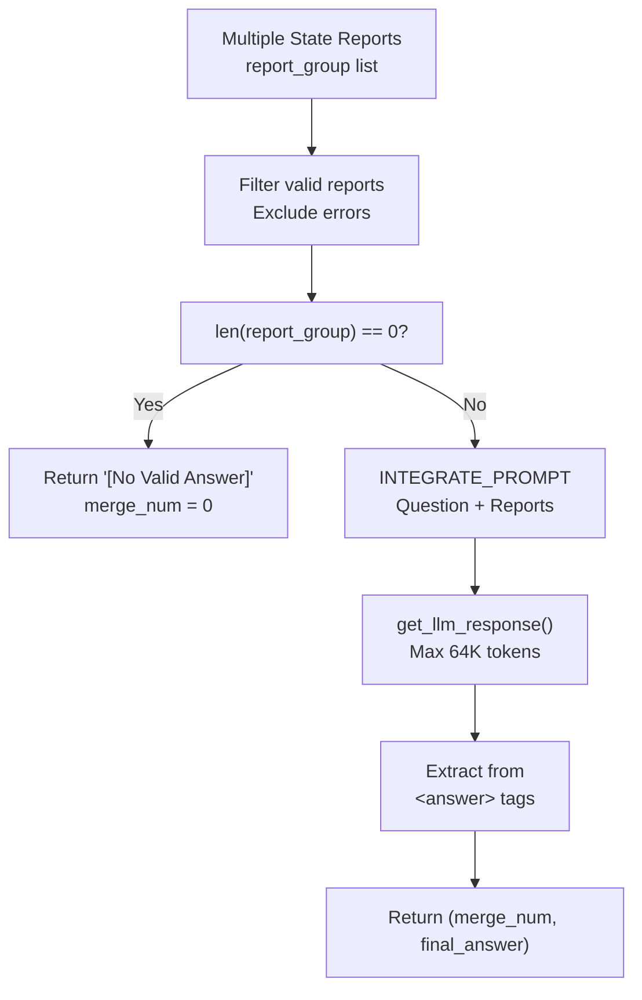
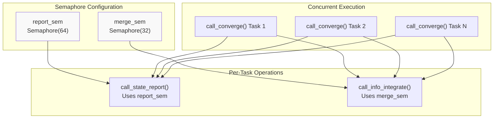
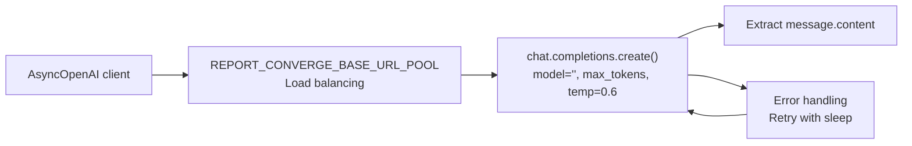
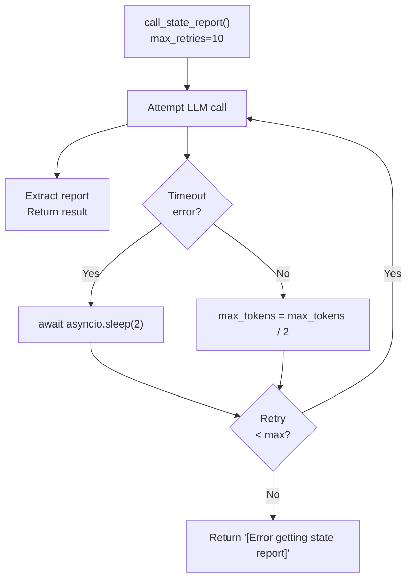

<!-- source: DeepWiki mcp.deepwiki.com · repo Alibaba-NLP/DeepResearch · page 4.5 ParallelMuse: Parallel Reasoning Aggregation · fetched 2026-10-29 -->

# ParallelMuse: Parallel Reasoning Aggregation

<details>
<summary>Relevant source files</summary>

The following files were used as context for generating this wiki page:

- [WebAgent/NestBrowse/toolkit/tool_explore.py](WebAgent/NestBrowse/toolkit/tool_explore.py)
- [WebAgent/NestBrowse/toolkit/tool_search.py](WebAgent/NestBrowse/toolkit/tool_search.py)
- [WebAgent/NestBrowse/utils.py](WebAgent/NestBrowse/utils.py)
- [WebAgent/NestBrowse/vllm_deploy.sh](WebAgent/NestBrowse/vllm_deploy.sh)
- [WebAgent/ParallelMuse/compressed_reasoning_aggregation.py](WebAgent/ParallelMuse/compressed_reasoning_aggregation.py)

</details>


ParallelMuse is a reasoning aggregation framework that combines multiple independent problem-solving trajectories into a single high-quality answer through compressed state reporting and information integration. This system enables parallel exploration of different reasoning paths and then synthesizes them using a two-stage LLM-based convergence process.

**Scope**: This page covers the ParallelMuse implementation for aggregating parallel reasoning trajectories. For the base ReAct agent that generates individual trajectories, see [MultiTurnReactAgent Architecture](#2.1). For the IterResearch Heavy mode that can generate multiple trajectories, see [Inference Paradigms](#2.2).

## Overview and Architecture

ParallelMuse addresses the challenge of combining insights from multiple independent reasoning attempts on the same question. Rather than selecting a single "best" trajectory or averaging predictions, it employs a two-stage compression and integration approach:

1. **State Report Generation**: Each trajectory is compressed into a concise problem-solving report that captures planning, methods, and reasoning
2. **Information Integration**: Multiple reports are analyzed together to produce a final answer that critically evaluates and synthesizes information

The system is implemented as an asynchronous Python script that processes JSONL files containing rollout trajectories.

### Core Workflow



**Sources**: [WebAgent/ParallelMuse/compressed_reasoning_aggregation.py:236-294]()

## State Report Generation

The state report generation stage transforms verbose agent trajectories into concise, analyzable problem-solving reports. This compression is critical for enabling the integration stage to effectively compare and synthesize information from multiple sources.

### Report Generation Process

The `call_state_report()` function implements the report generation logic:



**Sources**: [WebAgent/ParallelMuse/compressed_reasoning_aggregation.py:159-193]()

### Trajectory Formatting

The `construct_interaction_from_record()` function converts the raw message list into a human-readable interaction format:

| Message Type | Detection | Output Format |
|--------------|-----------|---------------|
| Tool Call | `role == 'assistant'` + `<tool_call>` tags | `**assistant:**\n*Thinking:* ...\n*Tool Call:* ...` |
| Tool Response | `role == 'user'` + `<tool_response>` tags | `**Tool Response:**\n...` |
| Final Answer | `role == 'assistant'` without `<tool_call>` | `**assistant:**\n*Thinking:* ...\n*Answer:* ...` |
| System/User | Other messages | `**{role}:**\n{content}` |

This formatting preserves the logical structure while making it easy for the LLM to understand the problem-solving flow.

**Sources**: [WebAgent/ParallelMuse/compressed_reasoning_aggregation.py:124-156]()

### Report Prompt Structure

The `REPORT_PROMPT` instructs the LLM to distill trajectories into structured reports:



The prompt explicitly requires:
- **Solution Planning**: Identification of subproblems and their dependencies
- **Solution Methods**: Tool invocations, parameters, and essential fragments of tool results (not full outputs)
- **Final Reasoning**: The logical chain from subanswers to final answer
- **Conciseness**: Removal of irrelevant content and ineffective tool calls

**Sources**: [WebAgent/ParallelMuse/compressed_reasoning_aggregation.py:26-45]()

## Information Integration

After generating individual reports, the integration stage combines them into a final answer. This is implemented by `call_info_integrate()`, which critically evaluates multiple reports to produce the most accurate answer.

### Integration Architecture



**Sources**: [WebAgent/ParallelMuse/compressed_reasoning_aggregation.py:196-233]()

### Integration Prompt Requirements

The `INTEGRATE_PROMPT` establishes strict requirements for the integration process:

| Requirement | Description |
|-------------|-------------|
| **Critical Evaluation** | Identify inconsistencies; determine which reports are trustworthy |
| **Consensus Detection** | Multiple reports with same conclusion increase likelihood of correctness |
| **Verification Required** | Even consensus must be verified through reflection |
| **Definitive Answer** | Cannot decline to answer; every question has a certain answer |
| **Confidence Weighting** | Reports without clear final answers have reduced confidence |
| **Single Selection** | Must select one report as having the most correct answer |
| **No Tool Calls** | Must rely solely on provided information |
| **No Merging** | Cannot merge different answers or create overly broad answers |
| **Short-Form Answer** | Directly answer the question without restating reports |

**Sources**: [WebAgent/ParallelMuse/compressed_reasoning_aggregation.py:48-68]()

## Asynchronous Processing Architecture

ParallelMuse uses Python's `asyncio` to process multiple trajectories concurrently while controlling resource usage through semaphores.

### Concurrency Control



The semaphore limits prevent overwhelming the LLM API:
- **Report Semaphore**: Allows up to 64 concurrent state report generation requests
- **Merge Semaphore**: Allows up to 32 concurrent integration requests

**Sources**: [WebAgent/ParallelMuse/compressed_reasoning_aggregation.py:252-260]()

### LLM Communication

The `get_llm_response()` function handles communication with the vLLM server:



Key configuration parameters:
- **Temperature**: 0.6 (moderate randomness)
- **Top-p**: 0.95 (nucleus sampling)
- **Presence Penalty**: 1.1 (encourage diverse vocabulary)
- **Max Tokens**: 32K for reports, 64K for integration
- **Retry Logic**: Up to 10 retries with exponential backoff
- **Dynamic Token Adjustment**: Halves max_tokens on non-timeout errors

**Sources**: [WebAgent/ParallelMuse/compressed_reasoning_aggregation.py:75-98]()

## Data Formats and Structures

### Input Format

ParallelMuse expects JSONL files where each line represents a trajectory from an agent rollout:

```json
{
  "question": "What is the capital of France?",
  "answer": "Paris",
  "rollout": [
    {"role": "system", "content": "..."},
    {"role": "user", "content": "..."},
    {"role": "assistant", "content": "<tool_call>...</tool_call>"},
    {"role": "user", "content": "<tool_response>...</tool_response>"},
    {"role": "assistant", "content": "<answer>...</answer>"}
  ],
  "prediction": "Paris",
  "termination_reason": "answer"
}
```

**Sources**: [WebAgent/ParallelMuse/compressed_reasoning_aggregation.py:101-121]()

### Clustering Logic

The `cluster_by_question()` function groups trajectories by their question field:

```python
def cluster_by_question(dataset):
    cluster = defaultdict(list)
    for item in dataset:
        cluster[item['question']].append(item)
    return list(cluster.values())
```

This creates groups where each group contains all trajectories attempting to solve the same question.

**Sources**: [WebAgent/ParallelMuse/compressed_reasoning_aggregation.py:117-121]()

### Output Format

The output JSONL file contains converged results:

```json
{
  "question": "What is the capital of France?",
  "answer": "Paris",
  "prediction": "Paris",
  "merge_num": 3,
  "report_group": ["Report 1...", "Report 2...", "Report 3..."],
  "traj_group": [...]
}
```

| Field | Type | Description |
|-------|------|-------------|
| `question` | string | Original question |
| `answer` | string | Ground truth answer |
| `prediction` | string | Final converged prediction |
| `merge_num` | int | Number of valid reports integrated (0 if none) |
| `report_group` | list[string] | All generated state reports |
| `traj_group` | list[object] | Original trajectory objects |

**Sources**: [WebAgent/ParallelMuse/compressed_reasoning_aggregation.py:236-249]()

## Configuration and Deployment

### LLM Server Configuration

ParallelMuse connects to vLLM servers hosting the Tongyi-DeepResearch-30B-A3B model:

```python
# tongyi-deepresearch-30b-a3b
REPORT_CONVERGE_BASE_URL_POOL = [
    "http://localhost:8000/v1",
    # You can add more LLM API URLs here to balance the workload.
]
REPORT_CONVERGE_API_KEY = "EMPTY"
```

Multiple base URLs can be added to distribute load across multiple vLLM instances. The system randomly selects from the pool for each request.

**Sources**: [WebAgent/ParallelMuse/compressed_reasoning_aggregation.py:14-19]()

### System Prompt

The `CONVERGE_SYSTEM_PROMPT` is minimal, allowing the user prompts to provide specific instructions:

```python
CONVERGE_SYSTEM_PROMPT = """Follow the user's instructions and present your answer in the format they request.
""".strip()
```

**Sources**: [WebAgent/ParallelMuse/compressed_reasoning_aggregation.py:22-23]()

### Execution

To run ParallelMuse:

1. **Prepare Input**: Generate multiple rollout trajectories for each question using the inference system
2. **Configure Path**: Set `data_path` in the `main()` function to point to your rollout JSONL file
3. **Run Script**: Execute `python compressed_reasoning_aggregation.py`
4. **Output**: Results are written incrementally to `{data_path}_converge_info.jsonl`

```python
async def main():
    data_path = "[YOUR-ROLLOUT-FILE-PATH-HERE]"  # TODO
    # ... processing logic ...
```

**Sources**: [WebAgent/ParallelMuse/compressed_reasoning_aggregation.py:252-292]()

## Error Handling and Retry Logic

### Retry Mechanism in Report Generation



**Sources**: [WebAgent/ParallelMuse/compressed_reasoning_aggregation.py:159-193]()

### Error States and Handling

| Error Type | Detection | Handling | Final State |
|------------|-----------|----------|-------------|
| LLM API Error | Exception in `get_llm_response()` | Sleep 2s, retry up to 10 times | `"[Error getting visit response]"` |
| Timeout | `"time out"` in exception | Sleep 2s, no token reduction | Preserve max_tokens |
| Other Errors | Any other exception | Sleep 2s, halve max_tokens | Reduce context window |
| No Prediction | `prediction == '[No Prediction]'` | Skip report generation | `"[Error getting state report]"` |
| No Valid Reports | `len(report_group) == 0` after filtering | Skip integration | `(0, "[No Valid Answer]")` |

The system implements progressive token reduction to handle context overflow issues while preserving timeout retry attempts at full capacity.

**Sources**: [WebAgent/ParallelMuse/compressed_reasoning_aggregation.py:159-233]()

### Incremental Output

Results are written incrementally to handle long-running jobs and enable recovery from failures:

```python
with open(f"{data_path.replace('.jsonl', f'_{mode}.jsonl')}", "a") as f:
    for future in tqdm(asyncio.as_completed(tasks), total=len(tasks)):
        try:
            result = await future
            results.append(result)
            f.write(json.dumps(result, ensure_ascii=False) + "\n")
            f.flush()
            os.fsync(f.fileno())  # Force write to disk
        except Exception as e:
            # Log exception details
```

The use of `f.flush()` and `os.fsync()` ensures that results are durably written even if the process crashes.

**Sources**: [WebAgent/ParallelMuse/compressed_reasoning_aggregation.py:277-291]()

## Integration with Tongyi DeepResearch

ParallelMuse provides the reasoning aggregation capability that enables test-time scaling in Tongyi DeepResearch. By generating multiple independent trajectories (through multiple inference runs or IterResearch Heavy mode) and then converging them, the system can achieve higher accuracy through:

1. **Parallel Exploration**: Different reasoning paths may discover different evidence
2. **Error Correction**: Multiple trajectories reduce the impact of individual errors
3. **Confidence Calibration**: Consensus across reports increases confidence
4. **Critical Evaluation**: The integration stage can identify and reject flawed reasoning

This approach is complementary to the IterResearch Heavy paradigm (see [Inference Paradigms](#2.2)), which focuses on iterative deepening within a single trajectory.

**Sources**: [WebAgent/ParallelMuse/compressed_reasoning_aggregation.py:1-295]()

---

