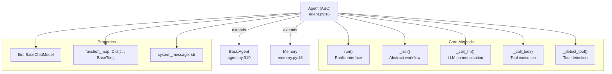
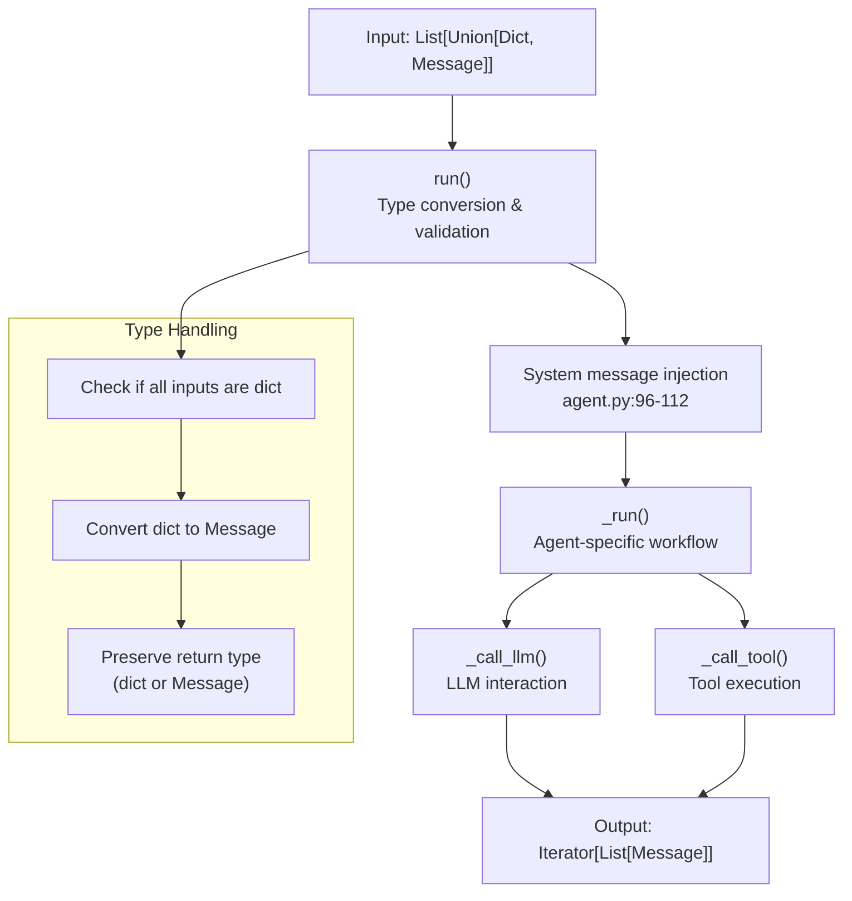
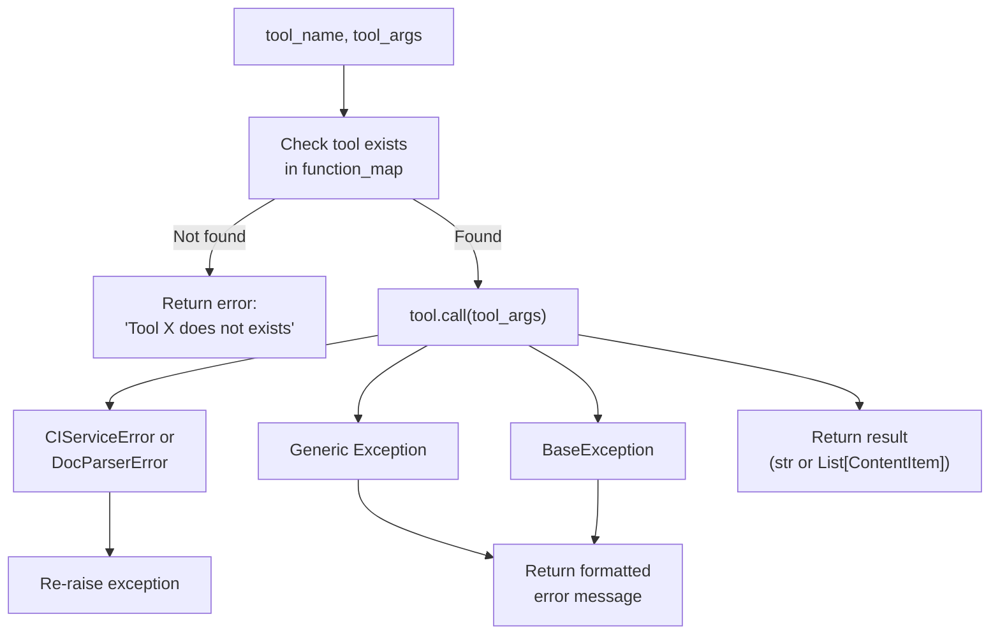
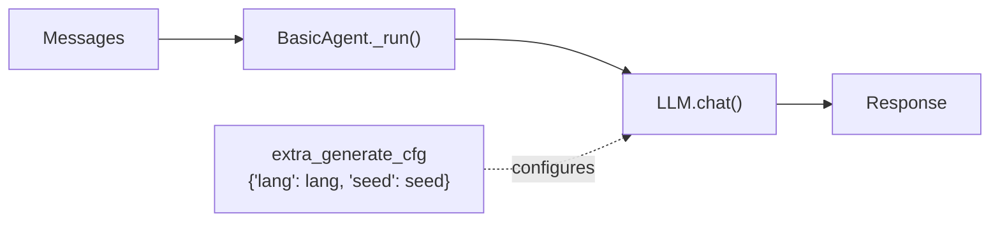
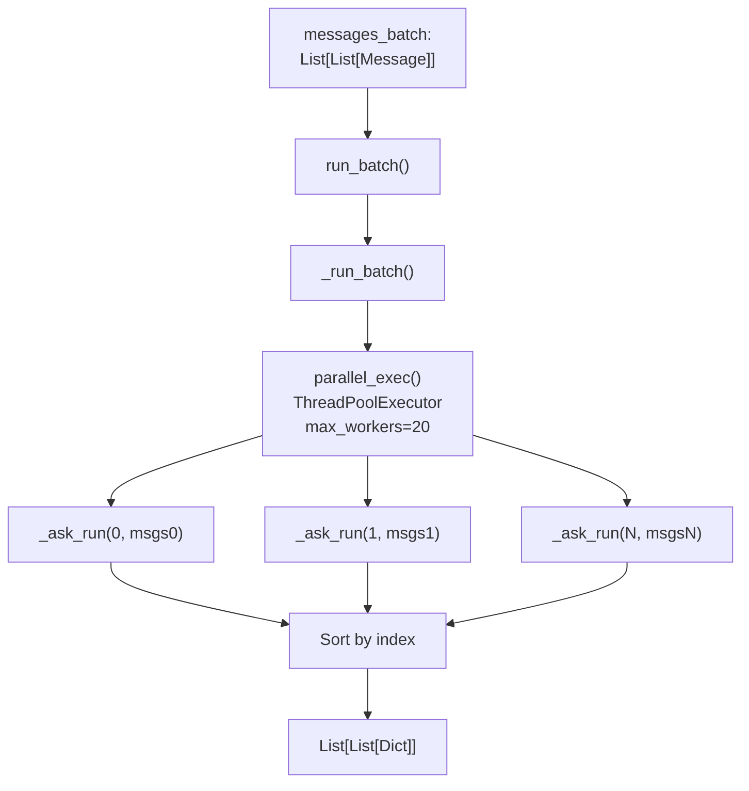
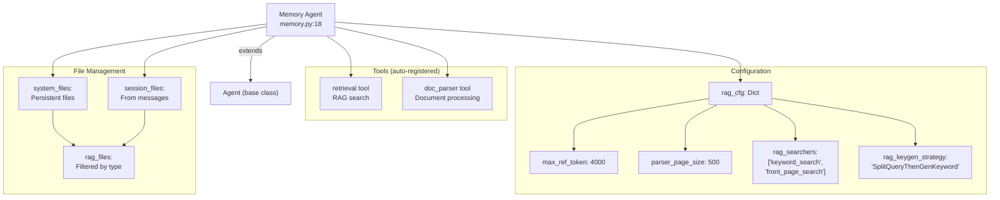
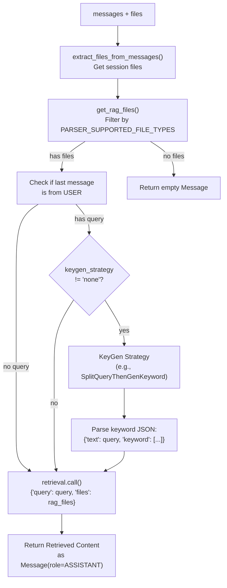
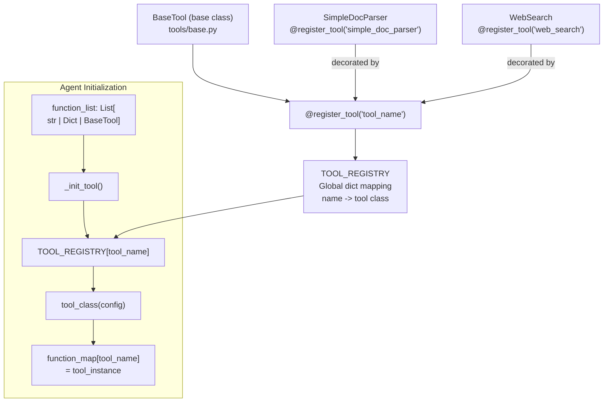
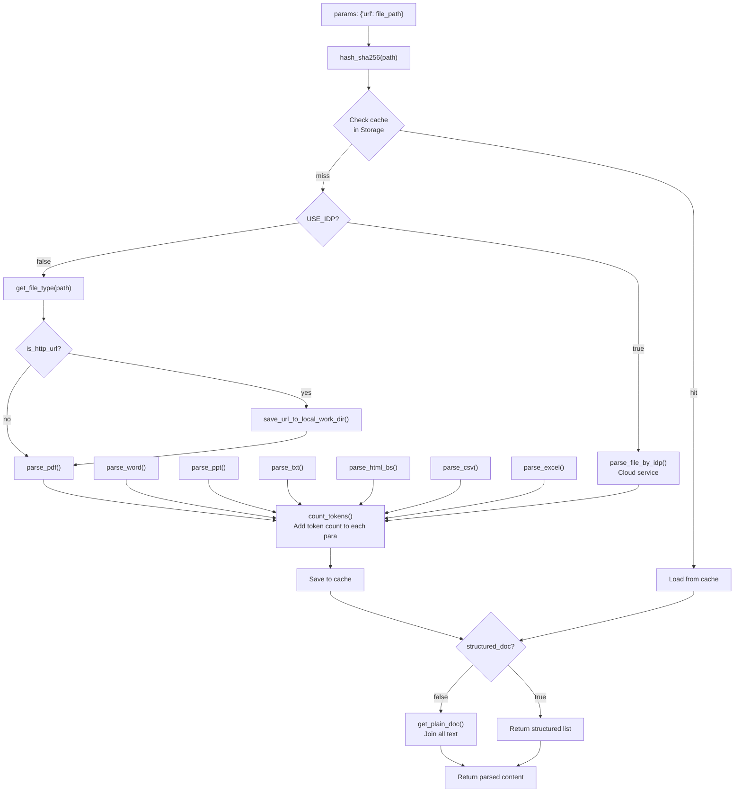
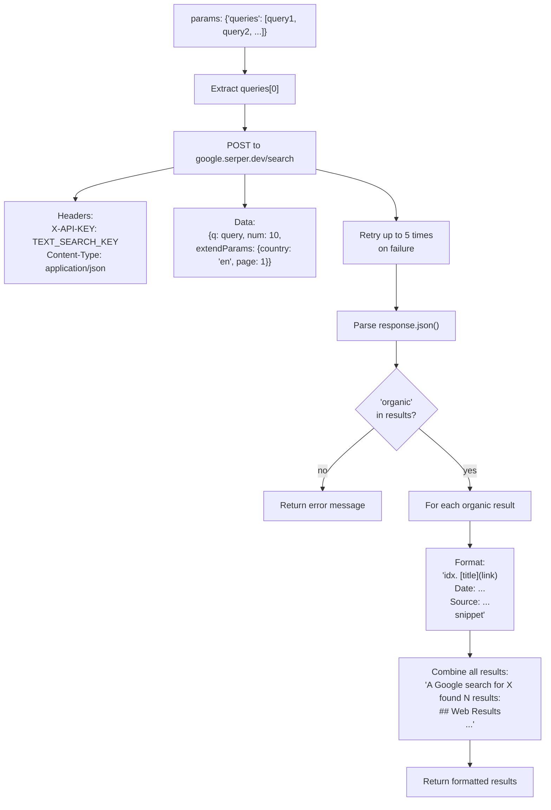

<!-- source: DeepWiki mcp.deepwiki.com · repo Alibaba-NLP/DeepResearch · page 4.6 Qwen-Agent Framework · fetched 2026-10-29 -->

# Qwen-Agent Framework

<details>
<summary>Relevant source files</summary>

The following files were used as context for generating this wiki page:

- [WebAgent/WebDancer/demos/llm/__pycache__/oai.cpython-313.pyc](WebAgent/WebDancer/demos/llm/__pycache__/oai.cpython-313.pyc)
- [WebAgent/WebDancer/demos/llm/oai.py](WebAgent/WebDancer/demos/llm/oai.py)
- [WebAgent/WebWatcher/infer/docker_env/requirements.txt](WebAgent/WebWatcher/infer/docker_env/requirements.txt)
- [WebAgent/WebWatcher/infer/vl_search_r1/qwen-agent-o1_search/qwen_agent/__init__.py](WebAgent/WebWatcher/infer/vl_search_r1/qwen-agent-o1_search/qwen_agent/__init__.py)
- [WebAgent/WebWatcher/infer/vl_search_r1/qwen-agent-o1_search/qwen_agent/agent.py](WebAgent/WebWatcher/infer/vl_search_r1/qwen-agent-o1_search/qwen_agent/agent.py)
- [WebAgent/WebWatcher/infer/vl_search_r1/qwen-agent-o1_search/qwen_agent/memory/memory.py](WebAgent/WebWatcher/infer/vl_search_r1/qwen-agent-o1_search/qwen_agent/memory/memory.py)
- [WebAgent/WebWatcher/infer/vl_search_r1/qwen-agent-o1_search/qwen_agent/tools/private/nlp_web_search.py](WebAgent/WebWatcher/infer/vl_search_r1/qwen-agent-o1_search/qwen_agent/tools/private/nlp_web_search.py)
- [WebAgent/WebWatcher/infer/vl_search_r1/qwen-agent-o1_search/qwen_agent/tools/private/prompt.py](WebAgent/WebWatcher/infer/vl_search_r1/qwen-agent-o1_search/qwen_agent/tools/private/prompt.py)
- [WebAgent/WebWatcher/infer/vl_search_r1/qwen-agent-o1_search/qwen_agent/tools/simple_doc_parser.py](WebAgent/WebWatcher/infer/vl_search_r1/qwen-agent-o1_search/qwen_agent/tools/simple_doc_parser.py)
- [WebAgent/WebWatcher/infer/vl_search_r1/qwen-agent-o1_search/setup.py](WebAgent/WebWatcher/infer/vl_search_r1/qwen-agent-o1_search/setup.py)
- [inference/file_tools/__pycache__/file_parser.cpython-313.pyc](inference/file_tools/__pycache__/file_parser.cpython-313.pyc)
- [inference/file_tools/file_parser.py](inference/file_tools/file_parser.py)

</details>


## Purpose and Scope

This page documents the `qwen-agent` framework, a lightweight agent architecture used primarily by WebWatcher and other Deep Research Agent Family projects. The framework provides a modular system for building LLM-based agents with tool calling capabilities, RAG (Retrieval-Augmented Generation), and extensible tool registration.

**Note:** This framework is distinct from the core inference engine described in [Core Inference Engine](#2). While the main DeepResearch system uses `MultiTurnReactAgent` (see [MultiTurnReactAgent Architecture](#2.1)), the qwen-agent framework is an alternative implementation used in specialized research projects like WebWatcher (see [WebWatcher: Vision-Language Agent](#4.2)).

The framework consists of three primary components:
1. **Agent Base Class**: Abstract interface for agent implementations with message handling and tool orchestration
2. **Memory Agent**: RAG-enabled agent for document processing and retrieval
3. **Tool Registration System**: Extensible mechanism for registering and invoking external tools

---

## Agent Base Class Architecture

### Class Hierarchy and Core Abstractions

The framework is built around an abstract `Agent` base class that defines the contract for all agent implementations. The hierarchy follows a simple pattern where concrete agents implement the `_run` method to define their specific workflows.

**Diagram: Agent Class Hierarchy**



Sources: [WebAgent/WebWatcher/infer/vl_search_r1/qwen-agent-o1_search/qwen_agent/agent.py:16-138]()

### Initialization and Configuration

The `Agent` constructor accepts several key parameters that configure the agent's behavior:

| Parameter | Type | Description |
|-----------|------|-------------|
| `function_list` | `List[Union[str, Dict, BaseTool]]` | Tools available to the agent |
| `llm` | `Union[dict, BaseChatModel]` | LLM model configuration or instance |
| `system_message` | `str` | System instruction for LLM chat |
| `name` | `str` | Agent identifier |
| `description` | `str` | Agent description for multi-agent scenarios |

**Tool Initialization Pattern:**

The agent supports three ways to specify tools:
1. **String name**: `'code_interpreter'` - looks up tool in `TOOL_REGISTRY`
2. **Configuration dict**: `{'name': 'code_interpreter', 'timeout': 10}` - passes config to tool constructor
3. **Tool instance**: `CodeInterpreter()` - uses the provided instance directly

Sources: [WebAgent/WebWatcher/infer/vl_search_r1/qwen-agent-o1_search/qwen_agent/agent.py:23-56](), [WebAgent/WebWatcher/infer/vl_search_r1/qwen-agent-o1_search/qwen_agent/agent.py:266-284]()

### Message Processing Pipeline

The agent implements a two-layer message processing pattern that separates public interface from internal workflow:

**Diagram: Message Processing Flow**



Sources: [WebAgent/WebWatcher/infer/vl_search_r1/qwen-agent-o1_search/qwen_agent/agent.py:64-122]()

**Key Implementation Details:**

1. **Type Conversion** [agent.py:77-88](): The `run` method converts all input messages to `Message` objects internally, but preserves the original type for output (dict or Message based on input).

2. **System Message Injection** [agent.py:96-112](): If no system message exists in the input, the agent's `system_message` is automatically prepended. If a system message exists but doesn't contain the agent's instruction, it's prepended to the existing content.

3. **Language Detection** [agent.py:90-94](): The framework automatically detects Chinese vs English messages using `has_chinese_messages()` to select appropriate prompts.

4. **Streaming Interface** [agent.py:57-62](): The `run_nonstream` method is a convenience wrapper that consumes the entire iterator and returns only the final response.

Sources: [WebAgent/WebWatcher/infer/vl_search_r1/qwen-agent-o1_search/qwen_agent/agent.py:64-122]()

### Tool Calling Mechanism

The agent provides two methods for tool interaction: detection and execution.

**Tool Detection** [agent.py:286-306](): The `_detect_tool` method inspects a message for function calls in the standard format:

```python
def _detect_tool(self, message: Message) -> Tuple[bool, str, str, str]:
    # Returns: (has_tool_call, func_name, func_args, text)
```

This method checks for `message.function_call` and extracts the tool name and arguments. It returns a tuple indicating whether a tool call is present, along with the tool details.

**Tool Execution** [agent.py:217-264](): The `_call_tool` method executes tools with comprehensive error handling:

**Diagram: Tool Execution Error Handling**



Sources: [WebAgent/WebWatcher/infer/vl_search_r1/qwen-agent-o1_search/qwen_agent/agent.py:217-264]()

The error handling strategy:
- **Critical errors** (`CIServiceError`, `DocParserError`): Re-raised to halt execution
- **Recoverable errors** (`Exception`): Converted to error messages returned to the agent
- **Fatal errors** (`BaseException`): Logged as `[FATAL]` but converted to error messages

Sources: [WebAgent/WebWatcher/infer/vl_search_r1/qwen-agent-o1_search/qwen_agent/agent.py:217-264]()

### BasicAgent Implementation

The `BasicAgent` class is the simplest concrete implementation, providing a minimal workflow that directly calls the LLM without any tool orchestration:

**Diagram: BasicAgent Workflow**



Sources: [WebAgent/WebWatcher/infer/vl_search_r1/qwen-agent-o1_search/qwen_agent/agent.py:310-316]()

This minimal implementation is useful as a baseline or for scenarios where no tool calling is needed. The agent simply forwards messages to the LLM with language and seed configuration.

Sources: [WebAgent/WebWatcher/infer/vl_search_r1/qwen-agent-o1_search/qwen_agent/agent.py:310-316]()

### Batch Processing Support

The framework includes parallel batch processing capabilities for handling multiple conversations simultaneously:

**Diagram: Batch Processing Architecture**



Sources: [WebAgent/WebWatcher/infer/vl_search_r1/qwen-agent-o1_search/qwen_agent/agent.py:140-187]()

The batch processing method:
1. Validates and converts all messages to `Message` objects
2. Detects language for each conversation
3. Executes conversations in parallel using `ThreadPoolExecutor` with 20 workers
4. Adds jitter (0.5s) to prevent thundering herd
5. Sorts results by original index to preserve order
6. Converts all outputs to dict format

Sources: [WebAgent/WebWatcher/infer/vl_search_r1/qwen-agent-o1_search/qwen_agent/agent.py:140-187]()

---

## Memory Agent for RAG

The `Memory` agent is a specialized agent that extends the base `Agent` class to provide Retrieval-Augmented Generation (RAG) capabilities. It automatically processes document files and retrieves relevant context for user queries.

### Memory Class Architecture

**Diagram: Memory Agent Components**



Sources: [WebAgent/WebWatcher/infer/vl_search_r1/qwen-agent-o1_search/qwen_agent/memory/memory.py:18-60]()

### Configuration Parameters

The `Memory` agent accepts a `rag_cfg` dictionary with the following parameters:

| Parameter | Default | Description |
|-----------|---------|-------------|
| `max_ref_token` | 4000 | Maximum tokens for retrieved context |
| `parser_page_size` | 500 | Page size for document parsing |
| `rag_searchers` | `['keyword_search', 'front_page_search']` | Search strategies to use |
| `rag_keygen_strategy` | `'SplitQueryThenGenKeyword'` | Keyword generation strategy |

Sources: [WebAgent/WebWatcher/infer/vl_search_r1/qwen-agent-o1_search/qwen_agent/memory/memory.py:42-46]()

### RAG Pipeline Workflow

**Diagram: Memory Agent RAG Pipeline**



Sources: [WebAgent/WebWatcher/infer/vl_search_r1/qwen-agent-o1_search/qwen_agent/memory/memory.py:64-127]()

### Keyword Generation Strategy

When a user query exists, the Memory agent can generate optimized search keywords before retrieval:

1. **Strategy Selection** [memory.py:90-94](): The strategy class is dynamically imported from `qwen_agent.agents.keygen_strategies` based on the configured name (e.g., `SplitQueryThenGenKeyword`).

2. **Keyword Generation** [memory.py:95-115](): The strategy agent is instantiated with the LLM and generates keywords by processing the user query. The output is expected to be a JSON object with a `text` field and optional keyword fields.

3. **JSON Parsing** [memory.py:104-115](): The generated keywords are parsed from JSON format (with support for `json5` and markdown code blocks). If parsing fails, the original query is used.

Sources: [WebAgent/WebWatcher/infer/vl_search_r1/qwen-agent-o1_search/qwen_agent/memory/memory.py:86-116]()

### Supported File Types

The Memory agent filters files based on the following supported types:

```python
PARSER_SUPPORTED_FILE_TYPES = ['pdf', 'docx', 'pptx', 'txt', 'html', 'csv', 'tsv', 'xlsx', 'xls']
```

Sources: [WebAgent/WebWatcher/infer/vl_search_r1/qwen-agent-o1_search/qwen_agent/memory/memory.py:16](), [WebAgent/WebWatcher/infer/vl_search_r1/qwen-agent-o1_search/qwen_agent/memory/memory.py:129-137]()

The `get_rag_files` method combines:
- **System files**: Persistent files provided during initialization [memory.py:62]()
- **Session files**: Files extracted from message attachments [memory.py:129]()

Only files matching the supported types are included in the final RAG file list.

Sources: [WebAgent/WebWatcher/infer/vl_search_r1/qwen-agent-o1_search/qwen_agent/memory/memory.py:129-137]()

---

## Tool Registration System

The qwen-agent framework provides a flexible tool registration mechanism that allows tools to be registered globally and instantiated with custom configurations.

### Tool Registration Pattern

**Diagram: Tool Registration and Instantiation**



Sources: [WebAgent/WebWatcher/infer/vl_search_r1/qwen-agent-o1_search/qwen_agent/agent.py:266-284]()

### Tool Registration Decorator

The `@register_tool` decorator enables tools to self-register in the global registry. The decorator accepts an optional `allow_overwrite` parameter:

```python
@register_tool("web_search", allow_overwrite=True)
class WebSearch(BaseTool):
    name = "web_search"
    description = "Call this tool to interact with the web_search API..."
    parameters = {...}
```

Sources: [WebAgent/WebWatcher/infer/vl_search_r1/qwen-agent-o1_search/qwen_agent/tools/private/nlp_web_search.py:37-56]()

The `allow_overwrite=True` flag permits replacing an existing tool with the same name, which is useful for customizing default tools.

### Tool Initialization Flow

When an agent is initialized with tools, the `_init_tool` method handles three input formats:

**1. String Name Format:**
```python
function_list = ['web_search', 'doc_parser']
```
- Looks up tool class in `TOOL_REGISTRY[tool_name]`
- Instantiates with `None` config (uses tool defaults)

**2. Configuration Dict Format:**
```python
function_list = [
    {'name': 'simple_doc_parser', 'extract_image': True},
    {'name': 'web_search', 'timeout': 30}
]
```
- Looks up tool class in `TOOL_REGISTRY[tool_name]`
- Instantiates with provided config dict

**3. Direct Instance Format:**
```python
from qwen_agent.tools import SimpleDocParser
function_list = [SimpleDocParser({'extract_image': True})]
```
- Uses the provided instance directly
- Extracts `tool.name` to register in `function_map`

Sources: [WebAgent/WebWatcher/infer/vl_search_r1/qwen-agent-o1_search/qwen_agent/agent.py:266-284]()

### Example Tool: SimpleDocParser

The `SimpleDocParser` tool demonstrates the complete tool implementation pattern:

**Tool Definition:**

```python
@register_tool('simple_doc_parser')
class SimpleDocParser(BaseTool):
    description = f'提取出一个文档的内容，支持类型包括：{"/".join(PARSER_SUPPORTED_FILE_TYPES)}'
    parameters = [{
        'name': 'url',
        'type': 'string',
        'description': '待提取的文件的路径，可以是一个本地路径或可下载的http(s)链接',
        'required': True
    }]
```

Sources: [WebAgent/WebWatcher/infer/vl_search_r1/qwen-agent-o1_search/qwen_agent/tools/simple_doc_parser.py:420-428]()

**Configuration Options:**

The tool accepts several configuration parameters:

| Parameter | Default | Description |
|-----------|---------|-------------|
| `path` | `DEFAULT_WORKSPACE/tools/simple_doc_parser` | Cache directory for parsed documents |
| `extract_image` | `False` | Whether to extract images (not yet supported) |
| `structured_doc` | `False` | Return structured format vs plain text |

Sources: [WebAgent/WebWatcher/infer/vl_search_r1/qwen-agent-o1_search/qwen_agent/tools/simple_doc_parser.py:430-437]()

**Parsing Pipeline:**

**Diagram: SimpleDocParser Document Processing**



Sources: [WebAgent/WebWatcher/infer/vl_search_r1/qwen-agent-o1_search/qwen_agent/tools/simple_doc_parser.py:438-550]()

**Parsing Methods by File Type:**

The tool supports multiple file formats with specialized parsers:

| File Type | Parser Function | Key Features |
|-----------|----------------|--------------|
| PDF | `parse_pdf()` | Extracts text, tables using pdfminer + pdfplumber |
| DOCX | `parse_word()` | Extracts paragraphs and tables using python-docx |
| PPTX | `parse_ppt()` | Extracts text and tables from slides using python-pptx |
| TXT | `parse_txt()` | Simple text splitting by paragraphs |
| HTML | `parse_html_bs()` | Extracts text using BeautifulSoup |
| CSV | `parse_csv()` | Converts to markdown tables using pandas |
| TSV | `parse_tsv()` | Converts to markdown tables using pandas |
| Excel | `parse_excel()` | Processes all sheets, converts to markdown tables |

Sources: [WebAgent/WebWatcher/infer/vl_search_r1/qwen-agent-o1_search/qwen_agent/tools/simple_doc_parser.py:99-221](), [WebAgent/WebWatcher/infer/vl_search_r1/qwen-agent-o1_search/qwen_agent/tools/simple_doc_parser.py:280-329](), [WebAgent/WebWatcher/infer/vl_search_r1/qwen-agent-o1_search/qwen_agent/tools/simple_doc_parser.py:505-520]()

**IDP Integration:**

When `USE_IDP` environment variable is set to `true`, the tool uses Alibaba Cloud's DocMind API for enhanced parsing:

```python
USE_IDP = os.getenv('QWEN_DOC_PARSER_USE_IDP', 'true').lower() == 'true'
```

The IDP service provides:
- Cloud-based document processing
- Markdown output support (`reveal_markdown=True`)
- Support for both file URLs and local paths
- Timeout configuration (150 seconds)

Sources: [WebAgent/WebWatcher/infer/vl_search_r1/qwen-agent-o1_search/qwen_agent/tools/simple_doc_parser.py:22-69](), [WebAgent/WebWatcher/infer/vl_search_r1/qwen-agent-o1_search/qwen_agent/tools/simple_doc_parser.py:470-488]()

### Example Tool: WebSearch

The `WebSearch` tool demonstrates a simplified search implementation:

**Tool Definition:**

```python
@register_tool("web_search", allow_overwrite=True)
class WebSearch(BaseTool):
    name = "web_search"
    description = "Call this tool to interact with the web_search API. You will receive the top 10 text excerpts from Google's text search engine using text as the search query."
    parameters = {
        "type": "object",
        "properties": {
            "queries": {
                "type": "array",
                "items": {"type": "string"},
                "description": "The list of search queries."
            }
        },
        "required": ["queries"]
    }
```

Sources: [WebAgent/WebWatcher/infer/vl_search_r1/qwen-agent-o1_search/qwen_agent/tools/private/nlp_web_search.py:37-56]()

**Google Search Integration:**

**Diagram: WebSearch Google Serper API Flow**



Sources: [WebAgent/WebWatcher/infer/vl_search_r1/qwen-agent-o1_search/qwen_agent/tools/private/nlp_web_search.py:58-113](), [WebAgent/WebWatcher/infer/vl_search_r1/qwen-agent-o1_search/qwen_agent/tools/private/nlp_web_search.py:116-130]()

The tool uses Google Serper API with automatic retry logic (up to 5 attempts) and formats search results into a readable markdown format with titles, links, dates, sources, and snippets.

Sources: [WebAgent/WebWatcher/infer/vl_search_r1/qwen-agent-o1_search/qwen_agent/tools/private/nlp_web_search.py:58-130]()

---

## Integration with DeepResearch Ecosystem

The qwen-agent framework serves as a foundational component for several Deep Research Agent Family projects, particularly WebWatcher.

### Differences from Core MultiTurnReactAgent

While the main DeepResearch system uses `MultiTurnReactAgent`, the qwen-agent framework provides an alternative architecture:

| Feature | qwen-agent Framework | MultiTurnReactAgent |
|---------|---------------------|---------------------|
| **Location** | `WebAgent/WebWatcher/infer/.../qwen-agent-o1_search/` | Core inference engine |
| **Base Class** | `Agent` (abstract) | Specialized for ReAct pattern |
| **Tool System** | `TOOL_REGISTRY` + `function_map` | `TOOL_MAP` |
| **RAG Support** | `Memory` agent with built-in retrieval | Separate file parser tool |
| **Primary Use** | WebWatcher, research experiments | Production inference |
| **Context Management** | Standard message list | Extended with ReSum support |

Sources: [WebAgent/WebWatcher/infer/vl_search_r1/qwen-agent-o1_search/qwen_agent/agent.py:16-316]()

### Usage in WebWatcher

WebWatcher uses the qwen-agent framework for its vision-language search capabilities. The framework's modular design allows WebWatcher to:

1. **Extend Agent Base**: WebWatcher implements custom agent classes that override `_run` for specialized workflows
2. **Register Custom Tools**: The `VLSearchImage` tool and enhanced search tools are registered via `@register_tool` decorator
3. **Leverage Memory Agent**: RAG capabilities for processing uploaded documents and images
4. **Customize Prompts**: System prompts defined in [prompt.py]() configure agent behavior

Sources: [WebAgent/WebWatcher/infer/vl_search_r1/qwen-agent-o1_search/qwen_agent/tools/private/prompt.py:1-206]()

**Example System Prompt for WebWatcher:**

```python
SYSTEM_PROMPT_MULTI = '''You are a Web Information Seeking Master. Your task is to thoroughly seek the internet for information and provide accurate answers to questions. No matter how complex the query, you will not give up until you find the corresponding information.

As you proceed, adhere to the following principles:

1. **Persistent Actions for Answers**: You will engage in many interactions, delving deeply into the topic to explore all possible aspects until a satisfactory answer is found.

2. **Repeated Verification**: Before presenting a Final Answer, you will **cross-check** and **validate the information** you've gathered to confirm its accuracy and reliability.

3. **Attention to Detail**: You will carefully analyze each information source to ensure that all data is current, relevant, and from credible origins.'''
```

Sources: [WebAgent/WebWatcher/infer/vl_search_r1/qwen-agent-o1_search/qwen_agent/tools/private/prompt.py:1-9]()

### Package Dependencies

The qwen-agent framework is distributed as a Python package with modular dependencies:

**Core Dependencies:**
- `dashscope>=1.11.0` - Alibaba Cloud model access
- `openai` - OpenAI-compatible API support
- `pydantic>=2.3.0` - Data validation
- `tiktoken` - Token counting
- `jsonschema` - Parameter validation

**RAG Dependencies** (`extras_require['rag']`):
- `beautifulsoup4`, `pdfminer.six`, `pdfplumber` - Document parsing
- `python-docx`, `python-pptx` - Office document support
- `pandas`, `tabulate` - Table processing
- `rank_bm25`, `jieba`, `snowballstemmer` - Search ranking

Sources: [WebAgent/WebWatcher/infer/vl_search_r1/qwen-agent-o1_search/setup.py:48-75](), [WebAgent/WebWatcher/infer/docker_env/requirements.txt:1-288]()

The framework is installed in editable mode for development:
```
-e /workspace/vl_search_r1/qwen-agent-o1_search
```

Sources: [WebAgent/WebWatcher/infer/docker_env/requirements.txt:217-218]()

---

## Summary

The qwen-agent framework provides a lightweight, extensible architecture for building LLM-based agents with the following key characteristics:

1. **Modular Design**: Abstract `Agent` base class with concrete implementations (`BasicAgent`, `Memory`)
2. **Flexible Tool System**: Global `TOOL_REGISTRY` with support for string names, configuration dicts, and direct instances
3. **RAG Integration**: `Memory` agent with automatic file processing and retrieval
4. **Batch Processing**: Parallel execution of multiple conversations with 20-worker thread pool
5. **Error Handling**: Comprehensive exception management with re-raise vs error message strategies
6. **Type Flexibility**: Automatic conversion between dict and Message objects while preserving output type

The framework serves as the foundation for WebWatcher and other Deep Research Agent Family projects, providing an alternative to the main DeepResearch inference engine with different trade-offs suitable for research experimentation and specialized use cases.

Sources: [WebAgent/WebWatcher/infer/vl_search_r1/qwen-agent-o1_search/qwen_agent/agent.py:16-316](), [WebAgent/WebWatcher/infer/vl_search_r1/qwen-agent-o1_search/qwen_agent/memory/memory.py:18-138](), [WebAgent/WebWatcher/infer/vl_search_r1/qwen-agent-o1_search/qwen_agent/tools/simple_doc_parser.py:420-550]()

---

