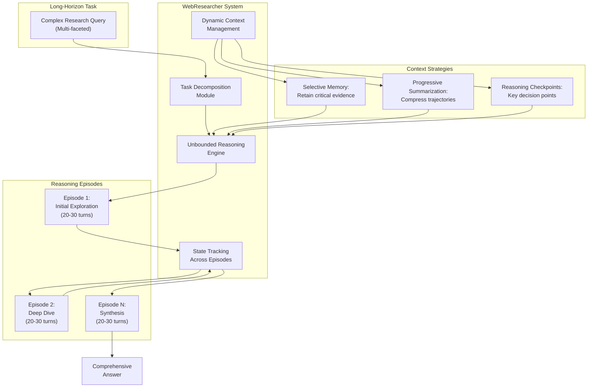
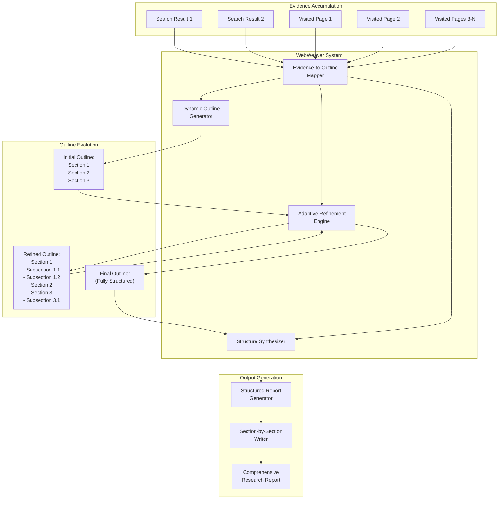
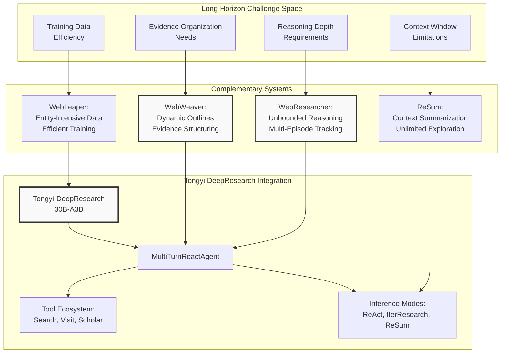
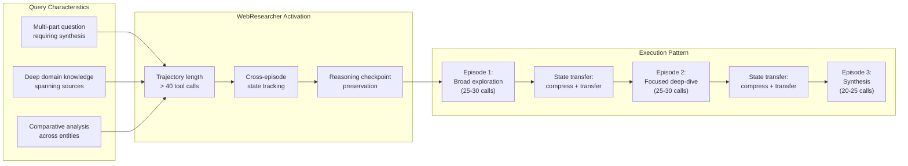
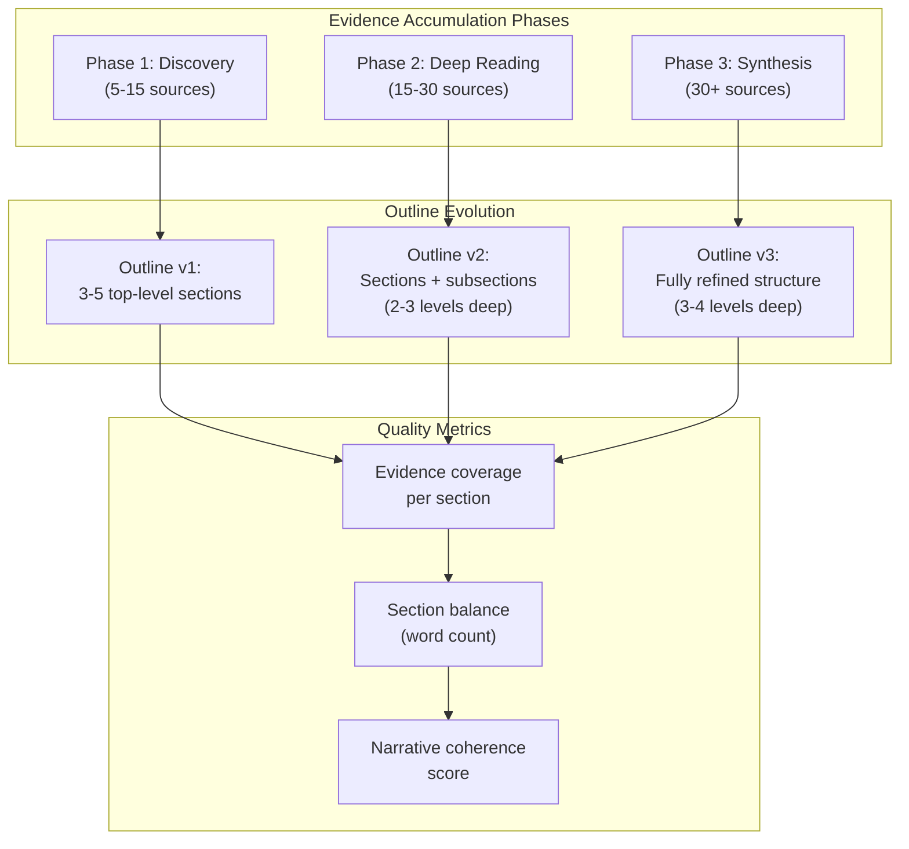

<!-- source: DeepWiki mcp.deepwiki.com · repo Alibaba-NLP/DeepResearch · page 4.7 Other Research Projects · fetched 2026-10-29 -->

# WebResearcher and WebWeaver

Relevant source files

The following files were used as context for generating this wiki page:

- [README.md](README.md)
- [WebAgent/README.md](WebAgent/README.md)

## Purpose and Scope

This document covers two specialized systems within the Deep Research Agent Family that contribute long-horizon capabilities to Tongyi DeepResearch: **WebResearcher** and **WebWeaver**. WebResearcher enables unbounded reasoning for tasks requiring extended exploration beyond typical context limits, while WebWeaver structures web-scale evidence using dynamically generated outlines for comprehensive research synthesis.

These systems complement other long-horizon capabilities documented in [ReSum and Context Management](#2.7) and [WebLeaper Training Framework](#3.3). For the broader agent family ecosystem, see [Agent Family Overview](#4.1).

**Sources:** [README.md:190-209]()

---

## Overview

WebResearcher and WebWeaver represent two distinct approaches to handling the challenges of deep, long-horizon information-seeking tasks:

| System | Primary Focus | Key Innovation | Contribution to TDR |
|--------|--------------|----------------|---------------------|
| **WebResearcher** | Unbounded reasoning capabilities | Extends reasoning beyond fixed context windows for multi-step exploration | Enables extended search trajectories with maintained reasoning quality |
| **WebWeaver** | Evidence structuring and organization | Dynamic outline generation that adapts as evidence accumulates | Provides structured synthesis of web-scale information into coherent reports |

Both systems address fundamental limitations in agentic search: WebResearcher tackles the problem of reasoning depth when tasks require dozens or hundreds of tool calls, while WebWeaver addresses the challenge of organizing and synthesizing large volumes of discovered evidence into structured, actionable outputs.

**Sources:** [README.md:203-205]()

---

## WebResearcher: Unbounded Reasoning for Long-Horizon Agents

### Problem Statement

Traditional language models face two critical constraints in long-horizon agentic tasks:

1. **Context Window Limitations**: Even with extended context (128K tokens), complex research tasks can exceed available context when:
   - Accumulating evidence from dozens of web pages
   - Maintaining reasoning traces across 100+ tool invocations
   - Tracking multi-step dependencies in complex queries

2. **Reasoning Degradation**: As trajectory length increases, model reasoning quality typically degrades due to:
   - Attention dilution across long contexts
   - Loss of early information in compressed representations
   - Accumulated errors propagating through reasoning chains

### Unbounded Reasoning Architecture

WebResearcher introduces mechanisms for maintaining high-quality reasoning across arbitrarily long exploration trajectories:

**Sources:** [README.md:203]()

### Key Capabilities

**1. Episode-Based Exploration**

WebResearcher segments long-horizon tasks into manageable episodes, each with focused sub-goals:
- Individual episodes stay within optimal reasoning windows (20-40 tool calls)
- Cross-episode state transfer preserves critical context
- Episode boundaries align with natural task decomposition points

**2. Progressive Context Compression**

Rather than maintaining complete trajectories, WebResearcher selectively retains information:
- **Evidence artifacts**: Extracted facts, quotes, and data points
- **Reasoning checkpoints**: Key decision points and their justifications
- **State summaries**: Compressed representations of completed work

**3. Multi-Step Dependency Tracking**

Complex queries often require assembling information across multiple exploration paths:
- Track dependencies between sub-questions
- Maintain consistency across independent research threads
- Synthesize findings from parallel exploration branches

### Integration with Tongyi DeepResearch

Tongyi DeepResearch incorporates WebResearcher's unbounded reasoning principles through:

1. **Extended Tool Call Limits**: The default `MAX_LLM_CALL_PER_RUN=100` allows extensive exploration (see [Inference Orchestration](#2.8))

2. **Context Management**: Integration with ReSum paradigm for trajectory summarization when approaching context limits (see [ReSum Paradigm](#2.7))

3. **IterResearch Mode**: Test-time scaling strategies that enable iterative refinement of research trajectories (see [Inference Modes](#2.2))

**Sources:** [README.md:203](), [README.md:47]()

---

## WebWeaver: Evidence Structuring with Dynamic Outlines

### Problem Statement

Deep research agents accumulate substantial evidence during exploration, creating organization challenges:

1. **Evidence Overload**: Dozens of web pages, documents, and data points lack inherent structure
2. **Dynamic Discovery**: Research directions evolve as new information surfaces, requiring adaptable organization
3. **Synthesis Requirements**: Users need coherent, structured reports rather than raw evidence dumps

### Dynamic Outline Architecture

WebWeaver addresses these challenges through adaptive outline generation that evolves with evidence discovery:

**Sources:** [README.md:205]()

### Key Capabilities

**1. Dynamic Outline Generation**

WebWeaver continuously adapts outlines as research progresses:
- **Initial Structure**: Begins with high-level sections based on query understanding
- **Evidence-Driven Refinement**: Adds subsections and reorganizes as new information emerges
- **Hierarchical Organization**: Maintains logical relationships between topics and subtopics

**2. Evidence-to-Structure Mapping**

Each piece of discovered evidence is mapped to appropriate outline locations:
- **Automatic Classification**: Determines which section(s) each piece of evidence supports
- **Multi-Assignment**: Evidence can support multiple sections when relevant
- **Gap Detection**: Identifies under-supported outline sections requiring additional research

**3. Structured Synthesis**

Final output generation follows the evolved outline:
- **Section-by-Section Writing**: Generates coherent prose for each outline section
- **Evidence Attribution**: Maintains citations and source tracking
- **Narrative Flow**: Ensures logical transitions between sections

### Integration with Tongyi DeepResearch

Tongyi DeepResearch incorporates WebWeaver's evidence structuring capabilities through:

1. **Multi-Turn Planning**: The `MultiTurnReactAgent` maintains state across extended conversations, enabling outline evolution (see [MultiTurnReactAgent Architecture](#2.1))

2. **Tool Composition**: Sequential use of Search and Visit tools builds evidence base that can be structured (see [Web Tools](#2.6))

3. **IterResearch Mode**: Test-time scaling enables iterative refinement of both evidence gathering and synthesis (see [Inference Modes](#2.2))

**Sources:** [README.md:205](), [README.md:47]()

---

## Integration Architecture: Long-Horizon Capabilities

The following diagram illustrates how WebResearcher and WebWeaver integrate with other long-horizon systems in the Tongyi DeepResearch ecosystem:

**Sources:** [README.md:198-209]()

### Complementary Roles

Each long-horizon system addresses a distinct aspect of deep research:

| System | Addresses | Mechanism | Integration Point |
|--------|-----------|-----------|-------------------|
| **ReSum** | Context exhaustion during single sessions | Trajectory summarization with ReSumTool-30B | Dedicated inference mode: `run_resum.sh` |
| **WebResearcher** | Multi-episode reasoning consistency | State tracking across exploration phases | Embedded in `MultiTurnReactAgent` conversation management |
| **WebWeaver** | Evidence synthesis and presentation | Dynamic outline generation and mapping | Leveraged in IterResearch iterative refinement |
| **WebLeaper** | Training data quality for long trajectories | Entity-intensive scenarios with ISR/ISE metrics | Pre-training and RL data generation |

**Sources:** [README.md:198-209]()

---

## Operational Characteristics

### WebResearcher in Practice

When Tongyi DeepResearch handles queries requiring extended exploration:

**Key Operational Parameters:**

- **Episode Length**: Typically 20-40 tool calls to maintain optimal reasoning quality
- **State Transfer**: Selective compression retaining ~30% of episode context
- **Total Trajectory**: Can extend to 100+ tool calls across multiple episodes

**Sources:** [README.md:203]()

### WebWeaver in Practice

When Tongyi DeepResearch accumulates substantial evidence:

**Key Operational Characteristics:**

- **Outline Depth**: Typically 3-4 hierarchical levels for complex queries
- **Evidence Density**: Targets 3-5 supporting pieces per section
- **Structural Adaptation**: Outline can be reorganized up to 3-4 times during research

**Sources:** [README.md:205]()

---

## Research Contributions to the Field

Both WebResearcher and WebWeaver represent significant advances in agentic AI:

### WebResearcher Contributions

1. **Unbounded Reasoning Framework**: Demonstrates that long-horizon reasoning can be maintained through careful state management rather than requiring infinite context
2. **Episode-Based Architecture**: Establishes episode segmentation as a practical approach to managing complex, multi-step agent tasks
3. **Reasoning Checkpoint Methodology**: Introduces systematic preservation of key decision points for cross-episode consistency

### WebWeaver Contributions

1. **Dynamic Outline Generation**: Shows that outline structures can evolve adaptively as evidence accumulates, rather than requiring pre-specified templates
2. **Evidence-to-Structure Mapping**: Provides a framework for automatic classification and organization of discovered information
3. **Web-Scale Synthesis**: Demonstrates feasibility of synthesizing dozens of web sources into coherent, structured reports

**Sources:** [README.md:203-205]()

---

## Related Systems and Future Directions

WebResearcher and WebWeaver complement other agent family members:

- **[ReSum](#2.7)**: Provides tactical context management within episodes, while WebResearcher handles strategic cross-episode reasoning
- **[WebLeaper](#3.3)**: Generates training data for long-horizon scenarios that test unbounded reasoning and synthesis capabilities
- **[IterResearch Mode](#2.2)**: Enables test-time scaling for both extended exploration (WebResearcher) and iterative synthesis (WebWeaver)
- **[WebWatcher](#4.5)**: Extends structured synthesis to multimodal evidence (images, videos, interactive elements)

Future research directions include:
- **Hierarchical Episode Planning**: Multi-level episode structures for extremely complex queries
- **Collaborative Evidence Structuring**: Multiple agents working on different outline sections in parallel
- **Real-Time Outline Updates**: Streaming outline refinement as evidence accumulates during live searches

**Sources:** [README.md:190-209]()

---

