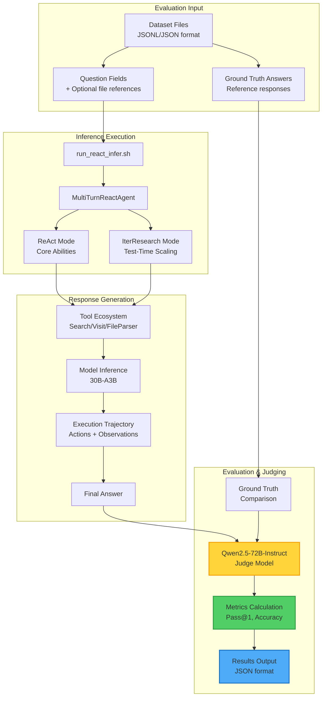
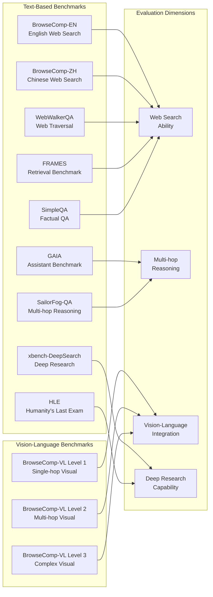
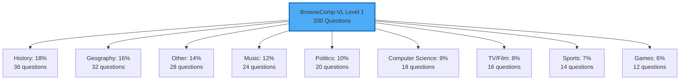
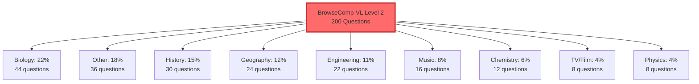
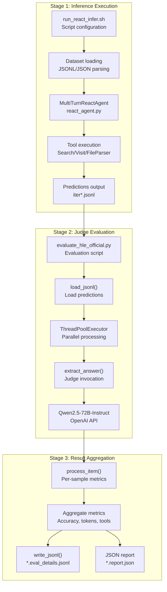
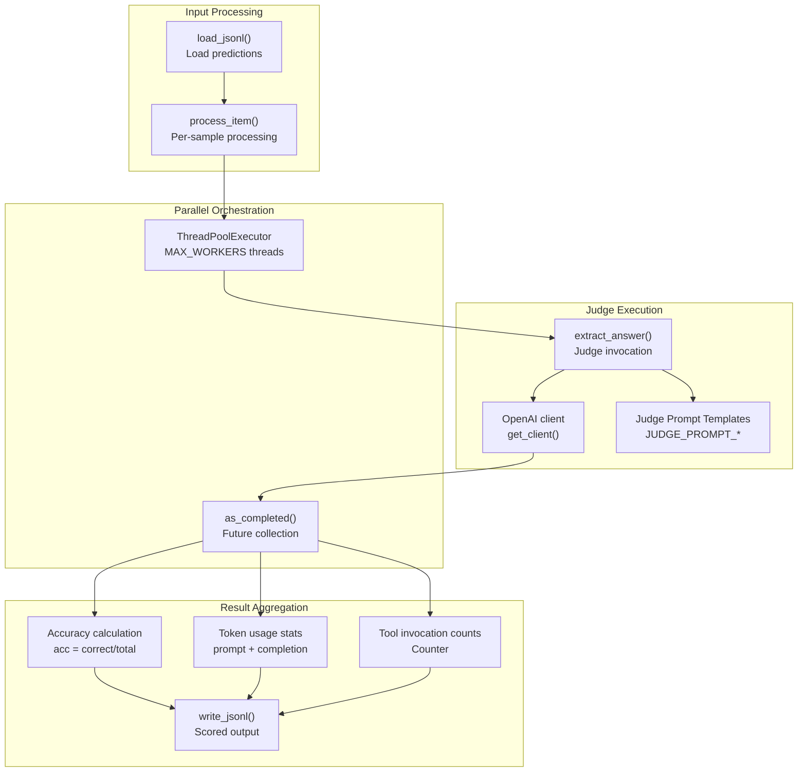

<!-- source: DeepWiki mcp.deepwiki.com · repo Alibaba-NLP/DeepResearch · page 5 Evaluation and Benchmarks · fetched 2026-10-29 -->

# Evaluation and Benchmarks

<details>
<summary>Relevant source files</summary>

The following files were used as context for generating this wiki page:

- [README.md](README.md)
- [WebAgent/WebWatcher/infer/evaluation/evaluate_hle_official.py](WebAgent/WebWatcher/infer/evaluation/evaluate_hle_official.py)
- [WebAgent/WebWatcher/infer/evaluation/prompt.py](WebAgent/WebWatcher/infer/evaluation/prompt.py)
- [WebAgent/WebWatcher/infer/evaluation/run_eval.sh](WebAgent/WebWatcher/infer/evaluation/run_eval.sh)
- [WebAgent/WebWatcher/infer/scripts_eval/agent_eval.py](WebAgent/WebWatcher/infer/scripts_eval/agent_eval.py)
- [WebAgent/WebWatcher/infer/scripts_eval/download_image.py](WebAgent/WebWatcher/infer/scripts_eval/download_image.py)
- [WebAgent/WebWatcher/infer/vl_search_r1/qwen-agent-o1_search/qwen_agent/tools/private/jialong_visit.py](WebAgent/WebWatcher/infer/vl_search_r1/qwen-agent-o1_search/qwen_agent/tools/private/jialong_visit.py)

</details>


This document describes the evaluation methodologies, benchmark suites, and assessment procedures used to measure the performance of the Tongyi DeepResearch system and its related WebAgent family. The evaluation infrastructure supports both text-based information-seeking tasks and vision-language benchmarks, with automated judging systems for large-scale assessment.

For information about training data quality metrics (ISR/ISE filtering), see [Synthetic Data Generation](#3.2). For inference execution procedures, see [Inference Orchestration Scripts](#2.8).

## Overview of Evaluation Architecture

The evaluation system operates on a judge-based assessment paradigm where model-generated responses are compared against ground truth answers using an LLM judge (Qwen2.5-72B-Instruct). The system supports multiple benchmark types, inference modes, and evaluation metrics.



**Sources:** [README.md:118-177](), [README.md:189-191]()

## Evaluation Dataset Format

The evaluation system accepts two input formats: **JSONL** (recommended) and **JSON**. Each entry must contain a `question` field and an `answer` field containing the ground truth for automated evaluation.

### JSONL Format Structure

```json
{"question": "What is the capital of France?", "answer": "Paris"}
{"question": "Explain quantum computing", "answer": "Quantum computing uses quantum mechanical phenomena..."}
```

### JSON Format Structure

```json
[
  {"question": "What is the capital of France?", "answer": "Paris"},
  {"question": "Explain quantum computing", "answer": "Quantum computing uses..."}
]
```

### File Reference Format

For questions requiring file parsing (PDF, DOCX, XLSX, etc.), prepend the filename to the question field and place files in `eval_data/file_corpus/`:

```json
{"question": "report.pdf What are the key findings?", "answer": "The key findings are..."}
```

**Directory Structure:**
```
project_root/
├── eval_data/
│   ├── my_questions.jsonl          # Evaluation data
│   └── file_corpus/                # Referenced documents
│       ├── report.pdf
│       └── data.xlsx
```

**Sources:** [README.md:118-159]()

## Benchmark Suite Overview

The system is evaluated across multiple benchmark categories covering different task types, domains, and difficulty levels:



**Sources:** [README.md:32-40](), [README.md:63-67]()

## Benchmark Datasets

### Text-Based Benchmarks

| Benchmark | Description | Domain | Difficulty | Question Type |
|-----------|-------------|--------|------------|---------------|
| **BrowseComp-EN** | English web-based information seeking | Multi-domain | Medium-Hard | Factual, analytical |
| **BrowseComp-ZH** | Chinese web-based information seeking | Multi-domain | Medium-Hard | Factual, analytical |
| **GAIA** | General assistant benchmark | Multi-domain | Hard | Complex reasoning |
| **WebWalkerQA** | Web page traversal and interaction | Web navigation | Medium | Action-based |
| **xbench-DeepSearch** | Deep research benchmark | Research-focused | Hard | Multi-step research |
| **HLE** | Humanity's Last Exam | Expert-level | Very Hard | Advanced reasoning |
| **FRAMES** | Retrieval and attribution | Information retrieval | Medium | Source-based |
| **SimpleQA** | Factual question answering | General knowledge | Easy-Medium | Short-form factual |
| **SailorFog-QA** | Multi-hop reasoning benchmark | Multi-domain | Hard | Chain reasoning |

**Sources:** [README.md:32-40]()

### Vision-Language Benchmarks

The BrowseComp-VL benchmark suite evaluates vision-language capabilities across three difficulty levels:

| Level | File | Questions | Complexity | Avg Reasoning Steps |
|-------|------|-----------|------------|---------------------|
| **Level 1** | `bc_vl_level1.jsonl` | 200 | Single-hop visual understanding | 1-2 steps |
| **Level 2** | `bc_vl_level2.jsonl` | 200 | Multi-hop visual reasoning | 3-5 steps |
| **Level 3** | N/A | TBD | Complex visual reasoning | 5+ steps |

#### Domain Distribution (BrowseComp-VL Level 1)

Based on analysis of [WebAgent/WebWatcher/benchmark/bc_vl_level1.jsonl]():



#### Domain Distribution (BrowseComp-VL Level 2)

Based on analysis of [WebAgent/WebWatcher/benchmark/bc_vl_level2.jsonl]():



**Complexity Characteristics:**
- **Level 1**: Direct visual information extraction, single web search typically sufficient
- **Level 2**: Multi-step reasoning, cross-referencing multiple sources, temporal/spatial reasoning

**Sources:** [WebAgent/WebWatcher/benchmark/bc_vl_level1.jsonl:1-200](), [WebAgent/WebWatcher/benchmark/bc_vl_level2.jsonl:1-200]()

## Evaluation Scripts and Execution

### Inference Script Configuration

The primary evaluation script `run_react_infer.sh` orchestrates model inference on benchmark datasets:

```bash
# Key configuration variables in run_react_infer.sh:
MODEL_PATH=/path/to/Tongyi-DeepResearch-30B-A3B
DATASET=eval_data/my_questions.jsonl
OUTPUT_PATH=./outputs
```

**Required Environment Variables** (see `.env`):
- `SERPER_KEY_ID`: Web search via Serper.dev
- `JINA_API_KEYS`: Page reading via Jina.ai
- `API_KEY`/`API_BASE`: OpenAI-compatible summarization API
- `DASHSCOPE_API_KEY`: File parsing via Dashscope
- `SANDBOX_FUSION_ENDPOINT`: Python code execution
- `IDP_ENDPOINT`: IDP Service for document AI (optional fallback)

**Sources:** [README.md:92-114](), [README.md:161-177]()

### Evaluation Script Execution

After generating predictions with `run_react_infer.sh`, run the evaluation script:

```bash
# Configure judge model environment
export API_KEY=your_api_key
export BASE_URL=https://api-inference.modelscope.cn/v1/
export JUDGE_MODEL=Qwen/Qwen2.5-32B-Instruct
export MAX_WORKERS=4

# Run evaluation
python evaluation/evaluate_hle_official.py \
    --input_fp predictions.jsonl \
    --repeat_times 1
```

The evaluation script:
1. Loads predictions from JSONL file
2. Spawns parallel workers (`MAX_WORKERS` threads)
3. Invokes judge model for each prediction
4. Aggregates metrics and generates reports

**Sources:** [WebAgent/WebWatcher/infer/evaluation/run_eval.sh:1-7](), [WebAgent/WebWatcher/infer/evaluation/evaluate_hle_official.py:144-156]()

### Complete Evaluation Execution Flow

**Inference + Evaluation Pipeline: Code Entity Mapping**



**Execution Commands:**

```bash
# Step 1: Generate predictions
bash run_react_infer.sh

# Step 2: Run evaluation
export JUDGE_MODEL=Qwen/Qwen2.5-32B-Instruct
python evaluation/evaluate_hle_official.py --input_fp outputs/predictions.jsonl
```

**Sources:** [README.md:169-177](), [WebAgent/WebWatcher/infer/evaluation/evaluate_hle_official.py:144-246]()

## Evaluation Metrics

### Primary Evaluation Metrics

| Metric | Description | Implementation | Output Location |
|--------|-------------|----------------|-----------------|
| **Pass@1 / Accuracy** | Percentage of correct answers | `sum(metrics)/len(res)` | `report['metrics']` |
| **Average Prompt Tokens** | Mean tokens in input context | `prompt_tokens/len(res)` | `report['avg_prompt_tokens']` |
| **Average Completion Tokens** | Mean tokens in model output | `completion_tokens/len(res)` | `report['avg_completion_tokens']` |
| **Tool Usage** | Average invocations per tool | `Counter` aggregation | `report['tool_usage']` |
| **Average Turns** | Mean trajectory length | `sum(turns)/len(res)` | `report['avg_turns']` |
| **Answer Rate** | Percentage providing final answer | `is_answer_rate` | `report['is_answer_rate']` |

**Sources:** [WebAgent/WebWatcher/infer/evaluation/evaluate_hle_official.py:169-238]()

### Metric Calculation Implementation

**Accuracy Calculation:**
```python
# Per-item accuracy from judge result
acc = 1 if judge_result['correct'] in ('y', 'yes', 'true', 'positive') else 0

# Aggregate accuracy across dataset
metrics = sum([i['acc'] for i in res]) / len(res) if res else 0
```

**Token Usage Statistics:**
```python
completion_tokens = 0
prompt_tokens = 0
for i in res:
    if i['token_usage']:
        completion_tokens += i['token_usage']['completion_tokens']
        prompt_tokens += i['token_usage']['prompt_tokens']
avg_completion_tokens = completion_tokens / len(res)
avg_prompt_tokens = prompt_tokens / len(res)
```

**Tool Invocation Tracking:**
```python
tool_usage = defaultdict(list)
for i in res:
    cur_usage = {'google_search': 0, 'google_scholar': 0, 'Visit': 0, 'PythonInterpreter': 0}
    for tool_use in i['tool_usage']:
        if tool_use in cur_usage:
            cur_usage[tool_use] += i['tool_usage'][tool_use]
    for tool_use in cur_usage:
        tool_usage[tool_use].append(cur_usage[tool_use])
tool_usage = {k: sum(v)/len(res) for k, v in tool_usage.items()}
```

**Sources:** [WebAgent/WebWatcher/infer/evaluation/evaluate_hle_official.py:169-218]()

### Training Data Quality Metrics

For information about **ISR** (Information-Seeking Rate) and **ISE** (Information-Seeking Efficiency) metrics used in training data filtering, see [WebLeaper: Entity-Intensive Training Framework](#3.2).

These metrics are used during the training data generation phase to filter high-quality trajectories:
- **ISR > 0.3**: Ensures coverage of target information
- **ISE > 0.1**: Ensures efficiency in information gathering

**Sources:** [README.md:53-62]()

## Judge-Based Evaluation System

### Evaluation Pipeline Architecture

The evaluation system uses **Qwen2.5-72B-Instruct** as the primary judge model to compare generated answers against ground truth. The implementation leverages parallel processing via `ThreadPoolExecutor` for efficient batch evaluation.

**Evaluation Pipeline: Natural Language to Code Entity Mapping**



**Sources:** [WebAgent/WebWatcher/infer/evaluation/evaluate_hle_official.py:1-246]()

### Judge Model Configuration

The judge model is configured via environment variables and uses OpenAI-compatible API endpoints:

```python
# Judge model configuration
JUDGE_MODEL = os.getenv("JUDGE_MODEL", "Qwen/Qwen2.5-32B-Instruct")
MAX_WORKERS = int(os.getenv("MAX_WORKERS", "1"))
API_KEY = os.getenv("API_KEY", "")
BASE_URL = os.getenv("BASE_URL", "https://api-inference.modelscope.cn/v1/")
```

**Key Implementation Details:**
- **Thread-local client management**: `get_client()` creates per-thread OpenAI clients to avoid concurrency issues
- **Retry mechanism**: Up to 100 retries with exponential backoff for API failures
- **Timeout handling**: 60-second timeout per judge request
- **Structured output**: Uses Pydantic `BaseModel` for response parsing

**Sources:** [WebAgent/WebWatcher/infer/evaluation/evaluate_hle_official.py:16-38]()

### Dataset-Specific Judge Prompts

The system uses specialized judge prompts optimized for each benchmark dataset:

| Prompt Template | Dataset | Format | Key Features |
|-----------------|---------|--------|--------------|
| `JUDGE_PROMPT_GAIA` | GAIA | Simple equivalence | Binary correct/incorrect decision |
| `JUDGE_PROMPT_BC_zh` | BrowseComp-ZH | Chinese rubric | Multi-aspect answer validation with examples |
| `JUDGE_PROMPT_BC_en` | BrowseComp-EN | English rubric | Detailed correctness criteria |
| `JUDGE_PROMPT_QA` | SimpleQA/FRAMES | Three-level grading | CORRECT/INCORRECT/NOT_ATTEMPTED |
| `JUDGE_PROMPT_XBENCH` | xbench-DeepSearch | Chinese formal | Final answer extraction + reasoning |
| `JUDGE_PROMPT_BROWSECOMP_OFFICIAL` | BrowseComp official | Structured JSON | Confidence score extraction |

**Example: GAIA Judge Prompt Structure**

```python
JUDGE_PROMPT_GAIA = """You are an evaluation assistant. Please determine if the predicted answer is equivalent to the labeled answer.

Question: {question}
Labeled Answer: {correct_answer}
Predicted Answer: {response}

Did the model give an answer **equivalent** to the labeled answer? Please respond with "Correct" if they are equivalent, or "Incorrect" if they are not equivalent. Do not include any other text.
""".strip()
```

**Sources:** [WebAgent/WebWatcher/infer/evaluation/prompt.py:98-108](), [WebAgent/WebWatcher/infer/evaluation/prompt.py:180-248](), [WebAgent/WebWatcher/infer/evaluation/prompt.py:422-439]()

### Structured Judge Response

The judge uses Pydantic models for type-safe response parsing:

```python
class ExtractedAnswer(BaseModel):
    extracted_final_answer: str
    reasoning: str
    correct: Literal["yes", "no"]
    confidence: int
    strict: Literal[True]
```

The `extract_answer()` function orchestrates the judge evaluation:

1. Constructs prompt with question, correct_answer, and model response
2. Calls judge model via `client.beta.chat.completions.parse()`
3. Parses structured response into `ExtractedAnswer` model
4. Returns evaluation result with reasoning and confidence

**Sources:** [WebAgent/WebWatcher/infer/evaluation/evaluate_hle_official.py:67-101]()

### Parallel Evaluation Workflow

The evaluation pipeline processes predictions in parallel to optimize throughput:

```python
# Parallel evaluation with ThreadPoolExecutor
with ThreadPoolExecutor(max_workers=MAX_WORKERS) as executor:
    future_to_item = {executor.submit(process_item, item): item for item in d}
    for future in tqdm(as_completed(future_to_item), total=len(d), desc="Processing"):
        try:
            result = future.result()
            if result is not None:
                res.append(result)
        except Exception as e:
            print(f"Task failed with error: {e}")
```

**Processing Per Item:**
1. Extract response from trajectory: `extract_response(messages)`
2. Invoke judge model: `extract_answer(question, correct_answer, response)`
3. Calculate accuracy: `acc = 1 if judge_result['correct'] in ('y', 'yes', 'true') else 0`
4. Aggregate token usage, tool usage, and trajectory statistics

**Sources:** [WebAgent/WebWatcher/infer/evaluation/evaluate_hle_official.py:159-167](), [WebAgent/WebWatcher/infer/evaluation/evaluate_hle_official.py:117-140]()

### Evaluation Output Format

The evaluation pipeline produces two output files:

**1. Detailed Evaluation Results** (`*.eval_details.jsonl`):
```json
{
  "acc": 1,
  "turns": 5,
  "token_usage": {"prompt_tokens": 1234, "completion_tokens": 567},
  "tool_usage": {"google_search": 2, "Visit": 3},
  "item": {original prediction item},
  "is_answer": 1
}
```

**2. Summary Report** (`*.report.json`):
```json
{
  "evaluated_nums": 1000,
  "valid_nums": 998,
  "metrics": 85.4,
  "judge_model": "Qwen/Qwen2.5-32B-Instruct",
  "avg_prompt_tokens": 1234.5,
  "avg_completion_tokens": 567.8,
  "tool_usage": {"google_search": 2.3, "Visit": 3.1},
  "avg_turns": 4.5,
  "turns_dist": {1: 10, 2: 50, 3: 100, ...}
}
```

**Sources:** [WebAgent/WebWatcher/infer/evaluation/evaluate_hle_official.py:222-244]()

## Inference Mode Comparison

The system supports two inference paradigms with different evaluation characteristics:

| Aspect | ReAct Mode | IterResearch Heavy Mode |
|--------|------------|-------------------------|
| **Purpose** | Core abilities evaluation | Maximum performance via test-time scaling |
| **Rollouts** | Single trajectory | Multiple parallel rollouts |
| **Time Cost** | Fast (baseline) | 3-5x slower |
| **Use Case** | Benchmark comparison | Production deployment |
| **Determinism** | Semi-deterministic | Ensemble voting |
| **Code Entry** | `MultiTurnReactAgent._run()` | IterResearch orchestration |

**ReAct Mode** is used for standardized benchmark evaluation to assess intrinsic model capabilities without test-time compute scaling. **IterResearch Mode** leverages multiple rollouts with voting/selection to maximize performance, making it suitable for real-world deployment where latency is acceptable.

**Sources:** [README.md:47-47]()

## Benchmark Performance Results

The following table summarizes Tongyi DeepResearch performance on key benchmarks (as of model release):

| Benchmark | Tongyi DeepResearch Score | Comparison Notes |
|-----------|---------------------------|------------------|
| **HLE** (Humanity's Last Exam) | State-of-the-art | Top performance among agentic systems |
| **BrowseComp-EN** | State-of-the-art | English web search tasks |
| **BrowseComp-ZH** | State-of-the-art | Chinese web search tasks |
| **WebWalkerQA** | State-of-the-art | Web traversal benchmark |
| **xbench-DeepSearch** | State-of-the-art | Deep research capabilities |
| **FRAMES** | State-of-the-art | Retrieval and attribution |
| **SimpleQA** | State-of-the-art | Factual QA baseline |

Detailed numerical results are available in the [performance figure](README.md:38-40) and [benchmark comparison chart](README.md:65-67).

**Sources:** [README.md:32-40](), [README.md:63-67]()

## Running Evaluations

### Step-by-Step Evaluation Procedure

1. **Prepare Dataset**
   ```bash
   # Create evaluation data directory
   mkdir -p eval_data/file_corpus
   
   # Place evaluation JSONL/JSON file
   cp my_questions.jsonl eval_data/
   
   # Place any referenced files
   cp *.pdf eval_data/file_corpus/
   ```

2. **Configure Environment**
   ```bash
   # Copy and edit environment configuration
   cp .env.example .env
   # Edit .env to add API keys
   ```

3. **Configure Inference Script**
   ```bash
   # Edit run_react_infer.sh
   vim run_react_infer.sh
   
   # Set variables:
   # MODEL_PATH=/path/to/model
   # DATASET=eval_data/my_questions.jsonl
   # OUTPUT_PATH=./outputs
   ```

4. **Execute Evaluation**
   ```bash
   # Run inference on dataset
   bash run_react_infer.sh
   ```

5. **Review Results**
   ```bash
   # Check output directory
   ls -lh outputs/
   
   # Results include:
   # - Individual question responses (JSON)
   # - Execution trajectories
   # - Aggregated metrics
   # - Error logs (if any)
   ```

**Sources:** [README.md:161-177]()

### Advanced Evaluation Options

For **OpenRouter API** evaluation (no local GPU required):

1. Modify [inference/react_agent.py]():
   - Set API key to OpenRouter credentials
   - Change model name to `alibaba/tongyi-deepresearch-30b-a3b`
   - Adjust content concatenation per comments at lines 88-90

2. Run evaluation with remote API inference

**Sources:** [README.md:179-188]()

## Code Entity Reference Guide

### Inference Pipeline Components

| Component | File Path | Primary Responsibility |
|-----------|-----------|------------------------|
| **MultiTurnReactAgent** | `inference/react_agent.py` | Main agent orchestration, ReAct loop execution |
| **call_server** | `inference/react_agent.py` | LLM communication with retry logic |
| **run_react_infer.sh** | `run_react_infer.sh` | Inference execution script |
| **FileParser** | `inference/file_tools/file_parser.py` | Document processing for file-based questions |
| **Tool ecosystem** | `inference/` directory | Search, Visit, Scholar, PythonInterpreter tools |

**Sources:** [README.md:169-177]()

### Evaluation Pipeline Components

| Component | File Path | Primary Responsibility |
|-----------|-----------|------------------------|
| **evaluate_hle_official.py** | `WebAgent/WebWatcher/infer/evaluation/evaluate_hle_official.py` | Main evaluation orchestration |
| **load_jsonl** | `evaluate_hle_official.py:22-24` | Load predictions from file |
| **write_jsonl** | `evaluate_hle_official.py:26-28` | Write scored results |
| **get_client** | `evaluate_hle_official.py:32-38` | Thread-local OpenAI client |
| **extract_answer** | `evaluate_hle_official.py:74-101` | Judge model invocation |
| **process_item** | `evaluate_hle_official.py:117-140` | Per-sample processing |
| **ExtractedAnswer** | `evaluate_hle_official.py:67-72` | Pydantic response model |
| **ThreadPoolExecutor** | `evaluate_hle_official.py:159-167` | Parallel evaluation execution |

**Sources:** [WebAgent/WebWatcher/infer/evaluation/evaluate_hle_official.py:1-246]()

### Judge Prompt Templates

| Prompt Template | File Location | Dataset Target |
|-----------------|---------------|----------------|
| **JUDGE_PROMPT_GAIA** | `prompt.py:98-108` | GAIA benchmark |
| **JUDGE_PROMPT_BC_zh** | `prompt.py:110-177` | BrowseComp-ZH |
| **JUDGE_PROMPT_BC_en** | `prompt.py:180-247` | BrowseComp-EN |
| **JUDGE_PROMPT_QA** | `prompt.py:250-329` | SimpleQA/FRAMES |
| **JUDGE_PROMPT_XBENCH** | `prompt.py:422-438` | xbench-DeepSearch |
| **JUDGE_PROMPT_BROWSECOMP_OFFICIAL** | `prompt.py:441-458` | BrowseComp official |

**Sources:** [WebAgent/WebWatcher/infer/evaluation/prompt.py:1-458]()

## Troubleshooting Evaluation Issues

| Issue | Possible Cause | Solution |
|-------|----------------|----------|
| **API Rate Limits** | Serper/Jina/Dashscope QPS exceeded | Reduce concurrency, add delays between requests |
| **File Not Found** | Referenced file missing from `file_corpus/` | Verify filename in question matches file path |
| **Token Limit Exceeded** | Context > 110K tokens | Enable ReSum mode for long conversations |
| **Tool Failures** | Network issues, API downtime | Check tool API status, verify credentials |
| **Judge Model Errors** | Qwen2.5-72B inference failures | Verify judge model endpoint, check API keys |
| **Format Errors** | Invalid JSON/JSONL structure | Validate dataset with JSON linter |

**Sources:** [README.md:92-114](), [README.md:161-177]()

---

