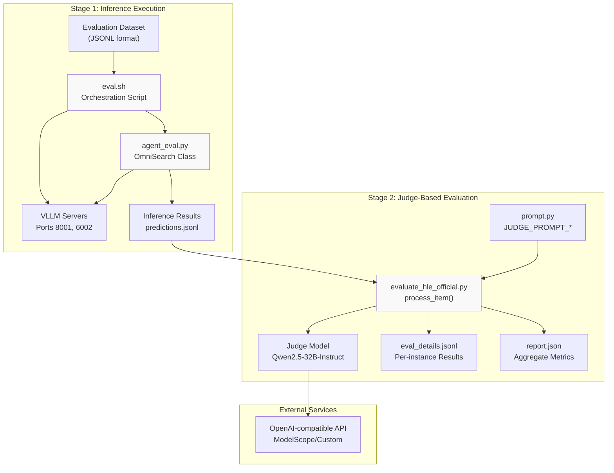
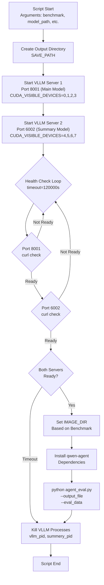

<!-- source: DeepWiki mcp.deepwiki.com · repo Alibaba-NLP/DeepResearch · page 5.1 Evaluation Framework and LLM Judge · fetched 2026-10-29 -->

# Evaluation Scripts and Methodology

<details>
<summary>Relevant source files</summary>

The following files were used as context for generating this wiki page:

- [WebAgent/WebResummer/src/evaluate.py](WebAgent/WebResummer/src/evaluate.py)
- [WebAgent/WebResummer/src/judge_prompt.py](WebAgent/WebResummer/src/judge_prompt.py)
- [WebAgent/WebResummer/src/main.py](WebAgent/WebResummer/src/main.py)
- [WebAgent/WebResummer/src/prompt.py](WebAgent/WebResummer/src/prompt.py)
- [WebAgent/WebResummer/src/react_agent.py](WebAgent/WebResummer/src/react_agent.py)
- [WebAgent/WebResummer/src/run_resum.sh](WebAgent/WebResummer/src/run_resum.sh)
- [WebAgent/WebResummer/src/summary_utils.py](WebAgent/WebResummer/src/summary_utils.py)
- [WebAgent/WebResummer/src/tool_search.py](WebAgent/WebResummer/src/tool_search.py)
- [WebAgent/WebResummer/src/tool_visit.py](WebAgent/WebResummer/src/tool_visit.py)
- [WebAgent/WebWatcher/infer/evaluation/evaluate_hle_official.py](WebAgent/WebWatcher/infer/evaluation/evaluate_hle_official.py)
- [WebAgent/WebWatcher/infer/evaluation/prompt.py](WebAgent/WebWatcher/infer/evaluation/prompt.py)
- [WebAgent/WebWatcher/infer/evaluation/run_eval.sh](WebAgent/WebWatcher/infer/evaluation/run_eval.sh)
- [WebAgent/WebWatcher/infer/scripts_eval/agent_eval.py](WebAgent/WebWatcher/infer/scripts_eval/agent_eval.py)
- [WebAgent/WebWatcher/infer/scripts_eval/download_image.py](WebAgent/WebWatcher/infer/scripts_eval/download_image.py)
- [WebAgent/WebWatcher/infer/vl_search_r1/qwen-agent-o1_search/qwen_agent/tools/private/jialong_visit.py](WebAgent/WebWatcher/infer/vl_search_r1/qwen-agent-o1_search/qwen_agent/tools/private/jialong_visit.py)

</details>


## Purpose and Scope

This document describes the evaluation infrastructure used to assess model performance across multiple benchmarks in the DeepResearch repository. The evaluation system consists of three main components: (1) inference orchestration scripts that manage VLLM server deployment and agent execution, (2) judge-based evaluation scripts that use LLM-as-a-judge methodology to assess answer correctness, and (3) metrics aggregation and reporting utilities.

For information about the benchmark datasets themselves (formats, statistics, download instructions), see [Benchmark Datasets](#5.2). For details on the core inference engine architecture, see [Core Inference Engine](#2).

---

## Evaluation Architecture Overview

The evaluation pipeline follows a two-stage architecture: inference execution followed by judge-based scoring. This separation allows for flexible evaluation of different model outputs against the same ground truth using various judging strategies.



**Sources:** [WebAgent/WebWatcher/infer/scripts_eval/scripts/eval.sh:1-149](), [WebAgent/WebWatcher/infer/evaluation/evaluate_hle_official.py:1-246]()

---

## Inference Orchestration: eval.sh

The `eval.sh` script provides end-to-end orchestration for running evaluation inference, including server lifecycle management, health checking, and cleanup.

### Script Execution Flow



### Server Configuration

| Parameter | Server 1 (Main Model) | Server 2 (Summary Model) |
|-----------|----------------------|--------------------------|
| **Port** | 8001 | 6002 |
| **GPUs** | CUDA_VISIBLE_DEVICES=0,1,2,3 | CUDA_VISIBLE_DEVICES=4,5,6,7 |
| **Model Path** | `$MODEL_PATH` (e.g., pretrain_model/webwatcher7b) | `$SUMMERY_MODEL_PATH` (e.g., qwen2.5_vl_72b) |
| **Max Batched Tokens** | 32768 | 32768 |
| **Max Num Seqs** | 128 | 128 |
| **Tensor Parallel Size** | 1 | 1 |
| **MM Limit** | `--limit-mm-per-prompt '{"image": 100}'` | N/A |

The script performs health checks by repeatedly sending curl requests to the `/v1/chat/completions` endpoint with a 120,000-second timeout (33.3 hours). Both servers must respond successfully before inference begins.

**Sources:** [WebAgent/WebWatcher/infer/scripts_eval/scripts/eval.sh:33-79]()

### Environment Variable Configuration

The script maps benchmark names to image directories:

```bash
# Lines 89-115 in eval.sh
if [ "$benchmark" = "mmsearch" ]; then
  export IMAGE_DIR=scripts_eval/images/mmsearch
elif [ "$benchmark" = "hle" ]; then
  export IMAGE_DIR=scripts_eval/images/hle
elif [ "$benchmark" = "gaia" ]; then
  export IMAGE_DIR=scripts_eval/images/gaia
# ... additional benchmarks
```

Required environment variables passed as script arguments:
- `IMG_SEARCH_KEY` ($5): Image search API key
- `JINA_API_KEY` ($6): Jina web reading API key  
- `TEXT_SEARCH_KEY` ($7): Text search API key
- `ALIBABA_CLOUD_ACCESS_KEY_ID` ($8): Alibaba cloud credentials
- `ALIBABA_CLOUD_ACCESS_KEY_SECRET` ($9): Alibaba cloud credentials

**Sources:** [WebAgent/WebWatcher/infer/scripts_eval/scripts/eval.sh:18-23](), [WebAgent/WebWatcher/infer/scripts_eval/scripts/eval.sh:89-115]()

---

## Agent Inference: agent_eval.py

The `agent_eval.py` script implements the `OmniSearch` class, which orchestrates multi-turn agent interactions with vision-language models and external tools.

### OmniSearch Class Architecture

```mermaid
graph TB
    subgraph "OmniSearch Class"
        Init["__init__()<br/>Initialize clients<br/>Configure parameters"]
        ProcessImage["process_image()<br/>Resize & encode base64"]
        RunMain["run_main()<br/>Main inference loop"]
        Infer["infer()<br/>Wrapper with error handling"]
        InferTimeout["infer_with_timeout_retry()<br/>Timeout & retry logic"]
        Eval["eval()<br/>Batch processing"]
    end
    
    subgraph "Dependencies"
        OpenAIClient["OpenAI Client<br/>base_url=http://0.0.0.0:8001/v1"]
        QwenAgent["Qwen_agent<br/>Tool registry"]
        Processor["AutoProcessor<br/>Chat template application"]
    end
    
    subgraph "Inference Loop Components"
        BuildMessages["Build Messages<br/>System + User prompt<br/>Image as base64"]
        CallLLM["client.chat.completions.create()<br/>top_p=0.95, temperature=0.6"]
        ParseResponse["Parse Response<br/>Extract <answer>Paris</answer>",
  "usage": {"prompt_tokens": 1234, "completion_tokens": 56}
}
```

**eval_details.jsonl** (one line per sample):
```json
{
  "acc": 1,
  "turns": 3,
  "token_usage": {"prompt_tokens": 1234, "completion_tokens": 56},
  "tool_usage": {"google_search": 1, "Visit": 2},
  "item": { ... original item ... },
  "is_answer": 1
}
```

**report.json**:
```json
{
  "evaluated_nums": 100,
  "valid_nums": 98,
  "metrics": 87.5,
  "judge_model": "Qwen/Qwen2.5-32B-Instruct",
  "avg_prompt_tokens": 1234.5,
  "avg_completion_tokens": 56.7,
  "avg_dollars_o4mini": 0.00678,
  "tool_usage": {"google_search": 1.2, "Visit": 2.3},
  "is_answer_rate": 0.98,
  "avg_turns": 4.2,
  "turns_dist": {"1": 10, "2": 20, "3": 30, ...}
}
```

**Sources:** [WebAgent/WebWatcher/infer/evaluation/evaluate_hle_official.py:222-244]()

---

