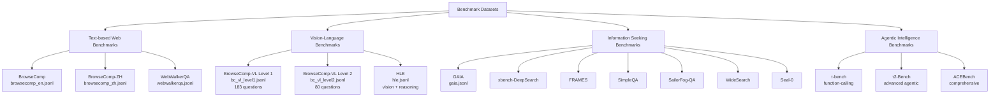
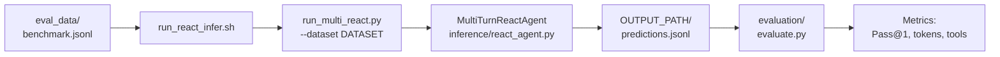
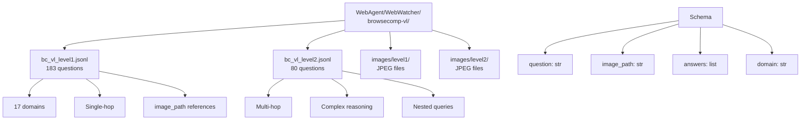
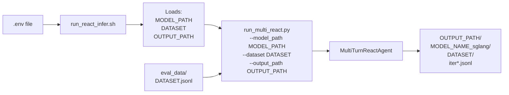
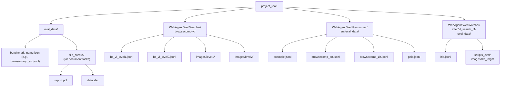
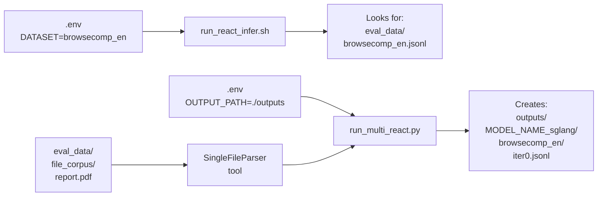
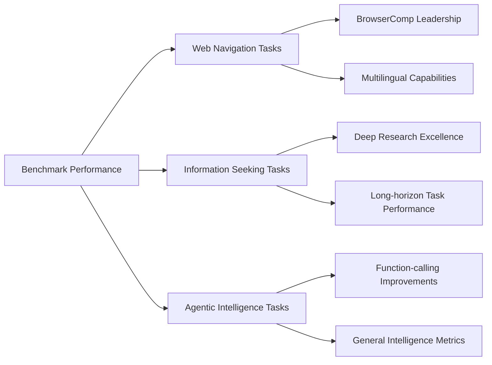

<!-- source: DeepWiki mcp.deepwiki.com · repo Alibaba-NLP/DeepResearch · page 5.2 Benchmark Datasets · fetched 2026-10-29 -->

# Benchmark Datasets

<details>
<summary>Relevant source files</summary>

The following files were used as context for generating this wiki page:

- [README.md](README.md)
- [WebAgent/WebResummer/README.md](WebAgent/WebResummer/README.md)
- [WebAgent/WebResummer/assets/resum_icon.png](WebAgent/WebResummer/assets/resum_icon.png)
- [WebAgent/WebResummer/src/eval_data/example.jsonl](WebAgent/WebResummer/src/eval_data/example.jsonl)
- [WebAgent/WebWatcher/browsecomp-vl/bc_vl_level1.jsonl](WebAgent/WebWatcher/browsecomp-vl/bc_vl_level1.jsonl)
- [WebAgent/WebWatcher/browsecomp-vl/bc_vl_level2.jsonl](WebAgent/WebWatcher/browsecomp-vl/bc_vl_level2.jsonl)
- [WebAgent/WebWatcher/browsecomp-vl/images/level1.tar](WebAgent/WebWatcher/browsecomp-vl/images/level1.tar)
- [WebAgent/WebWatcher/browsecomp-vl/images/level2.tar](WebAgent/WebWatcher/browsecomp-vl/images/level2.tar)
- [WebAgent/WebWatcher/infer/scripts_eval/images/hle_imgs.tar](WebAgent/WebWatcher/infer/scripts_eval/images/hle_imgs.tar)
- [WebAgent/WebWatcher/infer/vl_search_r1/eval_data/hle.jsonl](WebAgent/WebWatcher/infer/vl_search_r1/eval_data/hle.jsonl)

</details>


This document details the benchmark datasets used to evaluate Tongyi DeepResearch and the WebAgent research family. These datasets span web navigation, information seeking, vision-language understanding, and long-horizon research capabilities.

## Overview

The evaluation ecosystem comprises multiple benchmark datasets organized by task type and modality. All benchmarks follow standardized JSONL/JSON formats with `question` and `answer` fields, enabling consistent evaluation through the `run_react_infer.sh` inference pipeline.



**Data Flow from Benchmarks to Evaluation:**



**Sources:** [README.md:32-32](), [README.md:113-117](), [inference/run_react_infer.sh:117-128](), [WebAgent/WebLeaper/README.md:15-15](), [Agent/AgentScaler/README.md:18-20]()
</thinking>

## Text-based Web Benchmarks

### BrowseComp and BrowseComp-ZH

BrowseComp evaluates web navigation and information extraction capabilities. The dataset requires models to interact with web environments to answer questions. BrowseComp-ZH provides the Chinese language variant, enabling multilingual evaluation.

Both benchmarks are used in the WebLeaper training and evaluation pipeline with Information-Seeking Rate (ISR) and Information-Seeking Efficiency (ISE) metrics.

**Sources:** [README.md:32-32](), [WebAgent/WebLeaper/README.md:106-106]()

### WebWalkerQA

WebWalkerQA assesses web traversal capabilities through sequential navigation. The benchmark tests the model's ability to extract information by traversing web pages using button clicks and page visits.

**Dataset Location:** Referenced in evaluation configurations
**Format:** JSONL with `question` and `answer` fields

**Sources:** [README.md:32-32](), [README.md:118-141]()

## Vision-Language Benchmarks

### BrowseComp-VL

BrowseComp-VL extends web navigation evaluation to vision-language scenarios where models must process both images and text to answer questions. The benchmark is stored in `WebAgent/WebWatcher/browsecomp-vl/` with image files in the `images/` subdirectory.

**Dataset Structure:**



**Level 1 Dataset:** [WebAgent/WebWatcher/browsecomp-vl/bc_vl_level1.jsonl:1-183]()
- 183 questions across 17 domains: TV, Engineering, Art, Math, Biology, Physics, Sports, Computer Science, Politics, Music, Games, Geography, History, Chemistry, Social Science, Other
- Questions require visual understanding combined with web search
- Image files stored locally in `images/level1/` directory
- Example question (line 1): "Which country produced the movie that won the most Oscars according to the data on this website in the image?"
  - Image path: `browsecomp-vl/images/level1/level1_1.jpg`
  - Expected answer: `["United States"]`
  - Domain: `"TV"`

**Level 2 Dataset:** [WebAgent/WebWatcher/browsecomp-vl/bc_vl_level2.jsonl:1-80]()
- 80 complex multi-hop questions requiring deep reasoning chains
- Questions combine visual clues with multi-step web information retrieval
- Example question (line 1): "In the image, a music project followed up an earlier release from the mid-2020s with a new album... what additional instruments did the band member responsible for a variety of roles play?"
  - Image path: `browsecomp-vl/images/level2/level2_3.jpg`
  - Expected answer: `["Percussion and synthesizer."]`
  - Domain: `"Music"`

**Data Format Schema:**
```json
{
  "question": "Question text referencing image content",
  "image_path": "browsecomp-vl/images/level1/level1_X.jpg",
  "answers": ["Expected answer string"],
  "domain": "One of 17 domain categories"
}
```

**Image Storage:**
- Level 1 images: [WebAgent/WebWatcher/browsecomp-vl/images/level1/]()
- Level 2 images: [WebAgent/WebWatcher/browsecomp-vl/images/level2.tar]()
- Images referenced by relative path in `image_path` field

**Sources:** [WebAgent/WebWatcher/browsecomp-vl/bc_vl_level1.jsonl:1-183](), [WebAgent/WebWatcher/browsecomp-vl/bc_vl_level2.jsonl:1-80](), [README.md:32-32]()

## Information Seeking Benchmarks

### GAIA

GAIA (General AI Assistants) evaluates general-purpose AI assistant capabilities across diverse question types requiring web search, reasoning, and tool use.

**Performance:** WebLeaper reports 69.9-73.2% accuracy on GAIA validation set with SFT and RL training.

**Sources:** [WebAgent/WebLeaper/README.md:106-121]()

### xbench-DeepSearch

xbench-DeepSearch focuses on deep search capabilities, requiring models to synthesize information from multiple web sources to answer complex queries.

**Performance:** WebLeaper achieves 69.0-72.0% on this benchmark.

**Sources:** [README.md:32-32](), [WebAgent/WebLeaper/README.md:106-121]()

### Humanity's Last Exam (HLE)

HLE (Humanity's Last Exam) represents challenging long-horizon information-seeking tasks that test comprehensive research capabilities across complex, multi-faceted questions. The benchmark includes vision-language tasks requiring image understanding combined with deep reasoning.

**Dataset Location:** [WebAgent/WebWatcher/infer/vl_search_r1/eval_data/hle.jsonl:1-100]()

**Dataset Characteristics:**
- Vision-language tasks with image-based reasoning
- Diverse domains: Chess, Chemistry, Computer Science/AI, Math, Biology/Medicine, Other, Engineering, Humanities/Social Science, Physics
- Requires RAG (Retrieval-Augmented Generation) and core reasoning abilities
- Images stored in `infer/scripts_eval/images/hle_imgs/` directory

**Data Format Schema:**
```json
{
  "prompt": "Question text requiring image analysis",
  "source": "HLE",
  "lang": "en",
  "tags": "rag,core,en",
  "task": "hle/Domain",
  "file_path": "infer/scripts_eval/images/hle_imgs/file_XXXXXXXX.jpeg",
  "rationale": "Detailed explanation of correct answer and common mistakes",
  "answers": [["Expected answer with detailed reasoning"]]
}
```

**Example Questions:**

1. **Chess Reasoning** (line 1):
   - Prompt: "Given this position... find the 2 moves checkmate for white"
   - File: `file_56371458.jpeg`
   - Answer: `[["Qa8, then whatever black moves, Kc6# mated"]]`
   - Task: `hle/Other`

2. **Chemistry Analysis** (line 3):
   - Prompt: "Using the provided information, identify the rate-determining step... and calculate the reaction rate constant"
   - File: `file_85578687.jpeg`
   - Answer: `[["Final step or Product Desorption Step, 1.4*10^-14 or 1.4E-14 (hr-1)"]]`
   - Task: `hle/Chemistry`

3. **Computer Science** (line 4):
   - Prompt: "What is [the sorting algorithm's] time complexity in the worst case?"
   - File: `file_93771060.jpeg`
   - Answers: `[["D"]]` (O(n^3))
   - Task: `hle/Computer Science/AI`

4. **Math/Knot Theory** (line 6):
   - Prompt: "What is the Jones polynomial p(t) of this knot?"
   - File: `file_46843180.jpeg`
   - Answer: Complex polynomial expression
   - Task: `hle/Math`

**Evaluation Characteristics:**
- Includes detailed `rationale` field explaining common AI mistakes
- Tests multimodal understanding across highly specialized domains
- Requires both visual perception and domain expertise
- Images include diagrams, chemical structures, code snippets, chess positions, mathematical notation

**Image Archive:**
- Full image set stored in: [WebAgent/WebWatcher/infer/scripts_eval/images/hle_imgs.tar]()
- Images referenced by `file_path` field in JSONL entries

**Sources:** [README.md:32-32](), [WebAgent/WebWatcher/infer/vl_search_r1/eval_data/hle.jsonl:1-100]()

### FRAMES

FRAMES evaluates structured information extraction and reasoning, testing the model's ability to organize research findings into coherent frameworks.

**Sources:** [README.md:32-32]()

### SimpleQA

SimpleQA provides baseline question-answering evaluation for factual accuracy without complex reasoning requirements.

**Sources:** [README.md:32-32]()

### SailorFog-QA and SailorFog-QA-2

SailorFog-QA benchmarks evaluate extended thinking and reasoning capabilities. SailorFog-QA-2 is introduced in WebSailor-V2 with synthetic data generation and dual-environment RL training.

**Sources:** [README.md:32-32]()

### WideSearch

WideSearch evaluates entity-intensive information seeking with metrics for Success Rate (SR), Row F1, and Item F1. WebLeaper reports significant improvements: 1.5-4.0% SR, 23.0-31.0% Row F1, 45.4-48.8% Item F1.

**Sources:** [WebAgent/WebLeaper/README.md:117-121]()

### Seal-0

Seal-0 is part of the entity-intensive benchmark suite used to evaluate WebLeaper's information seeking capabilities.

**Sources:** [WebAgent/WebLeaper/README.md:15-15]()

## Agentic Intelligence Benchmarks

### τ-bench, τ2-Bench, ACEBench

AgentScaler introduces three benchmarks for general agentic intelligence:
- **τ-bench:** Function-calling scenarios
- **τ2-Bench:** Advanced agentic tasks
- **ACEBench:** Comprehensive evaluation across multiple agentic dimensions

These benchmarks measure improvements from environment scaling and two-phase fine-tuning (fundamental → domain-specific).

**Sources:** [Agent/AgentScaler/README.md:18-20](), [Agent/AgentScaler/README.md:33-34]()


## Dataset Formats and Storage

### Standard JSONL Format

All text-based benchmarks use JSONL format with required fields:

```json
{"question": "What is the capital of France?", "answer": "Paris"}
```

**Supported Formats:**
- **JSONL** (recommended): One JSON object per line [README.md:122-129]()
- **JSON**: Array of objects [README.md:131-140]()

**Field Specifications:**
- `question`: Input query (required)
- `answer`: Ground truth for evaluation (required)
- `image_path`: URL for vision-language tasks (optional)
- `domain`: Task category (optional)

**Sources:** [README.md:118-141](), [WebAgent/WebWatcher/benchmark/bc_vl_level1.jsonl:1-1]()

### File References

For document processing tasks, prepend filename to question field:

```json
{"question": "report.pdf What are the key findings?", "answer": "..."}
```

Referenced files must be placed in `eval_data/file_corpus/` directory.

**Sources:** [README.md:144-159]()

### Dataset Configuration

Datasets are configured via environment variables in `.env` file and loaded by the inference scripts. The configuration determines which benchmark to evaluate and where to store results.

**Environment Variables:**
```bash
# Core Configuration (.env file)
DATASET=your_dataset_name           # Dataset identifier (e.g., "browsecomp_en", "gaia")
OUTPUT_PATH=/your/output/path       # Results storage location
MODEL_PATH=/your/model/path         # Model weights path

# Additional Tool API Keys
SERPER_KEY_ID=your_serper_key      # For web search
JINA_API_KEYS=your_jina_key        # For page reading
DASHSCOPE_API_KEY=your_key         # For file parsing (evaluation)
```

**Configuration Flow:**



**Inference Script Usage:**

From [inference/run_react_infer.sh:14-128]():
```bash
# Step 1: Set environment variables
MODEL_PATH="/path/to/model"
DATASET="browsecomp_en"  # or "browsecomp_zh", "gaia", etc.
OUTPUT_PATH="./outputs"

# Step 2: Execute inference
bash run_react_infer.sh
```

The script internally calls:
```bash
python3 run_multi_react.py \
    --model_path $MODEL_PATH \
    --dataset $DATASET \
    --output_path $OUTPUT_PATH \
    --max_context $MAX_CONTEXT \
    --max_llm_call_per_run $MAX_LLM_CALL_PER_RUN
```

**Supported Dataset Names:**
- `browsecomp_en` - English BrowseComp benchmark
- `browsecomp_zh` - Chinese BrowseComp benchmark  
- `gaia` - GAIA benchmark
- `hle` - Humanity's Last Exam
- `webwalkerqa` - WebWalker navigation benchmark
- Custom dataset names matching JSONL files in `eval_data/`

**ReSum Configuration:**

For ReSum paradigm [WebAgent/WebResummer/src/run_resum.sh:66-69]():
```bash
cd WebAgent/WebResummer/src
bash run_resum.sh MODEL_PATH DATASET_NAME OUTPUT_PATH
```

**Sources:** [README.md:89-117](), [inference/run_react_infer.sh:14-128](), [WebAgent/WebResummer/src/run_resum.sh:66-69](), [WebAgent/WebResummer/README.md:49-56]()

### Dataset Storage Structure

**File System Organization:**



**Configuration to Storage Mapping:**



**Directory Structure for Different Benchmarks:**

| Benchmark | Dataset Location | Image/File Location |
|-----------|------------------|---------------------|
| BrowseComp-EN | `eval_data/browsecomp_en.jsonl` | N/A |
| BrowseComp-ZH | `eval_data/browsecomp_zh.jsonl` | N/A |
| BrowseComp-VL L1 | `WebAgent/WebWatcher/browsecomp-vl/bc_vl_level1.jsonl` | `browsecomp-vl/images/level1/` |
| BrowseComp-VL L2 | `WebAgent/WebWatcher/browsecomp-vl/bc_vl_level2.jsonl` | `browsecomp-vl/images/level2/` |
| HLE | `WebAgent/WebWatcher/infer/vl_search_r1/eval_data/hle.jsonl` | `infer/scripts_eval/images/hle_imgs/` |
| GAIA | `eval_data/gaia.jsonl` | `eval_data/file_corpus/` |
| ReSum Examples | `WebAgent/WebResummer/src/eval_data/example.jsonl` | N/A |

**Output Structure:**

Inference results are stored hierarchically:
```
OUTPUT_PATH/
├── MODEL_NAME_sglang/
│   ├── DATASET/
│   │   ├── iter0.jsonl          # First iteration predictions
│   │   ├── iter1.jsonl          # Second iteration (if multi-run)
│   │   └── ...
│   └── other_dataset/
│       └── iter0.jsonl
```

Each output JSONL contains:
- Original `question` and `answer` fields
- `messages`: Full conversation history
- `prediction`: Extracted model answer
- `termination_reason`: `answer`, `max_turn`, `token_limit`, or `error`
- `tool_usage`: Statistics on tool invocations

**Sources:** [README.md:152-159](), [inference/run_react_infer.sh:14-17](), [WebAgent/WebWatcher/browsecomp-vl/bc_vl_level1.jsonl:1-1](), [WebAgent/WebResummer/src/eval_data/example.jsonl:1-5]()

## Performance Results

The benchmark suite demonstrates Tongyi DeepResearch's state-of-the-art performance across multiple evaluation dimensions. The comprehensive evaluation covers both ReAct mode (intrinsic abilities) and Heavy mode (maximum performance with test-time scaling).



**Sources:** [README.md:52-55](), [Agent/AgentScaler/README.md:33-34]()

The evaluation results are visualized through comprehensive performance charts that demonstrate the model's capabilities across the diverse benchmark landscape, establishing Tongyi DeepResearch as a leading solution for agentic information seeking tasks.

**Sources:** [README.md:29-31](), [README.md:52-55]()

---

