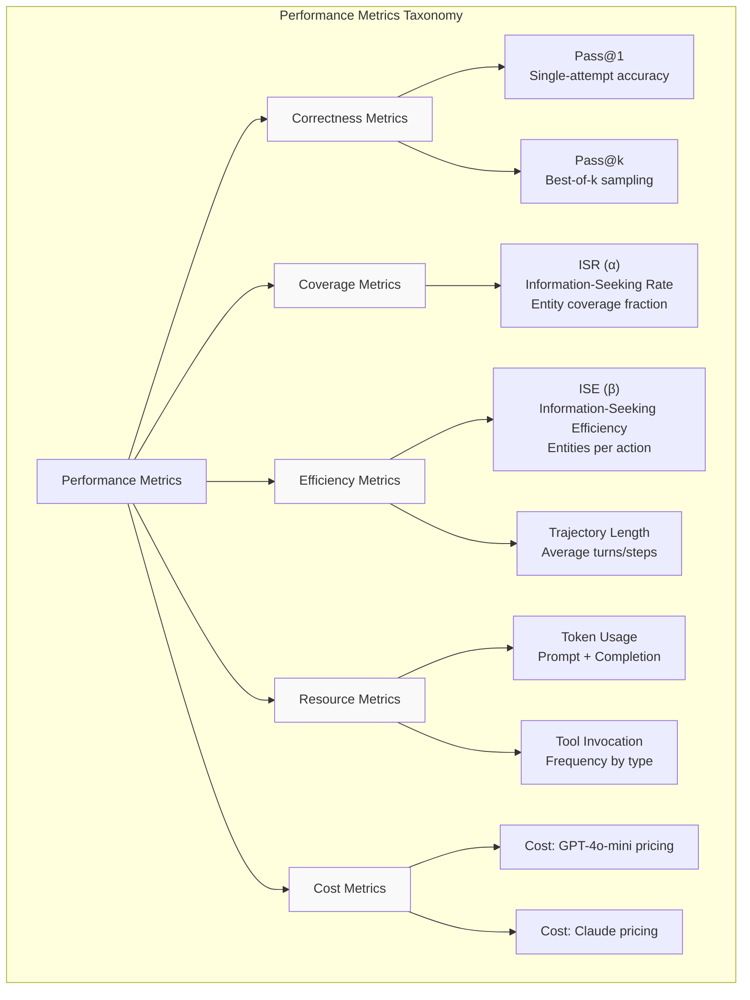
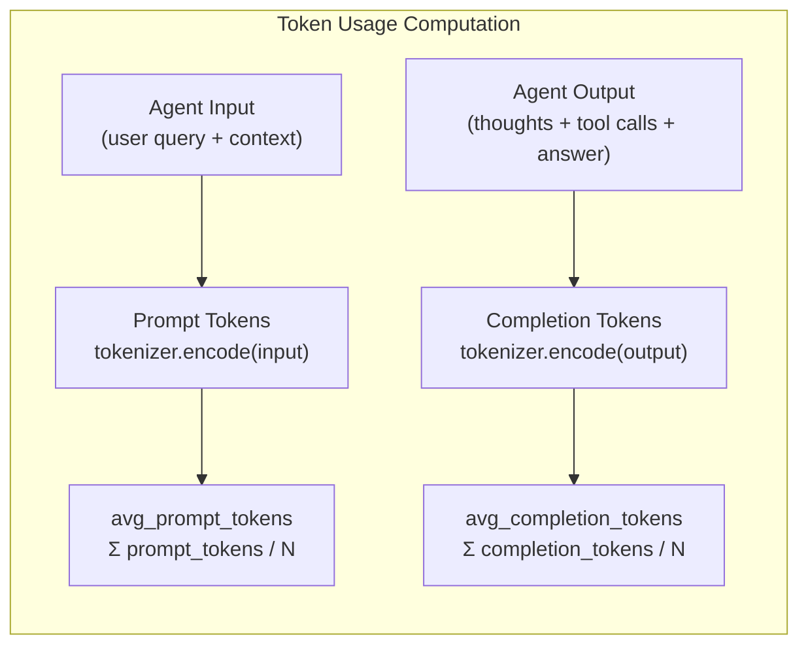
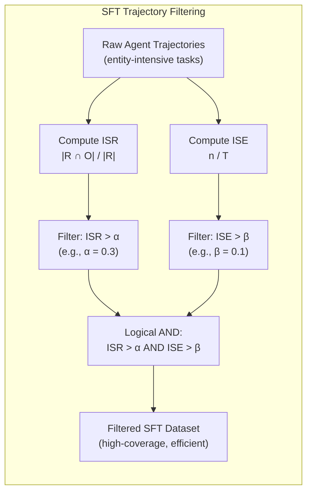

<!-- source: DeepWiki mcp.deepwiki.com · repo Alibaba-NLP/DeepResearch · page 5.3 Performance Metrics and Analysis · fetched 2026-10-29 -->

# Performance Metrics

<details>
<summary>Relevant source files</summary>

The following files were used as context for generating this wiki page:

- [README.md](README.md)
- [WebAgent/WebResummer/src/evaluate.py](WebAgent/WebResummer/src/evaluate.py)
- [WebAgent/WebResummer/src/judge_prompt.py](WebAgent/WebResummer/src/judge_prompt.py)
- [WebAgent/WebResummer/src/main.py](WebAgent/WebResummer/src/main.py)
- [WebAgent/WebResummer/src/prompt.py](WebAgent/WebResummer/src/prompt.py)
- [WebAgent/WebResummer/src/react_agent.py](WebAgent/WebResummer/src/react_agent.py)
- [WebAgent/WebResummer/src/run_resum.sh](WebAgent/WebResummer/src/run_resum.sh)
- [WebAgent/WebResummer/src/summary_utils.py](WebAgent/WebResummer/src/summary_utils.py)
- [WebAgent/WebResummer/src/tool_search.py](WebAgent/WebResummer/src/tool_search.py)
- [WebAgent/WebResummer/src/tool_visit.py](WebAgent/WebResummer/src/tool_visit.py)
- [WebAgent/WebWatcher/infer/evaluation/evaluate_hle_official.py](WebAgent/WebWatcher/infer/evaluation/evaluate_hle_official.py)
- [WebAgent/WebWatcher/infer/evaluation/prompt.py](WebAgent/WebWatcher/infer/evaluation/prompt.py)
- [WebAgent/WebWatcher/infer/evaluation/run_eval.sh](WebAgent/WebWatcher/infer/evaluation/run_eval.sh)
- [WebAgent/WebWatcher/infer/scripts_eval/agent_eval.py](WebAgent/WebWatcher/infer/scripts_eval/agent_eval.py)
- [WebAgent/WebWatcher/infer/scripts_eval/download_image.py](WebAgent/WebWatcher/infer/scripts_eval/download_image.py)
- [WebAgent/WebWatcher/infer/vl_search_r1/qwen-agent-o1_search/qwen_agent/tools/private/jialong_visit.py](WebAgent/WebWatcher/infer/vl_search_r1/qwen-agent-o1_search/qwen_agent/tools/private/jialong_visit.py)

</details>


## Purpose and Scope

This document details the comprehensive performance measurement system used throughout the DeepResearch repository. The metrics quantify agent behavior across multiple dimensions: correctness (Pass@1, Pass@k), information retrieval coverage (ISR), operational efficiency (ISE, trajectory length, token/tool usage), and computational cost. These metrics serve dual purposes: evaluation of deployed models and filtering/reward shaping during training phases.

For information about the evaluation infrastructure and LLM judge system, see [Evaluation Framework and LLM Judge](#5.1). For benchmark dataset specifications, see [Benchmark Datasets](#5.2).

---

## Metric Categories and Hierarchy

The evaluation system organizes metrics into five primary categories, each measuring distinct aspects of agent performance:



**Sources:** [WebLeaper/README.md:52-79](), [WebAgent/WebWatcher/infer/evaluation/evaluate_hle_official.py:169-238]()

---

## Correctness Metrics: Pass@1 and Pass@k

### Pass@1: Single-Attempt Accuracy

**Pass@1** measures the proportion of test instances where the agent's first generated response matches the ground truth. This is the primary correctness metric used across all benchmarks.

**Computation:** For each test instance, an LLM judge (typically `Qwen2.5-72B-Instruct` or `Qwen2.5-32B-Instruct`) compares the predicted answer against the labeled answer. The judge outputs `"yes"`/`"no"` or `"Correct"`/`"Incorrect"` based on semantic equivalence.

```python
# Pseudo-code from evaluate_hle_official.py
acc = 1 if judge_result['correct'] in ('y', 'yes', 'true', 'positive') else 0
metrics = sum([i['acc'] for i in results]) / len(results)
```

**Implementation:**
- Judge prompt templates: [WebAgent/WebWatcher/infer/evaluation/prompt.py:40-65]() (HLE), [WebAgent/WebWatcher/infer/evaluation/prompt.py:98-107]() (GAIA), [WebAgent/WebWatcher/infer/evaluation/prompt.py:110-163]() (BrowseComp-zh)
- Judge invocation: [WebAgent/WebWatcher/infer/evaluation/evaluate_hle_official.py:74-101]()
- Accuracy aggregation: [WebAgent/WebWatcher/infer/evaluation/evaluate_hle_official.py:169-170]()

### Pass@k: Best-of-k Sampling

**Pass@k** evaluates the maximum correctness achievable when generating k independent responses per query and selecting the best one. This metric assesses the model's potential performance with increased inference-time compute.

**Computation:** Generate k rollouts per query (controlled by `ROLLOUT_COUNT` in [inference/run_react_infer.sh:40]()), evaluate each independently, and report the percentage of queries where at least one rollout succeeds.

```
Pass@k = |{queries where max(acc_1, ..., acc_k) = 1}| / |total queries|
```

**Configuration:**
- Rollout count: [inference/run_react_infer.sh:40]() (`ROLLOUT_COUNT` environment variable)
- Sampling temperature: [inference/run_react_infer.sh:41]() (`TEMPERATURE`)
- Presence penalty: [inference/run_react_infer.sh:42]() (`PRESENCE_PENALTY`)

**Sources:** [WebAgent/WebWatcher/infer/evaluation/evaluate_hle_official.py:117-240](), [inference/run_react_infer.sh:40-43]()

---

## Coverage Metrics: Information-Seeking Rate (ISR)

### Definition

**ISR (Information-Seeking Rate)** quantifies the fraction of required information entities successfully retrieved by the agent. This metric is central to WebLeaper's entity-intensive training paradigm.

**Formula:**
```
ISR = |R ∩ O| / |R|
```
where:
- `R` = set of required entities (ground truth)
- `O` = set of observed/retrieved entities (agent output)
- `α` = threshold parameter for filtering SFT trajectories (e.g., α = 0.3)

**Intuition:** An agent with ISR = 0.7 successfully retrieved 70% of the required information entities. Higher ISR indicates more comprehensive information gathering.

### Variance Stability

As documented in WebLeaper, ISR exhibits favorable statistical properties for entity-intensive tasks:

```
Var(ISR) = O(1/n)
```

where `n` is the number of target entities. This inverse relationship ensures that as tasks scale to include more entities, ISR becomes a more reliable and stable metric for training.

### Use in Training

**SFT Trajectory Filtering:** During supervised fine-tuning, only trajectories satisfying `ISR > α` are retained. This ensures the model learns from high-coverage examples.

```
SFT_data = {trajectory | ISR(trajectory) > α}
```

**GRPO Reward Component:** ISR contributes to the soft F-score reward in reinforcement learning:

```
Soft Precision P = |semantically_matched_entities| / |retrieved_entities|
Soft Recall R_c = ISR (by definition)
R_WebLeaper = (1 + ω²) · (P · R_c) / (ω² · P + R_c)
```

**Sources:** [WebLeaper/README.md:52-62](), [WebLeaper/README.md:66-79](), [WebLeaper/README.md:82-96]()

---

## Efficiency Metrics

### Information-Seeking Efficiency (ISE)

**ISE (Information-Seeking Efficiency)** measures the rate of information discovery per action step, capturing how economically the agent uses its tool invocations.

**Formula:**
```
ISE = n / T
```
where:
- `n` = number of target entities successfully retrieved
- `T` = total number of action steps (primarily `Visit` calls)
- `β` = threshold parameter for filtering SFT trajectories (e.g., β = 0.1)

**Entity Attribution:** As noted in [WebLeaper/README.md:78](), entities from `Search` snippets are often imprecise; ISE primarily counts entities extracted from `Visit` tool responses, which provide detailed webpage content and entity extraction.

**Example:** If an agent retrieves 15 entities in 50 `Visit` actions, ISE = 15/50 = 0.3 entities per visit.

### Variance Stability

Similar to ISR, ISE variance decreases with task scale:

```
Var(ISE) = O(1/n)
```

This property makes ISE suitable as a training signal for entity-intensive tasks.

### Use in Training

**SFT Trajectory Filtering:** Only trajectories with both high coverage AND high efficiency are retained:

```
SFT_data = {trajectory | ISR(trajectory) > α AND ISE(trajectory) > β}
```

Typical thresholds: `α = 0.3`, `β = 0.1` [WebLeaper/README.md:148]()

**Sources:** [WebLeaper/README.md:58-62](), [WebLeaper/README.md:66-79]()

### Trajectory Length

**Trajectory Length** measures the number of interaction turns (think-action-observe cycles) required to produce a final answer.

**Computation:**

```python
# From evaluate_hle_official.py
avg_turns = sum([i['turns'] for i in results]) / len(results)
avg_turns_correct = sum([i['turns'] for i in results if i['acc'] == 1]) / correct_count
```

**Metrics Reported:**
- `avg_turns`: Mean trajectory length across all instances
- `avg_turns_correct`: Mean trajectory length for successful instances only
- `turns_dist`: Distribution histogram of trajectory lengths

**Interpretation:** Lower trajectory length (for correct answers) indicates more efficient problem-solving. However, complex queries may legitimately require longer trajectories.

**Sources:** [WebAgent/WebWatcher/infer/evaluation/evaluate_hle_official.py:219-237]()

---

## Resource Usage Metrics

### Token Statistics

Token usage quantifies the computational cost of each inference run by measuring prompt and completion token counts.



**Computation Logic:**

```python
# From evaluate_hle_official.py:172-179
for i in results:
    if i['token_usage']:
        completion_tokens += i['token_usage']['completion_tokens']
        prompt_tokens += i['token_usage']['prompt_tokens']

avg_completion_tokens = completion_tokens / len(results)
avg_prompt_tokens = prompt_tokens / len(results)
```

**Usage:** Token statistics inform infrastructure planning (GPU memory requirements) and cost estimation. Models with lower token usage per correct answer are more economical to deploy.

**Sources:** [WebAgent/WebWatcher/infer/evaluation/evaluate_hle_official.py:172-179](), [WebAgent/WebWatcher/infer/evaluation/evaluate_hle_official.py:227-228]()

### Tool Invocation Statistics

Tool usage metrics track the frequency of each tool type invocation, revealing the agent's information-gathering strategy.

**Tracked Tools:**
- `google_search` / `search`: Web search queries
- `google_scholar`: Academic paper search
- `Visit`: Webpage reading and summarization
- `PythonInterpreter` / `code_interpreter`: Code execution
- `VLSearchImage`: Reverse image search (vision-language agents)

**Computation:**

```python
# From evaluate_hle_official.py:198-217
tool_usage = defaultdict(list)
tool_usage_correct = defaultdict(list)

for i in results:
    cur_usage = {'google_search': 0, 'google_scholar': 0, 'Visit': 0, 'PythonInterpreter': 0}
    for tool_use in i['tool_usage']:
        if tool_use in cur_usage:
            cur_usage[tool_use] += i['tool_usage'][tool_use]
    
    for tool_use in cur_usage:
        tool_usage[tool_use].append(cur_usage[tool_use])
        if i['acc'] == 1:
            tool_usage_correct[tool_use].append(cur_usage[tool_use])

tool_usage = {k: sum(v)/len(results) for k, v in tool_usage.items()}
tool_usage_correct = {k: sum(v)/correct_num for k, v in tool_usage_correct.items()}
```

**Reported Metrics:**
- `tool_usage`: Average invocations per tool across all instances
- `tool_usage_correct`: Average invocations per tool for successful instances only

**Interpretation:** Comparing `tool_usage` vs. `tool_usage_correct` reveals whether successful strategies use tools more or less intensively than failed attempts.

**Sources:** [WebAgent/WebWatcher/infer/evaluation/evaluate_hle_official.py:198-217]()

---

## Cost Metrics

Cost metrics convert token usage into monetary estimates based on commercial API pricing models.

**Pricing Models Implemented:**

```python
# From evaluate_hle_official.py:229
avg_dollars_o4mini = avg_prompt_tokens/1000000 * 1.1 + avg_completion_tokens/1000000 * 4.4
avg_dollars_claude = avg_prompt_tokens/1000000 * 3 + avg_completion_tokens/1000000 * 15
```

**GPT-4o-mini Pricing:**
- Input: $1.10 per 1M tokens
- Output: $4.40 per 1M tokens

**Claude Pricing (for comparison):**
- Input: $3.00 per 1M tokens
- Output: $15.00 per 1M tokens

**Per-Turn Cost Distribution:**

```python
# From evaluate_hle_official.py:180-190
dollars_under_turn = Counter()
for i in results:
    dollars_under_turn[i['turns']] += i['dollars_o4mini']

for turn in dollars_under_turn:
    dollars_under_turn[turn] /= turns_dist[turn]
```

This computes the average cost per instance at each trajectory length, revealing whether longer interactions incur proportionally higher costs.

**Sources:** [WebAgent/WebWatcher/infer/evaluation/evaluate_hle_official.py:180-190](), [WebAgent/WebWatcher/infer/evaluation/evaluate_hle_official.py:229]()

---

## Metric Computation Flow

The following diagram illustrates how metrics are computed from raw agent predictions:

```mermaid
graph TB
    subgraph "Metric Computation Pipeline"
        PredFile["Prediction File<br/>iter*.jsonl<br/>run_multi_react.py output"]
        
        LoadData["load_jsonl()<br/>evaluate_hle_official.py:22-24"]
        
        PredFile --> LoadData
        
        ParallelProc["ThreadPoolExecutor<br/>max_workers=MAX_WORKERS<br/>evaluate_hle_official.py:159-167"]
        
        LoadData --> ParallelProc
        
        ProcessItem["process_item()<br/>per-instance evaluation<br/>evaluate_hle_official.py:117-140"]
        
        ParallelProc --> ProcessItem
        
        ExtractResp["extract_response()<br/>Parse <answer> tag<br/>evaluate_hle_official.py:103-115"]
        
        JudgeCall["extract_answer()<br/>LLM judge via OpenAI API<br/>evaluate_hle_official.py:74-101"]
        
        ProcessItem --> ExtractResp
        ExtractResp --> JudgeCall
        
        ItemMetrics["Per-item Metrics:<br/>acc, turns, token_usage,<br/>tool_usage, dollars<br/>evaluate_hle_official.py:131-139"]
        
        JudgeCall --> ItemMetrics
        
        Aggregate["Aggregate Metrics:<br/>mean(acc), avg_turns,<br/>tool_usage stats, cost<br/>evaluate_hle_official.py:169-237"]
        
        ItemMetrics --> Aggregate
        
        OutputFiles["Output Files:<br/>iter*_scored.jsonl<br/>iter*.report.json<br/>evaluate_hle_official.py:240-244"]
        
        Aggregate --> OutputFiles
    end
    
    style LoadData fill:#f9f9f9
    style ProcessItem fill:#f9f9f9
    style Aggregate fill:#f9f9f9
```



**Sources:** [WebAgent/WebWatcher/infer/evaluation/evaluate_hle_official.py:22-244]()

---

## Metric-Specific Training Components

### SFT Trajectory Filtering with ISR and ISE

During WebLeaper's supervised fine-tuning phase, trajectories are filtered to retain only high-quality examples satisfying both coverage and efficiency criteria:



**Rationale:** Filtering ensures the model learns from trajectories that are both comprehensive (high ISR) and economical (high ISE), avoiding examples that meander inefficiently or fail to retrieve sufficient information.

**Sources:** [WebLeaper/README.md:66-79](), [WebLeaper/README.md:145-151]()

### GRPO Hybrid Reward System

WebLeaper's reinforcement learning stage employs a **Hybrid Reward System** that provides dense, granular feedback:

**For WebLeaper Tasks (R_WebLeaper):**

```
Soft F-score Reward:
  - Soft Precision P = semantic_similarity(retrieved, required) / |retrieved|
  - Soft Recall R_c = ISR (coverage)
  - R_WebLeaper = (1 + ω²) · (P · R_c) / (ω² · P + R_c)
```

**For Legacy Benchmark Tasks (R_legacy):**

```
R_legacy = binary success/failure (0 or 1)
```

**Optimization Algorithm:** Group Relative Policy Optimization (GRPO), which samples multiple trajectories per query, computes advantages relative to the group mean reward, and updates the policy using a PPO-like objective.

**Motivation:** Standard binary rewards are too sparse for entity-intensive tasks with dozens of required entities. The soft F-score provides fine-grained credit assignment, rewarding partial progress while penalizing inefficiency.

**Sources:** [WebLeaper/README.md:82-96]()

---

## Evaluation Configuration and Environment Variables

Key configuration parameters controlling metric computation:

| Variable | Purpose | Default/Example | Source |
|----------|---------|-----------------|--------|
| `JUDGE_MODEL` | LLM model for accuracy evaluation | `Qwen/Qwen2.5-32B-Instruct` | [evaluate_hle_official.py:16]() |
| `MAX_WORKERS` | Parallel judging threads | `1` (adjustable) | [evaluate_hle_official.py:17]() |
| `API_KEY` | OpenAI-compatible API key for judge | Environment variable | [evaluate_hle_official.py:19]() |
| `BASE_URL` | API endpoint for judge | `https://api-inference.modelscope.cn/v1/` | [evaluate_hle_official.py:20]() |
| `ROLLOUT_COUNT` | Number of Pass@k rollouts | `3` | [run_react_infer.sh:40]() |
| `TEMPERATURE` | Sampling temperature | `0.85` | [run_react_infer.sh:41]() |
| `PRESENCE_PENALTY` | Repetition penalty | `1.1` | [run_react_infer.sh:42]() |

**Invocation Example:**

```bash
# From run_eval.sh
export API_KEY=$1
export BASE_URL=$2
export JUDGE_MODEL=$3
export MAX_WORKERS=$4

python evaluation/evaluate_hle_official.py --input_fp YOUR_PREDICTIONS_FILE.jsonl
```

**Sources:** [WebAgent/WebWatcher/infer/evaluation/run_eval.sh:1-7](), [inference/run_react_infer.sh:40-43](), [.env.example:43-60]()

---

## Output Formats

### Scored Details File

Each prediction is annotated with computed metrics:

```json
{
  "acc": 1,
  "turns": 5,
  "token_usage": {
    "completion_tokens": 1234,
    "prompt_tokens": 5678
  },
  "tool_usage": {
    "google_search": 2,
    "Visit": 3,
    "PythonInterpreter": 0
  },
  "dollars_o4mini": 0.0234,
  "is_answer": 1,
  "item": { /* original prediction data */ }
}
```

Saved as: `<input_file>_scored.jsonl`

### Summary Report File

Aggregated statistics across all instances:

```json
{
  "evaluated_nums": 1000,
  "valid_nums": 987,
  "metrics": 72.5,
  "judge_model": "Qwen/Qwen2.5-32B-Instruct",
  "avg_prompt_tokens": 3456.7,
  "avg_completion_tokens": 1234.5,
  "avg_dollars_o4mini": 0.0189,
  "avg_dollars_claude": 0.0567,
  "tool_usage": {
    "google_search": 2.3,
    "Visit": 4.1,
    "PythonInterpreter": 0.8
  },
  "tool_usage_correct": {
    "google_search": 2.1,
    "Visit": 3.9,
    "PythonInterpreter": 0.9
  },
  "is_answer_rate": 0.95,
  "avg_turns": 5.2,
  "avg_turns_correct": 4.8,
  "turns_dist": {
    "3": 120,
    "4": 230,
    "5": 310,
    "6": 180,
    "7": 90
  }
}
```

Saved as: `<input_file>.report.json`

**Sources:** [WebAgent/WebWatcher/infer/evaluation/evaluate_hle_official.py:222-244]()

---

## Key Takeaways

1. **Dual Purpose:** Metrics serve both evaluation (measuring deployed agent performance) and training (filtering SFT data, shaping RL rewards).

2. **Multi-Dimensional Assessment:** No single metric captures agent quality. Correctness (Pass@1), coverage (ISR), efficiency (ISE, trajectory length), resource usage (tokens, tools), and cost must be analyzed jointly.

3. **Entity-Intensive Focus:** ISR and ISE are specifically designed for tasks with many required entities, exhibiting favorable statistical properties (variance ∝ 1/n) that make them reliable training signals.

4. **Flexible Infrastructure:** The evaluation system supports parallel LLM judging, multiple API backends, and extensible tool tracking, accommodating diverse benchmark requirements.

5. **Training-Evaluation Alignment:** Metrics used during training (ISR/ISE thresholds for SFT, soft F-score for GRPO) directly correspond to evaluation metrics, ensuring consistency between development and deployment.

**Sources:** [WebLeaper/README.md:1-162](), [WebAgent/WebWatcher/infer/evaluation/evaluate_hle_official.py:1-246]()

---

