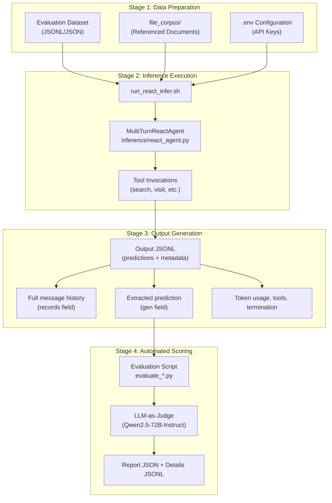
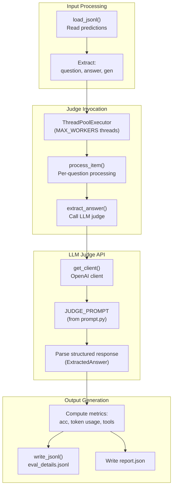

<!-- source: DeepWiki mcp.deepwiki.com · repo Alibaba-NLP/DeepResearch · page 5.4 Running Evaluations · fetched 2026-10-29 -->

# Running Evaluations

<details>
<summary>Relevant source files</summary>

The following files were used as context for generating this wiki page:

- [README.md](README.md)
- [WebAgent/WebWatcher/infer/evaluation/evaluate_hle_official.py](WebAgent/WebWatcher/infer/evaluation/evaluate_hle_official.py)
- [WebAgent/WebWatcher/infer/evaluation/prompt.py](WebAgent/WebWatcher/infer/evaluation/prompt.py)
- [WebAgent/WebWatcher/infer/evaluation/run_eval.sh](WebAgent/WebWatcher/infer/evaluation/run_eval.sh)
- [WebAgent/WebWatcher/infer/scripts_eval/agent_eval.py](WebAgent/WebWatcher/infer/scripts_eval/agent_eval.py)
- [WebAgent/WebWatcher/infer/scripts_eval/download_image.py](WebAgent/WebWatcher/infer/scripts_eval/download_image.py)
- [WebAgent/WebWatcher/infer/vl_search_r1/qwen-agent-o1_search/qwen_agent/tools/private/jialong_visit.py](WebAgent/WebWatcher/infer/vl_search_r1/qwen-agent-o1_search/qwen_agent/tools/private/jialong_visit.py)

</details>


This document provides a step-by-step guide to running evaluations on benchmark datasets, from generating model predictions through automated scoring and metrics computation. This covers the complete evaluation workflow for assessing Tongyi DeepResearch performance across various benchmarks.

For information about the evaluation framework architecture and LLM-as-judge methodology, see [Evaluation Framework and LLM Judge](#5.1). For details about individual benchmark datasets and their formats, see [Benchmark Datasets](#5.2). For interpreting results and metrics, see [Performance Metrics and Analysis](#5.3).

## Evaluation Pipeline Overview

The evaluation process consists of four sequential stages: data preparation, inference execution, prediction post-processing, and automated scoring using LLM-as-judge.



**Diagram: Complete Evaluation Pipeline from Data to Results**

Sources: [README.md:68-185](), [WebAgent/WebWatcher/infer/evaluation/evaluate_hle_official.py:1-246]()

## Stage 1: Preparing Evaluation Data

### Input Data Format

Evaluation datasets must be provided in either JSONL or JSON format, with each entry containing `question` and `answer` fields. The `answer` field contains the ground truth reference answer used for automated evaluation.

**JSONL Format (Recommended)**
```jsonl
{"question": "What is the capital of France?", "answer": "Paris"}
{"question": "Explain quantum computing", "answer": "A computational paradigm..."}
```

**JSON Format**
```json
[
  {"question": "What is the capital of France?", "answer": "Paris"},
  {"question": "Explain quantum computing", "answer": "A computational paradigm..."}
]
```

### File Organization Structure

```
project_root/
├── eval_data/
│   ├── my_questions.jsonl          # Your evaluation dataset
│   └── file_corpus/                # Referenced documents
│       ├── report.pdf
│       ├── data.xlsx
│       └── presentation.pptx
├── .env                            # API keys configuration
├── run_react_infer.sh              # Inference script
└── evaluation/
    ├── evaluate_hle_official.py
    ├── run_eval.sh
    └── prompt.py
```

### Document-Based Questions

For questions requiring document analysis, prepend the filename to the question field and place documents in `eval_data/file_corpus/`:

```jsonl
{"question": "(Uploaded 1 file: ['report.pdf'])\n\nWhat are the key findings?", "answer": "..."}
```

Sources: [README.md:113-153]()

## Stage 2: Running Inference

### Configuring the Inference Script

The [run_react_infer.sh]() script orchestrates the inference process. Key configuration variables:

| Variable | Description | Example |
|----------|-------------|---------|
| `MODEL_PATH` | Path to model weights (local or HuggingFace/ModelScope) | `/path/to/Tongyi-DeepResearch-30B-A3B` |
| `DATASET` | Full path to evaluation data file | `eval_data/my_questions.jsonl` |
| `OUTPUT_PATH` | Directory for saving prediction results | `./outputs/eval_run_001` |
| `MAX_TURNS` | Maximum conversation turns per question | `10` (default) |
| `MAX_TOKENS` | Token limit for generation | `32768` |

### Environment Variables Required

Ensure `.env` file contains all necessary API keys before running inference:

```bash
# Required API Keys
SERPER_KEY_ID=your_serper_key          # Web search (Serper.dev)
JINA_API_KEYS=your_jina_key            # Web page reading (Jina.ai)
API_KEY=your_openai_key                # Summarization (OpenAI-compatible)
DASHSCOPE_API_KEY=your_dashscope_key   # File parsing (Dashscope)
SANDBOX_FUSION_ENDPOINT=your_endpoint   # Python interpreter

# Model Configuration
MODEL_PATH=/path/to/model
DATASET=eval_data/my_questions.jsonl
OUTPUT_PATH=./outputs
```

Sources: [README.md:89-110]()

### Executing Inference

```bash
# Run inference script
bash run_react_infer.sh
```

The script invokes [inference/react_agent.py]() which instantiates `MultiTurnReactAgent` and processes each question through the ReAct loop (Think → Act → Observe) until:
- Agent provides final answer with `<answer>` tag
- Maximum turns reached (`MAX_TURNS`)
- Token limit exceeded (`MAX_TOKENS`)
- Error encountered

```mermaid
graph LR
    Start["Load Question"]
    Init["Initialize<br/>MultiTurnReactAgent"]
    Think["Generate Thinking<br/><tool_call>...</tool_call>"},
    {"role": "tool", "content": "<tool_response>...</tool_response>"},
    {"role": "assistant", "content": "<answer>Final answer</answer>"}
  ],
  "gen": "Extracted final answer from <answer> tag",
  "usage": {
    "prompt_tokens": 12543,
    "completion_tokens": 3421,
    "total_tokens": 15964
  },
  "tool_calls": [
    {"name": "search", "count": 2},
    {"name": "visit", "count": 5}
  ],
  "termination_reason": "answer",
  "turns": 8
}
```

### Output Fields Reference

| Field | Type | Description |
|-------|------|-------------|
| `question` | string | Original question from input |
| `answer` | string | Ground truth reference answer |
| `records` | array | Complete conversation history with roles |
| `gen` | string | Extracted final answer for evaluation |
| `usage` | object | Token counts (prompt, completion, total) |
| `tool_calls` | array | Tool invocation statistics |
| `termination_reason` | string | `answer`, `max_turn`, `token_limit`, or `error` |
| `turns` | integer | Number of conversation turns completed |

Sources: [WebAgent/WebWatcher/infer/evaluation/evaluate_hle_official.py:103-140]()

## Stage 4: Running Evaluation Scripts

### Evaluation Script Architecture

Different benchmarks use specialized evaluation scripts, but all follow a common pattern:



**Diagram: Evaluation Script Execution Flow**

### Running Standard Evaluation

For HLE (Humanity's Last Exam) and similar benchmarks:

```bash
# Configure environment
export API_KEY="your_api_key"
export BASE_URL="https://api-inference.modelscope.cn/v1/"
export JUDGE_MODEL="Qwen/Qwen2.5-72B-Instruct"
export MAX_WORKERS="4"

# Run evaluation
python evaluation/evaluate_hle_official.py \
    --input_fp outputs/predictions.jsonl \
    --repeat_times 1
```

The script generates two output files:
- `predictions.eval_details.jsonl`: Per-question detailed results
- `predictions.report.json`: Aggregated metrics and statistics

Sources: [WebAgent/WebWatcher/infer/evaluation/evaluate_hle_official.py:144-246](), [WebAgent/WebWatcher/infer/evaluation/run_eval.sh:1-7]()

### LLM-as-Judge Process

The evaluation uses structured output parsing with Pydantic models to ensure reliable extraction:

```python
class ExtractedAnswer(BaseModel):
    extracted_final_answer: str
    reasoning: str
    correct: Literal["yes", "no"]
    confidence: int
    strict: Literal[True]
```

The judge prompt [evaluation/prompt.py:40-65]() formats the question, ground truth, and prediction, instructing the judge model to:
1. Extract the final answer from the response
2. Compare against the correct answer
3. Provide reasoning for the judgment
4. Return "yes" or "no" for correctness
5. Extract confidence score if present

The evaluation script [WebAgent/WebWatcher/infer/evaluation/evaluate_hle_official.py:74-101]() calls the judge with retry logic:

```python
def extract_answer(question, correct_answer, response):
    client = get_client()
    prompt = JUDGE_PROMPT.format(
        question=question,
        correct_answer=correct_answer[0],
        response=response
    )
    for i in range(100):
        try:
            response_obj = client.beta.chat.completions.parse(
                model=JUDGE_MODEL,
                max_completion_tokens=100000,
                messages=[{"role": "user", "content": prompt}],
                response_format=ExtractedAnswer,
                timeout=60.0
            )
            content = response_obj.choices[0].message.parsed
            return {
                "correct_answer": correct_answer,
                "model_answer": content.extracted_final_answer,
                "reasoning": content.reasoning,
                "correct": content.correct,
                "confidence": content.confidence
            }
        except Exception as e:
            if 'length limit' in str(e):
                return None
            time.sleep(1)
```

Sources: [WebAgent/WebWatcher/infer/evaluation/evaluate_hle_official.py:67-101](), [WebAgent/WebWatcher/infer/evaluation/prompt.py:40-65]()

## Benchmark-Specific Evaluation

### Supported Judge Prompts

Different benchmarks require different evaluation criteria. The system provides specialized judge prompts:

| Benchmark | Judge Prompt | Key Characteristics |
|-----------|--------------|---------------------|
| HLE | `JUDGE_PROMPT` | Structured extraction with confidence scores |
| GAIA | `JUDGE_PROMPT_GAIA` | Equivalence checking for general questions |
| BrowseComp-EN | `JUDGE_PROMPT_BC_en` | Detailed correctness criteria in English |
| BrowseComp-ZH | `JUDGE_PROMPT_BC_zh` | Chinese-language evaluation rules |
| xbench-DeepSearch | `JUDGE_PROMPT_XBENCH` | Chinese general AI assistant evaluation |
| SimpleQA | `JUDGE_PROMPT_QA` | Three-level grading (CORRECT/INCORRECT/NOT_ATTEMPTED) |
| SEAL | `JUDGE_PROMPT_SEAL0_QA` | Structured QA evaluation with strict criteria |

### BrowseComp Evaluation Example

BrowseComp uses bracket notation in answers to indicate multiple valid responses:

```jsonl
{"question": "抖音自己的人工智能大模型叫什么名字?", "answer": "[[豆包,云雀]]"}
```

The judge prompt [evaluation/prompt.py:110-177]() handles multi-aspect answers:
- Single brackets `[[答案1,答案2]]`: Any correct answer suffices
- Multiple brackets `[[答案1][答案2][答案3]]`: All answers required

### Vision-Language Evaluation

For WebWatcher and other vision-language benchmarks, use the specialized agent evaluation script:

```bash
python scripts_eval/agent_eval.py \
    --output_file outputs/hle_vl_predictions.jsonl \
    --eval_data hle
```

This script [WebAgent/WebWatcher/infer/scripts_eval/agent_eval.py:456-482]() handles multimodal inputs with image processing and specialized tools (`VLSearchImage`, `code_interpreter`).

Sources: [WebAgent/WebWatcher/infer/evaluation/prompt.py:1-439](), [WebAgent/WebWatcher/infer/scripts_eval/agent_eval.py:1-482]()

## Report Output and Metrics

### Report JSON Structure

The evaluation report contains comprehensive statistics:

```json
{
  "evaluated_nums": 500,
  "valid_nums": 498,
  "metrics": 68.5,
  "judge_model": "Qwen/Qwen2.5-72B-Instruct",
  "avg_prompt_tokens": 12543.2,
  "avg_completion_tokens": 3421.8,
  "avg_dollars_o4mini": 0.027,
  "avg_dollars_claude": 0.089,
  "tool_usage": {
    "google_search": 2.3,
    "visit": 5.7,
    "PythonInterpreter": 0.8
  },
  "tool_usage_correct": {
    "google_search": 2.5,
    "visit": 6.1,
    "PythonInterpreter": 0.9
  },
  "is_answer_rate": 0.996,
  "repeat_times": 1,
  "avg_turns": 6.8,
  "avg_turns_correct": 7.2,
  "turns_dist": {
    "3": 45,
    "5": 89,
    "8": 142,
    "10": 87
  }
}
```

### Key Metrics Explained

| Metric | Description |
|--------|-------------|
| `metrics` | Overall accuracy (Pass@1) as percentage |
| `is_answer_rate` | Proportion of runs that produced valid answers |
| `avg_turns` | Average conversation turns across all questions |
| `avg_turns_correct` | Average turns for correctly answered questions |
| `tool_usage` | Average tool invocations per question |
| `tool_usage_correct` | Average tool invocations for correct answers |
| `turns_dist` | Distribution of completion turn counts |

The script [WebAgent/WebWatcher/infer/evaluation/evaluate_hle_official.py:169-245]() computes these metrics by aggregating results across all evaluation instances.

Sources: [WebAgent/WebWatcher/infer/evaluation/evaluate_hle_official.py:169-245]()

## Configuration Reference

### Judge Model Configuration

Environment variables for LLM-as-judge:

```bash
# Judge model selection
export JUDGE_MODEL="Qwen/Qwen2.5-72B-Instruct"

# API configuration
export API_KEY="your_api_key"
export BASE_URL="https://api-inference.modelscope.cn/v1/"

# Parallel processing
export MAX_WORKERS="4"  # Number of concurrent judge requests
```

Higher `MAX_WORKERS` values increase throughput but may hit API rate limits. The evaluation script uses [WebAgent/WebWatcher/infer/evaluation/evaluate_hle_official.py:30-38]() thread-local client instances to enable concurrent processing:

```python
thread_local = threading.local()

def get_client():
    if not hasattr(thread_local, 'client'):
        thread_local.client = OpenAI(
            api_key=API_KEY,
            base_url=BASE_URL,
        )
    return thread_local.client
```

### Inference Configuration

Key parameters in `run_react_infer.sh`:

```bash
# Model serving
MODEL_PATH="/path/to/Tongyi-DeepResearch-30B-A3B"
VLLM_PORT=8001
TENSOR_PARALLEL_SIZE=4  # For multi-GPU deployment

# Generation parameters
MAX_TURNS=10
MAX_TOKENS=32768
TEMPERATURE=0.7
TOP_P=0.95

# Tool configuration
ENABLE_SEARCH=true
ENABLE_VISIT=true
ENABLE_FILE_PARSER=true
ENABLE_PYTHON=true
```

Sources: [README.md:155-167](), [WebAgent/WebWatcher/infer/evaluation/evaluate_hle_official.py:16-20]()

## Troubleshooting Common Issues

### Issue: Evaluation Script Fails to Parse Predictions

**Symptom**: `KeyError: 'gen'` or `KeyError: 'answer'`

**Solution**: Verify output JSONL contains required fields. Check if inference completed successfully:

```bash
# Inspect output structure
head -n 1 outputs/predictions.jsonl | jq .

# Verify all required fields present
jq 'select(.gen == null or .answer == null)' outputs/predictions.jsonl
```

### Issue: Judge Model Returns Invalid Response

**Symptom**: Repeated retry attempts in evaluation logs

**Solution**: Check judge model availability and API quotas:

```bash
# Test judge model access
curl -X POST "$BASE_URL/chat/completions" \
  -H "Authorization: Bearer $API_KEY" \
  -H "Content-Type: application/json" \
  -d '{
    "model": "Qwen/Qwen2.5-72B-Instruct",
    "messages": [{"role": "user", "content": "test"}]
  }'
```

The evaluation script [WebAgent/WebWatcher/infer/evaluation/evaluate_hle_official.py:77-100]() retries up to 100 times with 1-second delays between attempts.

### Issue: Out of Memory During Inference

**Symptom**: CUDA out of memory errors

**Solution**: Adjust context management parameters or use tensor parallelism:

```bash
# Reduce context window
export MAX_TOKENS=16384

# Enable tensor parallelism across GPUs
export TENSOR_PARALLEL_SIZE=8
```

### Issue: Tool API Rate Limits

**Symptom**: Frequent tool failures, `[visit] Failed to read page`

**Solution**: Implement exponential backoff or use multiple API keys in rotation. The Visit tool [WebAgent/WebWatcher/infer/vl_search_r1/qwen-agent-o1_search/qwen_agent/tools/private/jialong_visit.py:221-311]() automatically retries with multiple services (aidata, jina) up to 10 times.

### Issue: Incomplete Evaluation Results

**Symptom**: `valid_nums < evaluated_nums` in report

**Solution**: Examine failed cases in eval_details.jsonl:

```bash
# Find failed evaluations
jq 'select(.acc == null)' outputs/predictions.eval_details.jsonl

# Count by termination reason
jq -r '.item.termination_reason' outputs/predictions.eval_details.jsonl | sort | uniq -c
```

Common failure reasons:
- `max_turn`: Question too complex for turn limit
- `token_limit`: Context overflow (increase MAX_TOKENS)
- `error`: Tool or API failures (check logs)

Sources: [WebAgent/WebWatcher/infer/evaluation/evaluate_hle_official.py:144-246](), [WebAgent/WebWatcher/infer/vl_search_r1/qwen-agent-o1_search/qwen_agent/tools/private/jialong_visit.py:221-311]()

## Complete Evaluation Workflow Example

Here's a complete example evaluating BrowseComp-EN benchmark:

```bash
# Step 1: Prepare data
mkdir -p eval_data
cp /path/to/browsecomp_en.jsonl eval_data/

# Step 2: Configure environment
cat > .env << EOF
SERPER_KEY_ID=your_serper_key
JINA_API_KEYS=your_jina_key
API_KEY=your_openai_key
DASHSCOPE_API_KEY=your_dashscope_key
MODEL_PATH=/path/to/Tongyi-DeepResearch-30B-A3B
DATASET=eval_data/browsecomp_en.jsonl
OUTPUT_PATH=./outputs/browsecomp_en_run
EOF

# Step 3: Run inference
bash run_react_infer.sh

# Step 4: Run evaluation with English judge prompt
export API_KEY="your_judge_api_key"
export BASE_URL="https://api-inference.modelscope.cn/v1/"
export JUDGE_MODEL="Qwen/Qwen2.5-72B-Instruct"
export MAX_WORKERS="4"

python evaluation/evaluate_browsecomp.py \
    --input_fp outputs/browsecomp_en_run/predictions.jsonl \
    --judge_prompt bc_en

# Step 5: Analyze results
cat outputs/browsecomp_en_run/predictions.report.json
jq '.metrics, .avg_turns_correct, .tool_usage_correct' \
    outputs/browsecomp_en_run/predictions.report.json
```

This complete workflow generates:
- `predictions.jsonl`: Raw model outputs with full conversation history
- `predictions.eval_details.jsonl`: Per-question evaluation results with judge reasoning
- `predictions.report.json`: Aggregated metrics and performance statistics

Sources: [README.md:68-185](), [WebAgent/WebWatcher/infer/evaluation/evaluate_hle_official.py:1-246]()

---

