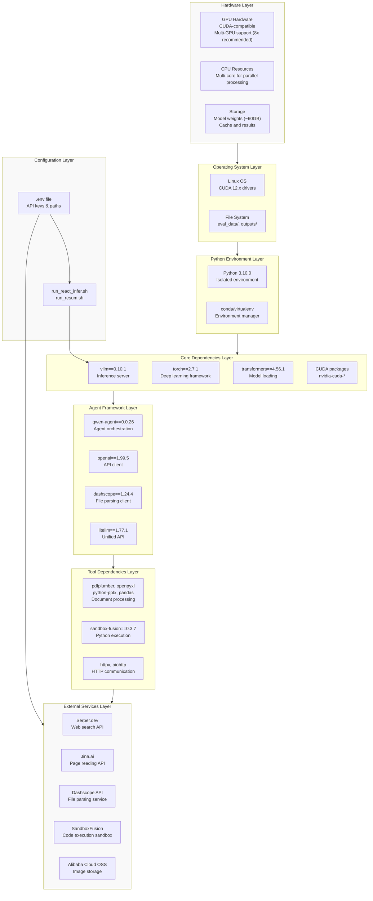
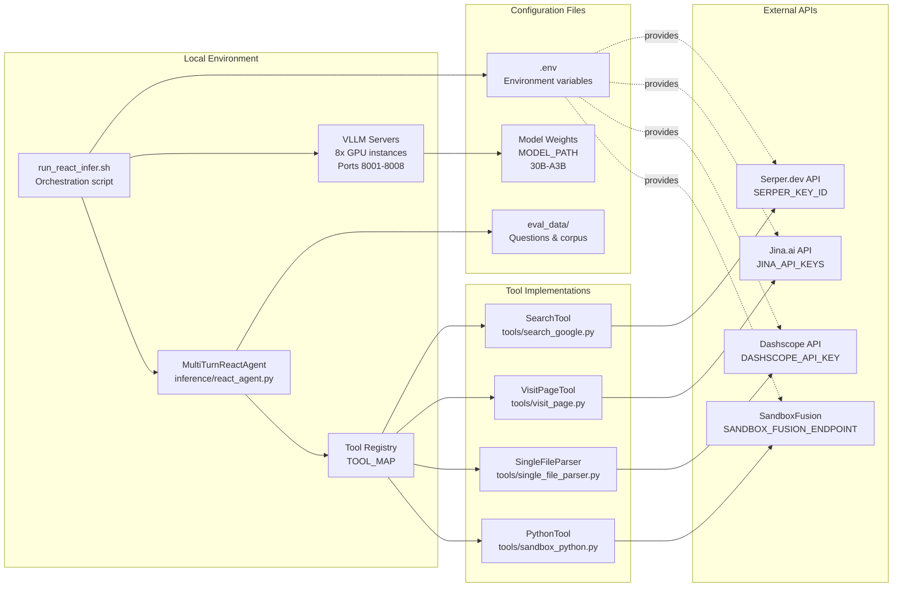

<!-- source: DeepWiki mcp.deepwiki.com · repo Alibaba-NLP/DeepResearch · page 6 Setup and Configuration · fetched 2026-10-29 -->

# Infrastructure and Setup

<details>
<summary>Relevant source files</summary>

The following files were used as context for generating this wiki page:

- [README.md](README.md)
- [requirements.txt](requirements.txt)

</details>


This page provides an overview of the infrastructure requirements and setup procedures for deploying and running Tongyi DeepResearch. It covers the hardware requirements, software dependencies, external service integrations, and configuration steps needed to prepare a development or production environment.

For detailed information about specific setup aspects, see:
- **[Dependencies and Environment](#6.1)** - Python packages, CUDA requirements, and environment isolation
- **[Configuration and API Keys](#6.2)** - Environment variables, API credentials, and model paths
- **[Model Downloads and Local Deployment](#6.3)** - Downloading models and configuring VLLM servers

For information about running the inference system after setup, see **[Inference Orchestration Scripts](#2.8)**.

## Infrastructure Overview

The Tongyi DeepResearch system requires a multi-layered infrastructure stack comprising local compute resources, external service integrations, and properly configured software dependencies. The system is designed for GPU-accelerated inference with distributed serving capabilities.

### Infrastructure Stack



**Sources:** [README.md:72-87](), [requirements.txt:1-189]()

### Component Interaction Architecture

The following diagram shows how infrastructure components interact during system operation:



**Sources:** [README.md:94-111](), [README.md:156-167]()

## Hardware and Compute Requirements

The system requires GPU acceleration for model inference. The recommended configuration is:

| Component | Requirement | Notes |
|-----------|-------------|-------|
| **GPU** | CUDA-compatible GPUs | Multi-GPU setup recommended (8x) for distributed serving |
| **CUDA** | 12.x drivers | Required for torch and vllm compatibility |
| **GPU Memory** | ~30GB+ per GPU | For 30B-A3B model with MoE architecture |
| **CPU** | Multi-core processor | For parallel tool execution and data processing |
| **RAM** | 64GB+ recommended | For data loading and processing |
| **Storage** | 100GB+ available | Model weights (~60GB), data, and cache |

**Alternative Deployment:** The system can also be accessed via [OpenRouter API](https://openrouter.ai/alibaba/tongyi-deepresearch-30b-a3b), eliminating GPU requirements for inference [README.md:172-181]().

**Sources:** [README.md:72-87](), [requirements.txt:89-102]()

## Software Dependencies Overview

The system relies on multiple categories of Python dependencies:

### Core Inference Stack

| Package | Version | Purpose |
|---------|---------|---------|
| `vllm` | 0.10.1 | Distributed LLM inference server |
| `torch` | 2.7.1 | Deep learning framework |
| `transformers` | 4.56.1 | Model loading and tokenization |
| `xformers` | 0.0.31 | Memory-efficient attention |
| `triton` | 3.3.1 | GPU kernel optimizations |

### Agent Framework

| Package | Version | Purpose |
|---------|---------|---------|
| `qwen-agent` | 0.0.26 | Agent orchestration framework |
| `openai` | 1.99.5 | OpenAI-compatible API client |
| `litellm` | 1.77.1 | Unified LLM API interface |

### Tool Dependencies

| Package | Version | Purpose |
|---------|---------|---------|
| `dashscope` | 1.24.4 | Alibaba Dashscope API client |
| `pdfplumber` | 0.11.7 | PDF parsing |
| `openpyxl` | 3.1.5 | Excel file processing |
| `python-pptx` | 1.0.2 | PowerPoint processing |
| `pandas` | 2.3.2 | Data manipulation |
| `sandbox-fusion` | 0.3.7 | Code execution sandbox |

### HTTP and Async Libraries

| Package | Version | Purpose |
|---------|---------|---------|
| `httpx` | 0.28.1 | Async HTTP client |
| `aiohttp` | 3.12.15 | Async HTTP operations |
| `requests` | 2.32.5 | Synchronous HTTP client |

Full dependency list is available in [requirements.txt:1-189]().

**Sources:** [requirements.txt:1-189]()

## External Service Dependencies

The system integrates with multiple external APIs for tool functionality:

### Service-to-Configuration Mapping

```mermaid
graph TB
    subgraph EnvVariables[".env Configuration Variables"]
        SERPER["SERPER_KEY_ID"]
        JINA["JINA_API_KEYS"]
        APIKEY["API_KEY / API_BASE"]
        DASHSCOPE["DASHSCOPE_API_KEY"]
        SANDBOX["SANDBOX_FUSION_ENDPOINT"]
        IMGKEY["IMG_SEARCH_KEY"]
        OSSKEYS["OSS_ACCESS_KEY_ID<br/>OSS_ACCESS_KEY_SECRET<br/>OSS_ENDPOINT<br/>OSS_BUCKET"]
        MODELPATH["MODEL_PATH"]
        DATASET["DATASET"]
        OUTPUT["OUTPUT_PATH"]
    end
    
    subgraph ExternalServices["External Service Providers"]
        SerperDev["Serper.dev<br/>serper.dev"]
        JinaAI["Jina.ai<br/>jina.ai"]
        OpenAIAPI["OpenAI-compatible API<br/>platform.openai.com"]
        DashscopeService["Dashscope<br/>dashscope.aliyun.com"]
        SandboxService["SandboxFusion<br/>github.com/bytedance/SandboxFusion"]
        SerpAPI["SerpApi<br/>serpapi.com"]
        AliyunOSS["Alibaba Cloud OSS<br/>aliyun.com/oss"]
    end
    
    subgraph ToolUsage["Tool Implementations"]
        SearchGoogle["SearchTool<br/>Web & Scholar search"]
        VisitPage["VisitPageTool<br/>Page reading"]
        FileParser["SingleFileParser<br/>Document parsing"]
        PythonExec["PythonTool<br/>Code execution"]
        VLSearch["VLSearchImageTool<br/>Image search"]
    end
    
    subgraph LocalResources["Local Resources"]
        ModelFiles["Model Weights<br/>HuggingFace/ModelScope"]
        DataFiles["Evaluation Data<br/>eval_data/"]
        OutputDir["Results Directory<br/>outputs/"]
    end
    
    SERPER --> SerperDev
    JINA --> JinaAI
    APIKEY --> OpenAIAPI
    DASHSCOPE --> DashscopeService
    SANDBOX --> SandboxService
    IMGKEY --> SerpAPI
    OSSKEYS --> AliyunOSS
    MODELPATH --> ModelFiles
    DATASET --> DataFiles
    OUTPUT --> OutputDir
    
    SerperDev --> SearchGoogle
    JinaAI --> VisitPage
    OpenAIAPI --> VisitPage
    DashscopeService --> FileParser
    SandboxService --> PythonExec
    SerpAPI --> VLSearch
    AliyunOSS --> VLSearch
```



**Sources:** [README.md:94-111]()

### Required API Keys and Services

| Service | Environment Variable | Required For | Obtain From |
|---------|---------------------|--------------|-------------|
| Serper.dev | `SERPER_KEY_ID` | Web search, Google Scholar | https://serper.dev/ |
| Jina.ai | `JINA_API_KEYS` | Web page reading | https://jina.ai/ |
| OpenAI-compatible API | `API_KEY`, `API_BASE` | Page summarization | https://platform.openai.com/ |
| Dashscope | `DASHSCOPE_API_KEY` | File parsing (PDF, DOCX, Excel) | https://dashscope.aliyun.com/ |
| SandboxFusion | `SANDBOX_FUSION_ENDPOINT` | Python code execution | https://github.com/bytedance/SandboxFusion |
| SerpApi | `IMG_SEARCH_KEY` | Image search (optional) | https://serpapi.com/ |
| Alibaba Cloud OSS | `OSS_ACCESS_KEY_ID`, etc. | Image storage (optional) | https://aliyun.com/oss |

**Sources:** [README.md:102-106]()

## Directory Structure and File Organization

The system expects a specific directory layout for data files and output:

```
project_root/
├── .env                        # Environment configuration (gitignored)
├── .env.example                # Example configuration template
├── requirements.txt            # Python dependencies
├── README.md                   # Main documentation
├── run_react_infer.sh         # ReAct inference orchestration script
├── run_resum.sh               # ReSum inference orchestration script
│
├── inference/                  # Core inference code
│   ├── react_agent.py         # MultiTurnReactAgent implementation
│   ├── llm_client.py          # LLM communication layer
│   └── ...
│
├── tools/                      # Tool implementations
│   ├── search_google.py       # Search tool
│   ├── visit_page.py          # Visit tool
│   ├── single_file_parser.py # File parser tool
│   ├── sandbox_python.py      # Python execution tool
│   └── ...
│
├── eval_data/                  # Evaluation datasets
│   ├── my_questions.jsonl     # Question files (JSON/JSONL)
│   └── file_corpus/           # Referenced documents
│       ├── report.pdf
│       ├── data.xlsx
│       └── ...
│
├── outputs/                    # Inference results
│   ├── iter_0.jsonl           # Prediction files
│   ├── iter_0_scored.jsonl    # Scored predictions
│   └── .report.json           # Summary statistics
│
└── evaluation/                 # Evaluation scripts
    ├── judge_gaia.py          # GAIA dataset evaluation
    ├── judge_browsecomp.py    # BrowseComp evaluation
    └── ...
```

**Sources:** [README.md:146-153]()

## Setup Workflow

The following diagram illustrates the complete setup and deployment workflow:

```mermaid
graph TB
    Start["Start Setup"]
    
    subgraph PrepareEnvironment["1. Prepare Environment"]
        CreateEnv["Create Python 3.10.0<br/>isolated environment<br/>conda/virtualenv"]
        InstallDeps["Install dependencies<br/>pip install -r requirements.txt"]
    end
    
    subgraph ObtainCredentials["2. Obtain API Credentials"]
        RegisterSerper["Register Serper.dev<br/>Get SERPER_KEY_ID"]
        RegisterJina["Register Jina.ai<br/>Get JINA_API_KEYS"]
        RegisterOpenAI["Get OpenAI API key<br/>Or compatible service"]
        RegisterDashscope["Register Dashscope<br/>Get DASHSCOPE_API_KEY"]
        RegisterSandbox["Setup SandboxFusion<br/>Get SANDBOX_FUSION_ENDPOINT"]
    end
    
    subgraph ConfigureSystem["3. Configure System"]
        CopyEnv["Copy .env.example to .env"]
        FillKeys["Fill in API keys<br/>in .env file"]
        SetPaths["Set MODEL_PATH<br/>DATASET, OUTPUT_PATH"]
    end
    
    subgraph DownloadModel["4. Download Model"]
        ChooseSource{"Choose source"}
        HuggingFace["Download from HuggingFace<br/>Alibaba-NLP/Tongyi-DeepResearch-30B-A3B"]
        ModelScope["Download from ModelScope<br/>iic/Tongyi-DeepResearch-30B-A3B"]
        SetModelPath["Set MODEL_PATH in .env"]
    end
    
    subgraph PrepareData["5. Prepare Evaluation Data"]
        CreateData["Create JSONL/JSON file<br/>with question/answer pairs"]
        PlaceFiles["Place referenced files<br/>in eval_data/file_corpus/"]
        SetDataset["Set DATASET path in .env"]
    end
    
    subgraph LaunchInference["6. Launch Inference"]
        ConfigScript["Configure run_react_infer.sh<br/>or run_resum.sh"]
        StartVLLM["Start VLLM servers<br/>Multi-GPU if available"]
        RunInference["Execute inference script<br/>bash run_react_infer.sh"]
    end
    
    CheckResults["Check outputs/<br/>for results"]
    End["Setup Complete"]
    
    Start --> CreateEnv
    CreateEnv --> InstallDeps
    
    InstallDeps --> RegisterSerper
    RegisterSerper --> RegisterJina
    RegisterJina --> RegisterOpenAI
    RegisterOpenAI --> RegisterDashscope
    RegisterDashscope --> RegisterSandbox
    
    RegisterSandbox --> CopyEnv
    CopyEnv --> FillKeys
    FillKeys --> SetPaths
    
    SetPaths --> ChooseSource
    ChooseSource --> HuggingFace
    ChooseSource --> ModelScope
    HuggingFace --> SetModelPath
    ModelScope --> SetModelPath
    
    SetModelPath --> CreateData
    CreateData --> PlaceFiles
    PlaceFiles --> SetDataset
    
    SetDataset --> ConfigScript
    ConfigScript --> StartVLLM
    StartVLLM --> RunInference
    
    RunInference --> CheckResults
    CheckResults --> End
```



**Sources:** [README.md:68-170]()

## Configuration File Template

The `.env.example` file serves as a template for configuration. Key variables include:

```bash
# Search API
SERPER_KEY_ID=your_serper_key

# Web page reading
JINA_API_KEYS=your_jina_key

# Page summarization (OpenAI-compatible)
API_KEY=your_openai_key
API_BASE=https://api.openai.com/v1

# File parsing
DASHSCOPE_API_KEY=your_dashscope_key

# Python sandbox
SANDBOX_FUSION_ENDPOINT=your_sandbox_endpoint

# Model configuration
MODEL_PATH=/path/to/Tongyi-DeepResearch-30B-A3B

# Evaluation configuration
DATASET=eval_data/my_questions.jsonl
OUTPUT_PATH=./outputs
```

The actual `.env` file is gitignored to prevent credential exposure [README.md:111]().

**Sources:** [README.md:94-111]()

## GPU-Free Deployment Option

For users without GPU resources, the model can be accessed via OpenRouter API. This requires modifications to [inference/react_agent.py:176-181]():

1. Set API key and URL to OpenRouter credentials in the `call_server` function
2. Change model name to `alibaba/tongyi-deepresearch-30b-a3b`
3. Adjust content concatenation as described in code comments [README.md:176-181]()

**Sources:** [README.md:172-181]()

## Verification Steps

After completing setup, verify the installation:

1. **Check Python environment:** `python --version` should show 3.10.0
2. **Verify dependencies:** `pip list` should show all packages from requirements.txt
3. **Test environment variables:** `cat .env` should show all required keys
4. **Check model access:** Verify `MODEL_PATH` points to valid model weights
5. **Validate data files:** Ensure evaluation data exists at `DATASET` path
6. **Test VLLM server:** If using local deployment, ensure VLLM can load the model

For detailed deployment instructions, proceed to the child pages:
- **[Dependencies and Environment](#6.1)** for package installation details
- **[Configuration and API Keys](#6.2)** for comprehensive configuration guide
- **[Model Downloads and Local Deployment](#6.3)** for model setup and VLLM configuration

**Sources:** [README.md:68-170]()

---

