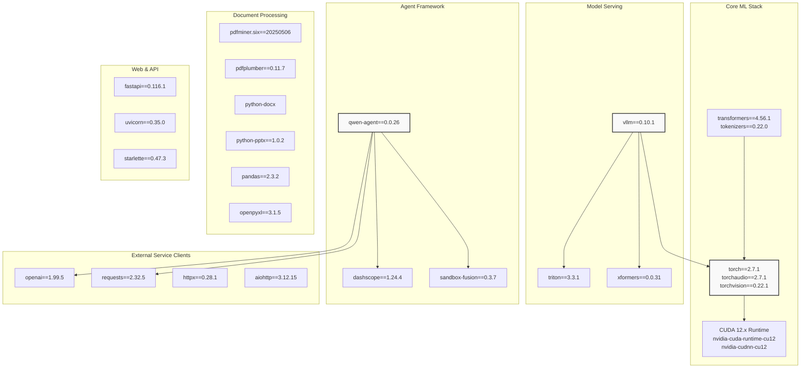
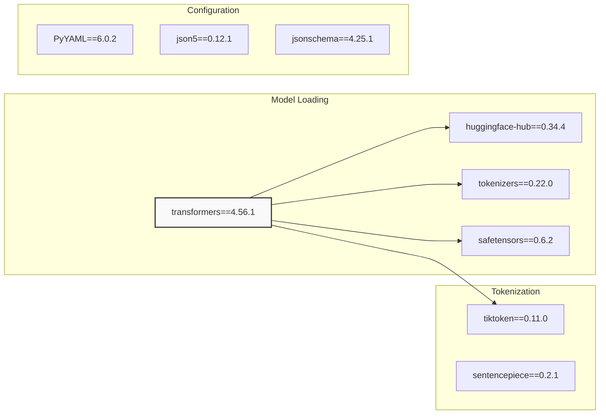
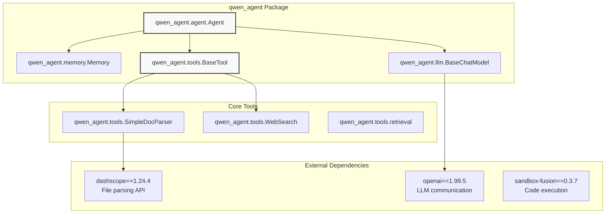
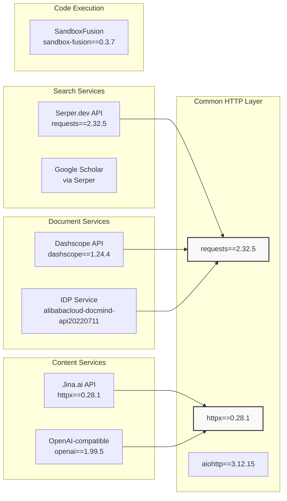
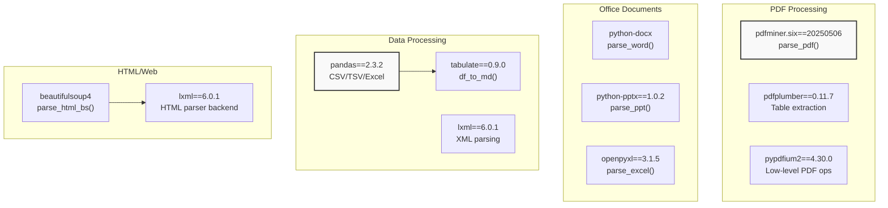

<!-- source: DeepWiki mcp.deepwiki.com · repo Alibaba-NLP/DeepResearch · page 6.1 Dependencies and Environment Setup · fetched 2026-10-29 -->

# Dependencies and Environment

<details>
<summary>Relevant source files</summary>

The following files were used as context for generating this wiki page:

- [README.md](README.md)
- [requirements.txt](requirements.txt)

</details>


## Purpose and Scope

This document details the Python package dependencies, environment requirements, and library ecosystem required to run the Tongyi DeepResearch system. It covers the core machine learning frameworks, model serving infrastructure, agent framework components, external service integrations, and utility libraries. For information about configuring API keys and environment variables, see [Configuration and API Keys](#6.2). For model download and deployment procedures, see [Model Downloads and Local Deployment](#6.3).

## Overview

The Tongyi DeepResearch system requires a comprehensive set of Python packages organized into several functional categories: deep learning frameworks, model serving infrastructure, agent orchestration, external service clients, document processing libraries, and supporting utilities. The system is built on Python 3.8+ and requires GPU support for local model inference.

### Dependency Architecture



**Sources:** [requirements.txt:1-189]()

## Core Machine Learning Dependencies

### PyTorch Ecosystem

The system is built on PyTorch 2.7.1 with CUDA 12.x support for GPU acceleration. The complete PyTorch stack includes:

| Package | Version | Purpose |
|---------|---------|---------|
| `torch` | 2.7.1 | Core deep learning framework |
| `torchaudio` | 2.7.1 | Audio processing capabilities |
| `torchvision` | 0.22.1 | Vision model components |
| `triton` | 3.3.1 | GPU kernel compilation |
| `xformers` | 0.0.31 | Memory-efficient attention operations |

**CUDA Runtime Dependencies:**

The system requires CUDA 12.x with the following NVIDIA packages:

| Package | Version | Function |
|---------|---------|----------|
| `nvidia-cuda-runtime-cu12` | 12.6.77 | CUDA runtime libraries |
| `nvidia-cudnn-cu12` | 9.5.1.17 | Deep neural network primitives |
| `nvidia-cublas-cu12` | 12.6.4.1 | Linear algebra operations |
| `nvidia-nccl-cu12` | 2.26.2 | Multi-GPU communication |
| `cupy-cuda12x` | 13.6.0 | NumPy-compatible GPU arrays |

**Sources:** [requirements.txt:165-170](), [requirements.txt:89-102](), [requirements.txt:31]()

### Transformers and Model Infrastructure

The Hugging Face Transformers library provides the model architecture and tokenization infrastructure:



- **transformers (4.56.1)**: Provides `AutoModelForCausalLM`, `AutoTokenizer`, and model architecture definitions
- **tokenizers (0.22.0)**: Fast tokenization backend used by Transformers
- **huggingface-hub (0.34.4)**: Model downloading and caching via `snapshot_download`
- **safetensors (0.6.2)**: Safe tensor serialization format for model weights
- **tiktoken (0.11.0)**: OpenAI tokenizer used for token counting

**Sources:** [requirements.txt:169](), [requirements.txt:164](), [requirements.txt:59](), [requirements.txt:147](), [requirements.txt:163]()

## Model Serving Infrastructure

### vLLM and Inference Optimization

The vLLM library (version 0.10.1) provides distributed inference capabilities with memory optimization:

| Component | Purpose | Key Features |
|-----------|---------|--------------|
| `vllm` | Distributed inference server | PagedAttention, continuous batching |
| `llguidance` | Structured generation | Constrained decoding |
| `lm-format-enforcer` | Output formatting | JSON/regex enforcement |
| `outlines_core` | Sampling strategies | Advanced decoding methods |
| `xgrammar` | Grammar-based generation | Syntax validation |

The system spawns 8 VLLM servers across ports 6001-6008 for parallel inference as configured in the orchestration scripts.

**Sources:** [requirements.txt:179](), [requirements.txt:72](), [requirements.txt:74](), [requirements.txt:107](), [requirements.txt:185]()

### FastAPI Service Layer

The inference system exposes an HTTP API using FastAPI:

```python
# Key dependencies for API serving
fastapi==0.116.1              # Web framework
uvicorn==0.35.0               # ASGI server
starlette==0.47.3             # Core async framework
pydantic==2.11.9              # Request/response validation
prometheus-fastapi-instrumentator==7.1.0  # Metrics
```

**Sources:** [requirements.txt:44](), [requirements.txt:177](), [requirements.txt:159](), [requirements.txt:125](), [requirements.txt:116]()

## Agent Framework Dependencies

### qwen-agent Package Structure

The `qwen-agent` package (version 0.0.26) provides the agent orchestration framework:



The agent framework is installed as an editable package and requires these core dependencies as defined in [setup.py:48-60]():

| Category | Packages | Purpose |
|----------|----------|---------|
| **Core** | `dashscope>=1.11.0`, `openai`, `pydantic>=2.3.0` | LLM API clients and validation |
| **Serialization** | `json5`, `jsonlines`, `jsonschema` | Configuration and data formats |
| **Utilities** | `requests`, `tiktoken`, `eval_type_backport` | HTTP, tokenization, type checking |
| **Cloud Services** | `alibabacloud-facebody20191230`, `alibabacloud-tea-util` | Alibaba Cloud SDK |

**Sources:** [WebAgent/WebWatcher/infer/vl_search_r1/qwen-agent-o1_search/setup.py:48-60](), [WebAgent/WebWatcher/infer/vl_search_r1/qwen-agent-o1_search/qwen_agent/__init__.py:1-8]()

### RAG Extensions

The RAG (Retrieval-Augmented Generation) functionality requires additional dependencies defined in [setup.py:63-75]():

```python
'rag': [
    'charset-normalizer',      # Character encoding detection
    'rank_bm25',               # BM25 ranking algorithm
    'jieba',                   # Chinese text segmentation
    'snowballstemmer',         # Stemming for multiple languages
    'beautifulsoup4',          # HTML parsing
    'pdfminer.six',            # PDF text extraction
    'pdfplumber',              # Advanced PDF parsing
    'python-docx',             # Word document processing
    'python-pptx',             # PowerPoint processing
    'pandas',                  # Spreadsheet handling
    'tabulate',                # Table formatting
]
```

**Sources:** [WebAgent/WebWatcher/infer/vl_search_r1/qwen-agent-o1_search/setup.py:63-75]()

## External Service Integration Dependencies

### API Client Libraries

The system integrates with multiple external services through dedicated client libraries:



### Alibaba Cloud SDK

The Alibaba Cloud services are accessed through a comprehensive SDK suite:

| Package | Version | Service |
|---------|---------|---------|
| `dashscope` | 1.24.4 | Document parsing and LLM APIs |
| `alibabacloud-docmind-api20220711` | 1.4.11 | IDP (Intelligent Document Processing) |
| `alibabacloud-credentials` | 1.0.2 | Authentication and credential management |
| `alibabacloud-tea-openapi` | 0.4.1 | OpenAPI client framework |
| `alibabacloud-facebody20191230` | 5.1.2 | Vision services (WebWatcher) |

These packages are used in the document parsing flow as seen in [simple_doc_parser.py:20-70](), where the IDP service is conditionally enabled via the `QWEN_DOC_PARSER_USE_IDP` environment variable.

**Sources:** [requirements.txt:5-12](), [requirements.txt:33](), [WebAgent/WebWatcher/infer/vl_search_r1/qwen-agent-o1_search/qwen_agent/tools/simple_doc_parser.py:20-70]()

### HTTP and Async I/O

Multiple HTTP client libraries are used for different purposes:

| Library | Use Case | Key Features |
|---------|----------|--------------|
| `requests==2.32.5` | Synchronous HTTP | Simple blocking API |
| `httpx==0.28.1` | Async HTTP | OpenAI client backend |
| `aiohttp==3.12.15` | Async HTTP | Streaming responses |
| `websockets==15.0.1` | WebSocket | Real-time communication |

**Sources:** [requirements.txt:142](), [requirements.txt:58](), [requirements.txt:3](), [requirements.txt:182]()

## Document Processing Dependencies

### File Format Support

The document processing pipeline supports multiple file formats through specialized libraries:



The `SimpleDocParser` class in [simple_doc_parser.py:420-551]() uses these libraries to parse files with the `PARSER_SUPPORTED_FILE_TYPES = ['pdf', 'docx', 'pptx', 'txt', 'html', 'csv', 'tsv', 'xlsx', 'xls']` as defined at [simple_doc_parser.py:407]().

**Key Functions:**
- `parse_pdf()` [simple_doc_parser.py:280-329]() - Extracts text and tables from PDFs
- `parse_word()` [simple_doc_parser.py:99-117]() - Processes DOCX documents
- `parse_ppt()` [simple_doc_parser.py:120-153]() - Extracts PowerPoint content
- `parse_excel()` [simple_doc_parser.py:190-203]() - Converts Excel to markdown tables
- `parse_csv()` [simple_doc_parser.py:206-221]() - Processes CSV files
- `parse_html_bs()` [simple_doc_parser.py:242-277]() - Parses HTML with BeautifulSoup

**Sources:** [requirements.txt:111-112](), [requirements.txt:129](), [requirements.txt:106](), [requirements.txt:134](), [requirements.txt:109](), [requirements.txt:131](), [WebAgent/WebWatcher/infer/vl_search_r1/qwen-agent-o1_search/qwen_agent/tools/simple_doc_parser.py:407](), [WebAgent/WebWatcher/infer/vl_search_r1/qwen-agent-o1_search/qwen_agent/tools/simple_doc_parser.py:420-551]()

### Image Processing

Image handling for multimodal capabilities requires:

| Package | Version | Purpose |
|---------|---------|---------|
| `pillow` | 11.3.0 | Image loading and processing |
| `opencv-python-headless` | 4.12.0.88 | Computer vision operations |
| `alibabacloud-facebody20191230` | 5.1.2 | Face and body detection |

These are used in the WebWatcher vision-language agent for image search and visual QA tasks.

**Sources:** [requirements.txt:113](), [requirements.txt:105](), [WebAgent/WebWatcher/infer/docker_env/requirements.txt:8]()

## Utility and Supporting Dependencies

### Data Serialization and Validation

```python
# JSON/YAML processing
json5==0.12.1                 # JSON5 format support
jsonlines==4.0.0              # Newline-delimited JSON
jsonschema==4.25.1            # Schema validation
PyYAML==6.0.2                 # YAML parsing

# Data validation
pydantic==2.11.9              # Runtime type checking
pydantic_core==2.33.2         # Pydantic core engine
pydantic-extra-types==2.10.5  # Additional type validators
```

The `Memory` class in [memory.py:18-137]() uses `json5` for parsing keyword dictionaries at [memory.py:109](), and the `Agent` class uses JSON serialization for tool results at [agent.py:264]().

**Sources:** [requirements.txt:66-69](), [requirements.txt:125-127](), [WebAgent/WebWatcher/infer/vl_search_r1/qwen-agent-o1_search/qwen_agent/memory/memory.py:109](), [WebAgent/WebWatcher/infer/vl_search_r1/qwen-agent-o1_search/qwen_agent/agent.py:264]()

### Caching and Storage

| Package | Purpose | Usage |
|---------|---------|-------|
| `diskcache==5.6.3` | Persistent key-value cache | Result caching |
| `cachetools==6.2.0` | In-memory caching | Function memoization |
| `blake3==1.0.5` | Fast hashing | Cache key generation |

**Sources:** [requirements.txt:36](), [requirements.txt:21](), [requirements.txt:20]()

### Logging and Monitoring

```python
# Monitoring
prometheus_client==0.22.1           # Metrics collection
prometheus-fastapi-instrumentator==7.1.0  # FastAPI instrumentation
sentry-sdk==2.37.1                  # Error tracking

# Logging
python-json-logger==3.3.0           # Structured logging
rich==14.1.0                        # Rich terminal output
```

**Sources:** [requirements.txt:115-116](), [requirements.txt:151](), [requirements.txt:132](), [requirements.txt:143]()

### Parallel Execution

The agent framework uses multiple libraries for concurrent execution:

| Package | Purpose | Context |
|---------|---------|---------|
| `ray==2.49.1` | Distributed computing | Batch processing |
| `APScheduler==3.11.0` | Task scheduling | Background jobs |
| `cloudpickle==3.1.1` | Serialization | Ray backend |

The `_run_batch()` method in [agent.py:173-187]() uses `parallel_exec` for concurrent agent execution.

**Sources:** [requirements.txt:139](), [requirements.txt:16](), [requirements.txt:27](), [WebAgent/WebWatcher/infer/vl_search_r1/qwen-agent-o1_search/qwen_agent/agent.py:173-187]()

## Environment-Specific Dependencies

### Docker Environment Extensions

The Docker environment includes additional packages for Jupyter notebook support as seen in [docker_env/requirements.txt:84-152]():

```python
# Jupyter ecosystem
jupyter==1.1.1
jupyter_server==2.17.0
jupyterlab==4.4.9
ipykernel==7.0.1
notebook==7.4.7

# Visualization
matplotlib==3.10.7
seaborn==0.13.2

# Search integration
google-search-results==2.4.2
```

These enable interactive development and visualization within containerized environments.

**Sources:** [WebAgent/WebWatcher/infer/docker_env/requirements.txt:109-152]()

### Python Version Compatibility

The system requires Python 3.8 or higher with specific version constraints:

- **typing_extensions==4.15.0**: Backports newer typing features
- **eval_type_backport==0.2.2**: Type evaluation compatibility
- **importlib_metadata==8.7.0**: Package metadata access

**Sources:** [requirements.txt:172](), [requirements.txt:42](), [requirements.txt:61]()

## Dependency Installation

### Installation Methods

The dependencies can be installed through multiple methods:

1. **Direct pip install:**
```bash
pip install -r requirements.txt
```

2. **qwen-agent with extras:**
```bash
pip install qwen-agent[rag,code_interpreter]
```

3. **Editable development install:**
```bash
pip install -e ./qwen-agent-o1_search
```

The setup.py defines optional dependency groups in [setup.py:61-110]() including `rag`, `python_executor`, `code_interpreter`, and `gui`.

**Sources:** [requirements.txt:1-189](), [WebAgent/WebWatcher/infer/vl_search_r1/qwen-agent-o1_search/setup.py:61-110]()

### GPU Requirements

For local inference, the system requires:

- **CUDA Toolkit**: 12.x series
- **GPU Memory**: Minimum 40GB for 30B model inference
- **Driver Version**: Compatible with CUDA 12.6+
- **Compute Capability**: 7.0+ (Volta architecture or newer)

The CUDA dependencies are automatically installed with the PyTorch package as wheel dependencies.

**Sources:** [requirements.txt:89-102]()

## Version Pinning Strategy

The requirements file uses exact version pinning (==) for stability:

```python
# Exact versions for reproducibility
torch==2.7.1
transformers==4.56.1
vllm==0.10.1
qwen-agent==0.0.26

# Minimum versions for flexibility
dashscope>=1.11.0  # (in setup.py)
pydantic>=2.3.0    # (in setup.py)
```

This ensures reproducible builds while allowing minor updates for SDK packages that maintain backward compatibility.

**Sources:** [requirements.txt:165-179](), [WebAgent/WebWatcher/infer/vl_search_r1/qwen-agent-o1_search/setup.py:48-60]()

---

