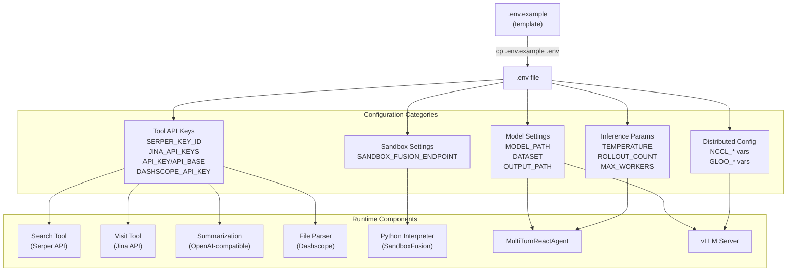
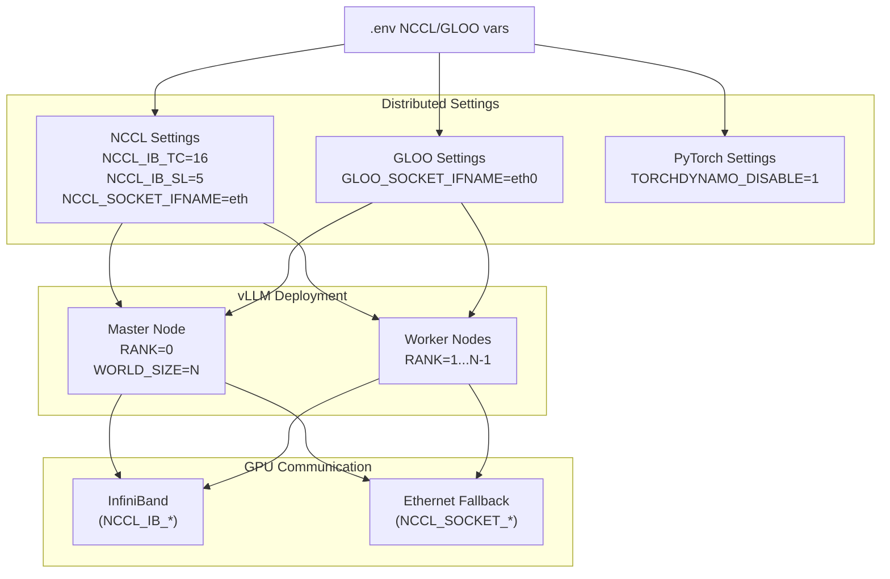

<!-- source: DeepWiki mcp.deepwiki.com · repo Alibaba-NLP/DeepResearch · page 6.2 Configuration and API Keys · fetched 2026-10-29 -->

# Configuration and API Keys

<details>
<summary>Relevant source files</summary>

The following files were used as context for generating this wiki page:

- [.env.example](.env.example)
- [.gitignore](.gitignore)
- [README.md](README.md)
- [WebAgent/WebLeaper/README.md](WebAgent/WebLeaper/README.md)
- [WebAgent/WebLeaper/assets/overview.png](WebAgent/WebLeaper/assets/overview.png)
- [WebAgent/WebLeaper/assets/performance_summary.png](WebAgent/WebLeaper/assets/performance_summary.png)
- [WebAgent/WebLeaper/assets/webleaper.jpg](WebAgent/WebLeaper/assets/webleaper.jpg)
- [inference/run_react_infer.sh](inference/run_react_infer.sh)

</details>


This page provides a complete reference for configuring the DeepResearch inference system through environment variables and API keys. It covers all required and optional external service integrations, model deployment settings, and distributed inference configuration.

For information about installing dependencies and setting up the Python environment, see [Dependencies and Environment Setup](#6.1). For instructions on downloading and deploying models, see [Model Downloads and Deployment](#6.3). For a step-by-step walkthrough of the entire setup process, see [Quick Start Guide](#6.4).

---

## Configuration System Overview

The DeepResearch system uses a `.env` file for all configuration management. This approach keeps sensitive API keys out of version control and provides a single location for all runtime settings.

**Configuration Workflow:**

1. Copy the example configuration file: `cp .env.example .env`
2. Edit `.env` with your actual API keys and paths
3. The system automatically loads these variables at runtime
4. Tools and components read their specific configuration values

The `.env` file is gitignored [.gitignore:2]() to prevent accidental credential exposure.

**Diagram: Configuration Loading Architecture**



Sources: [.env.example:1-89](), [.gitignore:1-3](), [README.md:89-111]()

---

## API Keys and External Services

The DeepResearch system integrates with multiple external services to provide comprehensive tool capabilities. Each service requires API credentials obtained from the respective provider.

### Serper API (Web Search)

**Purpose:** Powers the `Search` tool for web search and Google Scholar queries.

**Configuration Variables:**
- `SERPER_KEY_ID` - Your Serper API key

**Obtaining API Key:**
1. Visit [https://serper.dev/](https://serper.dev/)
2. Sign up for an account
3. Navigate to API Keys section
4. Copy your API key

**Usage in Code:** The Search tool uses this key to query web search results and retrieve snippets for the agent.

**Configuration Example:**
```bash
SERPER_KEY_ID=abc123def456ghi789jkl012mno345pqr678
```

Sources: [.env.example:49-51](), [README.md:102]()

---

### Jina API (Web Page Reading)

**Purpose:** Powers the `Visit` tool for reading and extracting content from web pages.

**Configuration Variables:**
- `JINA_API_KEYS` - Your Jina AI API key(s), comma-separated for multiple keys

**Obtaining API Key:**
1. Visit [https://jina.ai/](https://jina.ai/)
2. Create an account
3. Generate an API key from your dashboard
4. Optionally create multiple keys for load balancing

**Usage in Code:** The Visit tool sends URLs to Jina's reader API to retrieve cleaned, structured page content that the agent can process.

**Configuration Example:**
```bash
# Single key
JINA_API_KEYS=jina_abc123def456ghi789

# Multiple keys for load balancing
JINA_API_KEYS=jina_key1,jina_key2,jina_key3
```

Sources: [.env.example:53-55](), [README.md:103]()

---

### OpenAI-Compatible API (Summarization)

**Purpose:** Powers the summarization functionality for compressing long web pages and contexts.

**Configuration Variables:**
- `API_KEY` - OpenAI API key or compatible service key
- `API_BASE` - API endpoint URL (e.g., `https://api.openai.com/v1`)
- `SUMMARY_MODEL_NAME` - Model identifier for summarization tasks

**Obtaining API Key:**
1. Visit [https://platform.openai.com/](https://platform.openai.com/)
2. Sign up and navigate to API keys
3. Generate a new secret key
4. For alternative providers, use their specific endpoint and credentials

**Compatible Providers:**
- OpenAI (GPT-4, GPT-3.5)
- Azure OpenAI
- Other OpenAI-compatible endpoints (vLLM, FastChat, etc.)

**Configuration Example:**
```bash
# OpenAI
API_KEY=sk-abc123def456ghi789jkl012mno345pqr678
API_BASE=https://api.openai.com/v1
SUMMARY_MODEL_NAME=gpt-3.5-turbo

# Alternative provider example
API_KEY=your_provider_key
API_BASE=https://your-provider.com/v1
SUMMARY_MODEL_NAME=your-model-name
```

Sources: [.env.example:57-61](), [README.md:104]()

---

### Dashscope API (File Parsing)

**Purpose:** Powers the `SingleFileParser` tool for parsing PDFs, Office documents, Excel files, HTML, and other formats.

**Configuration Variables:**
- `DASHSCOPE_API_KEY` - Dashscope API key
- `DASHSCOPE_API_BASE` - Dashscope endpoint URL
- `VIDEO_MODEL_NAME` - Model for video processing
- `VIDEO_ANALYSIS_MODEL_NAME` - Model for video analysis

**Supported Models:**
- `qwen-omni-turbo` - Fast general-purpose parsing
- `qwen-plus-latest` - Advanced parsing with better accuracy

**Obtaining API Key:**
1. Visit [https://dashscope.aliyun.com/](https://dashscope.aliyun.com/)
2. Sign up for an Alibaba Cloud account
3. Enable Dashscope service
4. Generate API credentials from the console

**Configuration Example:**
```bash
DASHSCOPE_API_KEY=sk-dashscope123456789
DASHSCOPE_API_BASE=https://dashscope.aliyuncs.com/api/v1
VIDEO_MODEL_NAME=qwen-omni-turbo
VIDEO_ANALYSIS_MODEL_NAME=qwen-plus-latest
```

Sources: [.env.example:63-69](), [README.md:105]()

---

### SandboxFusion (Python Interpreter)

**Purpose:** Powers the `PythonInterpreter` tool for secure code execution in isolated sandbox environments.

**Configuration Variables:**
- `SANDBOX_FUSION_ENDPOINT` - Comma-separated list of sandbox server endpoints
- `TORCH_COMPILE_CACHE_DIR` - Cache directory for compiled code (default: `./cache`)

**Setup Instructions:**
1. Deploy SandboxFusion servers using the project at [https://github.com/bytedance/SandboxFusion](https://github.com/bytedance/SandboxFusion)
2. Start one or more sandbox instances
3. Configure endpoints for load balancing

**Configuration Example:**
```bash
# Single sandbox
SANDBOX_FUSION_ENDPOINT=http://192.168.1.100:8080

# Multiple sandboxes for load balancing
SANDBOX_FUSION_ENDPOINT=http://192.168.1.100:8080,http://192.168.1.101:8080,http://192.168.1.102:8080

TORCH_COMPILE_CACHE_DIR=./cache
```

**Security Note:** Ensure sandbox servers are deployed in isolated environments with proper network security to prevent unauthorized code execution.

Sources: [.env.example:71-79](), [README.md:106]()

---

### IDP Service (Optional Advanced Parsing)

**Purpose:** Provides enhanced document parsing capabilities beyond standard Dashscope parsing, particularly for complex document layouts and table extraction.

**Configuration Variables:**
- `QWEN_DOC_PARSER_USE_IDP` - Enable IDP service (`true`/`false`)
- `QWEN_IDP_ENABLE_CSI` - Enable CSI features (`true`/`false`)
- `IDP_DOMAIN` - IDP service domain
- `IDP_AK` - Access key
- `IDP_SK` - Secret key
- `IDP_VERSION` - IDP API version
- `IDP_SERVICE_ID` - Service identifier
- `IDP_ENABLE_TABLE` - Enable table extraction
- `IDP_ENABLE_SEAL` - Enable seal detection

**When to Use IDP:**
- Complex multi-column documents
- Documents with intricate table structures
- Financial reports, academic papers with detailed layouts
- Documents requiring seal/stamp detection

**Configuration Example:**
```bash
# Enable IDP
QWEN_DOC_PARSER_USE_IDP=true
QWEN_IDP_ENABLE_CSI=true

# IDP credentials (contact your IDP provider)
IDP_DOMAIN=your_idp_domain.com
IDP_AK=your_access_key
IDP_SK=your_secret_key
IDP_VERSION=2023-12-01
IDP_SERVICE_ID=your_service_id
IDP_ENABLE_TABLE=true
IDP_ENABLE_SEAL=false
```

**Default Behavior:** When `QWEN_DOC_PARSER_USE_IDP=false` (default), the system uses standard Dashscope parsing which is sufficient for most use cases.

Sources: [.env.example:82-89]()

---

## Model and Inference Configuration

These settings control model loading, inference behavior, and output handling.

**Configuration Variables:**

| Variable | Purpose | Example | Default |
|----------|---------|---------|---------|
| `MODEL_PATH` | Local path or HuggingFace model identifier | `/models/Tongyi-DeepResearch-30B-A3B` | Required |
| `DATASET` | Evaluation dataset name or path | `eval_data/my_questions.jsonl` | Required |
| `OUTPUT_PATH` | Directory for saving inference results | `./outputs` | Required |
| `ROLLOUT_COUNT` | Number of parallel rollouts per question (for heavy mode) | `3` | `3` |
| `TEMPERATURE` | Sampling temperature | `0.85` | `0.85` |
| `PRESENCE_PENALTY` | Repetition penalty | `1.1` | `1.1` |
| `MAX_WORKERS` | Maximum concurrent inference workers | `30` | `30` |

**Configuration Example:**
```bash
# Model configuration
MODEL_PATH=/path/to/Tongyi-DeepResearch-30B-A3B
DATASET=eval_data/browsecomp.jsonl
OUTPUT_PATH=./outputs/browsecomp_results

# Inference hyperparameters
ROLLOUT_COUNT=3
TEMPERATURE=0.85
PRESENCE_PENALTY=1.1
MAX_WORKERS=30
```

**Notes:**
- `MODEL_PATH` can be a local directory or a HuggingFace model ID (e.g., `Alibaba-NLP/Tongyi-DeepResearch-30B-A3B`)
- `TEMPERATURE` controls sampling randomness: lower values (0.6-0.8) for more deterministic outputs, higher values (0.8-1.0) for more creative responses
- `PRESENCE_PENALTY` reduces repetition: values > 1.0 penalize repeated tokens
- `MAX_WORKERS` should be tuned based on available memory and GPU capacity

Sources: [.env.example:35-43](), [README.md:107-109]()

---

## Multi-GPU and Distributed Configuration

For deploying models across multiple GPUs or machines, configure these NCCL and GLOO environment variables.

**Diagram: Multi-GPU Configuration Flow**



**NCCL Configuration Variables:**

| Variable | Purpose | Recommended Value |
|----------|---------|-------------------|
| `NCCL_IB_TC` | InfiniBand traffic class | `16` |
| `NCCL_IB_SL` | InfiniBand service level | `5` |
| `NCCL_IB_GID_INDEX` | InfiniBand GID index | `3` |
| `NCCL_SOCKET_IFNAME` | Network interface name | `eth` or `eth0` |
| `NCCL_DEBUG` | Debug verbosity level | `INFO` |
| `NCCL_IB_HCA` | InfiniBand HCA name | `mlx5` |
| `NCCL_IB_TIMEOUT` | Connection timeout (seconds) | `22` |
| `NCCL_IB_QPS_PER_CONNECTION` | Queue pairs per connection | `8` |
| `NCCL_MIN_NCHANNELS` | Minimum communication channels | `4` |
| `NCCL_NET_PLUGIN` | Network plugin (use `none` for default) | `none` |

**GLOO Configuration Variables:**

| Variable | Purpose | Recommended Value |
|----------|---------|-------------------|
| `GLOO_SOCKET_IFNAME` | Network interface for GLOO backend | `eth0` |

**PyTorch Configuration Variables:**

| Variable | Purpose | Recommended Value |
|----------|---------|-------------------|
| `TORCHDYNAMO_VERBOSE` | TorchDynamo verbosity | `1` |
| `TORCHDYNAMO_DISABLE` | Disable TorchDynamo (recommended for stability) | `1` |

**Configuration Example:**
```bash
# InfiniBand configuration (for high-performance clusters)
NCCL_IB_TC=16
NCCL_IB_SL=5
NCCL_IB_GID_INDEX=3
NCCL_IB_HCA=mlx5
NCCL_IB_TIMEOUT=22
NCCL_IB_QPS_PER_CONNECTION=8

# Network interface configuration
NCCL_SOCKET_IFNAME=eth
GLOO_SOCKET_IFNAME=eth0

# Debug and optimization
NCCL_DEBUG=INFO
NCCL_MIN_NCHANNELS=4
NCCL_NET_PLUGIN=none

# PyTorch stability
TORCHDYNAMO_VERBOSE=1
TORCHDYNAMO_DISABLE=1
```

**Usage Notes:**
- These settings are primarily used when deploying vLLM servers across multiple GPUs or nodes
- For single-GPU deployments, default values are sufficient
- InfiniBand settings (`NCCL_IB_*`) are only relevant for clusters with InfiniBand networking
- For Ethernet-only clusters, focus on `NCCL_SOCKET_IFNAME` and `GLOO_SOCKET_IFNAME`
- See [Distributed Inference](#7.3) for detailed multi-GPU deployment instructions

Sources: [.env.example:5-20]()

---

## DeepResearch-Specific Flags

These flags control specific behaviors of the DeepResearch system.

**Configuration Variables:**

| Variable | Purpose | Recommended Value |
|----------|---------|-------------------|
| `QWEN_DOC_PARSER_USE_IDP` | Enable IDP service for advanced parsing | `false` |
| `QWEN_IDP_ENABLE_CSI` | Enable CSI features in IDP | `false` |
| `NLP_WEB_SEARCH_ONLY_CACHE` | Use only cached search results | `false` |
| `NLP_WEB_SEARCH_ENABLE_READPAGE` | Enable automatic page reading in search | `false` |
| `NLP_WEB_SEARCH_ENABLE_SFILTER` | Enable search result filtering | `false` |
| `QWEN_SEARCH_ENABLE_CSI` | Enable CSI features in search | `false` |
| `SPECIAL_CODE_MODE` | Enable special code execution mode | `false` |
| `PYTHONDONTWRITEBYTECODE` | Prevent Python bytecode generation | `1` |

**Configuration Example:**
```bash
# Standard configuration (recommended defaults)
QWEN_DOC_PARSER_USE_IDP=false
QWEN_IDP_ENABLE_CSI=false
NLP_WEB_SEARCH_ONLY_CACHE=false
NLP_WEB_SEARCH_ENABLE_READPAGE=false
NLP_WEB_SEARCH_ENABLE_SFILTER=false
QWEN_SEARCH_ENABLE_CSI=false
SPECIAL_CODE_MODE=false
PYTHONDONTWRITEBYTECODE=1
```

**Flag Descriptions:**
- **IDP Flags:** Control advanced document parsing (see IDP section above)
- **Search Flags:** Modify search behavior; typically keep disabled for standard operation
- **SPECIAL_CODE_MODE:** Reserved for debugging code execution; keep `false` in production
- **PYTHONDONTWRITEBYTECODE:** Prevents `.pyc` file generation for cleaner directories

Sources: [.env.example:22-32]()

---

## Configuration Validation and Troubleshooting

**Common Configuration Issues:**

### Missing API Keys
**Symptom:** Tool calls fail with authentication errors

**Solution:**
1. Verify all required keys are set in `.env`
2. Check for trailing whitespace or quotes in key values
3. Ensure `.env` file is in the project root directory

### Invalid Model Path
**Symptom:** "Model not found" or loading errors

**Solution:**
1. Verify `MODEL_PATH` points to a valid directory or HuggingFace model ID
2. Check file permissions on the model directory
3. For HuggingFace models, ensure you have network access to download

### Sandbox Connection Failures
**Symptom:** Python interpreter tool times out or fails

**Solution:**
1. Verify sandbox endpoints are reachable: `curl http://your-endpoint:8080/health`
2. Check firewall rules allow connections
3. Ensure sandbox services are running

### Multi-GPU Issues
**Symptom:** NCCL errors or GPU communication failures

**Solution:**
1. Verify network interface names match your system: `ifconfig` or `ip addr`
2. Check InfiniBand status: `ibstat` (if applicable)
3. Test GPU visibility: `nvidia-smi`
4. Ensure CUDA versions match across nodes

**Configuration Checklist:**

```bash
# Verify .env file exists
ls -la .env

# Check required variables are set
grep -E "SERPER_KEY_ID|JINA_API_KEYS|API_KEY|DASHSCOPE_API_KEY|MODEL_PATH" .env

# Test tool connectivity
curl -H "X-API-KEY: $SERPER_KEY_ID" https://serper.dev/api/health
curl -H "Authorization: Bearer $JINA_API_KEYS" https://api.jina.ai/v1/health

# Verify model path
ls $MODEL_PATH/config.json
```

Sources: [README.md:89-111](), [.env.example:1-89]()

---

## Configuration Reference Table

**Complete Variable Reference:**

| Category | Variable | Required | Default | Purpose |
|----------|----------|----------|---------|---------|
| **Search** | `SERPER_KEY_ID` | Yes | - | Web search API key |
| **Visit** | `JINA_API_KEYS` | Yes | - | Page reading API key(s) |
| **Summary** | `API_KEY` | Yes | - | Summarization API key |
| **Summary** | `API_BASE` | Yes | - | Summarization endpoint |
| **Summary** | `SUMMARY_MODEL_NAME` | Yes | - | Summarization model |
| **File Parser** | `DASHSCOPE_API_KEY` | Yes | - | Dashscope API key |
| **File Parser** | `DASHSCOPE_API_BASE` | No | Default endpoint | Dashscope endpoint |
| **File Parser** | `VIDEO_MODEL_NAME` | No | - | Video processing model |
| **File Parser** | `VIDEO_ANALYSIS_MODEL_NAME` | No | - | Video analysis model |
| **Sandbox** | `SANDBOX_FUSION_ENDPOINT` | Yes | - | Python sandbox endpoint(s) |
| **Model** | `MODEL_PATH` | Yes | - | Model weights path |
| **Inference** | `DATASET` | Yes | - | Evaluation data path |
| **Inference** | `OUTPUT_PATH` | Yes | - | Results output directory |
| **Inference** | `ROLLOUT_COUNT` | No | `3` | Parallel rollouts |
| **Inference** | `TEMPERATURE` | No | `0.85` | Sampling temperature |
| **Inference** | `PRESENCE_PENALTY` | No | `1.1` | Repetition penalty |
| **Inference** | `MAX_WORKERS` | No | `30` | Concurrent workers |
| **IDP** | `QWEN_DOC_PARSER_USE_IDP` | No | `false` | Enable IDP parsing |
| **IDP** | `IDP_DOMAIN` | No | - | IDP service domain |
| **IDP** | `IDP_AK` | No | - | IDP access key |
| **IDP** | `IDP_SK` | No | - | IDP secret key |
| **Distributed** | `NCCL_SOCKET_IFNAME` | No | `eth` | Network interface |
| **Distributed** | `GLOO_SOCKET_IFNAME` | No | `eth0` | GLOO interface |
| **Distributed** | Various NCCL_* | No | See above | Multi-GPU settings |

Sources: [.env.example:1-89]()

---

