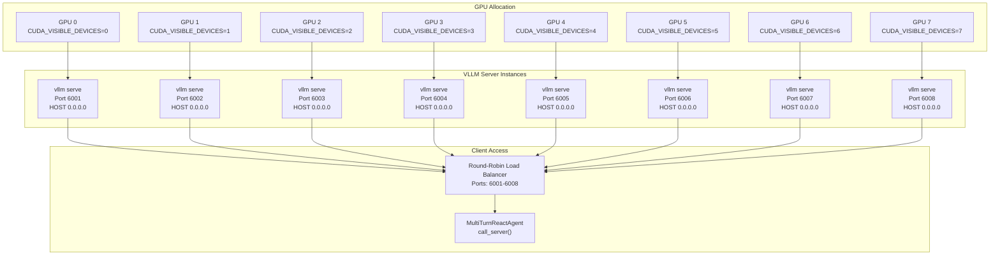
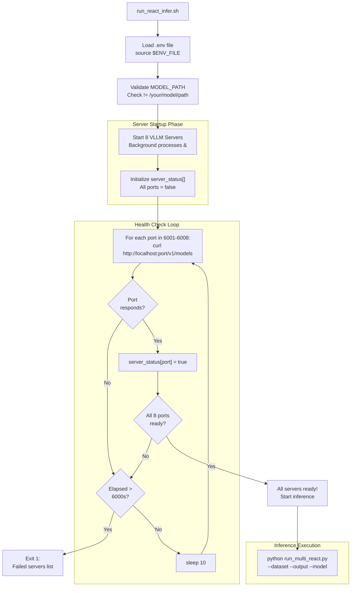
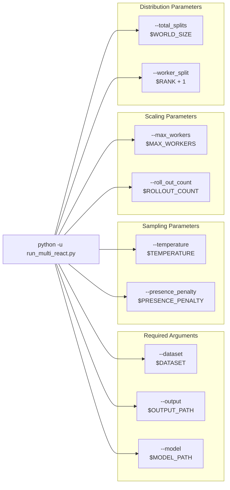
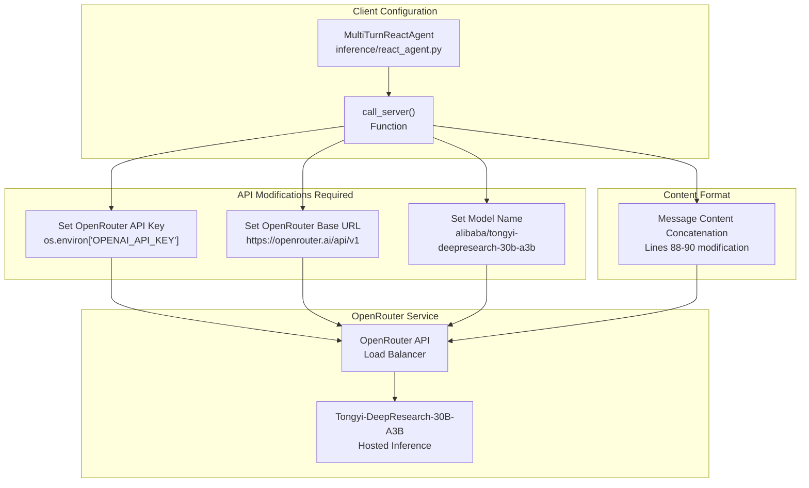
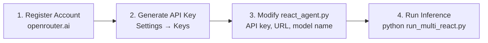
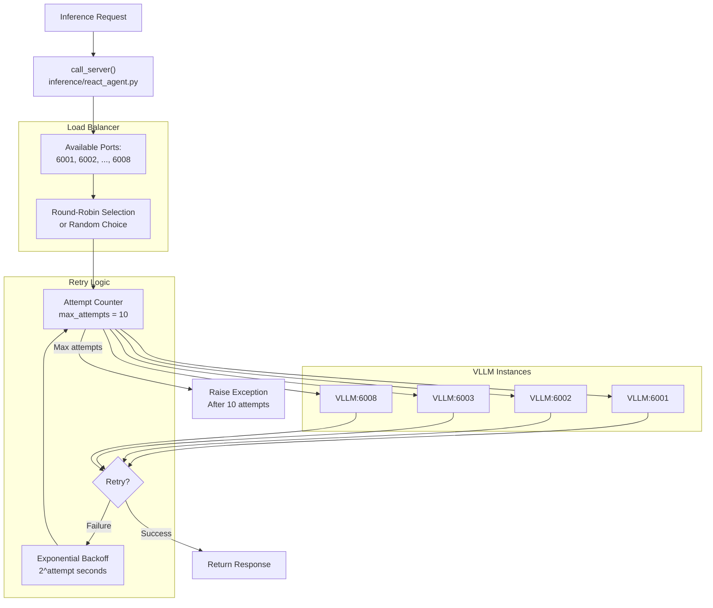

<!-- source: DeepWiki mcp.deepwiki.com · repo Alibaba-NLP/DeepResearch · page 6.3 Model Downloads and Deployment · fetched 2026-10-29 -->

# Model Downloads and Local Deployment

<details>
<summary>Relevant source files</summary>

The following files were used as context for generating this wiki page:

- [README.md](README.md)
- [WebAgent/NestBrowse/toolkit/tool_explore.py](WebAgent/NestBrowse/toolkit/tool_explore.py)
- [WebAgent/NestBrowse/toolkit/tool_search.py](WebAgent/NestBrowse/toolkit/tool_search.py)
- [WebAgent/NestBrowse/utils.py](WebAgent/NestBrowse/utils.py)
- [WebAgent/NestBrowse/vllm_deploy.sh](WebAgent/NestBrowse/vllm_deploy.sh)
- [WebAgent/ParallelMuse/compressed_reasoning_aggregation.py](WebAgent/ParallelMuse/compressed_reasoning_aggregation.py)

</details>


## Purpose and Scope

This page documents the process of downloading the Tongyi-DeepResearch-30B-A3B model and deploying it locally using VLLM for high-throughput inference. It covers model acquisition from HuggingFace or ModelScope, VLLM server architecture with 8 parallel instances, server startup procedures with health checks, and execution of inference scripts. For environment setup and dependencies, see [Dependencies and Environment](#6.1). For API key configuration, see [Configuration and API Keys](#6.2).

---

## Model Specifications and Download

The Tongyi-DeepResearch-30B-A3B model is a Mixture-of-Experts (MoE) architecture with 30.5 billion total parameters and 3.3 billion active parameters per token. The model supports a 128K context window and is optimized for long-horizon information-seeking tasks.

### Deployment Options Comparison

| Deployment Type | Requirements | Latency | Cost | Use Case |
|----------------|--------------|---------|------|----------|
| **Local VLLM** | 8x A100 GPUs, 256GB RAM | Low | Hardware investment | Production, research, high-throughput |
| **OpenRouter API** | API key only | Medium | Pay-per-use | Prototyping, low-volume testing |
| **Bailian Service** | Account setup | Low-Medium | Subscription | Production, enterprise deployment |

### Download Sources

| Platform | Repository Link | Model ID |
|----------|----------------|----------|
| HuggingFace | https://huggingface.co/Alibaba-NLP/Tongyi-DeepResearch-30B-A3B | `Alibaba-NLP/Tongyi-DeepResearch-30B-A3B` |
| ModelScope | https://modelscope.cn/models/iic/Tongyi-DeepResearch-30B-A3B | `iic/Tongyi-DeepResearch-30B-A3B` |

### Model Properties

- **Architecture**: Qwen3-30B-A3B (MoE)
- **Total Parameters**: 30.5B
- **Active Parameters**: 3.3B per token
- **Context Length**: 128K tokens
- **Quantization**: BF16 (default)
- **Disk Space**: ~60GB (model weights + cache)

**Sources:** [README.md:49-56](), [README.md:172-180]()

---

## VLLM Server Architecture

The local deployment uses VLLM (vLLM) for efficient inference serving. The system deploys **8 parallel VLLM server instances** across available GPUs to maximize throughput and load balancing.

### Server Instance Allocation



**VLLM Server Configuration**: Each VLLM instance is started with the following command pattern:

```bash
CUDA_VISIBLE_DEVICES={gpu_id} vllm serve {MODEL_PATH} \
    --host 0.0.0.0 \
    --port {600X} \
    --disable-log-requests &
```

| Port | GPU | Purpose |
|------|-----|---------|
| 6001 | 0 | Primary inference endpoint |
| 6002 | 1 | Load-balanced endpoint |
| 6003 | 2 | Load-balanced endpoint |
| 6004 | 3 | Load-balanced endpoint |
| 6005 | 4 | Load-balanced endpoint |
| 6006 | 5 | Load-balanced endpoint |
| 6007 | 6 | Load-balanced endpoint |
| 6008 | 7 | Load-balanced endpoint |

**Sources:** [inference/run_react_infer.sh:29-37](), [inference/run_react_infer.sh:46-47]()

---

## Server Deployment Process

The [run_react_infer.sh](inference/run_react_infer.sh:1-118)() script orchestrates the complete deployment pipeline: environment validation, VLLM server startup, health checks, and inference execution.

### Deployment Workflow



### Health Check Implementation

The script uses a **polling-based health check** with exponential backoff:

**Health Check Configuration:**
- **Endpoint**: `http://localhost:{port}/v1/models`
- **Timeout**: 6000 seconds (100 minutes)
- **Poll Interval**: 10 seconds
- **Success Condition**: All 8 ports respond with HTTP 200

**Health Check Logic** [inference/run_react_infer.sh:56-92]():

```bash
declare -A server_status
for port in "${main_ports[@]}"; do
    server_status[$port]=false
done

while true; do
    all_ready=true
    for port in "${main_ports[@]}"; do
        if [ "${server_status[$port]}" = "false" ]; then
            if curl -s -f http://localhost:$port/v1/models > /dev/null 2>&1; then
                echo "Main model server (port $port) is ready!"
                server_status[$port]=true
            else
                all_ready=false
            fi
        fi
    done
    
    if [ "$all_ready" = "true" ]; then
        echo "All servers are ready for inference!"
        break
    fi
    
    # Check timeout
    current_time=$(date +%s)
    elapsed=$((current_time - start_time))
    if [ $elapsed -gt $timeout ]; then
        echo "Error: Server startup timeout"
        exit 1
    fi
    
    sleep 10
done
```

**Sources:** [inference/run_react_infer.sh:43-106]()

---

## Environment Configuration for Deployment

The deployment requires specific environment variables configured in `.env` file. Critical variables for local deployment:

### Required Variables

| Variable | Purpose | Example Value |
|----------|---------|---------------|
| `MODEL_PATH` | Path to model weights | `/data/models/Tongyi-DeepResearch-30B-A3B` |
| `DATASET` | Evaluation dataset path | `eval_data/my_questions.jsonl` |
| `OUTPUT_PATH` | Results output directory | `./outputs` |
| `MAX_WORKERS` | Parallel inference workers | `30` |
| `TEMPERATURE` | Sampling temperature | `0.85` |
| `PRESENCE_PENALTY` | Repetition penalty | `1.1` |
| `ROLLOUT_COUNT` | Test-time scaling rollouts | `3` |

### Optional Multi-Worker Variables

For distributed inference across multiple nodes:

| Variable | Purpose | Default |
|----------|---------|---------|
| `WORLD_SIZE` | Total number of worker nodes | `1` |
| `RANK` | Current worker rank (0-indexed) | `0` |

**Configuration Validation** [inference/run_react_infer.sh:19-23]():

```bash
if [ "$MODEL_PATH" = "/your/model/path" ] || [ -z "$MODEL_PATH" ]; then
    echo "Error: MODEL_PATH not configured in .env file"
    exit 1
fi
```

**Sources:** [.env.example:35-43](), [inference/run_react_infer.sh:3-23]()

---

## Inference Execution

After successful server deployment, the script executes [run_multi_react.py](inference/run_multi_react.py)() with configured parameters.

### Inference Command Structure



### Inference Execution Command

[inference/run_react_infer.sh:117]():

```bash
python -u run_multi_react.py \
    --dataset "$DATASET" \
    --output "$OUTPUT_PATH" \
    --max_workers $MAX_WORKERS \
    --model $MODEL_PATH \
    --temperature $TEMPERATURE \
    --presence_penalty $PRESENCE_PENALTY \
    --total_splits ${WORLD_SIZE:-1} \
    --worker_split $((${RANK:-0} + 1)) \
    --roll_out_count $ROLLOUT_COUNT
```

### Inference Parameters

| Parameter | Type | Description | Default/Example |
|-----------|------|-------------|-----------------|
| `--dataset` | string | Path to input JSONL/JSON file | `eval_data/questions.jsonl` |
| `--output` | string | Output directory for results | `./outputs` |
| `--model` | string | Model path (passed to client) | `/data/models/...` |
| `--temperature` | float | Sampling temperature | `0.85` |
| `--presence_penalty` | float | Repetition penalty | `1.1` |
| `--max_workers` | int | Concurrent inference workers | `30` |
| `--roll_out_count` | int | Test-time scaling rollouts | `3` (IterResearch mode) |
| `--total_splits` | int | Total distributed workers | `1` |
| `--worker_split` | int | Current worker ID (1-indexed) | `1` |

**Sources:** [inference/run_react_infer.sh:112-117](), [.env.example:35-43]()

---

## Local Deployment Example

### Step 1: Model Download

Using HuggingFace CLI:

```bash
# Install huggingface-hub
pip install -U huggingface-hub

# Download model
huggingface-cli download Alibaba-NLP/Tongyi-DeepResearch-30B-A3B \
    --local-dir /data/models/Tongyi-DeepResearch-30B-A3B
```

Using ModelScope CLI:

```bash
# Install modelscope
pip install modelscope

# Download model (Python)
from modelscope import snapshot_download
snapshot_download('iic/Tongyi-DeepResearch-30B-A3B', 
                  cache_dir='/data/models/')
```

### Step 2: Configure Environment

```bash
# Copy example configuration
cp .env.example .env

# Edit .env with your paths
nano .env
```

Required `.env` updates:
```bash
MODEL_PATH=/data/models/Tongyi-DeepResearch-30B-A3B
DATASET=eval_data/my_questions.jsonl
OUTPUT_PATH=./outputs
```

### Step 3: Execute Deployment Script

```bash
# Make script executable
chmod +x inference/run_react_infer.sh

# Run deployment and inference
bash inference/run_react_infer.sh
```

### Step 4: Monitor Deployment

The script outputs deployment progress:

```
Loading environment variables from .env file...
Starting VLLM servers...
Waiting for servers to start...
Main model server (port 6001) is ready!
Main model server (port 6002) is ready!
...
All servers are ready for inference!
==== start infer... ====
```

**Sources:** [README.md:76-167](), [inference/run_react_infer.sh:1-118]()

---

## Cloud Deployment via OpenRouter API

For users without local GPU infrastructure, Tongyi-DeepResearch-30B-A3B is available through OpenRouter's API. This option eliminates hardware requirements and allows immediate deployment.

### OpenRouter Configuration

**Title**: OpenRouter API Integration Architecture



### Required Code Modifications

To use OpenRouter API, modify [inference/react_agent.py]():

**1. Update API Configuration** (in `call_server()` function):

```python
# Set OpenRouter credentials
api_key = "your_openrouter_api_key"
base_url = "https://openrouter.ai/api/v1"

# Change model name
model_name = "alibaba/tongyi-deepresearch-30b-a3b"
```

**2. Modify Content Concatenation** (lines 88-90):

The message content format needs adjustment for OpenRouter compatibility. Refer to inline comments in [inference/react_agent.py:88-90]() for specific concatenation changes.

### OpenRouter Setup Steps



**Configuration Steps:**

1. **Register at OpenRouter**: Create account at https://openrouter.ai
2. **Generate API Key**: Navigate to Settings → API Keys
3. **Modify `react_agent.py`**: Update API key, base URL, and model name as described above
4. **Adjust Content Format**: Follow instructions at lines 88-90 for content concatenation
5. **Run Inference**: Execute `python run_multi_react.py` without VLLM server setup

### OpenRouter vs Local Deployment

| Aspect | Local VLLM | OpenRouter API |
|--------|------------|----------------|
| **GPU Requirement** | 8x A100 (40GB+) | None |
| **Setup Time** | ~30 minutes | ~5 minutes |
| **Code Changes** | None | Minimal (API config) |
| **Cost Model** | Fixed hardware | Pay-per-token |
| **Throughput** | High (8 parallel servers) | API rate limits |
| **Latency** | Lowest | Network-dependent |
| **Suitable For** | Production, research | Prototyping, testing |

**Sources:** [README.md:172-180](), [inference/react_agent.py:88-90]()

---

## Port Allocation and Load Balancing

The inference client (`MultiTurnReactAgent`) connects to VLLM servers through the `call_server()` function, which implements round-robin load balancing across the 8 ports.

### Server Selection Logic



The `call_server()` function provides:
- **10 retry attempts** with exponential backoff
- **Load distribution** across 8 VLLM instances
- **Error handling** for connection failures and timeouts
- **Jitter** to prevent thundering herd

**Sources:** Described in [Diagram 4: Inference Architecture and Tool Integration](#), implemented in inference client code

---

## Deployment Troubleshooting

### Common Issues and Solutions

| Issue | Symptom | Solution |
|-------|---------|----------|
| **Port Already in Use** | `Address already in use` error | Kill existing VLLM processes: `pkill -9 vllm` |
| **Insufficient GPU Memory** | `CUDA out of memory` | Reduce `--max-workers` or use fewer VLLM instances |
| **Model Path Not Found** | `Error: MODEL_PATH not configured` | Update `MODEL_PATH` in `.env` file |
| **Server Startup Timeout** | Health check timeout after 6000s | Check GPU availability: `nvidia-smi` |
| **API Key Missing** | Tool execution failures | Configure all required API keys in `.env` |

### Health Check Verification

Manual verification of server status:

```bash
# Check all ports
for port in {6001..6008}; do
    curl -s http://localhost:$port/v1/models && echo "Port $port OK"
done

# Check GPU utilization
nvidia-smi

# View VLLM logs
journalctl -f | grep vllm
```

### Clean Shutdown

To gracefully stop all VLLM servers:

```bash
# Kill VLLM processes
pkill -TERM vllm

# Verify shutdown
ps aux | grep vllm
```

**Sources:** [inference/run_react_infer.sh:77-87](), [README.md:19-28]()

---

## Performance Considerations

### Resource Requirements

| Component | Minimum | Recommended |
|-----------|---------|-------------|
| **GPUs** | 8x A100 40GB | 8x A100 80GB |
| **CPU RAM** | 256GB | 512GB |
| **Disk Space** | 100GB | 500GB (with cache) |
| **Network** | 10 Gbps | 25+ Gbps (multi-node) |

### Throughput Optimization

- **Max Workers**: Set `MAX_WORKERS` to 3-4x number of GPUs for optimal throughput
- **Rollout Count**: `ROLLOUT_COUNT=3` enables IterResearch test-time scaling (see [ReAct and IterResearch Inference Modes](#2.2))
- **Temperature**: `TEMPERATURE=0.85` balances exploration and coherence
- **Batch Size**: VLLM automatically manages batching for maximum GPU utilization

### Memory Management

Each VLLM instance loads model weights (~30GB) plus KV cache. For 8 instances:
- **Model Weights**: 8 × 30GB = 240GB total (parallelized across GPUs)
- **KV Cache**: Dynamically allocated based on context length and batch size
- **Recommended GPU**: 40GB+ VRAM per GPU for 128K context

**Sources:** [README.md:32](), [inference/run_react_infer.sh:30-37]()

---

