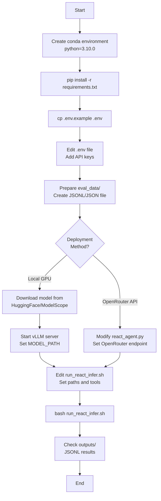
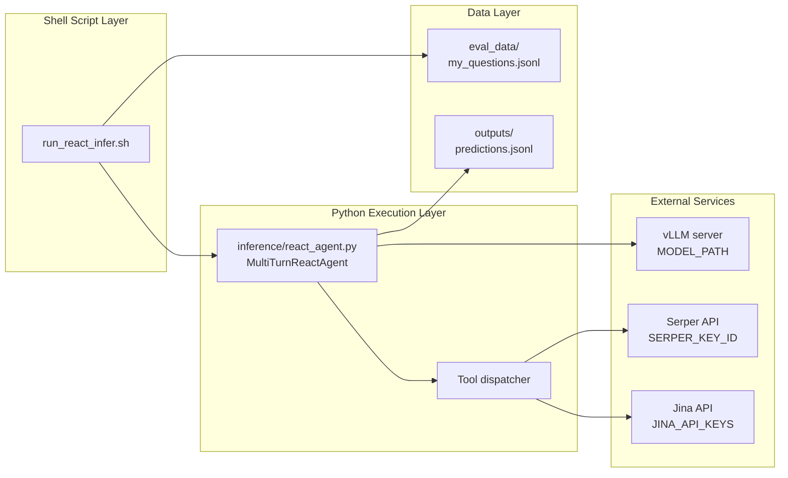
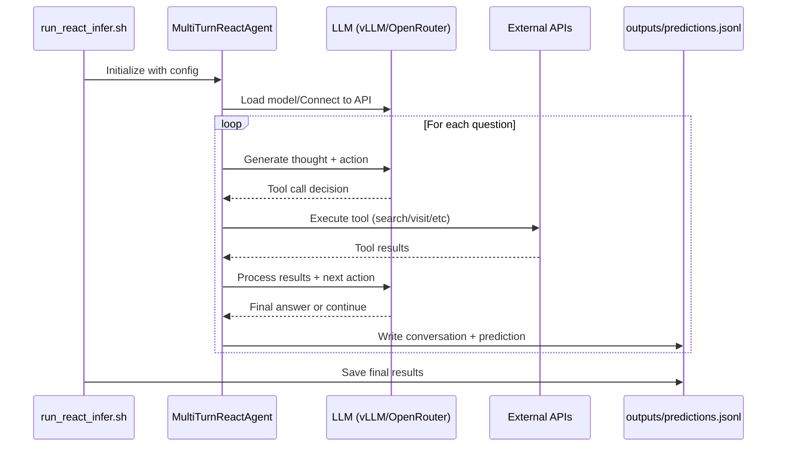

<!-- source: DeepWiki mcp.deepwiki.com · repo Alibaba-NLP/DeepResearch · page 6.4 Quick Start Guide · fetched 2026-10-29 -->

# Quick Start Guide

<details>
<summary>Relevant source files</summary>

The following files were used as context for generating this wiki page:

- [FAQ.md](FAQ.md)
- [README.md](README.md)
- [assets/family.png](assets/family.png)
- [assets/family17.png](assets/family17.png)

</details>


This page provides a step-by-step walkthrough to get Tongyi DeepResearch running from initial installation to executing your first inference. For detailed configuration options, see [Configuration and API Keys](#6.2). For production deployment strategies, see [Model Downloads and Deployment](#6.3).

## Prerequisites

Before starting, ensure you have:
- **Python 3.10.0** (other versions may cause dependency issues)
- A conda or virtualenv installation
- API keys for external services (Serper, Jina, OpenAI-compatible endpoint, Dashscope)
- Either: GPU resources for local model deployment OR OpenRouter API access

---

## Quick Start Workflow

The following diagram shows the complete workflow from installation to first inference:



Sources: [README.md:68-170]()

---

## Step 1: Environment Setup

Create an isolated Python environment to avoid dependency conflicts:

```bash
# Create conda environment with Python 3.10.0
conda create -n react_infer_env python=3.10.0
conda activate react_infer_env
```

**Why Python 3.10.0?** The dependency tree, particularly for `vLLM` and transformer libraries, is tested and stable with this version. Other versions may encounter installation or runtime errors.

Sources: [README.md:72-80]()

---

## Step 2: Install Dependencies

Install required packages from the root of the repository:

```bash
pip install -r requirements.txt
```

Key dependencies installed include:
- `vllm` - for efficient LLM inference
- `openai` - for API communication
- `dashscope` - for document parsing
- `qwen-agent` - agent framework components
- Standard ML/NLP libraries (transformers, torch, etc.)

For a complete breakdown of dependencies, see [Dependencies and Environment Setup](#6.1).

Sources: [README.md:82-87]()

---

## Step 3: Configure Environment Variables

Create your configuration file from the template:

```bash
cp .env.example .env
```

Edit `.env` and add your API keys for the minimal working setup:

| Variable | Purpose | Required For | Get Key From |
|----------|---------|--------------|--------------|
| `SERPER_KEY_ID` | Web search functionality | Search tool | [serper.dev](https://serper.dev/) |
| `JINA_API_KEYS` | Web page reading | Visit tool | [jina.ai](https://jina.ai/) |
| `API_KEY` | Content summarization | Summary operations | [OpenAI](https://platform.openai.com/) |
| `API_BASE` | API endpoint URL | Summary operations | Your API provider |
| `DASHSCOPE_API_KEY` | File parsing (PDF, DOCX, etc.) | File parser tool | [dashscope.aliyun.com](https://dashscope.aliyun.com/) |
| `MODEL_PATH` | Local model location | Local inference | Model directory path |

**Minimal configuration for basic inference** (Search + Visit only):
```bash
SERPER_KEY_ID=your_serper_key_here
JINA_API_KEYS=your_jina_key_here
MODEL_PATH=/path/to/Tongyi-DeepResearch-30B-A3B
```

For complete configuration details, see [Configuration and API Keys](#6.2).

Sources: [README.md:89-111]()

---

## Step 4: Prepare Evaluation Data

Create your input data file in one of two supported formats:

### JSONL Format (Recommended)

Create `eval_data/my_questions.jsonl`:

```jsonl
{"question": "What are the latest developments in quantum computing?", "answer": ""}
{"question": "Explain the impact of transformers in NLP", "answer": ""}
```

### JSON Format

Create `eval_data/my_questions.json`:

```json
[
  {"question": "What are the latest developments in quantum computing?", "answer": ""},
  {"question": "Explain the impact of transformers in NLP", "answer": ""}
]
```

### Data Format Specifications

| Field | Type | Required | Purpose |
|-------|------|----------|---------|
| `question` | string | Yes | The input query for the agent |
| `answer` | string | No | Ground truth for evaluation (leave empty for open-ended inference) |

### Working with Files

For document-based questions, prepend the filename to the question and place files in `eval_data/file_corpus/`:

```jsonl
{"question": "(Uploaded 1 file: ['report.pdf'])\n\nSummarize the key findings.", "answer": ""}
```

Directory structure:
```
project_root/
├── eval_data/
│   ├── my_questions.jsonl
│   └── file_corpus/
│       └── report.pdf
```

Sources: [README.md:113-153]()

---

## Step 5: Configure Inference Script

The following diagram shows the key components involved in a basic inference run:



Sources: [README.md:155-161](), [inference/react_agent.py:1-100]()

### Edit run_react_infer.sh

Open `run_react_infer.sh` and configure the following variables:

```bash
# Model configuration
MODEL_PATH="/path/to/Tongyi-DeepResearch-30B-A3B"

# Data paths
DATASET="eval_data/my_questions.jsonl"  # Your input file
OUTPUT_PATH="./outputs"                  # Results directory

# Tool configuration (uncomment tools you want to enable)
--use_search   # Enable web search (requires SERPER_KEY_ID)
--use_visit    # Enable page reading (requires JINA_API_KEYS)
# --use_file_parser  # Enable file parsing (requires DASHSCOPE_API_KEY)
# --use_python       # Enable code execution (requires SANDBOX_FUSION_ENDPOINT)
```

**Configuration hierarchy:**
1. Environment variables from `.env` are loaded first
2. Command-line arguments in `run_react_infer.sh` override defaults
3. Script variables (`MODEL_PATH`, `DATASET`, etc.) are passed to Python

Sources: [README.md:155-161]()

---

## Step 6: Run Inference

Execute the inference script:

```bash
bash run_react_infer.sh
```

### What Happens During Execution



Sources: [inference/react_agent.py:1-800]()

### Expected Output

The script creates an output JSONL file with one entry per question:

```jsonl
{
  "question": "What are the latest developments in quantum computing?",
  "messages": [...],  # Full conversation history
  "prediction": "Recent developments include...",
  "termination_reason": "answer",
  "token_count": 2847,
  "tool_calls": 5
}
```

### Output Fields

| Field | Description |
|-------|-------------|
| `question` | Original input question |
| `messages` | Complete conversation trace with tool calls |
| `prediction` | Extracted final answer |
| `termination_reason` | Why inference stopped (`answer`, `max_turn`, `token_limit`, `error`) |
| `token_count` | Total tokens used |
| `tool_calls` | Number of tool invocations |

Sources: [README.md:165-170]()

---

## Step 7: Verify Results

Check the output directory:

```bash
ls -lh outputs/
# predictions_<timestamp>.jsonl
```

Inspect the results:

```bash
# View first prediction
head -n 1 outputs/predictions_*.jsonl | jq '.'

# Count successful completions
grep -c '"termination_reason": "answer"' outputs/predictions_*.jsonl
```

For evaluation and benchmarking, see [Running Evaluations](#5.4).

Sources: [README.md:165-170]()

---

## Alternative: Using OpenRouter API

For inference without local GPU resources, use OpenRouter's hosted Tongyi DeepResearch endpoint:

### Modify react_agent.py

Edit `inference/react_agent.py` to configure OpenRouter:

**1. Update API endpoint** in the `call_server` function ([inference/react_agent.py:50-100]()):

```python
# Change these lines:
API_KEY = "your_openrouter_api_key"
API_BASE = "https://openrouter.ai/api/v1"
```

**2. Update model name** ([inference/react_agent.py:80-90]()):

```python
# Change from:
model = "Tongyi-DeepResearch-30B-A3B"
# To:
model = "alibaba/tongyi-deepresearch-30b-a3b"
```

**3. Adjust message format** ([inference/react_agent.py:88-90]()):

The OpenRouter API may require different content concatenation. Refer to inline comments in the code for specific adjustments needed.

### Configuration

You do NOT need to set `MODEL_PATH` or run a local vLLM server when using OpenRouter. Update your `.env`:

```bash
# Comment out or remove:
# MODEL_PATH=/path/to/model

# Ensure API keys are set:
SERPER_KEY_ID=your_serper_key
JINA_API_KEYS=your_jina_key
```

### Run Inference

Execute normally:

```bash
bash run_react_infer.sh
```

The agent will make API calls to OpenRouter instead of a local model server.

For more details on OpenRouter integration, see [OpenRouter Integration](#7.4).

Sources: [README.md:172-181]()

---

## Component Reference

The following table maps high-level concepts to concrete code entities:

| Concept | Code Entity | File Path |
|---------|-------------|-----------|
| Agent orchestration | `MultiTurnReactAgent` | `inference/react_agent.py` |
| Tool registry | Tool dispatcher logic | `inference/react_agent.py` |
| Search functionality | `Search` tool class | `inference/tools/` |
| Page reading | `Visit` tool class | `inference/tools/` |
| File parsing | `SingleFileParser` | `inference/tools/` |
| Configuration | Environment variables | `.env` |
| Inference script | Shell script | `run_react_infer.sh` |
| Input data | JSONL/JSON files | `eval_data/` |
| Output data | JSONL results | `outputs/` |

---

## Troubleshooting Quick Reference

| Issue | Likely Cause | Solution |
|-------|--------------|----------|
| `ModuleNotFoundError` | Wrong Python version or incomplete install | Use Python 3.10.0, reinstall requirements |
| `API key not found` | `.env` not loaded or missing keys | Verify `.env` exists and contains all required keys |
| `Connection refused` (local) | vLLM server not running | Start vLLM server with correct `MODEL_PATH` |
| `Rate limit exceeded` | API quota reached | Check API key limits or reduce concurrent requests |
| Empty predictions | Tool APIs failing silently | Check API key validity and network connectivity |
| `CUDA out of memory` | Insufficient GPU memory | Use smaller batch size or GPU with more memory |

For detailed troubleshooting, see [FAQ](FAQ.md).

Sources: [FAQ.md:1-19]()

---

## Next Steps

After completing your first inference run:

1. **Explore tools**: Enable additional tools like `--use_file_parser` or `--use_python` in [run_react_infer.sh]()
2. **Run benchmarks**: Use provided evaluation scripts to test on standard datasets - see [Running Evaluations](#5.4)
3. **Customize behavior**: Modify system prompts and tool configurations - see [Prompt Engineering](#7.2)
4. **Scale deployment**: Set up distributed inference with multiple GPUs - see [Distributed Inference](#7.3)
5. **Create custom tools**: Extend the agent with domain-specific tools - see [Custom Tool Development](#7.1)

Sources: [README.md:68-189]()

---

