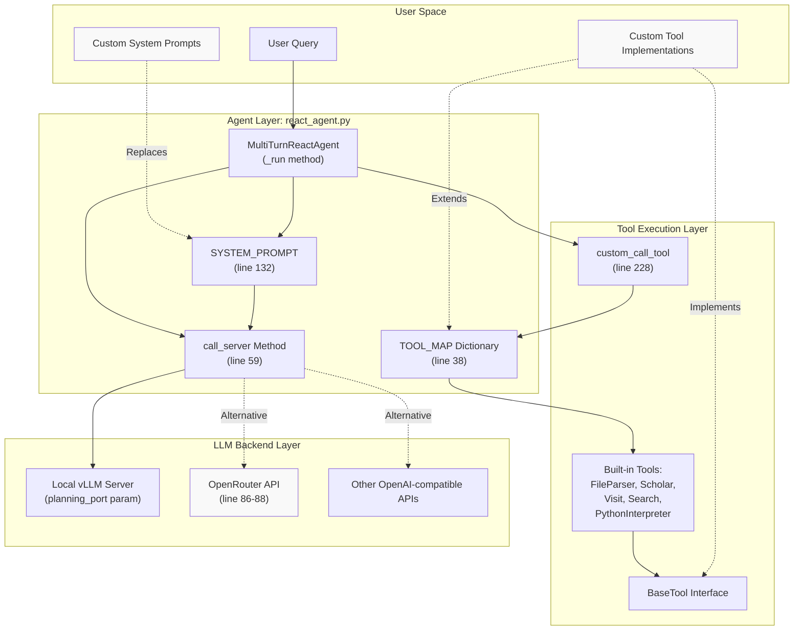
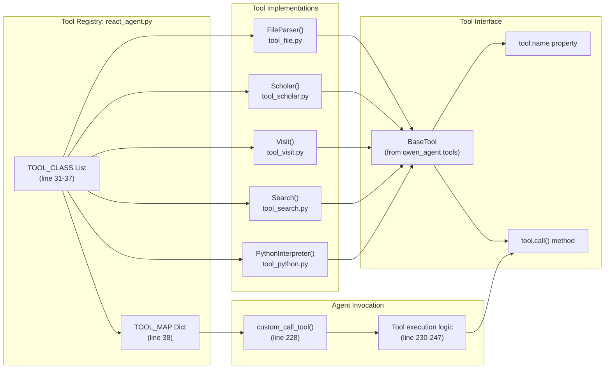
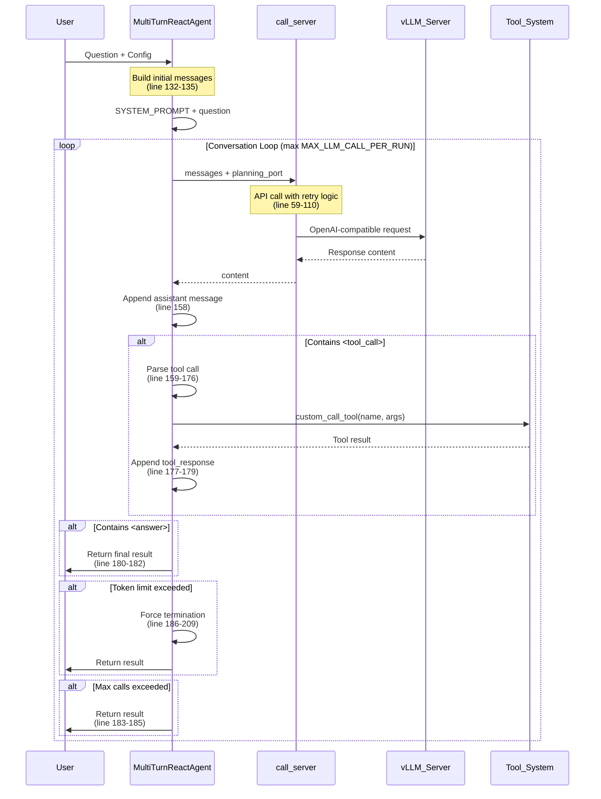
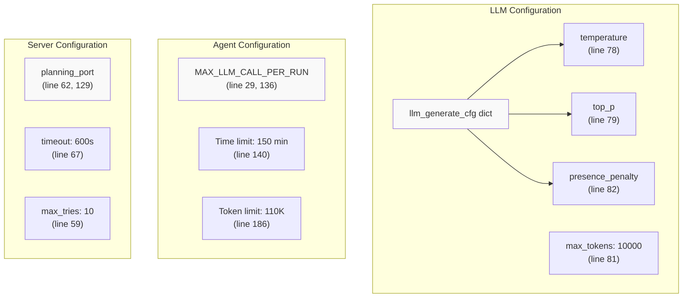
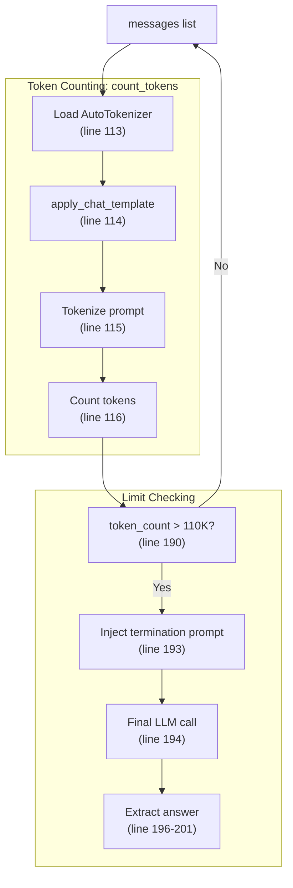
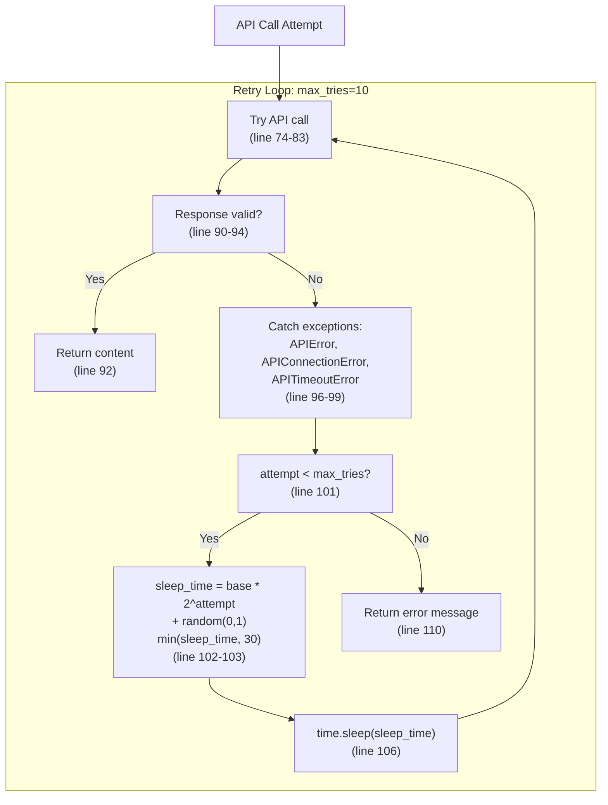

<!-- source: DeepWiki mcp.deepwiki.com · repo Alibaba-NLP/DeepResearch · page 7 Advanced Topics · fetched 2026-10-29 -->

# Advanced Topics

<details>
<summary>Relevant source files</summary>

The following files were used as context for generating this wiki page:

- [README.md](README.md)
- [inference/react_agent.py](inference/react_agent.py)

</details>


This document covers advanced usage patterns, system customization, and extending the Tongyi DeepResearch inference engine beyond basic deployment. These topics are intended for users who need to customize agent behavior, develop new tools, optimize deployment for production workloads, or integrate with alternative inference providers.

For basic setup and configuration, see [Setup and Configuration](#6). For core inference concepts, see [Core Inference Engine](#2).

---

## Overview

The Tongyi DeepResearch system is designed with extensibility in mind. Advanced users can customize and extend the system in several key areas:

- **Tool Development**: Create custom tools that extend agent capabilities beyond the built-in search, visit, file parsing, and code execution tools
- **Prompt Engineering**: Modify system prompts and tool call formats to customize agent reasoning behavior
- **Distributed Inference**: Deploy multiple vLLM servers with load balancing for high-throughput production workloads
- **Alternative Inference Providers**: Use OpenRouter or other OpenAI-compatible APIs without local GPU resources

The following sections provide technical overviews of these capabilities. For detailed implementation guidance, refer to the corresponding subsections ([7.1](#7.1), [7.2](#7.2), [7.3](#7.3), [7.4](#7.4)).

---

## Architecture for Extensibility

The inference system is structured to support customization at multiple layers. Understanding this architecture is essential for advanced usage.

### System Extension Points



**Sources**: [inference/react_agent.py:31-38](), [inference/react_agent.py:47-55](), [inference/react_agent.py:59-68](), [inference/react_agent.py:228-247]()

### Code Entity Map: Tool System

The tool system is the primary extension point for adding new capabilities. Understanding the key code entities is essential:



**Key Code Entities**:

| Entity | Location | Purpose |
|--------|----------|---------|
| `TOOL_CLASS` | [inference/react_agent.py:31-37]() | List of instantiated tool objects |
| `TOOL_MAP` | [inference/react_agent.py:38]() | Dictionary mapping tool names to tool instances |
| `custom_call_tool()` | [inference/react_agent.py:228-247]() | Tool dispatcher that routes calls to appropriate tools |
| `BaseTool` | qwen_agent.tools | Base class defining tool interface |
| Tool implementations | tool_*.py modules | Individual tool implementations (FileParser, Scholar, Visit, Search, PythonInterpreter) |

**Sources**: [inference/react_agent.py:31-38](), [inference/react_agent.py:228-247]()

---

## Message Flow and Customization Points

Understanding the message flow through the system reveals where customization hooks exist:



**Customization Points in Flow**:

1. **System Prompt** (line 132): Replace `SYSTEM_PROMPT` to change agent behavior
2. **API Endpoint** (line 62): Change `openai_api_base` to use different servers or OpenRouter
3. **Generation Parameters** (line 78-82): Modify temperature, top_p, presence_penalty
4. **Tool Registry** (line 38): Add custom tools to `TOOL_MAP`
5. **Tool Parsing** (line 159-176): Customize how tool calls are extracted and formatted
6. **Response Formatting** (line 86-88): Handle different API response formats (e.g., OpenRouter reasoning)

**Sources**: [inference/react_agent.py:59-110](), [inference/react_agent.py:120-226]()

---

## Tool Call Protocol

The agent uses a specific XML-based protocol for tool calls. Understanding this protocol is essential for custom tool development and prompt engineering:

### Tool Call Format

```mermaid
graph TD
    AssistantMsg["Assistant Message"]
    
    subgraph "Message Structure"
        Think[""]
        ToolCall["<tool_call>JSON</tool_call>"]
        Answer["<answer>response</answer>"]
    end
    
    subgraph "Tool Call JSON"
        ToolName["name: tool_name"]
        ToolArgs["arguments: dict"]
    end
    
    subgraph "Tool Response"
        ToolResp["<tool_response>result</tool_response>"]
    end
    
    AssistantMsg --> Think
    Think --> ToolCall
    ToolCall --> ToolName
    ToolCall --> ToolArgs
    
    ToolCall -.->|"Triggers execution"| ToolResp
    ToolResp -.->|"Appended as user message"| AssistantMsg
    
    Think --> Answer
    ToolCall -.->|"If no answer tag"| Think
```

**Protocol Specification**:

| Element | Format | Purpose | Code Reference |
|---------|--------|---------|----------------|
| `` | Agent reasoning | [inference/react_agent.py:56-57]() |
| `<tool_call>` | `<tool_call>{"name": "...", "arguments": {...}}</tool_call>` | Tool invocation | [inference/react_agent.py:159-176]() |
| `<tool_response>` | `<tool_response>text</tool_response>` | Tool result | [inference/react_agent.py:177]() |
| `<answer>` | `<answer>text</answer>` | Final answer | [inference/react_agent.py:180-182]() |
| Stop sequences | `["\n<tool_response>", "<tool_response>"]` | LLM stop tokens | [inference/react_agent.py:77]() |

**Special Cases**:

- **Python Interpreter**: Uses `<code>` tags within `<tool_call>` for code blocks [inference/react_agent.py:162-167]()
- **File References**: File paths prepended to questions for parse_file tool [README.md:141-143]()

**Sources**: [inference/react_agent.py:56-57](), [inference/react_agent.py:159-182](), [README.md:141-143]()

---

## Configuration Parameters

The system exposes several configuration points through environment variables and runtime parameters:

### Environment Variables

| Variable | Purpose | Location | Default |
|----------|---------|----------|---------|
| `MAX_LLM_CALL_PER_RUN` | Maximum agent loop iterations | [inference/react_agent.py:29]() | 100 |
| `SERPER_KEY_ID` | Web search API key | .env | Required |
| `JINA_API_KEYS` | Web reading API key | .env | Required |
| `API_KEY` | OpenAI-compatible API key | .env | Required |
| `DASHSCOPE_API_KEY` | File parsing API key | .env | Required |
| `SANDBOX_FUSION_ENDPOINT` | Python execution sandbox | .env | Optional |
| `MODEL_PATH` | Model weights path | .env | Required |

### Runtime Configuration



**Configuration Points**:

- **Generation Config**: Passed through `llm["generate_cfg"]` dict [inference/react_agent.py:53]()
- **Temperature**: Controls randomness (default 0.6) [inference/react_agent.py:78]()
- **Top-p**: Nucleus sampling (default 0.95) [inference/react_agent.py:79]()
- **Presence Penalty**: Reduces repetition (default 1.1) [inference/react_agent.py:82]()
- **Max Turns**: Configurable via `MAX_LLM_CALL_PER_RUN` environment variable [inference/react_agent.py:29]()

**Sources**: [inference/react_agent.py:29](), [inference/react_agent.py:53-54](), [inference/react_agent.py:59-83](), [inference/react_agent.py:136-210]()

---

## Token Management

The system implements sophisticated token tracking and overflow handling:

### Token Counting and Limits



**Token Management Strategy**:

1. **Periodic Counting**: Token count computed after each round [inference/react_agent.py:187-188]()
2. **Threshold**: Hard limit at 110K tokens (slightly below 128K model capacity) [inference/react_agent.py:186]()
3. **Graceful Degradation**: When limit reached, inject special prompt requesting final answer [inference/react_agent.py:193]()
4. **Forced Termination**: Final LLM call to extract best-effort answer [inference/react_agent.py:194-209]()

**Termination Reasons**:

| Reason | Condition | Code Reference |
|--------|-----------|----------------|
| `"answer"` | Agent produces `<answer>` tag | [inference/react_agent.py:181, 213]() |
| `"generate an answer as token limit reached"` | Token overflow with valid answer | [inference/react_agent.py:198]() |
| `"format error: generate an answer as token limit reached"` | Token overflow without valid answer format | [inference/react_agent.py:201]() |
| `"exceed available llm calls"` | Hit `MAX_LLM_CALL_PER_RUN` | [inference/react_agent.py:218]() |
| `"No answer found after 2h30mins"` | Time limit exceeded | [inference/react_agent.py:140-142]() |

**Sources**: [inference/react_agent.py:112-118](), [inference/react_agent.py:186-209]()

---

## Retry Logic and Error Handling

The system implements exponential backoff retry logic for robust API communication:

### Retry Mechanism



**Retry Strategy**:

- **Base Sleep Time**: 1 second [inference/react_agent.py:70]()
- **Exponential Backoff**: `sleep_time = base_sleep_time * (2 ** attempt) + random(0, 1)` [inference/react_agent.py:102]()
- **Max Sleep Time**: 30 seconds cap [inference/react_agent.py:103]()
- **Max Attempts**: 10 tries [inference/react_agent.py:59]()
- **Random Jitter**: Prevents thundering herd [inference/react_agent.py:102]()

**Error Types Caught**:

- `APIError`: API-level errors from OpenAI client
- `APIConnectionError`: Network connectivity issues
- `APITimeoutError`: Request timeout (600s configured) [inference/react_agent.py:67]()

**Sources**: [inference/react_agent.py:59-110]()

---

## OpenRouter Integration Notes

OpenRouter provides access to Tongyi DeepResearch without local GPU resources. The integration requires specific modifications:

### Required Code Changes

The system includes commented code for OpenRouter compatibility:

```python
# Lines 86-88 in inference/react_agent.py
# reasoning_content = ""
# content = reasoning_content + content
```

**OpenRouter Differences**:

1. **Reasoning Field**: OpenRouter returns reasoning in separate `message.reasoning` field
2. **Content Concatenation**: Must manually prepend reasoning content with `<think>` tags
3. **API Configuration**: Replace `openai_api_base` with OpenRouter URL
4. **Model Name**: Use `alibaba/tongyi-deepresearch-30b-a3b`

**Configuration Table**:

| Parameter | Local vLLM | OpenRouter |
|-----------|------------|------------|
| `api_key` | "EMPTY" | OpenRouter API key |
| `base_url` | `http://127.0.0.1:{port}/v1` | `https://openrouter.ai/api/v1` |
| `model` | Model path | `alibaba/tongyi-deepresearch-30b-a3b` |
| Reasoning handling | Included in content | Separate field (lines 86-88) |

For complete OpenRouter setup instructions, see [OpenRouter Integration](#7.4).

**Sources**: [README.md:172-180](), [inference/react_agent.py:86-88]()

---

## Summary

This page introduced the advanced capabilities of the Tongyi DeepResearch system:

- **Tool System**: Extensible through `TOOL_MAP` registry and `BaseTool` interface
- **Prompt Engineering**: XML-based protocol with `<think>`, `<tool_call>`, `<answer>` tags
- **Distributed Inference**: Multi-server deployment through `planning_port` parameter
- **OpenRouter**: Alternative inference without local GPUs

For implementation details on each topic, see the corresponding subsections:

- [Custom Tool Development](#7.1)
- [Prompt Engineering](#7.2)
- [Distributed Inference](#7.3)
- [OpenRouter Integration](#7.4)

**Sources**: [inference/react_agent.py](), [README.md:172-180]()

---

