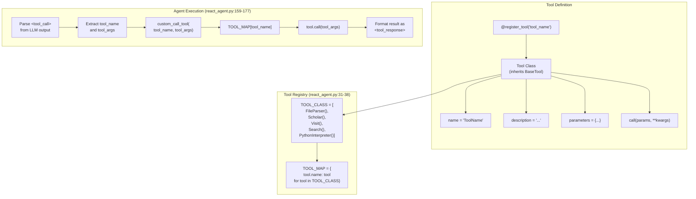
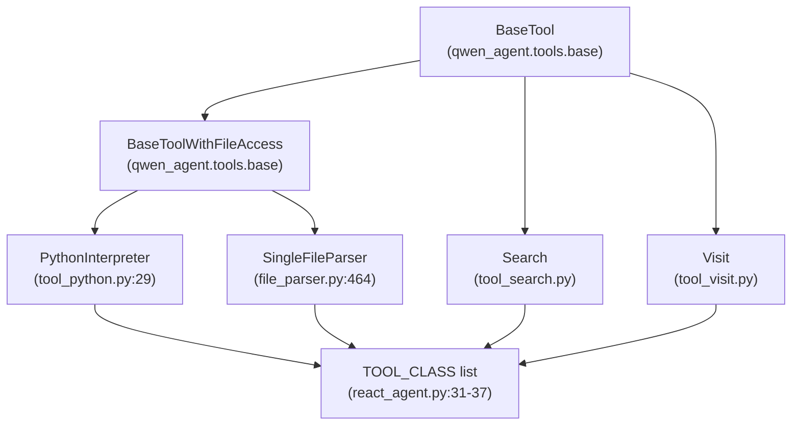
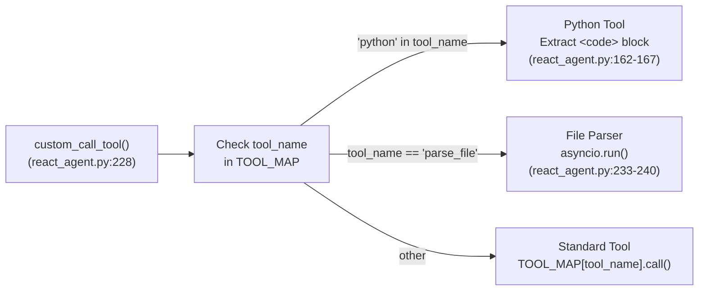
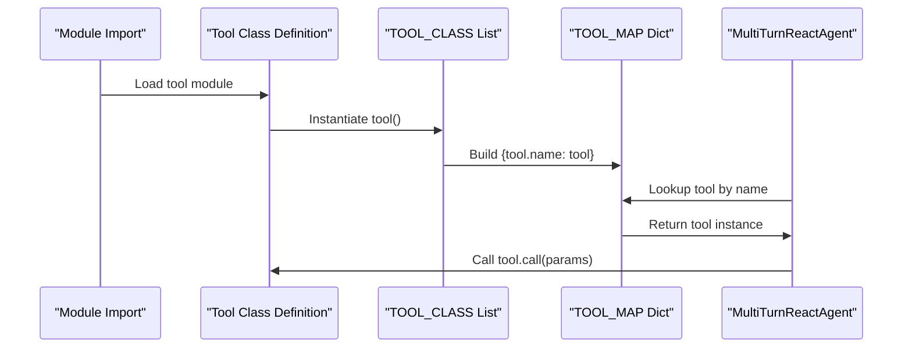
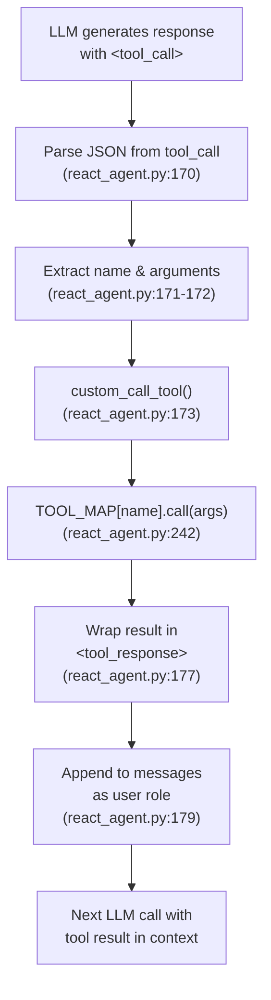

<!-- source: DeepWiki mcp.deepwiki.com · repo Alibaba-NLP/DeepResearch · page 7.1 Custom Tool Development · fetched 2026-10-29 -->

# Custom Tool Development

<details>
<summary>Relevant source files</summary>

The following files were used as context for generating this wiki page:

- [WebAgent/WebDancer/demos/llm/__pycache__/oai.cpython-313.pyc](WebAgent/WebDancer/demos/llm/__pycache__/oai.cpython-313.pyc)
- [WebAgent/WebDancer/demos/llm/oai.py](WebAgent/WebDancer/demos/llm/oai.py)
- [inference/file_tools/__pycache__/file_parser.cpython-313.pyc](inference/file_tools/__pycache__/file_parser.cpython-313.pyc)
- [inference/file_tools/file_parser.py](inference/file_tools/file_parser.py)
- [inference/react_agent.py](inference/react_agent.py)
- [inference/tool_python.py](inference/tool_python.py)

</details>


This page provides technical documentation for creating and registering custom tools within the Tongyi DeepResearch inference system. Custom tools extend the agent's capabilities by providing specialized functions that can be invoked during the ReAct reasoning loop.

For information about the overall tool system architecture and built-in tools, see [Tool System Architecture](#2.4). For details on specific tool implementations like Search, Visit, and FileParser, see [Web Tools: Search and Visit](#2.6), [File Parser and Document Processing](#2.5), and [Python Interpreter and Code Execution](#2.8).

## Tool System Overview

The inference engine uses a tool registry pattern where tools are defined as Python classes, registered by name, and invoked dynamically by the agent during execution. Tools must conform to a specific interface to integrate with the `MultiTurnReactAgent`.

### Tool Registration and Dispatch Architecture



**Sources:** [inference/react_agent.py:31-38](), [inference/react_agent.py:159-177](), [inference/react_agent.py:228-247]()

## Tool Interface Requirements

All custom tools must implement the following interface components:

| Component | Type | Required | Description |
|-----------|------|----------|-------------|
| `name` | `str` | Yes | Unique identifier for the tool (used in `TOOL_MAP`) |
| `description` | `str` | Yes | Natural language description shown to the LLM |
| `parameters` | `list[dict]` or `dict` | Yes | JSON schema defining tool input parameters |
| `call(params, **kwargs)` | method | Yes | Execution method that receives parameters and returns results |

### Tool Class Hierarchy



**Sources:** [inference/tool_python.py:28-32](), [inference/file_tools/file_parser.py:464-466](), [inference/react_agent.py:31-37]()

## Creating a Custom Tool

### Step 1: Define the Tool Class

Create a new Python class that inherits from `BaseTool` or `BaseToolWithFileAccess`:

```python
from qwen_agent.tools.base import BaseTool, register_tool

@register_tool('my_custom_tool')
class MyCustomTool(BaseTool):
    name = "my_custom_tool"
    description = "Brief description of what this tool does"
    parameters = [{
        'name': 'param1',
        'type': 'string',
        'description': 'Description of parameter',
        'required': True
    }]
```

**Key Points:**
- Use the `@register_tool` decorator with a unique tool name
- Set `name` attribute to match the decorator argument
- Provide clear `description` that helps the LLM understand when to use the tool
- Define `parameters` schema following JSON schema conventions

**Sources:** [inference/tool_python.py:28-42](), [inference/file_tools/file_parser.py:464-472]()

### Step 2: Implement the Call Method

The `call` method contains the tool's execution logic:

```python
def call(self, params: Union[str, dict], **kwargs) -> Union[str, list]:
    # Verify and parse parameters
    params = self._verify_json_format_args(params)
    
    # Extract specific parameters
    param_value = params.get('param1')
    
    # Implement tool logic
    try:
        result = self._execute_logic(param_value)
        return result
    except Exception as e:
        return f"[Tool Error]: {str(e)}"
```

**Implementation Guidelines:**

1. **Parameter Parsing**: Handle both string and dict inputs. Use `_verify_json_format_args` if available from parent class.

2. **Error Handling**: Wrap execution in try-except blocks and return formatted error messages that the agent can interpret.

3. **Return Format**: Return either:
   - Simple string for text results
   - List of dicts for structured data (e.g., file parsing results)
   - Formatted error message starting with `[Tool Error]` or `[ToolName Error]`

**Sources:** [inference/tool_python.py:72-112](), [inference/file_tools/file_parser.py:500-507]()

### Step 3: Handle Special Cases

Some tools require special handling in the agent's `custom_call_tool` method:



For Python code execution, special handling extracts code from `<code>` blocks:

```python
if "python" in tool_call.lower():
    try:
        code_raw = content.split('<tool_call>')[1]\
                         .split('</tool_call>')[0]\
                         .split('<code>')[1]\
                         .split('</code>')[0].strip()
        result = TOOL_MAP['PythonInterpreter'].call(code_raw)
    except:
        result = "[Python Interpreter Error]: Formatting error."
```

**Sources:** [inference/react_agent.py:162-167](), [inference/react_agent.py:233-240]()

## Parameter Schema Definition

### Basic Parameter Schema

Parameters follow JSON Schema conventions with extensions:

```python
parameters = [{
    'name': 'parameter_name',
    'type': 'string',  # or 'number', 'boolean', 'array', 'object'
    'description': 'Detailed description for the LLM',
    'required': True  # or False
}]
```

### Object-Style Schema (OpenAI Format)

Some tools use the OpenAI function calling schema format:

```python
parameters = {
    "type": "object",
    "properties": {
        "code": {
            "type": "string",
            "description": "The Python code to execute. Must be within <code></code> tags."
        }
    },
    "required": ["code"]
}
```

**Example from PythonInterpreter:**

[inference/tool_python.py:33-42]() shows this pattern where the `parameters` dict defines an object schema with nested properties.

**Sources:** [inference/tool_python.py:33-42](), [inference/file_tools/file_parser.py:467-472]()

## Tool Registration and Loading

### Adding Tools to the Agent

Tools are registered by adding instances to the `TOOL_CLASS` list:

```python
# In react_agent.py
TOOL_CLASS = [
    FileParser(),
    Scholar(),
    Visit(),
    Search(),
    PythonInterpreter(),
    # Add your custom tool here:
    # MyCustomTool(),
]

TOOL_MAP = {tool.name: tool for tool in TOOL_CLASS}
```

**Registration Flow:**



**Sources:** [inference/react_agent.py:31-38]()

### Environment Configuration

Tools that require external services need environment variables:

| Tool | Environment Variable | Purpose |
|------|---------------------|---------|
| Search | `SERPER_API_KEY` | Serper.dev API access |
| Visit | `JINA_API_KEY` | Jina AI reader API |
| FileParser | `USE_IDP` | Enable/disable IDP parsing |
| FileParser | `DASHSCOPE_API_KEY` | Document parsing service |
| PythonInterpreter | `SANDBOX_FUSION_ENDPOINT` | Code execution sandbox |

For complete configuration details, see [Configuration and API Keys](#6.2).

**Sources:** Configuration patterns observed across tool implementations

## Tool Invocation in Agent Loop

### LLM Output Format

The agent expects tools to be invoked through structured XML tags:

```xml

<tool_call>
{"name": "tool_name", "arguments": {"param1": "value1"}}
</tool_call>
```

### Execution Flow



**Code Reference:**

[inference/react_agent.py:159-179]() shows the complete flow:
1. Detect `<tool_call>` tags in content
2. Parse JSON with `json5.loads(tool_call)`
3. Extract `name` and `arguments`
4. Call `custom_call_tool(tool_name, tool_args)`
5. Format result as `<tool_response>\n{result}\n</tool_response>`
6. Append to messages as user input

**Sources:** [inference/react_agent.py:159-179]()

## Advanced Tool Patterns

### Asynchronous Tool Execution

For tools that require async operations (e.g., file I/O, API calls):

```python
def call(self, params: Union[str, dict], **kwargs) -> str:
    params = self._verify_json_format_args(params)
    
    # Synchronous wrapper for async operation
    result = asyncio.run(self._async_operation(params))
    return result

async def _async_operation(self, params: dict):
    # Async implementation
    pass
```

Example from FileParser: [inference/file_tools/file_parser.py:236]() uses `asyncio.run()` to execute async file parsing.

**Sources:** [inference/file_tools/file_parser.py:233-240]()

### Retry Logic and Error Handling

Tools that interact with external services should implement retry logic:

```python
def call(self, params, timeout=50, **kwargs) -> str:
    last_error = None
    for attempt in range(max_retries):
        try:
            endpoint = random.choice(endpoints)
            result = self._execute(endpoint, params, timeout)
            return result
        except Timeout as e:
            last_error = f'[Tool Error] TimeoutError: {endpoint}'
            if attempt == max_retries - 1:
                return last_error
            continue
        except Exception as e:
            last_error = f'[Tool Error]: {str(e)}'
            continue
    
    return last_error or '[Tool Error]: All attempts failed.'
```

**Example:** [inference/tool_python.py:76-109]() demonstrates retry logic with multiple sandbox endpoints.

**Sources:** [inference/tool_python.py:72-112]()

### Caching Tool Results

Tools can cache expensive operations:

```python
from qwen_agent.tools.storage import Storage, KeyNotExistsError

class CachingTool(BaseTool):
    def __init__(self, cfg: Optional[Dict] = None):
        super().__init__(cfg)
        self.db = Storage({'storage_root_path': self.data_root})
    
    def call(self, params: Union[str, dict], **kwargs) -> str:
        cache_key = self._generate_cache_key(params)
        
        try:
            cached = self.db.get(cache_key)
            return json.loads(cached)
        except KeyNotExistsError:
            result = self._compute_result(params)
            self.db.put(cache_key, json.dumps(result))
            return result
```

**Example:** [inference/file_tools/file_parser.py:504-507]() shows cache lookup pattern.

**Sources:** [inference/file_tools/file_parser.py:500-557]()

## Tool Description Best Practices

### Writing Effective Descriptions

The `description` field is critical for the LLM to understand when to use the tool:

**Good Description Pattern:**
```python
description = (
    "Tool purpose in one sentence. "
    "Use this to [specific use case]. "
    "Detailed behavior description with examples. "
    "Special instructions or format requirements."
)
```

**Example from PythonInterpreter:**
```python
description = (
    'Execute Python code in a sandboxed environment. '
    'Use this to run Python code and get the execution results.\n'
    '**Make sure to use print() for any output you want to see in the results.**\n'
    'For code parameters, use placeholders first, then put code within '
    '<code></code> XML tags...'
)
```

**Key Elements:**
1. Start with clear purpose
2. Specify when to use the tool
3. Include format requirements (e.g., XML tags, special syntax)
4. Provide usage warnings or best practices
5. Use markdown formatting for readability

**Sources:** [inference/tool_python.py:31](), [inference/file_tools/file_parser.py:466]()

### Parameter Descriptions

Each parameter should have a clear, actionable description:

```python
{
    'name': 'code',
    'type': 'string',
    'description': (
        'The Python code to execute. Must be provided within <code></code> XML tags. '
        'Remember to use print() statements for any output you want to see.'
    )
}
```

**Sources:** [inference/tool_python.py:36-39]()

## Complete Tool Implementation Example

### Minimal Working Tool

```python
from typing import Dict, Optional, Union
from qwen_agent.tools.base import BaseTool, register_tool

@register_tool('example_tool')
class ExampleTool(BaseTool):
    name = "example_tool"
    description = (
        "Example tool that processes text input. "
        "Use this when you need to transform or analyze text data."
    )
    parameters = [{
        'name': 'text',
        'type': 'string',
        'description': 'The text to process',
        'required': True
    }, {
        'name': 'operation',
        'type': 'string',
        'description': 'Operation to perform: "uppercase", "lowercase", or "reverse"',
        'required': False
    }]
    
    def __init__(self, cfg: Optional[Dict] = None):
        super().__init__(cfg)
    
    def call(self, params: Union[str, dict], **kwargs) -> str:
        try:
            # Parse parameters
            if isinstance(params, str):
                import json5
                params = json5.loads(params)
            
            text = params.get('text', '')
            operation = params.get('operation', 'uppercase')
            
            # Execute operation
            if operation == 'uppercase':
                result = text.upper()
            elif operation == 'lowercase':
                result = text.lower()
            elif operation == 'reverse':
                result = text[::-1]
            else:
                return f"[Example Tool Error]: Unknown operation '{operation}'"
            
            return f"Processed text: {result}"
            
        except Exception as e:
            return f"[Example Tool Error]: {str(e)}"
```

### Registering the Tool

Add the tool to `react_agent.py`:

```python
from tool_example import ExampleTool

TOOL_CLASS = [
    FileParser(),
    Scholar(),
    Visit(),
    Search(),
    PythonInterpreter(),
    ExampleTool(),  # Add here
]
```

**Sources:** Pattern derived from [inference/tool_python.py:28-112]() and [inference/react_agent.py:31-38]()

## Testing Custom Tools

### Unit Testing

Test the tool's `call` method directly:

```python
def test_custom_tool():
    tool = ExampleTool()
    
    # Test with dict params
    result = tool.call({'text': 'hello', 'operation': 'uppercase'})
    assert result == 'Processed text: HELLO'
    
    # Test with string params
    result = tool.call('{"text": "hello", "operation": "reverse"}')
    assert result == 'Processed text: olleh'
    
    # Test error handling
    result = tool.call({'text': 'hello', 'operation': 'invalid'})
    assert '[Example Tool Error]' in result
```

### Integration Testing

Test the tool within the agent loop by running inference with a query that should trigger the tool:

```bash
python run_react_infer.py \
    --data_path test_data.jsonl \
    --model_name your-model \
    --planning_port 8000
```

Monitor the output for:
1. LLM generates `<tool_call>` with correct tool name
2. Tool executes without errors
3. Result appears in `<tool_response>`
4. Agent uses the result in subsequent reasoning

**Sources:** Testing patterns inferred from agent execution flow

## Troubleshooting

### Common Issues and Solutions

| Issue | Symptom | Solution |
|-------|---------|----------|
| Tool not found | `Error: Tool {name} not found` | Verify tool is in `TOOL_CLASS` and name matches exactly |
| JSON parsing error | `Error: Tool call is not a valid JSON` | Check LLM prompt includes JSON format examples |
| Import errors | `ModuleNotFoundError` | Add tool module to imports in `react_agent.py` |
| Silent failures | Tool executes but no result | Check return type is string and not None |
| Parameter mismatch | Tool receives wrong params | Verify parameter names in schema match LLM output |

### Debugging Tool Execution

Add logging to tool execution:

```python
def call(self, params: Union[str, dict], **kwargs) -> str:
    print(f"[DEBUG] Tool called with params: {params}")
    print(f"[DEBUG] kwargs: {kwargs}")
    
    result = self._execute(params)
    
    print(f"[DEBUG] Tool result: {result}")
    return result
```

The agent's `_run` method prints each tool result at [inference/react_agent.py:178]().

**Sources:** Debugging patterns from [inference/react_agent.py:154](), [inference/tool_python.py:83]()

## Related Documentation

- **Tool System Architecture** ([#2.4](#2.4)): Overview of how tools are integrated into the agent system
- **Individual Tool Documentation**:
  - [File Parser and Document Processing](#2.5)
  - [Web Tools: Search and Visit](#2.6)
  - [Visual Search and Image Tools](#2.7)
  - [Python Interpreter and Code Execution](#2.8)
- **Configuration** ([#6.2](#6.2)): Setting up API keys and environment variables for tools
- **Prompt Engineering** ([#7.2](#7.2)): Crafting system prompts that effectively use tools

---

