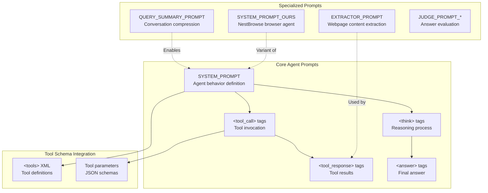
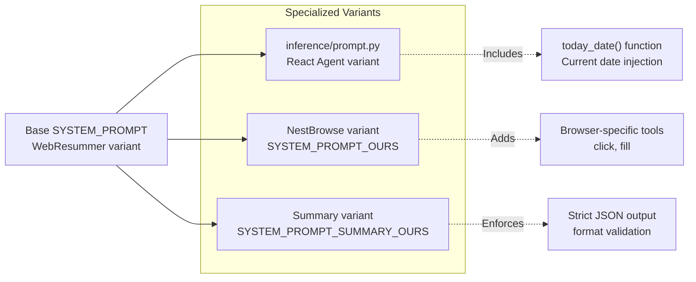
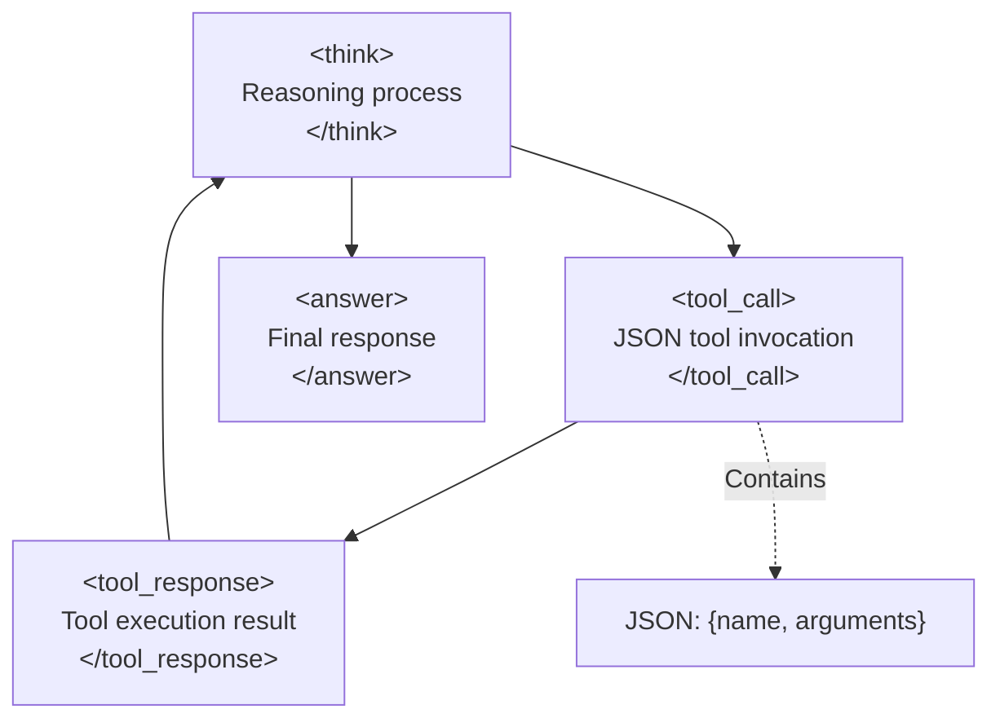
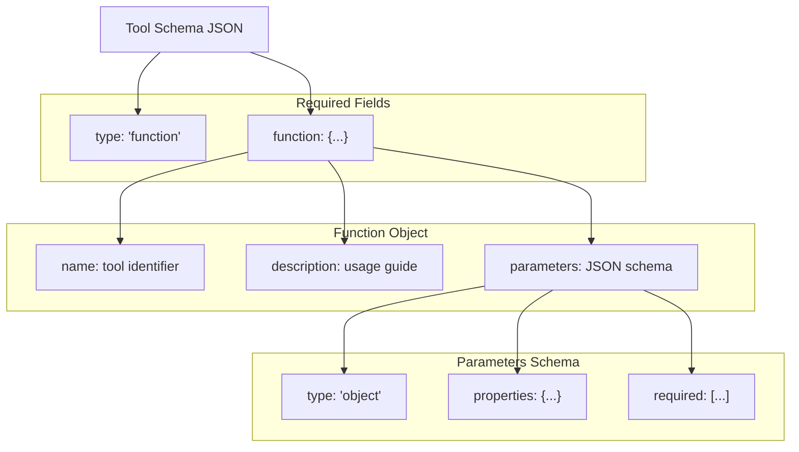
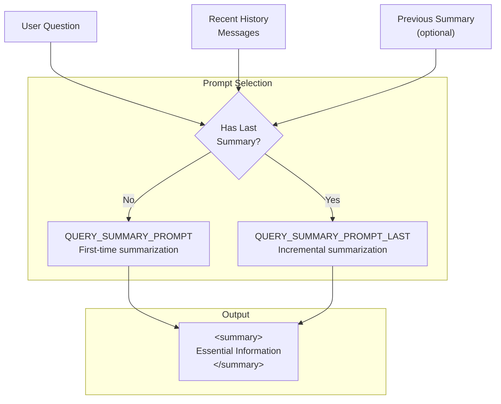
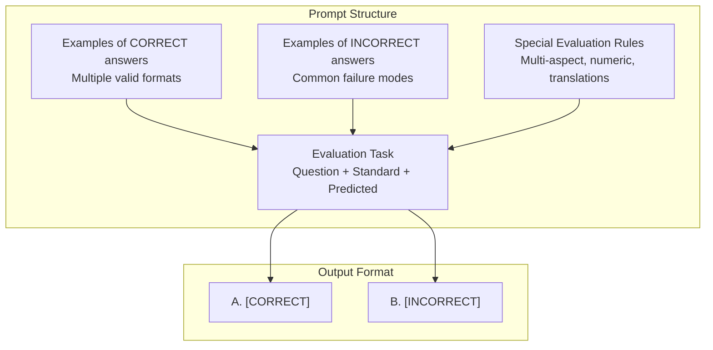
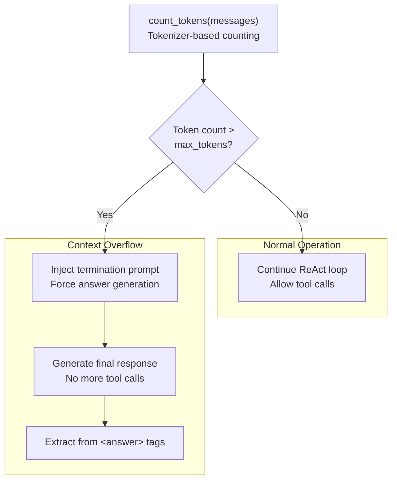
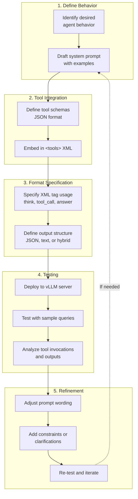

<!-- source: DeepWiki mcp.deepwiki.com · repo Alibaba-NLP/DeepResearch · page 7.2 Prompt Engineering · fetched 2026-10-29 -->

# Prompt Engineering

<details>
<summary>Relevant source files</summary>

The following files were used as context for generating this wiki page:

- [WebAgent/NestBrowse/data/.gitkeep](WebAgent/NestBrowse/data/.gitkeep)
- [WebAgent/NestBrowse/infer_async_nestbrowse.py](WebAgent/NestBrowse/infer_async_nestbrowse.py)
- [WebAgent/NestBrowse/prompts.py](WebAgent/NestBrowse/prompts.py)
- [WebAgent/NestBrowse/results/.gitkeep](WebAgent/NestBrowse/results/.gitkeep)
- [WebAgent/WebResummer/src/evaluate.py](WebAgent/WebResummer/src/evaluate.py)
- [WebAgent/WebResummer/src/judge_prompt.py](WebAgent/WebResummer/src/judge_prompt.py)
- [WebAgent/WebResummer/src/main.py](WebAgent/WebResummer/src/main.py)
- [WebAgent/WebResummer/src/prompt.py](WebAgent/WebResummer/src/prompt.py)
- [WebAgent/WebResummer/src/react_agent.py](WebAgent/WebResummer/src/react_agent.py)
- [WebAgent/WebResummer/src/run_resum.sh](WebAgent/WebResummer/src/run_resum.sh)
- [WebAgent/WebResummer/src/summary_utils.py](WebAgent/WebResummer/src/summary_utils.py)
- [WebAgent/WebResummer/src/tool_search.py](WebAgent/WebResummer/src/tool_search.py)
- [WebAgent/WebResummer/src/tool_visit.py](WebAgent/WebResummer/src/tool_visit.py)
- [inference/react_agent.py](inference/react_agent.py)

</details>


This page documents the prompt engineering strategies, system prompts, and tool call formats used throughout the DeepResearch codebase. It covers how agent behavior is defined through prompts, how tool calls are structured, and how to customize prompts for different use cases. For information about custom tool development, see [Custom Tool Development](#7.1). For details on the inference engine that processes these prompts, see [MultiTurnReactAgent Architecture](#2.1).

## Overview of Prompt Architecture

The DeepResearch system uses a multi-layered prompt architecture where different prompt components work together to guide agent behavior, structure tool interactions, and extract information from external sources.

### Prompt Component Diagram



Sources: [inference/react_agent.py:16](), [WebAgent/NestBrowse/prompts.py:1-82](), [WebAgent/WebResummer/src/prompt.py:1-170]()

## System Prompt Structure

### Base System Prompt

The primary system prompt (`SYSTEM_PROMPT`) defines the agent as a "Web Information Seeking Master" and establishes core behavioral principles. This prompt is located in [WebAgent/WebResummer/src/prompt.py:18-93]().

**Key Components:**

| Component | Purpose | Location |
|-----------|---------|----------|
| Identity Statement | Defines agent role and capabilities | Lines 18-19 |
| Behavioral Principles | Sets exploration and verification guidelines | Lines 20-27 |
| Tool Definitions | Embeds tool schemas in `<tools>` XML tags | Lines 29-72 |
| Format Instructions | Specifies output structure with XML tags | Lines 74-93 |

**Core Behavioral Principles:**

```text
1. Persistent Actions for Answers: Engage in many interactions, delving deeply 
   into topics until satisfactory answers are found.

2. Repeated Verification: Cross-check and validate information before presenting 
   final answers.

3. Attention to Detail: Carefully analyze each information source for currency, 
   relevance, and credibility.
```

### System Prompt Variants

Different agent implementations use specialized system prompts:



**NestBrowse System Prompt** ([WebAgent/NestBrowse/prompts.py:63-82]()):
- Extends base prompt with browser-specific tools: `search`, `visit`, `click`, `fill`
- Emphasizes multi-source investigation for both open-domain and specialized academic queries
- Adds reference-based interaction model where clickable/fillable elements are identified by `[ref=XXX]` notation

**React Agent System Prompt** ([inference/react_agent.py:132-135]()):
- Uses `SYSTEM_PROMPT` imported from `prompt.py` module
- Dynamically appends current date via `today_date()` function
- Includes tools: `FileParser`, `Scholar`, `Visit`, `Search`, `PythonInterpreter`

Sources: [WebAgent/WebResummer/src/prompt.py:18-93](), [WebAgent/NestBrowse/prompts.py:63-82](), [inference/react_agent.py:44-135]()

## Tool Call Format and XML Tags

### XML Tag Structure

The system uses five primary XML tags to structure agent conversations:



### Tool Call JSON Format

Tool calls must be valid JSON objects with two required fields:

```json
{
  "name": "<tool-name>",
  "arguments": {
    "<param-name>": "<param-value>",
    ...
  }
}
```

**Example Tool Call:**

```xml

<tool_call>
{"name": "search", "arguments": {"query": ["Barack Obama children names"]}}
</tool_call>
```

**Parsing Logic** ([inference/react_agent.py:159-176]()):
- Extract content between `<tool_call>` and `</tool_call>` tags
- Special handling for Python interpreter: extracts code from `<code>` tags
- Uses `json5.loads()` for parsing (tolerates trailing commas, comments)
- Error handling returns: `"Error: Tool call is not a valid JSON..."`

### Stop Sequences

The system uses specific stop sequences to prevent the LLM from generating tool responses:

| Stop Sequence | Location | Purpose |
|---------------|----------|---------|
| `"\n<tool_response>"` | [inference/react_agent.py:77]() | Prevents response generation |
| `"<tool_response>"` | [inference/react_agent.py:77]() | Alternative stop sequence |

**Implementation Detail:**
```python
chat_response = client.chat.completions.create(
    model=self.model,
    messages=msgs,
    stop=["\n<tool_response>", "<tool_response>"],
    ...
)
```

Sources: [inference/react_agent.py:77-177](), [WebAgent/NestBrowse/infer_async_nestbrowse.py:60-102]()

## Tool Schema Definition

### Tool Schema Format

Tools are defined using JSON schema embedded within `<tools>` XML tags in the system prompt:



### Example: Search Tool Schema

From [WebAgent/WebResummer/src/prompt.py:31-49]():

```json
{
  "name": "search",
  "description": "Performs batched web searches: supply an array 'query'; the tool retrieves the top 10 results for each query in one call.",
  "parameters": {
    "type": "object",
    "properties": {
      "query": {
        "type": "array",
        "items": {"type": "string"},
        "description": "Array of query strings. Include multiple complementary search queries in a single call."
      }
    },
    "required": ["query"]
  }
}
```

### Example: Visit Tool Schema

From [WebAgent/WebResummer/src/prompt.py:50-71]():

```json
{
  "name": "visit",
  "description": "Visit webpage(s) and return the summary of the content.",
  "parameters": {
    "type": "object",
    "properties": {
      "url": {
        "type": "array",
        "items": {"type": "string"},
        "description": "The URL(s) of the webpage(s) to visit. Can be a single URL or an array of URLs."
      },
      "goal": {
        "type": "string",
        "description": "The specific information goal for visiting webpage(s)."
      }
    },
    "required": ["url", "goal"]
  }
}
```

**Key Design Decisions:**
- Both `search` and `visit` accept arrays to enable batched operations
- `goal` parameter in `visit` guides content extraction
- Tool descriptions emphasize when to use arrays vs. single values

Sources: [WebAgent/WebResummer/src/prompt.py:29-72](), [WebAgent/NestBrowse/prompts.py:70-76]()

## Specialized Prompts

### Webpage Extraction Prompt

The `EXTRACTOR_PROMPT` ([WebAgent/WebResummer/src/tool_visit.py:6](), [WebAgent/WebResummer/src/prompt.py:1-15]()) is used to extract relevant information from webpage content. It enforces a three-field JSON output structure:

**Template Structure:**
```python
EXTRACTOR_PROMPT = """Please process the following webpage content and user goal to extract relevant information:

## **Webpage Content** 
{webpage_content}

## **User Goal**
{goal}

## **Task Guidelines**
1. **Content Scanning for Rational**: Locate the **specific sections/data** directly related to the user's goal
2. **Key Extraction for Evidence**: Identify and extract the **most relevant information**, output the **full original context**
3. **Summary Output for Summary**: Organize into a concise paragraph with logical flow

**Final Output Format using JSON format has "rational", "evidence", "summary" fields**
"""
```

**Expected Output Format:**
```json
{
  "rational": "Identification of relevant sections in the webpage",
  "evidence": "Full extracted text preserving original context (multiple paragraphs)",
  "summary": "Concise organized summary with logical flow"
}
```

**Usage in Visit Tool** ([WebAgent/WebResummer/src/tool_visit.py:165-216]()):
1. Read webpage content via Jina API
2. Truncate to 95,000 tokens if necessary
3. Format prompt with `webpage_content` and `goal`
4. Call summarization LLM with extraction prompt
5. Parse JSON response and format as tool response

### NestBrowse Summary Prompts

NestBrowse uses incremental summarization for long browsing sessions. Two variants exist:

**Initial Summary** ([WebAgent/NestBrowse/prompts.py:2-17]()):
```python
SUMMARY_PROMPT = """
Please process the following webpage content and user goal to extract relevant information:

## **Webpage Content** 
{raw_response}

## **User Goal**
{goal}

## **Task Guidelines**
[Three-step extraction process]

**Final Output Format using JSON format has "rational", "evidence", "summary" fields**
"""
```

**Incremental Summary** ([WebAgent/NestBrowse/prompts.py:21-44]()):
- Adds `{existing_evidence}` and `{existing_summary}` fields
- Instructions: "Build upon and integrate these existing pieces of information to perform incremental processing"
- Produces consolidated result incorporating both provided and newly added information

**Strict JSON Output Enforcement** ([WebAgent/NestBrowse/prompts.py:48-59]()):
```python
SYSTEM_PROMPT_SUMMARY_OURS = """
You must answer only by outputting a single valid JSON object, with no extra text before or after it.

[...instructions...]

Formatting requirements: Output only one valid JSON object wrapped inside <useful_info> and </useful_info> tags: use double quotes (") for all keys and string values, no trailing commas, and the top-level structure must be exactly: {"rational": "...", "evidence": "...", "summary": "..."}.
"""
```

Sources: [WebAgent/NestBrowse/prompts.py:2-59](), [WebAgent/WebResummer/src/tool_visit.py:152-221]()

### ReSum Conversation Compression Prompts

ReSum uses specialized prompts for context compression during long agent sessions.



**Initial Summary Prompt** ([WebAgent/WebResummer/src/prompt.py:97-126]()):
- Inputs: `{{{question}}}`, `{{{recent_history_messages}}}`
- Emphasizes: "Do NOT make assumptions, guesses, or inferences beyond what is explicitly stated"
- Output: `<summary>- Essential Information: [...]</summary>`

**Incremental Summary Prompt** ([WebAgent/WebResummer/src/prompt.py:129-169]()):
- Adds: `{{{last_summary}}}` as baseline
- Instructions: "Use the last summary as a baseline when recent history is sparse"
- Purpose: Maintain continuity across multiple compression cycles

**Implementation** ([WebAgent/WebResummer/src/summary_utils.py:50-59]()):
```python
def summarize_conversation(question, recent_history_messages, last_summary, max_retries=10):
    recent_history_str = "\n".join([str(msg) for msg in recent_history_messages])
    
    if not last_summary:
        query_prompt = QUERY_SUMMARY_PROMPT.replace("{{{question}}}", question).replace("{{{recent_history_messages}}}", recent_history_str)
    else:
        query_prompt = QUERY_SUMMARY_PROMPT_LAST.replace("{{{question}}}", question).replace("{{{recent_history_messages}}}", recent_history_str).replace("{{{last_summary}}}", last_summary)
    
    response = call_resum_server(query_prompt, max_retries=max_retries)
    return response
```

**Invocation in Agent Loop** ([WebAgent/WebResummer/src/react_agent.py:135-156]()):
- Triggered when: `token_count >= max_tokens * 0.9` or at regular intervals
- Replaces entire message history with summary observation
- Format: `"Question: {question}\nBelow is a summary of the previous conversation..."`

Sources: [WebAgent/WebResummer/src/prompt.py:97-169](), [WebAgent/WebResummer/src/summary_utils.py:50-59](), [WebAgent/WebResummer/src/react_agent.py:135-156]()

## Evaluation Prompts (LLM-as-Judge)

### Judge Prompt Architecture

The evaluation system uses specialized prompts to assess answer correctness across different benchmarks:

| Benchmark | Prompt Constant | Language | Key Characteristics |
|-----------|----------------|----------|---------------------|
| GAIA | `JUDGE_PROMPT_GAIA` | English | Simple equivalence check |
| BrowseComp (EN) | `JUDGE_PROMPT_BC_en` | English | Complex multi-aspect matching |
| BrowseComp (ZH) | `JUDGE_PROMPT_BC_zh` | Chinese | Handles bracketed multi-answers |

### GAIA Judge Prompt

Simple equivalence-based evaluation ([WebAgent/WebResummer/src/judge_prompt.py:1-10]()):

```python
JUDGE_PROMPT_GAIA = """You are an evaluation assistant. Please determine if the predicted answer is equivalent to the labeled answer.

Question: {question}
Labeled Answer: {correct_answer}
Predicted Answer: {response}

Did the model give an answer **equivalent** to the labeled answer? Please respond with "Correct" if they are equivalent, or "Incorrect" if they are not equivalent. Do not include any other text.
"""
```

**Key Feature:** Binary output with strict format enforcement.

### BrowseComp Judge Prompts

More sophisticated evaluation with example-based few-shot learning:



**Special Rules in BrowseComp** ([WebAgent/WebResummer/src/judge_prompt.py:48-66]()):

1. **Multi-Aspect Answers:** Standard answers with `[[aspect1][aspect2][aspect3]]` require ALL aspects present
   - Example: `[[Wang Junkai][Wang Yuan][Yi Yangqianxi]]` → Must include all three names

2. **Alternative Answers:** Within brackets, comma-separated options are all valid
   - Example: `[[Doubao, Skylark]]` → "Doubao" OR "Skylark" OR "Doubao, Skylark" all correct

3. **Numeric Precision:** Predictions should match or be close to standard answer
   - Example: For `3518.17`, accept `3518`, `3518.1`, `3518.17` but reject `3520`

4. **Translation Variants:** Different name translations accepted if clearly the same person
   - Example: "Robinson" matches "鲁滨逊" or "鲁滨孙"

5. **Question Context:** If info omitted from prediction can be inferred from question, it's correct
   - Example: Question "Where is X located?" with answer "Sardinia, Italy" → "Sardinia" is correct

**Implementation** ([WebAgent/WebResummer/src/evaluate.py:16-58]()):
```python
def call_llm_judge(item, max_retries=10):
    question = item.get(args.question_key, "")
    correct_answer = item.get(args.answer_key, "")
    response = item.get(args.prediction_key, "")
    
    # Select appropriate judge prompt
    judge_prompt = JUDGE_PROMPT_GAIA
    if args.dataset.startswith("browsecomp_zh"):
        judge_prompt = JUDGE_PROMPT_BC_zh
    elif args.dataset.startswith("browsecomp_en"):
        judge_prompt = JUDGE_PROMPT_BC_en
    
    prompt = judge_prompt.format(question=question, correct_answer=correct_answer, response=response)
    
    # Call Qwen2.5-72B-Instruct for judgment
    response = dashscope.Generation.call(
        model='qwen2.5-72b-instruct',
        messages=[{"role": "user", "content": prompt}],
    )
    judgement = response.output.text
    judgement = "Correct" if judgement[:1] in ["a", "A"] else judgement
    
    return {"question": question, "answer": correct_answer, "judgement": judgement}
```

Sources: [WebAgent/WebResummer/src/judge_prompt.py:1-150](), [WebAgent/WebResummer/src/evaluate.py:16-58]()

## Customizing Agent Behavior Through Prompts

### Modifying System Prompts

To customize agent behavior, modify the system prompt in the appropriate location:

**For Standard ReAct Agent:**
1. Edit [inference/prompt.py]() (imported by [inference/react_agent.py:16]())
2. Modify behavioral principles section
3. Update tool definitions in `<tools>` XML

**For WebResummer Agent:**
1. Edit [WebAgent/WebResummer/src/prompt.py:18-93]()
2. Customize `SYSTEM_PROMPT` variable
3. Ensure tool schemas match available tools

**For NestBrowse Agent:**
1. Edit [WebAgent/NestBrowse/prompts.py:63-82]()
2. Modify `SYSTEM_PROMPT_OURS` variable
3. Update browser-specific tool schemas

### Adding New Tools to System Prompt

When adding a custom tool (see [Custom Tool Development](#7.1)), update the system prompt:

```python
# Step 1: Add tool schema to <tools> section
NEW_TOOL_SCHEMA = {
    "name": "my_custom_tool",
    "description": "What the tool does and when to use it",
    "parameters": {
        "type": "object",
        "properties": {
            "param_name": {
                "type": "string",
                "description": "Parameter description"
            }
        },
        "required": ["param_name"]
    }
}

# Step 2: Format as JSON and add to system prompt
SYSTEM_PROMPT = """...
<tools>
{existing_tool_1}
{existing_tool_2}
{NEW_TOOL_SCHEMA}  # Add here
</tools>
..."""
```

### Adjusting Generation Parameters via Prompts

While not strictly prompts, generation parameters in LLM calls affect behavior:

**Temperature and Top-P** ([inference/react_agent.py:78-82]()):
```python
chat_response = client.chat.completions.create(
    model=self.model,
    messages=msgs,
    temperature=self.llm_generate_cfg.get('temperature', 0.6),  # Default: 0.6
    top_p=self.llm_generate_cfg.get('top_p', 0.95),            # Default: 0.95
    presence_penalty=self.llm_generate_cfg.get('presence_penalty', 1.1)  # Discourages repetition
)
```

**Configurable via Agent Constructor:**
```python
llm_cfg = {
    'model': model_path,
    'generate_cfg': {
        'temperature': 0.85,        # Higher = more creative
        'top_p': 0.95,             # Nucleus sampling threshold
        'presence_penalty': 1.1    # Penalize repeated tokens
    }
}
agent = MultiTurnReactAgent(llm=llm_cfg, ...)
```

Sources: [inference/react_agent.py:48-82](), [WebAgent/WebResummer/src/main.py:105-120]()

## Token Management and Context Window Prompts

### Maximum Context Handling

When context length is exceeded, the system injects special prompts to force answer generation:

**Token Limit Prompt** ([inference/react_agent.py:193]()):
```python
messages[-1]['content'] = "You have now reached the maximum context length you can handle. You should stop making tool calls and, based on all the information above, think again and provide what you consider the most likely answer in the following format:\n<answer>your answer</answer>"
```

**Implementation Flow:**



**Token Counting Implementation** ([inference/react_agent.py:112-118]()):
```python
def count_tokens(self, messages):
    tokenizer = AutoTokenizer.from_pretrained(self.llm_local_path)
    full_prompt = tokenizer.apply_chat_template(messages, tokenize=False)
    tokens = tokenizer(full_prompt, return_tensors="pt")
    token_count = len(tokens["input_ids"][0])
    return token_count
```

**Context Limits by System:**
- Standard ReAct: 110k tokens ([inference/react_agent.py:186]())
- ReSum-enabled: Configurable via `MAX_CONTEXT` env var (default: 32k) ([WebAgent/WebResummer/src/react_agent.py:20-21]())

### ReSum Context Compression Prompt Injection

When using ReSum, compressed summaries replace the message history:

**Summary Observation Format** ([WebAgent/WebResummer/src/react_agent.py:148-153]()):
```python
new_observation = "Question: " + question + "\nBelow is a summary of the previous conversation. This summary condenses key information from earlier steps, so please consider it carefully. Assess whether the summary provides enough information to answer the question and use it as the basis for further reasoning and information gathering to answer the question.\n" \
                 + "Summary: " + summary_response + "\n"

messages = [
    {"role": "system", "content": self.system_message},
    {"role": "user", "content": new_observation}
]
```

**Effect:** Agent sees compressed history instead of full conversation, enabling unlimited exploration within context window.

Sources: [inference/react_agent.py:186-209](), [WebAgent/WebResummer/src/react_agent.py:131-156]()

## Common Prompt Patterns and Best Practices

### Example-Based Instructions

Several prompts use example-driven specifications:

**Pattern:** Show correct and incorrect examples before task description

**Used in:**
- Judge prompts ([WebAgent/WebResummer/src/judge_prompt.py:17-45]())
- System prompts ([WebAgent/WebResummer/src/prompt.py:76-93]())

**Structure:**
```text
Example response:

<tool_call>
{"name": "tool name here", "arguments": {...}}
</tool_call>
<tool_response>
tool_response here
</tool_response>

<answer> answer here </answer>
```

### Multi-Step Task Decomposition

Extraction and summarization prompts break tasks into numbered steps:

**Pattern from EXTRACTOR_PROMPT** ([WebAgent/WebResummer/src/prompt.py:9-13]()):
```text
## **Task Guidelines**
1. **Content Scanning for Rational**: Locate the **specific sections/data**...
2. **Key Extraction for Evidence**: Identify and extract the **most relevant information**...
3. **Summary Output for Summary**: Organize into a concise paragraph...
```

**Benefits:**
- Clear task decomposition
- Explicit output field mapping
- Reduced ambiguity in LLM interpretation

### Strict Format Enforcement

For structured outputs, prompts explicitly constrain format:

**JSON Output Enforcement** ([WebAgent/NestBrowse/prompts.py:48-59]()):
```text
You must answer only by outputting a single valid JSON object, with no extra text before or after it.

Formatting requirements: 
- Use double quotes (") for all keys and string values
- No trailing commas
- Top-level structure must be exactly: {"rational": "...", "evidence": "...", "summary": "..."}
```

**XML Tag Enforcement** ([WebAgent/WebResummer/src/prompt.py:74-93]()):
```text
For each function call, return a json object with function name and arguments within <tool_call></tool_call> XML tags:
<tool_call>
{"name": <function-name>, "arguments": <args-json-object>}
</tool_call>
```

### Emphasis Techniques

Prompts use multiple techniques to emphasize critical instructions:

| Technique | Example | Location |
|-----------|---------|----------|
| **Bold text** | `**specific sections/data**` | [prompt.py:10]() |
| Repetition | "never miss any important information" | [prompts.py:32]() |
| Caps | "Do NOT make assumptions" | [prompt.py:103]() |
| Explicit negation | "Do not include any other text" | [judge_prompt.py:9]() |

Sources: [WebAgent/WebResummer/src/prompt.py:1-170](), [WebAgent/NestBrowse/prompts.py:1-82](), [WebAgent/WebResummer/src/judge_prompt.py:1-150]()

## Prompt Engineering Workflow

### Development and Testing Process



### Debugging Prompt Issues

**Common Issues and Solutions:**

| Issue | Symptom | Solution |
|-------|---------|----------|
| Tool not called | Agent describes tool but doesn't invoke | Add explicit examples in system prompt |
| Invalid JSON | Parse errors in tool calls | Add JSON format constraints, use json5 parser |
| Wrong parameters | Tool calls with missing/incorrect args | Clarify parameter descriptions in schema |
| No answer tag | Agent stops without `<answer>` | Add explicit instruction to always use answer tags |
| Context overflow | Agent runs out of tokens | Implement ReSum compression or reduce max turns |

**Debugging Techniques:**

1. **Examine full conversation history** ([inference/react_agent.py:219-226]()):
```python
result = {
    "question": question,
    "answer": answer,
    "messages": messages,  # Full conversation for inspection
    "prediction": prediction,
    "termination": termination
}
```

2. **Check tool invocation counts** ([WebAgent/WebResummer/src/evaluate.py:96-112]()):
```python
cur_tool_invocation = defaultdict(int)
for msg in msgs:
    if msg["role"] == "assistant":
        try:
            tool_call = json.loads(...)
            tool_name = tool_call["name"]
            cur_tool_invocation[tool_name] += 1
        except:
            continue
```

3. **Monitor token usage** ([inference/react_agent.py:187-188]()):
```python
token_count = self.count_tokens(messages)
print(f"round: {round}, token count: {token_count}")
```

Sources: [inference/react_agent.py:112-226](), [WebAgent/WebResummer/src/evaluate.py:60-129]()

## Advanced Prompt Techniques

### Dynamic Prompt Modification

Some systems modify prompts based on context:

**Date Injection** ([inference/react_agent.py:44-46, 132-134]()):
```python
def today_date():
    return datetime.date.today().strftime("%Y-%m-%d")

# In agent loop
cur_date = today_date()
system_prompt = system_prompt + str(cur_date)
```

**Summary Injection** ([WebAgent/WebResummer/src/react_agent.py:148-153]()):
- Dynamically replaces entire message history with compressed summary
- Maintains question context while reducing tokens

### Goal-Oriented Prompting

The `goal` parameter in tools enables context-specific extraction:

**Visit Tool with Goal** ([WebAgent/WebResummer/src/prompt.py:61-64]()):
```json
{
  "goal": {
    "type": "string",
    "description": "The specific information goal for visiting webpage(s)."
  }
}
```

**Usage in Extraction** ([WebAgent/WebResummer/src/tool_visit.py:172]()):
```python
messages = [{"role":"user","content": EXTRACTOR_PROMPT.format(webpage_content=content, goal=goal)}]
```

**Effect:** LLM focuses extraction on goal-relevant information, improving signal-to-noise ratio.

### Incremental Information Building

NestBrowse uses incremental prompts to build evidence across multiple page visits:

**Incremental Prompt Structure** ([WebAgent/NestBrowse/prompts.py:35-41]()):
```text
## **Existing Evidence**
{existing_evidence}

## **Existing Summary**
{existing_summary}

Note: Existing extracted evidence and summaries are already provided. You must build upon and integrate these existing pieces of information to perform incremental processing.
```

**Implementation:** Each new page visit receives prior evidence, enabling cumulative knowledge building.

Sources: [inference/react_agent.py:44-134](), [WebAgent/WebResummer/src/tool_visit.py:152-194](), [WebAgent/NestBrowse/prompts.py:21-44]()

## OpenRouter Integration Considerations

When using the OpenRouter API, prompts require special handling for reasoning content:

**OpenRouter Reasoning Content** ([inference/react_agent.py:86-88]()):
```python
# OpenRouter provides API calling. If you want to use OpenRouter, you need to uncomment line 89 - 90.
# reasoning_content = ""
# content = reasoning_content + content
```

**Purpose:** OpenRouter's extended models provide reasoning traces separately; these must be wrapped in `<think>` tags and prepended to the response content.

**Configuration:** Uncomment lines 87-88 when using OpenRouter for models with native reasoning capabilities.

Sources: [inference/react_agent.py:86-88]()

---

This completes the documentation of prompt engineering in the DeepResearch system. For implementing custom tools that work with these prompts, see [Custom Tool Development](#7.1). For configuring the inference engine that processes these prompts, see [MultiTurnReactAgent Architecture](#2.1).

---

