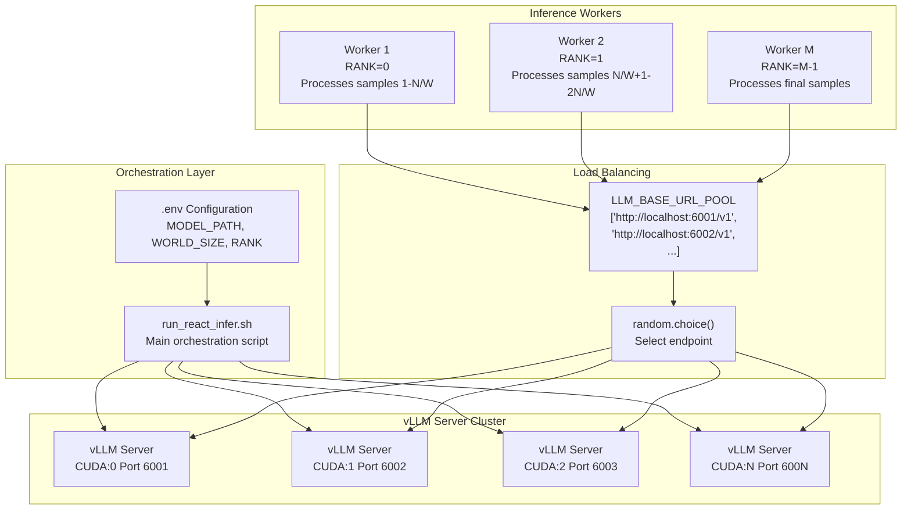
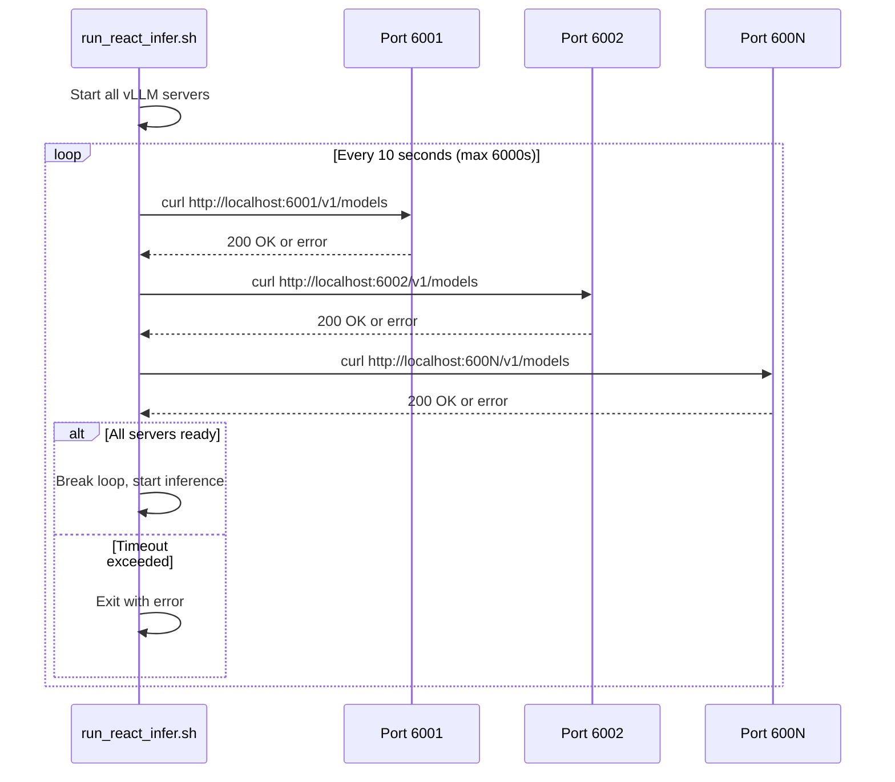
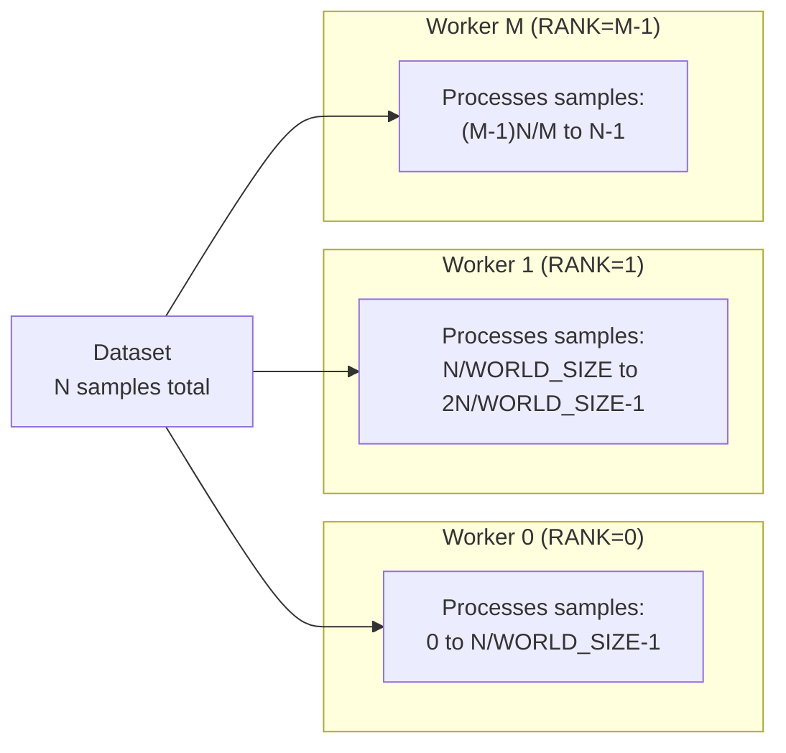
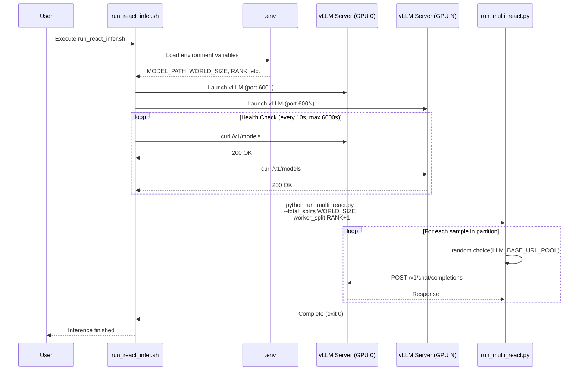
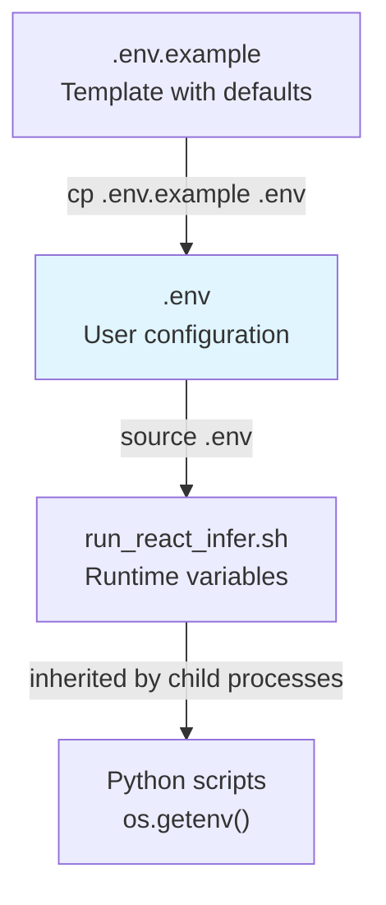

<!-- source: DeepWiki mcp.deepwiki.com · repo Alibaba-NLP/DeepResearch · page 7.3 Distributed Inference · fetched 2026-10-29 -->

# Distributed Inference

<details>
<summary>Relevant source files</summary>

The following files were used as context for generating this wiki page:

- [.env.example](.env.example)
- [.gitignore](.gitignore)
- [WebAgent/NestBrowse/toolkit/tool_explore.py](WebAgent/NestBrowse/toolkit/tool_explore.py)
- [WebAgent/NestBrowse/toolkit/tool_search.py](WebAgent/NestBrowse/toolkit/tool_search.py)
- [WebAgent/NestBrowse/utils.py](WebAgent/NestBrowse/utils.py)
- [WebAgent/NestBrowse/vllm_deploy.sh](WebAgent/NestBrowse/vllm_deploy.sh)
- [WebAgent/ParallelMuse/compressed_reasoning_aggregation.py](WebAgent/ParallelMuse/compressed_reasoning_aggregation.py)
- [WebAgent/WebLeaper/README.md](WebAgent/WebLeaper/README.md)
- [WebAgent/WebLeaper/assets/overview.png](WebAgent/WebLeaper/assets/overview.png)
- [WebAgent/WebLeaper/assets/performance_summary.png](WebAgent/WebLeaper/assets/performance_summary.png)
- [WebAgent/WebLeaper/assets/webleaper.jpg](WebAgent/WebLeaper/assets/webleaper.jpg)
- [inference/run_react_infer.sh](inference/run_react_infer.sh)

</details>


This page documents the distributed inference infrastructure for deploying Tongyi DeepResearch models across multiple GPUs and machines. The system supports both data parallelism (multiple independent servers processing different queries) and tensor parallelism (model weights sharded across GPUs), with automatic load balancing and worker coordination.

For information about model deployment options and general inference setup, see [Model Downloads and Deployment](#6.3). For inference paradigms and agent loops, see [Inference Paradigms: ReAct and IterResearch](#2.2).

---

## Architecture Overview

The distributed inference system consists of three main components:

1. **vLLM Server Deployment**: Multiple vLLM servers running on different GPUs/ports
2. **Load Balancing Layer**: Client-side random selection across available endpoints
3. **Worker Coordination**: Data-parallel distribution using WORLD_SIZE and RANK



**Sources**: [inference/run_react_infer.sh:1-118](), [.env.example:1-98]()

---

## vLLM Server Deployment

### Data-Parallel Deployment

The most common deployment pattern launches multiple independent vLLM servers, each serving the full model on a single GPU:

```bash
# From run_react_infer.sh
CUDA_VISIBLE_DEVICES=0 vllm serve $MODEL_PATH --host 0.0.0.0 --port 6001 --disable-log-requests &
CUDA_VISIBLE_DEVICES=1 vllm serve $MODEL_PATH --host 0.0.0.0 --port 6002 --disable-log-requests &
CUDA_VISIBLE_DEVICES=2 vllm serve $MODEL_PATH --host 0.0.0.0 --port 6003 --disable-log-requests &
# ... up to 8 GPUs
```

| Configuration | Purpose | Typical Value |
|--------------|---------|---------------|
| `CUDA_VISIBLE_DEVICES` | GPU assignment | 0, 1, 2, ..., 7 |
| `--port` | Server port | 6001-6008 |
| `--host` | Network interface | 0.0.0.0 (all interfaces) |
| `--disable-log-requests` | Reduce logging | flag (no value) |

**Sources**: [inference/run_react_infer.sh:30-37]()

### Tensor-Parallel Deployment

For larger models that don't fit on a single GPU, tensor parallelism shards model weights across multiple GPUs:

```bash
# From NestBrowse/vllm_deploy.sh
python -m vllm.entrypoints.openai.api_server \
    --model $MODEL_PATH \
    --port 8000 \
    --max-model-len 131072 \
    --tensor-parallel-size 4 \
    --gpu-memory-utilization 0.8
```

| Parameter | Description | Example |
|-----------|-------------|---------|
| `--tensor-parallel-size` | Number of GPUs to shard across | 4 |
| `--max-model-len` | Maximum context length | 131072 |
| `--gpu-memory-utilization` | Fraction of GPU memory to use | 0.8 |

**Trade-offs**:
- **Data-parallel**: Higher throughput, each GPU processes independent requests
- **Tensor-parallel**: Support for larger models, shared across requests, lower throughput per GPU

**Sources**: [WebAgent/NestBrowse/vllm_deploy.sh:1-7]()

---

## Server Health Monitoring

The orchestration script implements a polling mechanism to ensure all servers are ready before starting inference:



The health check logic:

```bash
# Tracks status of each server
declare -A server_status
for port in "${main_ports[@]}"; do
    server_status[$port]=false
done

# Poll until all ready or timeout
while true; do
    all_ready=true
    for port in "${main_ports[@]}"; do
        if [ "${server_status[$port]}" = "false" ]; then
            if curl -s -f http://localhost:$port/v1/models > /dev/null 2>&1; then
                echo "Main model server (port $port) is ready!"
                server_status[$port]=true
            else
                all_ready=false
            fi
        fi
    done
    
    if [ "$all_ready" = "true" ]; then
        break
    fi
    # ... timeout check ...
    sleep 10
done
```

**Sources**: [inference/run_react_infer.sh:43-106]()

---

## Client-Side Load Balancing

### URL Pool Configuration

Multiple components use a pool of base URLs with random selection for load balancing:

**ParallelMuse Example**:
```python
# From compressed_reasoning_aggregation.py
REPORT_CONVERGE_BASE_URL_POOL = [
    "http://localhost:8000/v1",
    # You can add more LLM API URLs here to balance the workload.
]

async def get_llm_response(messages, max_tokens):
    client = AsyncOpenAI(
        base_url=random.choice(REPORT_CONVERGE_BASE_URL_POOL),
        api_key=REPORT_CONVERGE_API_KEY
    )
```

**NestBrowse Example**:
```python
# From utils.py
async def call_llm(sem, prompt, max_tokens, model_name, client=None, mode='agent'):
    LLM_BASE_URL = os.getenv('AGENT_LLM_BASE_URL')
    
    try:
        # Support list of URLs in .env
        LLM_BASE_URL = random.choice(ast.literal_eval(LLM_BASE_URL))
    except:
        pass
    
    client = AsyncOpenAI(
        api_key=LLM_API_KEY,
        base_url=LLM_BASE_URL,
    )
```

**Configuration in .env**:
```bash
# Single endpoint
AGENT_LLM_BASE_URL=http://localhost:6001/v1

# Multiple endpoints (Python list syntax)
AGENT_LLM_BASE_URL="['http://localhost:6001/v1', 'http://localhost:6002/v1', 'http://localhost:6003/v1']"
```

**Sources**: [WebAgent/ParallelMuse/compressed_reasoning_aggregation.py:15-18,75-78](), [WebAgent/NestBrowse/utils.py:9-24]()

### Concurrency Control

Async semaphores limit concurrent requests to prevent overwhelming servers:

```python
# From NestBrowse/utils.py
async def call_llm(sem, prompt, max_tokens, model_name, client=None, mode='agent'):
    async with sem['llm']:  # Acquire semaphore
        for retry in range(10):
            try:
                response = await client.chat.completions.create(
                    model="", 
                    messages=prompt, 
                    temperature=0.6,
                    top_p=0.95,
                    max_tokens=max_tokens
                )
                return response.choices[0].message.content
            except Exception as e:
                # Retry logic with exponential backoff
                if "time out" not in str(e).lower():    
                    max_tokens = max_tokens / 2
```

The `MAX_WORKERS` environment variable controls the total number of concurrent inference requests.

**Sources**: [WebAgent/NestBrowse/utils.py:26-63](), [.env.example:43]()

---

## Worker Coordination (Data Parallelism)

### WORLD_SIZE and RANK

For distributing a large dataset across multiple machines or processes:



### Configuration

```bash
# .env file
WORLD_SIZE=4  # Total number of workers
RANK=0        # Current worker ID (0, 1, 2, or 3)
```

### Implementation

The inference script uses these variables to partition the dataset:

```bash
# From run_react_infer.sh
python -u run_multi_react.py \
    --dataset "$DATASET" \
    --output "$OUTPUT_PATH" \
    --max_workers $MAX_WORKERS \
    --total_splits ${WORLD_SIZE:-1} \
    --worker_split $((${RANK:-0} + 1))
```

**Default behavior**: If `WORLD_SIZE` or `RANK` are not set, defaults to single-worker mode (`WORLD_SIZE=1`, `RANK=0`).

**Typical deployment pattern**:

| Machine | GPUs | WORLD_SIZE | RANK | vLLM Ports | Processes |
|---------|------|------------|------|------------|-----------|
| Machine 1 | 0-7 | 4 | 0 | 6001-6008 | Samples 0-24% |
| Machine 2 | 0-7 | 4 | 1 | 6001-6008 | Samples 25-49% |
| Machine 3 | 0-7 | 4 | 2 | 6001-6008 | Samples 50-74% |
| Machine 4 | 0-7 | 4 | 3 | 6001-6008 | Samples 75-100% |

**Sources**: [inference/run_react_infer.sh:113-117](), [.env.example:96-98]()

---

## Execution Flow

### Complete Deployment Sequence



**Sources**: [inference/run_react_infer.sh:1-118]()

### Environment Variable Hierarchy

The system uses a layered configuration approach:



**Priority order** (highest to lowest):
1. Command-line arguments to Python scripts
2. Environment variables set in shell
3. Variables loaded from `.env` file
4. Default values in code (e.g., `${WORLD_SIZE:-1}`)

**Sources**: [inference/run_react_infer.sh:4-23](), [.env.example:1-98]()

---

## Configuration Reference

### Critical Variables

| Variable | Purpose | Example | Required |
|----------|---------|---------|----------|
| `MODEL_PATH` | Path to model weights | `/models/deepresearch-30b` | Yes |
| `WORLD_SIZE` | Number of distributed workers | `4` | No (default: 1) |
| `RANK` | Current worker ID | `0` | No (default: 0) |
| `MAX_WORKERS` | Concurrent async requests | `30` | Yes |
| `DATASET` | Input data file | `browsecomp.jsonl` | Yes |
| `OUTPUT_PATH` | Output directory | `/outputs/results` | Yes |

### Server Configuration

| Variable | Purpose | Example | Required |
|----------|---------|---------|----------|
| `AGENT_LLM_BASE_URL` | vLLM server endpoints | `['http://localhost:6001/v1', ...]` | Yes |
| `AGENT_LLM_API_KEY` | API key for authentication | `EMPTY` (local servers) | Yes |
| `TEMPERATURE` | Sampling temperature | `0.85` | No (default: 0.6) |
| `PRESENCE_PENALTY` | Presence penalty | `1.1` | No |

### NCCL Configuration (Multi-Node)

For distributed training or tensor-parallel inference across multiple machines:

```bash
# From .env.example
NCCL_IB_TC=16
NCCL_IB_SL=5
NCCL_IB_GID_INDEX=3
NCCL_SOCKET_IFNAME=eth
NCCL_DEBUG=INFO
NCCL_IB_HCA=mlx5
NCCL_IB_TIMEOUT=22
NCCL_IB_QPS_PER_CONNECTION=8
NCCL_MIN_NCHANNELS=4
NCCL_NET_PLUGIN=none
GLOO_SOCKET_IFNAME=eth0
```

These are primarily for InfiniBand-connected GPU clusters and are not needed for single-machine deployments.

**Sources**: [.env.example:6-20,36-46]()

---

## Best Practices

### Choosing Parallelism Strategy

**Use data parallelism (multiple independent servers) when:**
- Model fits on a single GPU (< 40GB for A100)
- High throughput is priority
- Queries are independent
- Example: 8x GPUs → 8x throughput

**Use tensor parallelism when:**
- Model exceeds single GPU memory
- Latency per query is priority
- Example: 70B model requiring 4x GPUs

**Hybrid approach**:
```bash
# 8 GPUs total: 2 tensor-parallel groups of 4 GPUs each
# Group 1: GPUs 0-3 (port 8000)
CUDA_VISIBLE_DEVICES=0,1,2,3 vllm serve $MODEL_PATH --port 8000 --tensor-parallel-size 4 &

# Group 2: GPUs 4-7 (port 8001)
CUDA_VISIBLE_DEVICES=4,5,6,7 vllm serve $MODEL_PATH --port 8001 --tensor-parallel-size 4 &
```

### Load Balancing Recommendations

1. **Equal GPU allocation**: Ensure all servers have similar hardware to avoid bottlenecks
2. **URL pool size**: Match number of vLLM servers (e.g., 8 servers → 8 URLs in pool)
3. **Health monitoring**: Implement retry logic with exponential backoff
4. **Graceful degradation**: Continue with remaining servers if one fails

### Worker Distribution

For optimal performance with `WORLD_SIZE` > 1:

```
Total samples: N
Workers: W (WORLD_SIZE)
Samples per worker: N/W (rounded up)

Worker 0: samples[0 : N/W]
Worker 1: samples[N/W : 2N/W]
Worker k: samples[k*N/W : (k+1)*N/W]
```

**Example**: 1000 samples, 4 workers
- Worker 0: 0-249
- Worker 1: 250-499
- Worker 2: 500-749
- Worker 3: 750-999

**Sources**: [inference/run_react_infer.sh:113-117]()

---

## Troubleshooting

### Server Startup Issues

**Symptom**: "Server startup timeout after 6000 seconds"

**Common causes**:
1. **Insufficient GPU memory**: Reduce `--gpu-memory-utilization` or use smaller batch size
2. **Port conflicts**: Another process using ports 6001-6008
3. **Model loading failure**: Check `MODEL_PATH` and file permissions
4. **CUDA errors**: Verify GPU health with `nvidia-smi`

**Debug steps**:
```bash
# Check GPU availability
nvidia-smi

# Test single server manually
CUDA_VISIBLE_DEVICES=0 vllm serve /path/to/model --port 6001

# Check port availability
lsof -i :6001

# View vLLM logs (if not using --disable-log-requests)
tail -f /tmp/vllm.log
```

### Load Balancing Issues

**Symptom**: Uneven GPU utilization

**Solutions**:
- Ensure `random.choice()` is called per-request, not per-session
- Check that all URLs in pool are reachable
- Monitor server response times and remove slow servers

**Monitoring GPU utilization**:
```bash
watch -n 1 nvidia-smi
```

### Worker Coordination Issues

**Symptom**: Duplicate or missing samples in output

**Common causes**:
1. **Incorrect RANK values**: Ensure RANK ∈ [0, WORLD_SIZE-1]
2. **Inconsistent WORLD_SIZE**: All workers must use same value
3. **Race conditions**: Multiple workers writing to same output file

**Validation**:
```bash
# Verify environment variables
echo "WORLD_SIZE: $WORLD_SIZE"
echo "RANK: $RANK"

# Check output file partitioning
ls -lh $OUTPUT_PATH/worker_*
```

**Sources**: [inference/run_react_infer.sh:43-106]()

---

## Performance Tuning

### Throughput Optimization

| Parameter | Impact | Recommended Range |
|-----------|--------|-------------------|
| `MAX_WORKERS` | Concurrent requests per process | 20-50 |
| `--gpu-memory-utilization` | Model batch size capacity | 0.7-0.9 |
| `--max-model-len` | Maximum context length | 4096-131072 |
| Number of vLLM servers | Linear throughput scaling | 1 per GPU |

### Latency Optimization

- **Reduce `MAX_WORKERS`**: Lower concurrency = faster per-request
- **Use tensor parallelism**: Parallelize single request across GPUs
- **Decrease `--max-model-len`**: Reduces memory overhead
- **Increase `--gpu-memory-utilization`**: Larger batch cache

### Memory Management

Estimate memory requirements:

```
Model memory = parameters × 2 bytes (FP16)
KV cache memory = batch_size × max_tokens × 2 layers × hidden_dim × 2 bytes
```

For 30B model (A3B active):
- Model: ~6GB (3.3B active × 2 bytes)
- KV cache (batch=8, len=32K): ~16GB
- Total: ~22GB → fits on A100-40GB

**Sources**: [WebAgent/NestBrowse/vllm_deploy.sh:1-7]()

---

