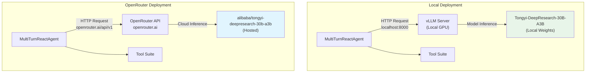
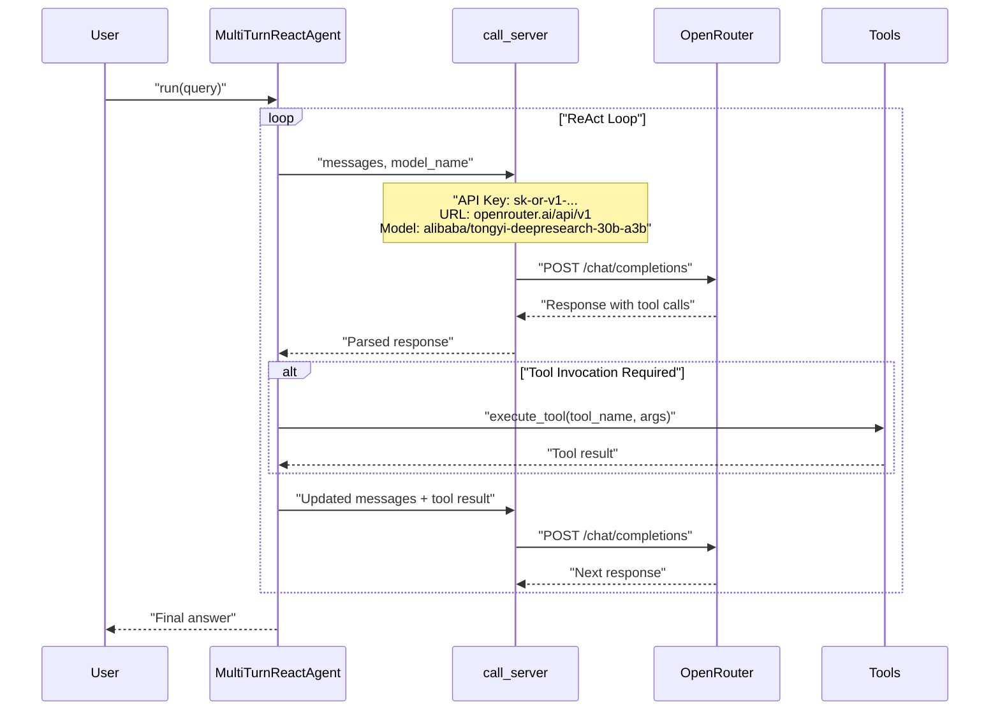
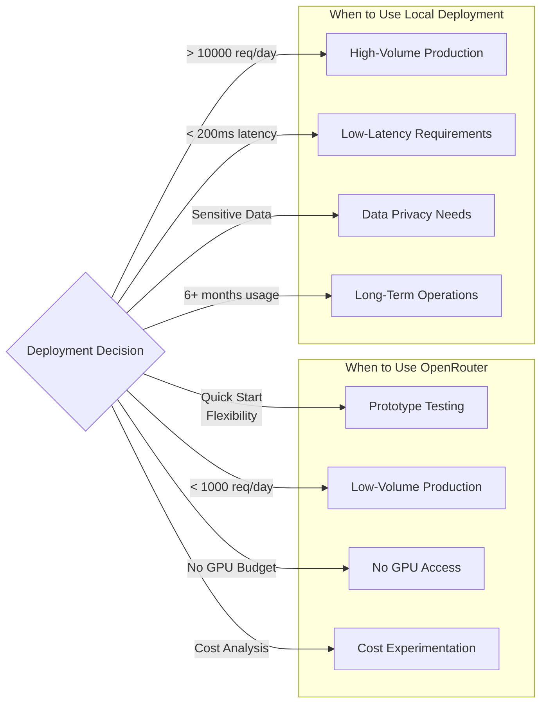
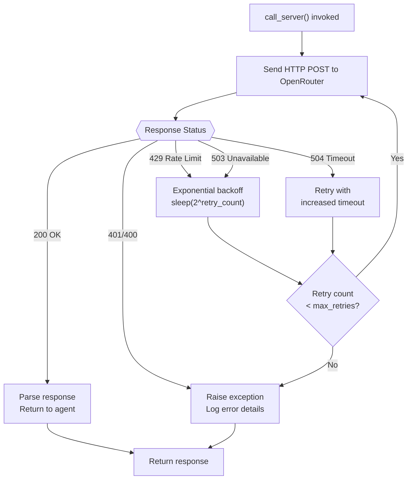

<!-- source: DeepWiki mcp.deepwiki.com · repo Alibaba-NLP/DeepResearch · page 7.4 OpenRouter Integration · fetched 2026-10-29 -->

# OpenRouter Integration

<details>
<summary>Relevant source files</summary>

The following files were used as context for generating this wiki page:

- [README.md](README.md)

</details>


## Purpose and Scope

This page documents how to use Tongyi DeepResearch through the OpenRouter API service, enabling inference without local GPU resources. OpenRouter provides cloud-hosted access to the `alibaba/tongyi-deepresearch-30b-a3b` model through an OpenAI-compatible API endpoint.

For information about local deployment with vLLM servers, see [Model Downloads and Deployment](#6.3). For other cloud deployment options, see [Deployment Options](#1.2).

---

## Overview

OpenRouter is a unified API gateway that provides access to various large language models, including Tongyi DeepResearch. This integration allows users to run the full agentic inference pipeline without maintaining local GPU infrastructure, while still leveraging all tool capabilities (search, web browsing, file parsing, code execution).

### Key Benefits

| Feature | Description |
|---------|-------------|
| **Zero GPU Requirements** | Run inference entirely through cloud API calls |
| **Full Tool Support** | All tools (Search, Visit, FileParser, PythonInterpreter) work unchanged |
| **OpenAI Compatibility** | Uses familiar OpenAI-compatible message formats |
| **Cost-Effective Testing** | Pay-per-use pricing without infrastructure overhead |
| **Production Ready** | Suitable for production deployments with API rate limits |

### Architecture Comparison



**Diagram: Local vs OpenRouter Deployment Architecture**

Both deployment methods use the same `MultiTurnReactAgent` and tool infrastructure, differing only in the LLM backend endpoint.

Sources: [README.md:172-181]()

---

## Configuration Requirements

### API Key Setup

OpenRouter integration requires an OpenRouter API key, which must be configured alongside other service API keys.

**Required API Keys:**

| Service | Purpose | Configuration Variable |
|---------|---------|------------------------|
| OpenRouter | LLM inference | Set in `call_server` function |
| Serper.dev | Web search | `SERPER_KEY_ID` in `.env` |
| Jina.ai | Web page reading | `JINA_API_KEYS` in `.env` |
| Dashscope | File parsing | `DASHSCOPE_API_KEY` in `.env` |
| SandboxFusion | Code execution | `SANDBOX_FUSION_ENDPOINT` in `.env` |

**Obtaining an OpenRouter API Key:**

1. Visit [OpenRouter](https://openrouter.ai)
2. Create an account and navigate to API Keys
3. Generate a new API key
4. Note the key for configuration (format: `sk-or-v1-...`)

### Environment File Configuration

While the OpenRouter API key is set directly in code, other tool dependencies still use the `.env` file:

```bash
# .env file (other services remain unchanged)
SERPER_KEY_ID=your_serper_key
JINA_API_KEYS=your_jina_key
DASHSCOPE_API_KEY=your_dashscope_key
SANDBOX_FUSION_ENDPOINT=your_sandbox_endpoint

# MODEL_PATH not needed for OpenRouter
# MODEL_PATH=/path/to/local/weights  # Commented out
```

Sources: [README.md:89-111]()

---

## Code Modifications

To integrate OpenRouter, three modifications are required in the `call_server` function of [inference/react_agent.py]().

### Modification 1: API Endpoint and Authentication

**Location:** `call_server` function in [inference/react_agent.py]()

**Changes:**
1. Set the API base URL to OpenRouter's endpoint
2. Set the API key to your OpenRouter key

```python
# Original (local vLLM server)
api_key = "EMPTY"
base_url = "http://localhost:8000/v1"

# Modified for OpenRouter
api_key = "sk-or-v1-your-openrouter-key"
base_url = "https://openrouter.ai/api/v1"
```

### Modification 2: Model Name

**Location:** `call_server` function in [inference/react_agent.py]()

**Changes:**
Update the model identifier to OpenRouter's format:

```python
# Original (local deployment)
model = "Tongyi-DeepResearch-30B-A3B"

# Modified for OpenRouter
model = "alibaba/tongyi-deepresearch-30b-a3b"
```

### Modification 3: Content Concatenation Format

**Location:** Lines 88-90 in [inference/react_agent.py]()

**Changes:**
Adjust how message content is formatted for the API request. OpenRouter may expect different content concatenation compared to local vLLM servers.

**Context:** Different LLM serving platforms handle multi-turn conversations differently. The content concatenation refers to how the system assembles message history before sending to the API. This typically involves:

- Combining system prompts with user messages
- Formatting tool call results
- Handling multi-part messages (text + images for vision models)

The specific format depends on OpenRouter's implementation of the OpenAI-compatible API.

Sources: [README.md:176-181]()

---

## Integration Flow Diagram



**Diagram: OpenRouter Integration Sequence Flow**

The agent loop remains identical to local deployment, with only the `call_server` function's backend changed.

Sources: [README.md:172-181]()

---

## Complete Configuration Example

### Step-by-Step Setup

**1. Install Dependencies**

```bash
conda create -n react_infer_env python=3.10.0
conda activate react_infer_env
pip install -r requirements.txt
```

**2. Configure Environment Variables**

Create `.env` file with tool API keys:

```bash
cp .env.example .env
# Edit .env with your Serper, Jina, Dashscope, etc. keys
```

**3. Modify react_agent.py**

Edit [inference/react_agent.py]() in the `call_server` function:

```python
def call_server(messages, model_name, ...):
    # OpenRouter configuration
    api_key = "sk-or-v1-your-actual-openrouter-key"
    base_url = "https://openrouter.ai/api/v1"
    
    # Model identifier
    model = "alibaba/tongyi-deepresearch-30b-a3b"
    
    # ... rest of function with adjusted content concatenation (lines 88-90)
```

**4. Prepare Evaluation Data**

Create your question file in JSONL format:

```json
{"question": "What are the latest developments in quantum computing?", "answer": ""}
{"question": "Compare renewable energy sources", "answer": ""}
```

**5. Run Inference**

```bash
bash run_react_infer.sh
```

The script will use OpenRouter instead of local GPU, but all tools and agent behavior remain unchanged.

Sources: [README.md:72-170]()

---

## Message Format and API Compatibility

### OpenAI-Compatible Message Structure

OpenRouter implements the OpenAI chat completions API format:

```json
{
  "model": "alibaba/tongyi-deepresearch-30b-a3b",
  "messages": [
    {
      "role": "system",
      "content": "You are a helpful research assistant..."
    },
    {
      "role": "user",
      "content": "What is quantum computing?"
    },
    {
      "role": "assistant",
      "content": "Let me search for information...",
      "tool_calls": [
        {
          "id": "call_123",
          "type": "function",
          "function": {
            "name": "Search",
            "arguments": "{\"query\": \"quantum computing basics\"}"
          }
        }
      ]
    },
    {
      "role": "tool",
      "tool_call_id": "call_123",
      "content": "Search results: ..."
    }
  ],
  "tools": [...],
  "temperature": 0.7,
  "max_tokens": 4096
}
```

### Content Concatenation Considerations

The content concatenation adjustment (lines 88-90) likely addresses:

1. **System Prompt Handling:** Some providers prefer system messages separated, others concatenated with user messages
2. **Tool Result Formatting:** How tool outputs are inserted into the conversation
3. **Multi-Part Content:** If using vision models, handling image + text content
4. **Token Optimization:** Minimizing redundant content in message history

### Tool Call Response Format

OpenRouter returns tool calls in the standard OpenAI format, which the `MultiTurnReactAgent` already handles:

```python
# Agent processes response
if response.tool_calls:
    for tool_call in response.tool_calls:
        tool_name = tool_call.function.name
        tool_args = json.loads(tool_call.function.arguments)
        result = execute_tool(tool_name, tool_args)
```

Sources: [README.md:176-181]()

---

## Comparison: OpenRouter vs Local Deployment

### Performance Characteristics

| Aspect | Local Deployment | OpenRouter Integration |
|--------|------------------|------------------------|
| **Latency** | Low (local network) | Higher (internet round-trip) |
| **Throughput** | Limited by GPU count | Limited by API rate limits |
| **Cost Model** | Fixed GPU infrastructure | Pay-per-token usage |
| **Scalability** | Manual scaling | Automatic cloud scaling |
| **Setup Time** | Hours (model download + setup) | Minutes (API key only) |
| **GPU Requirements** | 40GB+ VRAM for 30B model | None |

### Use Case Recommendations



**Diagram: Deployment Decision Tree**

### Cost Analysis Example

**Assumptions:**
- OpenRouter pricing: ~$0.50 per 1M input tokens, ~$1.50 per 1M output tokens (example rates)
- Local GPU: 1x A100 80GB = ~$2/hour cloud rental
- Average query: 2K input tokens, 1K output tokens across multi-turn conversation

| Deployment | Daily Queries | Monthly Cost | Break-Even Point |
|------------|---------------|--------------|------------------|
| OpenRouter | 100 | ~$10 | N/A |
| OpenRouter | 1,000 | ~$100 | N/A |
| OpenRouter | 10,000 | ~$1,000 | Borderline |
| Local GPU | Any | ~$1,440 (24/7) | ~15K queries/day |

For research experiments and prototyping, OpenRouter is more cost-effective. For sustained production workloads exceeding 10-15K queries per day, local deployment becomes economical.

Sources: [README.md:172-181]()

---

## Integration with Existing Scripts

### run_react_infer.sh Compatibility

The standard inference script [run_react_infer.sh]() works with OpenRouter without modification, since all changes are in `react_agent.py`:

```bash
#!/bin/bash

# These variables are still needed for tools
export SERPER_KEY_ID="your_serper_key"
export JINA_API_KEYS="your_jina_key"

# MODEL_PATH is ignored when using OpenRouter
# export MODEL_PATH="/path/to/weights"  # Not needed

export DATASET="eval_data/my_questions.jsonl"
export OUTPUT_PATH="./outputs"

python inference/react_agent.py \
    --dataset $DATASET \
    --output_path $OUTPUT_PATH \
    # ... other args remain unchanged
```

### Benchmark Evaluation

All benchmark evaluation scripts work identically with OpenRouter:

```bash
# Run evaluation on any benchmark
bash run_react_infer.sh

# Results saved to OUTPUT_PATH in same JSONL format
# Evaluation scripts process outputs identically
python evaluation/eval_script.py \
    --predictions outputs/predictions.jsonl \
    --references eval_data/my_questions.jsonl
```

The evaluation pipeline treats OpenRouter responses identically to local model responses.

Sources: [README.md:155-170](), [README.md:182-184]()

---

## Error Handling and Retry Logic

### OpenRouter-Specific Errors

The `call_server` function in [inference/react_agent.py]() includes retry logic that handles common OpenRouter API errors:

**Common Error Scenarios:**

| Error Type | HTTP Code | Handling Strategy |
|------------|-----------|-------------------|
| Rate Limit | 429 | Exponential backoff retry |
| Invalid Key | 401 | Immediate failure with clear message |
| Model Unavailable | 503 | Retry with backoff |
| Timeout | 504 | Retry with extended timeout |
| Malformed Request | 400 | Log and fail (check content format) |

### Network Resilience



**Diagram: OpenRouter API Error Handling Flow**

The retry mechanism ensures robustness against transient network issues and API rate limits.

Sources: [README.md:176-181]()

---

## Security Considerations

### API Key Management

**Best Practices:**

1. **Never Commit API Keys:** Keep OpenRouter keys out of version control
2. **Use Environment Variables:** Store in `.env` or secure secret management
3. **Rotate Keys Regularly:** Generate new keys periodically
4. **Limit Key Scope:** Use separate keys for development/production

**Recommended Code Pattern:**

```python
import os
from dotenv import load_dotenv

load_dotenv()

def call_server(messages, model_name, ...):
    # Read from environment instead of hardcoding
    api_key = os.getenv("OPENROUTER_API_KEY")
    if not api_key:
        raise ValueError("OPENROUTER_API_KEY not set in environment")
    
    base_url = "https://openrouter.ai/api/v1"
    model = "alibaba/tongyi-deepresearch-30b-a3b"
    # ... rest of function
```

### Data Privacy

When using OpenRouter:

- Query data is transmitted to OpenRouter's servers
- Conversation history may be logged by the provider
- Tool results (search, web pages) are sent to the API

**For sensitive data:**
- Use local deployment instead (see [Model Downloads and Deployment](#6.3))
- Implement data sanitization before API calls
- Review OpenRouter's data retention policies

Sources: [README.md:92-111]()

---

## Troubleshooting

### Common Issues and Solutions

| Issue | Symptom | Solution |
|-------|---------|----------|
| **Invalid API Key** | 401 Unauthorized error | Verify key format `sk-or-v1-...`, check account status |
| **Model Not Found** | 404 Not Found | Ensure model name is exactly `alibaba/tongyi-deepresearch-30b-a3b` |
| **Content Format Error** | 400 Bad Request | Check content concatenation (lines 88-90), verify message structure |
| **Rate Limit Exceeded** | 429 Too Many Requests | Reduce request rate, upgrade OpenRouter plan, or implement queuing |
| **Timeout Errors** | 504 Gateway Timeout | Increase client timeout, check network connectivity |
| **Tool Execution Fails** | Tool results empty | Verify other API keys (Serper, Jina, etc.) are valid |

### Debugging Steps

**1. Test Basic API Connection:**

```python
import requests

response = requests.post(
    "https://openrouter.ai/api/v1/chat/completions",
    headers={
        "Authorization": f"Bearer {api_key}",
        "Content-Type": "application/json"
    },
    json={
        "model": "alibaba/tongyi-deepresearch-30b-a3b",
        "messages": [{"role": "user", "content": "Hello"}]
    }
)
print(response.status_code, response.json())
```

**2. Verify Tool API Keys:**

```bash
# Test each external service independently
curl -X POST "https://google.serper.dev/search" \
  -H "X-API-KEY: $SERPER_KEY_ID" \
  -d '{"q":"test"}'
```

**3. Enable Verbose Logging:**

Add logging to `call_server` to inspect request/response details:

```python
import logging
logging.basicConfig(level=logging.DEBUG)
```

Sources: [README.md:172-181]()

---

## Summary

OpenRouter integration enables GPU-free deployment of Tongyi DeepResearch by:

1. **Simple Configuration:** Three code changes in `react_agent.py`
2. **Full Compatibility:** All tools and agent loops work unchanged
3. **Flexible Deployment:** Ideal for prototyping and low-volume production
4. **Cost-Effective:** Pay-per-use model without infrastructure overhead

**Next Steps:**
- For local deployment alternatives, see [Model Downloads and Deployment](#6.3)
- For distributed inference scaling, see [Distributed Inference](#7.3)
- For evaluation workflows, see [Running Evaluations](#5.4)

Sources: [README.md:172-181]()