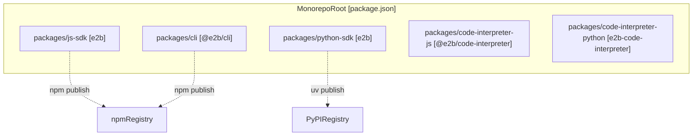
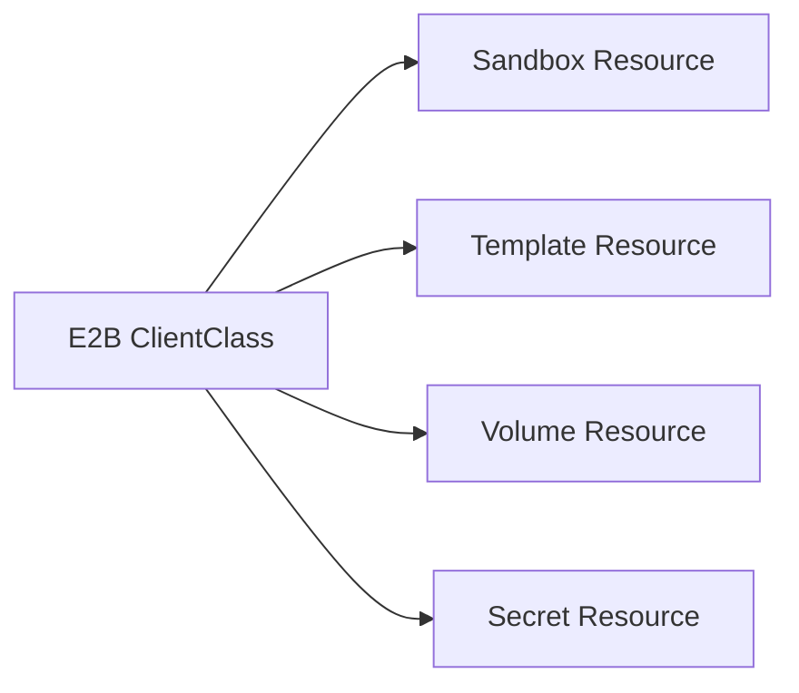

<!-- source: DeepWiki mcp.deepwiki.com · repo e2b-dev/E2B · page 1 Overview · fetched 2026-10-29 -->

# Overview

Relevant source files

The following files were used as context for generating this wiki page:

- [CONTRIBUTING.md](CONTRIBUTING.md)
- [README.md](README.md)
- [package.json](package.json)
- [packages/cli/CHANGELOG.md](packages/cli/CHANGELOG.md)
- [packages/cli/README.md](packages/cli/README.md)
- [packages/cli/package.json](packages/cli/package.json)
- [packages/code-interpreter-python/uv.lock](packages/code-interpreter-python/uv.lock)
- [packages/desktop-python/uv.lock](packages/desktop-python/uv.lock)
- [packages/js-sdk/CHANGELOG.md](packages/js-sdk/CHANGELOG.md)
- [packages/js-sdk/README.md](packages/js-sdk/README.md)
- [packages/js-sdk/package.json](packages/js-sdk/package.json)
- [packages/python-sdk/CHANGELOG.md](packages/python-sdk/CHANGELOG.md)
- [packages/python-sdk/README.md](packages/python-sdk/README.md)
- [packages/python-sdk/package.json](packages/python-sdk/package.json)
- [packages/python-sdk/pyproject.toml](packages/python-sdk/pyproject.toml)
- [packages/python-sdk/uv.lock](packages/python-sdk/uv.lock)
- [pnpm-lock.yaml](pnpm-lock.yaml)

## Introduction and Purpose

E2B is an open-source infrastructure that allows you to run AI-generated code in secure isolated sandboxes in the cloud [README.md:19-20](). The repository contains core client SDKs, command-line tooling, code execution interpreters, and desktop automation modules designed for AI agents [README.md:20,66,83]().

Sources: [README.md:19-20](), [packages/js-sdk/README.md:19-20](), [packages/python-sdk/README.md:16-17]()

## Monorepo Structure and Packages

The codebase is organized as a monorepo managed via `pnpm` and `uv`, bundling multiple independent packages that are published to package registries [package.json:5-19](), [packages/python-sdk/package.json:6-9]().

Sources: [package.json:5-19](), [packages/js-sdk/package.json:2-3](), [packages/python-sdk/pyproject.toml:2-3](), [packages/cli/package.json:2-3]()

Sources: [package.json:5-19](), [packages/js-sdk/package.json:2-3](), [packages/python-sdk/pyproject.toml:2-3](), [packages/cli/package.json:2-3]()

## Core Resources

The E2B platform exposes four primary resource types through its SDK client interfaces (`Sandbox`, `Template`, `Volume`, and `Secret`), which can be configured either via environment variables or explicitly through the `E2B` client class [packages/js-sdk/README.md:50-61](), [packages/python-sdk/README.md:47-57]().

Sources: [packages/js-sdk/README.md:50-61](), [packages/python-sdk/README.md:47-57]()

Sources: [packages/js-sdk/README.md:50-61](), [packages/python-sdk/README.md:47-57]()

## Subsystem Navigation and Child Pages

As a parent overview page, this document summarizes the high-level architecture and structure. For detailed technical specifications, implementation details, and getting started guides, refer to the following child pages:

- **System Architecture**: For details on the client/control-plane/envd model, dual protocol communication (REST and ConnectRPC/HTTP2), and connection pool sharding, see [System Architecture](#1.1).
- **Package Structure**: For details on the monorepo workspace configuration, specifications, and publishing workflows, see [Package Structure](#1.2).
- **Getting Started**: For installation instructions, environment configuration (`E2B_API_KEY`, `E2B_DOMAIN`), and basic sandbox initialization examples in JavaScript and Python, see [Getting Started](#1.3).

Sources: [packages/js-sdk/README.md:50-67](), [packages/python-sdk/README.md:47-67]()

---

