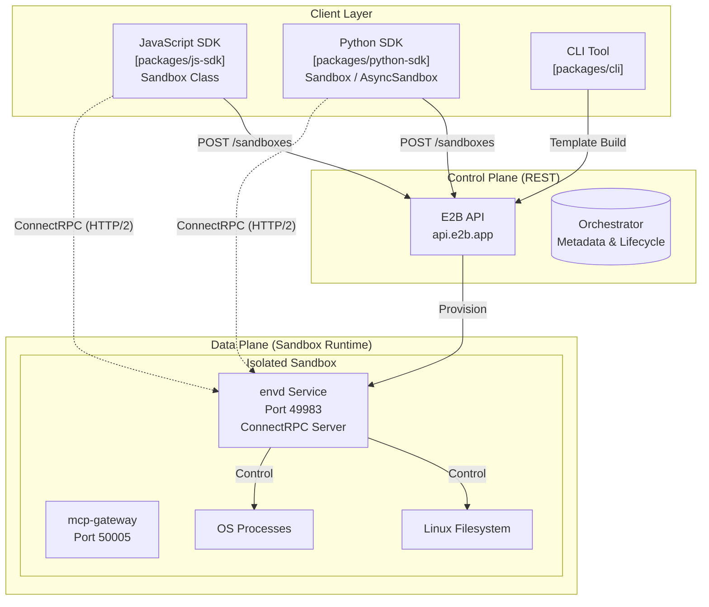
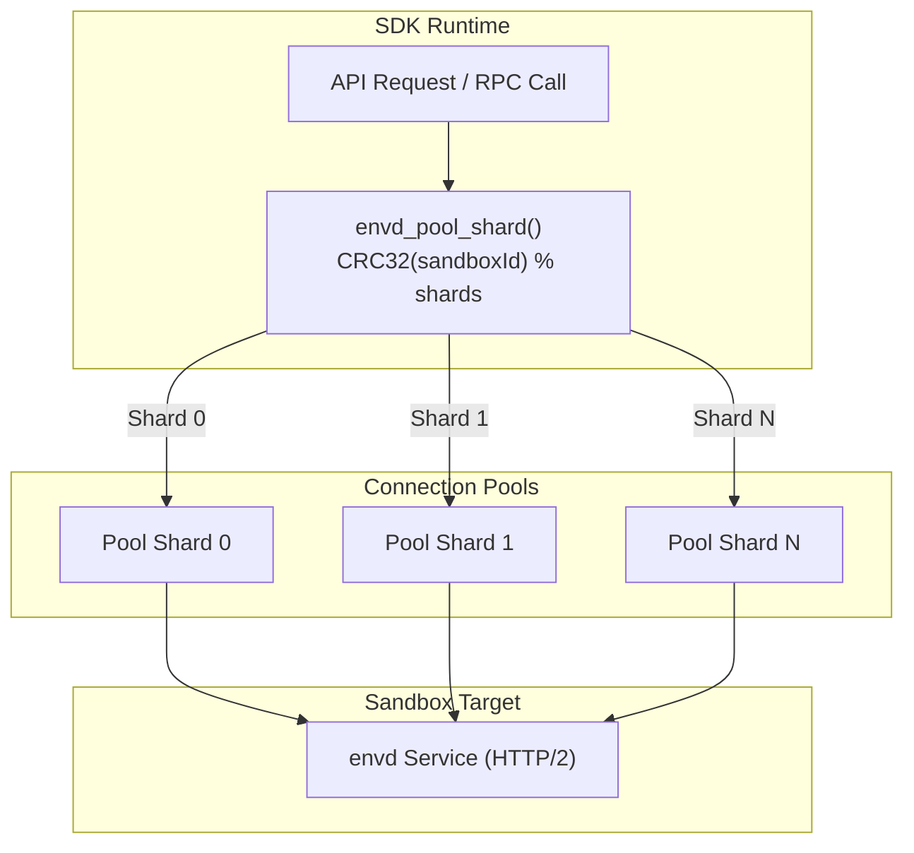
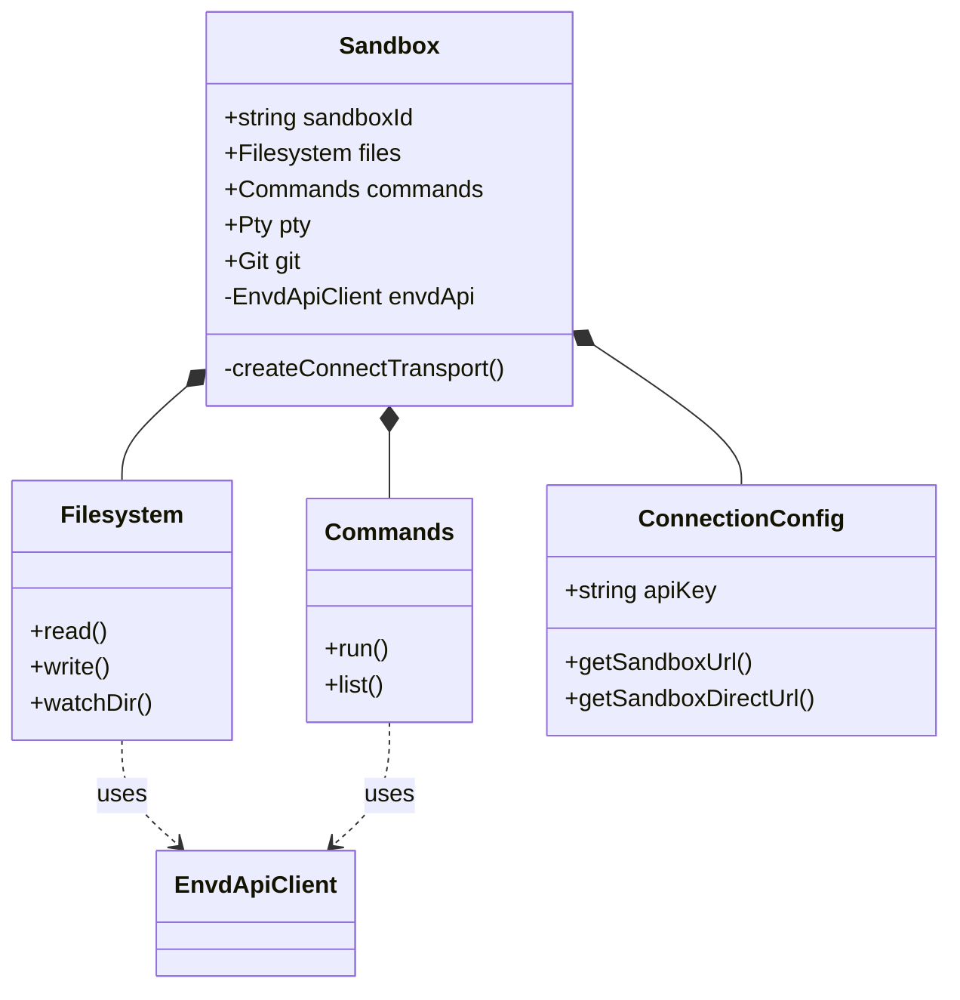

<!-- source: DeepWiki mcp.deepwiki.com · repo e2b-dev/E2B · page 1.1 System Architecture · fetched 2026-10-29 -->

# System Architecture

Relevant source files

The following files were used as context for generating this wiki page:

- [packages/js-sdk/src/api/http2.ts](packages/js-sdk/src/api/http2.ts)
- [packages/js-sdk/src/api/index.ts](packages/js-sdk/src/api/index.ts)
- [packages/js-sdk/src/connectionConfig.ts](packages/js-sdk/src/connectionConfig.ts)
- [packages/js-sdk/src/envd/http2.ts](packages/js-sdk/src/envd/http2.ts)
- [packages/js-sdk/src/sandbox/index.ts](packages/js-sdk/src/sandbox/index.ts)
- [packages/js-sdk/src/undici.ts](packages/js-sdk/src/undici.ts)
- [packages/js-sdk/src/utils.ts](packages/js-sdk/src/utils.ts)
- [packages/js-sdk/tests/api/http2.test.ts](packages/js-sdk/tests/api/http2.test.ts)
- [packages/js-sdk/tests/connectionConfig.test.ts](packages/js-sdk/tests/connectionConfig.test.ts)
- [packages/js-sdk/tests/envd/http2.test.ts](packages/js-sdk/tests/envd/http2.test.ts)
- [packages/js-sdk/tests/undici.test.ts](packages/js-sdk/tests/undici.test.ts)
- [packages/js-sdk/tests/utils.test.ts](packages/js-sdk/tests/utils.test.ts)
- [packages/js-sdk/vitest.config.mts](packages/js-sdk/vitest.config.mts)
- [packages/python-sdk/e2b/api/__init__.py](packages/python-sdk/e2b/api/__init__.py)
- [packages/python-sdk/e2b/connection_config.py](packages/python-sdk/e2b/connection_config.py)
- [packages/python-sdk/e2b/sandbox/main.py](packages/python-sdk/e2b/sandbox/main.py)
- [packages/python-sdk/tests/test_connection_config.py](packages/python-sdk/tests/test_connection_config.py)

## Purpose and Scope

This document explains the high-level architecture of the E2B platform, focusing on the interaction between client SDKs, the E2B REST API (control plane), and the `envd` service (data plane) running within isolated sandboxes. It details the dual-protocol communication pattern (REST and ConnectRPC/HTTP2), connection pool sharding, and the authentication mechanisms that secure sandbox operations.

## Core Components

The E2B architecture follows a client-server model where SDKs act as clients to both a centralized management API and distributed runtime services.

**Component Responsibilities:**

| Component | Role | Code Entity |
|-----------|------|-------------|
| **JavaScript SDK** | Node/Browser client | `class Sandbox` [packages/js-sdk/src/sandbox/index.ts:75]() |
| **Python SDK** | Sync/Async client | `class SandboxBase` [packages/python-sdk/e2b/sandbox/main.py:27]() |
| **E2B API** | Lifecycle management | `ApiClient` [packages/js-sdk/src/api/index.ts:90]() |
| **envd Service** | Runtime operations | `EnvdApiClient` [packages/js-sdk/src/sandbox/index.ts:121]() |
| **Connection Config** | Auth & URL resolution | `class ConnectionConfig` [packages/python-sdk/e2b/connection_config.py:154]() |

**Sources:** [packages/js-sdk/src/sandbox/index.ts:75](), [packages/python-sdk/e2b/sandbox/main.py:27](), [packages/js-sdk/src/api/index.ts:90](), [packages/python-sdk/e2b/connection_config.py:154]()

## Dual-Protocol Communication

E2B employs two distinct protocols to balance management overhead with runtime performance.

### 1. REST API (Control Plane)
The REST API handles sandbox lifecycle events. These operations are typically infrequent and require centralized coordination (e.g., checking team quotas, billing, and global metadata).

*   **Creation:** `POST /sandboxes` initializes the environment.
*   **Termination:** `DELETE /sandboxes/{id}` kills the instance.
*   **Maintenance:** Sandbox TTL updates and metadata lookups.

In the JS SDK, these are abstracted via OpenAPI-generated fetch clients [packages/js-sdk/src/api/index.ts:107]().

### 2. ConnectRPC / HTTP2 (Data Plane)
High-performance operations like filesystem I/O, shell command execution, and PTY interactions use **ConnectRPC** (a gRPC-compatible protocol) over HTTP/2. This communication happens directly between the SDK and the `envd` service running at `envdPort` (`49983`) [packages/js-sdk/src/sandbox/index.ts:114](). In Python, custom connection pool sharding (`envd_pool_shard`) distributes heavy streams across bounded connection pools to prevent HTTP/2 concurrency bottlenecks [packages/python-sdk/e2b/api/__init__.py:109-125]().

**Sources:** [packages/js-sdk/src/sandbox/index.ts:114](), [packages/js-sdk/src/api/index.ts:107](), [packages/python-sdk/e2b/api/__init__.py:109-125]()

## Connection Pool Sharding and Transports

To maintain optimal throughput over HTTP/2, both SDKs employ custom connection pool tuning and request multiplexing.

*   **JavaScript SDK (Undici Dispatchers):** The JS SDK uses custom `undici` agent configurations (`createEnvdFetch` and `createEnvdRpcFetch`) with HTTP/2 enabled (`allowH2: true`) and configurable limits for concurrent connections and inflight requests (`E2B_ENVD_RPC_CONNECTIONS`, `E2B_ENVD_INFLIGHT_REQUESTS`) [packages/js-sdk/src/envd/http2.ts:20-74]().
*   **Python SDK (Pool Sharding):** The Python SDK uses `pyqwest` transports where `envd_pool_shard` hashes the `E2b-Sandbox-Id` via CRC32 modulo `E2B_ENVD_POOL_SHARDS` to isolate long-running streams across a bounded set of underlying connections [packages/python-sdk/e2b/api/__init__.py:106-125]().

**Sources:** [packages/js-sdk/src/envd/http2.ts:20-74](), [packages/python-sdk/e2b/api/__init__.py:106-125]()

## Client Initialization and Data Flow

When a `Sandbox` instance is created, it initializes multiple sub-modules, each responsible for a specific domain of the sandbox runtime.

### Initialization Sequence
1.  **Config Resolution:** `ConnectionConfig` resolves the API key, domain, proxy settings, and environment variables [packages/python-sdk/e2b/connection_config.py:154]().
2.  **Transport Setup:** The JS SDK creates an `rpcTransport` using `createConnectTransport` with customized `fetch` redirects and header injection [packages/js-sdk/src/sandbox/index.ts:169-201]().
3.  **Header Injection:** All gRPC/ConnectRPC requests are patched to include `X-Access-Token` (when secured) and routing headers such as `E2b-Sandbox-Id` and `E2b-Sandbox-Port` [packages/js-sdk/src/sandbox/index.ts:162-191]().
4.  **Module Initialization:** The `Filesystem`, `Commands`, and `Pty` modules are instantiated with the configured transport and client stubs [packages/js-sdk/src/sandbox/index.ts:218-225]().

**Sources:** [packages/js-sdk/src/sandbox/index.ts:162-225](), [packages/python-sdk/e2b/connection_config.py:154]()

## Authentication and Security

E2B uses a multi-layered authentication approach to ensure that only authorized clients can manage or interact with sandboxes.

### 1. API Management Auth
Used for REST API calls (Control Plane).
*   **API Key:** Passed via `X-API-KEY` header [packages/js-sdk/src/api/index.ts:118]().
*   **Access Token:** Managed through configuration options for integration attribution and workload access.

### 2. Sandbox Runtime Auth
Used for ConnectRPC/envd calls (Data Plane).
*   **envdAccessToken:** A short-lived token generated per-sandbox session, passed via the `X-Access-Token` header [packages/js-sdk/src/sandbox/index.ts:190]().
*   **Traffic Token (`trafficAccessToken`):** Used to access restricted ports exposed by the sandbox [packages/js-sdk/src/sandbox/index.ts:112]().

### 3. File Signing
For secure file uploads and downloads, the SDK generates signed URLs via `getSignature` (JS) and `get_signature` (Python), combining operation types (`read`/`write`), usernames, and expiration timestamps [packages/python-sdk/e2b/sandbox/main.py:15]().

**Sources:** [packages/js-sdk/src/sandbox/index.ts:112](), [packages/js-sdk/src/sandbox/index.ts:190](), [packages/js-sdk/src/api/index.ts:118](), [packages/python-sdk/e2b/sandbox/main.py:15]()

## URL Resolution and Routing

The system uses a specific subdomain pattern to route traffic to the correct sandbox and port.

| URL Type | Pattern | Purpose |
|----------|---------|---------|
| **API URL** | `https://api.e2b.app` | REST Control Plane [packages/js-sdk/src/connectionConfig.ts:42]() |
| **Sandbox URL** | `https://sandbox.e2b.app` | Default gRPC routing [packages/js-sdk/src/connectionConfig.ts:48]() |
| **Direct URL** | `https://{port}-{sandboxId}.e2b.app` | Direct port access [packages/python-sdk/e2b/sandbox/main.py:53]() |
| **Local Debug** | `http://localhost:{envdPort}` | Local development [packages/js-sdk/src/connectionConfig.ts:163]() |

**Sources:** [packages/js-sdk/src/connectionConfig.ts:42-163](), [packages/python-sdk/e2b/sandbox/main.py:53]()

---

