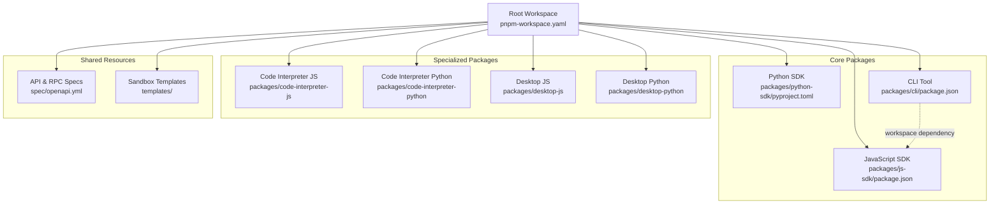
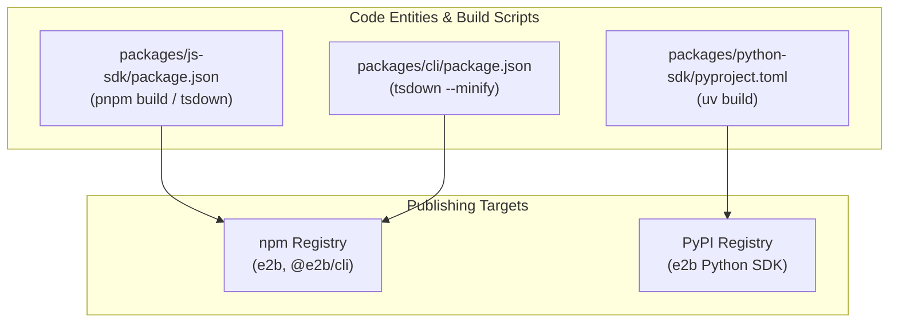

<!-- source: DeepWiki mcp.deepwiki.com · repo e2b-dev/E2B · page 1.2 Package Structure · fetched 2026-10-29 -->

# Package Structure

Relevant source files

The following files were used as context for generating this wiki page:

- [.changeset/connectrpc-minor-bump.md](.changeset/connectrpc-minor-bump.md)
- [.changeset/undici-security-patch.md](.changeset/undici-security-patch.md)
- [codegen.Dockerfile](codegen.Dockerfile)
- [package.json](package.json)
- [packages/cli/CHANGELOG.md](packages/cli/CHANGELOG.md)
- [packages/cli/package.json](packages/cli/package.json)
- [packages/code-interpreter-python/CHANGELOG.md](packages/code-interpreter-python/CHANGELOG.md)
- [packages/code-interpreter-python/package.json](packages/code-interpreter-python/package.json)
- [packages/code-interpreter-python/pyproject.toml](packages/code-interpreter-python/pyproject.toml)
- [packages/code-interpreter-python/uv.lock](packages/code-interpreter-python/uv.lock)
- [packages/desktop-js/CHANGELOG.md](packages/desktop-js/CHANGELOG.md)
- [packages/desktop-js/package.json](packages/desktop-js/package.json)
- [packages/desktop-python/CHANGELOG.md](packages/desktop-python/CHANGELOG.md)
- [packages/desktop-python/package.json](packages/desktop-python/package.json)
- [packages/desktop-python/pyproject.toml](packages/desktop-python/pyproject.toml)
- [packages/desktop-python/uv.lock](packages/desktop-python/uv.lock)
- [packages/js-sdk/CHANGELOG.md](packages/js-sdk/CHANGELOG.md)
- [packages/js-sdk/package.json](packages/js-sdk/package.json)
- [packages/python-sdk/CHANGELOG.md](packages/python-sdk/CHANGELOG.md)
- [packages/python-sdk/package.json](packages/python-sdk/package.json)
- [packages/python-sdk/pyproject.toml](packages/python-sdk/pyproject.toml)
- [packages/python-sdk/uv.lock](packages/python-sdk/uv.lock)
- [pnpm-lock.yaml](pnpm-lock.yaml)
- [pnpm-workspace.yaml](pnpm-workspace.yaml)

This document describes the physical organization of the E2B monorepo, including all packages, their dependencies, and how they are managed and published. For information about the high-level system architecture and how these packages interact at runtime, see [System Architecture](#1.1). For details on development workflows and CI/CD processes, see [Monorepo Build System and Tooling](#7.1) and [CI/CD and Release Process](#7.2).

## Monorepo Overview

E2B uses a monorepo structure managed by **pnpm workspaces** at the root level `pnpm-workspace.yaml` [pnpm-workspace.yaml:1-3](). Individual package managers (pnpm for JavaScript/TypeScript, `uv` for Python) handle language-specific dependencies. The repository contains core SDKs, specialized application SDKs, command-line tools, shared specifications, and prebuilt templates.

**Diagram: Monorepo Layout and Workspace Mapping**

Sources: [package.json:1-18](), [pnpm-workspace.yaml:1-3](), [packages/js-sdk/package.json:1-17](), [packages/cli/package.json:83]()

## Core Packages

### JavaScript SDK (`packages/js-sdk`)

The JavaScript SDK is published as `e2b` on npm and provides the primary programmatic interface for creating and managing sandboxes [packages/js-sdk/package.json:2-4]().

| Property | Value |
|----------|-------|
| Package Name | `e2b` |
| Current Version | `2.49.1` |
| Main Entry | `dist/index.js` |
| Module Entry | `dist/index.mjs` |
| TypeScript Types | `dist/index.d.ts` |
| Build Tool | `tsdown` |
| Test Framework | `vitest` |
| Node Version | `>=20.18.1 <21 \|\| >=22` |

**Key Dependencies:**
- `@connectrpc/connect`: gRPC communication with Envd [packages/js-sdk/package.json:90]()
- `openapi-fetch`: REST API client generation [packages/js-sdk/package.json:96]()
- `dockerfile-ast`: Dockerfile parsing for template building [packages/js-sdk/package.json:94]()
- `tar`: File archiving for template uploads [packages/js-sdk/package.json:98]()

**Code Generation:**
Scripts in `packages/js-sdk/package.json` define the generation of API schema types from OpenAPI specifications (`openapi-typescript`) and Protocol Buffer definitions (`buf generate`) [packages/js-sdk/package.json:30-36]().

Sources: [packages/js-sdk/package.json:1-110]()

### Python SDK (`packages/python-sdk`)

The Python SDK is published as `e2b` on PyPI and provides both synchronous and asynchronous APIs for sandbox management. It uses `uv` as the primary build and dependency manager [packages/python-sdk/pyproject.toml:57-58]().

| Property | Value |
|----------|-------|
| Package Name | `e2b` |
| Current Version | `2.49.1` |
| Build Backend | `uv_build` |
| Python Version | `>=3.10` |

**Key Dependencies:**
- `httpx`: HTTP client for API communication [packages/python-sdk/pyproject.toml:13]()
- `connectrpc`: Connect-RPC support for gRPC runtime operations [packages/python-sdk/pyproject.toml:22]()
- `dockerfile-parse`: Dockerfile parsing for templates [packages/python-sdk/pyproject.toml:20]()
- `protobuf-py`: Protocol Buffer support [packages/python-sdk/pyproject.toml:12]()

Sources: [packages/python-sdk/pyproject.toml:1-63](), [packages/python-sdk/package.json:1-14]()

### CLI (`packages/cli`)

The CLI tool is published as `@e2b/cli` on npm and provides command-line interfaces for template and sandbox management [packages/cli/package.json:2-4]().

| Property | Value |
|----------|-------|
| Package Name | `@e2b/cli` |
| Current Version | `2.19.0` |
| Binary Name | `e2b` |
| Build Tool | `tsdown` |
| Node Version | `>=20.18.1 <21 \|\| >=22.9.0` |

**Architecture:**
The CLI is built as a wrapper around the JavaScript SDK (`e2b`), importing it as a workspace dependency [packages/cli/package.json:83]().

Sources: [packages/cli/package.json:1-94]()

## Specialized Packages (`code-interpreter` and `desktop`)

In addition to core SDKs, the repository contains packages tailored for specific domain workflows across both JavaScript and Python ecosystems:
- **Code Interpreter SDKs (`packages/code-interpreter-js` and `packages/code-interpreter-python`)**: Provide Jupyter-style code execution environments.
- **Desktop SDKs (`packages/desktop-js` and `packages/desktop-python`)**: Support launching GUI applications, remote desktop streaming, and mouse/keyboard automation within sandboxes.

Sources: [pnpm-lock.yaml:186-218]()

## Specifications and Templates (`spec/` and `templates/`)

- `spec/`: Contains shared API definitions (`openapi.yml`), protocol buffer schemas (`envd/*.proto`), and configuration files (`envd.yaml`, `mcp-server.json`) used by the code generation pipeline.
- `templates/`: Contains prebuilt sandbox templates (such as base images and custom runtimes) and GitHub workflows used to build and publish them.

Sources: [packages/js-sdk/package.json:31-35]()

## Package Management and Publishing

### Workspace Definition and Version Synchronization
The root `package.json` configures pnpm workspaces and utilizes `changesets` for cross-package versioning and release coordination [package.json:1-18]().

**Publishing Pipeline:**
- **npm Packages (`e2b`, `@e2b/cli`)**: Published via `changeset publish` [package.json:6](). Build scripts compile TypeScript packages using `tsdown` prior to publishing [packages/js-sdk/package.json:26-27](), [packages/cli/package.json:38-39]().
- **PyPI Package (`e2b`)**: Published using `uv` via custom publishing workflows and helper scripts [packages/python-sdk/package.json:9](), [package.json:7]().

**Diagram: Code Entity Space to Package Publishing Flow**

Sources: [package.json:5-7](), [packages/js-sdk/package.json:25-27](), [packages/cli/package.json:37-39](), [packages/python-sdk/package.json:5-9]()

---

