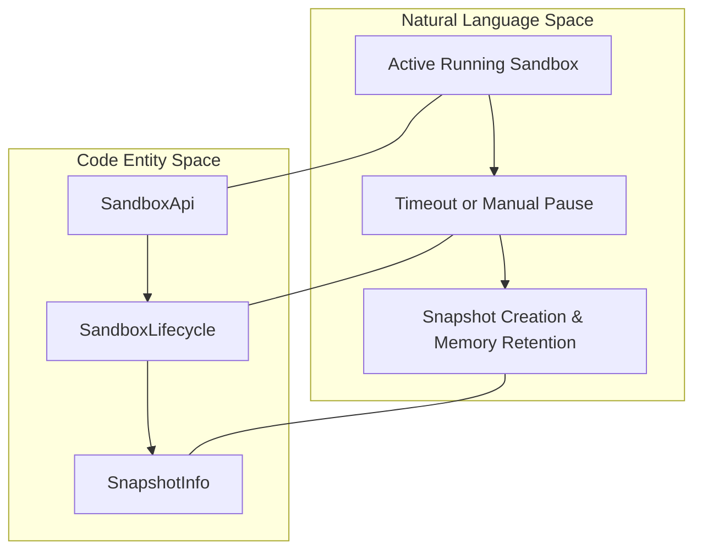
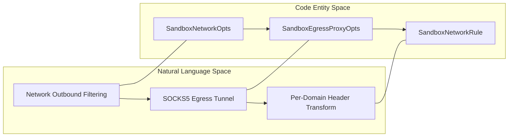

<!-- source: DeepWiki mcp.deepwiki.com · repo e2b-dev/E2B · page 10 Advanced Topics · fetched 2026-10-29 -->

# Advanced Topics

Relevant source files

The following files were used as context for generating this wiki page:

- [packages/js-sdk/src/index.ts](packages/js-sdk/src/index.ts)
- [packages/js-sdk/src/sandbox/sandboxApi.ts](packages/js-sdk/src/sandbox/sandboxApi.ts)
- [packages/python-sdk/e2b/__init__.py](packages/python-sdk/e2b/__init__.py)
- [packages/python-sdk/e2b/sandbox/sandbox_api.py](packages/python-sdk/e2b/sandbox/sandbox_api.py)
- [packages/python-sdk/e2b/sandbox_async/main.py](packages/python-sdk/e2b/sandbox_async/main.py)
- [packages/python-sdk/e2b/sandbox_async/sandbox_api.py](packages/python-sdk/e2b/sandbox_async/sandbox_api.py)
- [packages/python-sdk/e2b/sandbox_sync/main.py](packages/python-sdk/e2b/sandbox_sync/main.py)
- [packages/python-sdk/e2b/sandbox_sync/sandbox_api.py](packages/python-sdk/e2b/sandbox_sync/sandbox_api.py)

This page serves as a high-level overview of advanced E2B sandbox features and operational patterns, including lifecycle management, persistent snapshots, granular network egress controls, resource observability, and Model Context Protocol (MCP) integrations. As a parent page, it introduces core concepts and points to dedicated child pages for deep technical details.

## 10.1. Lifecycle, Persistence and Snapshots

E2B sandboxes operate on a state machine model encompassing **Running**, **Paused**, and **Killed** states [packages/js-sdk/src/sandbox/sandboxApi.ts:88-95](). Users can configure timeout behaviors via `SandboxLifecycle` options, specifying whether a timeout triggers a pause or termination, whether memory state should be preserved (`keepMemory`), and whether the sandbox should automatically resume upon receiving new SDK operations (`autoResume`) [packages/js-sdk/src/sandbox/sandboxApi.ts:64-95](). Snapshots allow capturing sandbox states for branching or cloning via fork operations.

*Diagram: Sandbox Lifecycle to Code Entity Mapping*

Sources: [packages/js-sdk/src/sandbox/sandboxApi.ts:64-95](), [packages/python-sdk/e2b/sandbox/sandbox_api.py:20-66]()

For details, see [Lifecycle, Persistence and Snapshots](#10.1).

---

## 10.2. Network Egress Control

Security and traffic governance are managed through `SandboxNetworkOpts`, which enables allowlists (`allowOut`) and denylists (`denyOut`) using CIDR blocks or hostnames, alongside the `ALL_TRAFFIC` sentinel [packages/js-sdk/src/sandbox/sandboxApi.ts:135-149](). Furthermore, the platform supports per-domain header transforms with workload identity token injection (`SandboxNetworkRule`) and custom SOCKS5 egress proxies (`SandboxEgressProxyOpts`) [packages/js-sdk/src/sandbox/sandboxApi.ts:49-188]().

*Diagram: Network Egress Control Mapping*

Sources: [packages/js-sdk/src/sandbox/sandboxApi.ts:49-197](), [packages/python-sdk/e2b/sandbox/sandbox_api.py:104-222]()

For details, see [Network Egress Control](#10.2).

---

## 10.3. Metadata, Listing and Filtering

Sandboxes support flexible tagging and categorization through metadata dictionaries and custom environment variables supplied during creation [packages/python-sdk/e2b/sandbox_sync/main.py:171-178](). The `SandboxApi.list()` method provides paginated iteration (`Paginator`) and query filters (`SandboxQuery`) to sort and filter active or paused sandboxes by state, template ID, or metadata key-value pairs [packages/python-sdk/e2b/sandbox_sync/sandbox_api.py:71-99]().

Sources: [packages/js-sdk/src/sandbox/sandboxApi.ts:60-95](), [packages/python-sdk/e2b/sandbox_sync/sandbox_api.py:71-99]()

For details, see [Metadata, Listing and Filtering](#10.3).

---

## 10.4. Metrics, Logs and Observability

To monitor execution health, sandboxes expose real-time resource utilization metrics (`SandboxMetrics`) covering CPU usage, memory consumption, and disk allocation [packages/js-sdk/src/sandbox/sandboxApi.ts:60-66](). Additionally, streaming logs allow inspecting runtime stdout/stderr streams and debugging interactions through configured `Logger` interfaces [packages/js-sdk/src/index.ts:32]().

Sources: [packages/js-sdk/src/index.ts:32](), [packages/js-sdk/src/sandbox/sandboxApi.ts:60-66]()

For details, see [Metrics, Logs and Observability](#10.4).

---

## 10.5. MCP Integration

E2B integrates with the **Model Context Protocol (MCP)** to allow AI models to connect with standardized tool servers [packages/js-sdk/src/sandbox/sandboxApi.ts:21-27](). Configurations accept standard `McpServer` definitions as well as dynamic `GitHubMcpServer` entries (`GitHubMcpServer`), which automatically execute installation (`installCmd`) and runtime (`runCmd`) sequences directly from remote GitHub repositories [packages/js-sdk/src/sandbox/sandboxApi.ts:27-44]().

Sources: [packages/js-sdk/src/sandbox/sandboxApi.ts:21-44](), [packages/python-sdk/e2b/sandbox/sandbox_api.py:76-101]()

For details, see [MCP Integration](#10.5).

---

