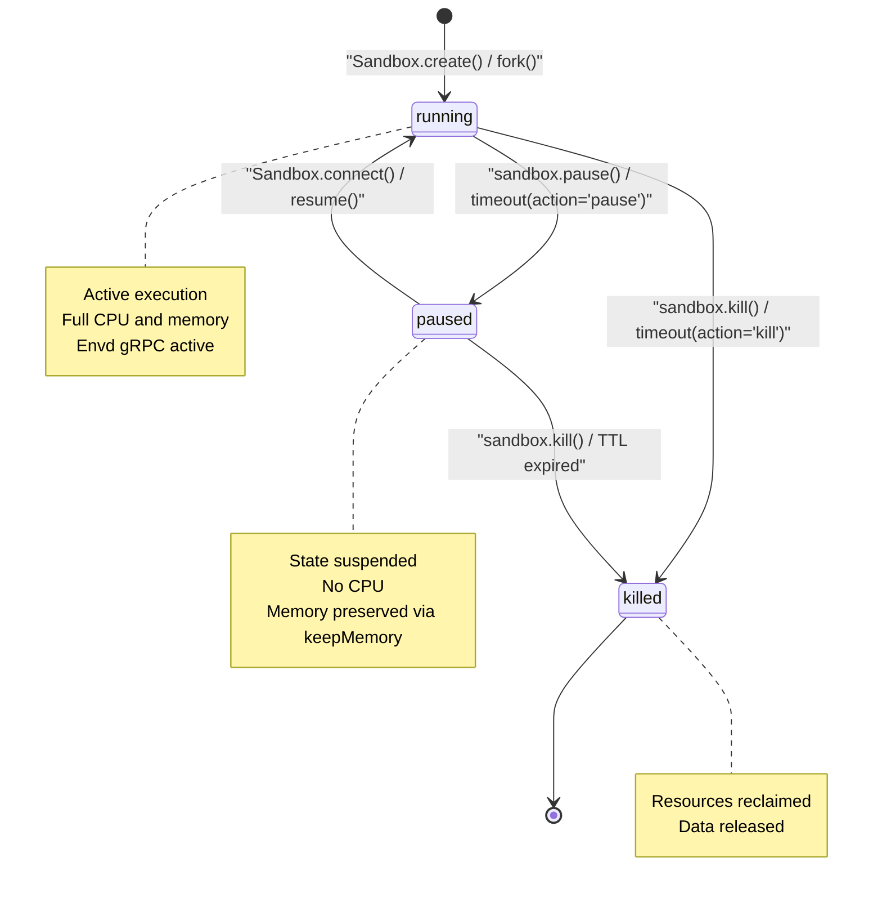
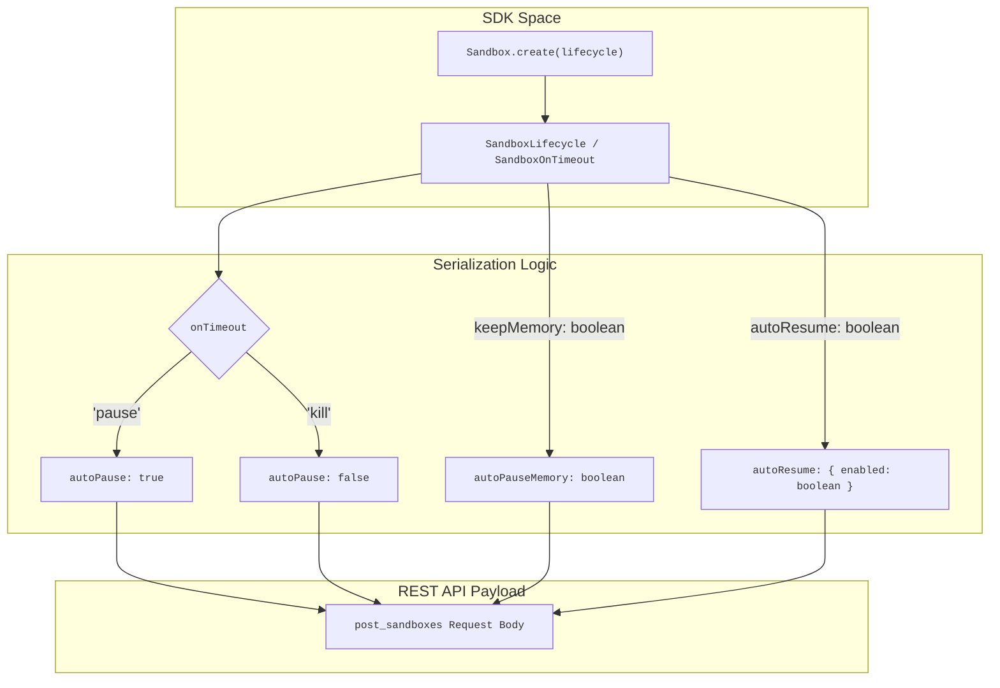
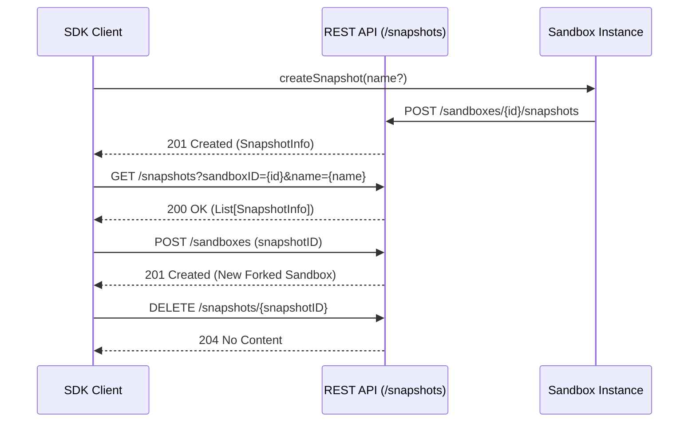

<!-- source: DeepWiki mcp.deepwiki.com · repo e2b-dev/E2B · page 10.1 Lifecycle, Persistence and Snapshots · fetched 2026-10-29 -->

# Lifecycle, Persistence and Snapshots

<details>
<summary>Relevant source files</summary>

The following files were used as context for generating this wiki page:

- [packages/js-sdk/tests/api/kill.test.ts](packages/js-sdk/tests/api/kill.test.ts)
- [packages/js-sdk/tests/sandbox/kill.test.ts](packages/js-sdk/tests/sandbox/kill.test.ts)
- [packages/js-sdk/tests/sandbox/lifecycleRequest.test.ts](packages/js-sdk/tests/sandbox/lifecycleRequest.test.ts)
- [packages/js-sdk/tests/sandbox/onResumeRequest.test.ts](packages/js-sdk/tests/sandbox/onResumeRequest.test.ts)
- [packages/js-sdk/tests/sandbox/snapshot-api.test.ts](packages/js-sdk/tests/sandbox/snapshot-api.test.ts)
- [packages/js-sdk/tests/sandbox/timeout.test.ts](packages/js-sdk/tests/sandbox/timeout.test.ts)
- [packages/python-sdk/e2b/api/client/api/snapshots/get_snapshots.py](packages/python-sdk/e2b/api/client/api/snapshots/get_snapshots.py)
- [packages/python-sdk/tests/async/api_async/test_sbx_kill.py](packages/python-sdk/tests/async/api_async/test_sbx_kill.py)
- [packages/python-sdk/tests/async/sandbox_async/commands/test_cmd_kill.py](packages/python-sdk/tests/async/sandbox_async/commands/test_cmd_kill.py)
- [packages/python-sdk/tests/async/sandbox_async/commands/test_cmd_list.py](packages/python-sdk/tests/async/sandbox_async/commands/test_cmd_list.py)
- [packages/python-sdk/tests/async/sandbox_async/files/test_exists.py](packages/python-sdk/tests/async/sandbox_async/files/test_exists.py)
- [packages/python-sdk/tests/async/sandbox_async/test_kill.py](packages/python-sdk/tests/async/sandbox_async/test_kill.py)
- [packages/python-sdk/tests/async/sandbox_async/test_snapshot_api.py](packages/python-sdk/tests/async/sandbox_async/test_snapshot_api.py)
- [packages/python-sdk/tests/async/sandbox_async/test_timeout.py](packages/python-sdk/tests/async/sandbox_async/test_timeout.py)
- [packages/python-sdk/tests/shared/sandbox/test_lifecycle_request.py](packages/python-sdk/tests/shared/sandbox/test_lifecycle_request.py)
- [packages/python-sdk/tests/shared/sandbox/test_on_resume_request.py](packages/python-sdk/tests/shared/sandbox/test_on_resume_request.py)
- [packages/python-sdk/tests/sync/api_sync/test_sbx_kill.py](packages/python-sdk/tests/sync/api_sync/test_sbx_kill.py)
- [packages/python-sdk/tests/sync/sandbox_sync/commands/test_cmd_kill.py](packages/python-sdk/tests/sync/sandbox_sync/commands/test_cmd_kill.py)
- [packages/python-sdk/tests/sync/sandbox_sync/test_snapshot_api.py](packages/python-sdk/tests/sync/sandbox_sync/test_snapshot_api.py)
- [packages/python-sdk/tests/sync/sandbox_sync/test_timeout.py](packages/python-sdk/tests/sync/sandbox_sync/test_timeout.py)

</details>


This page details the technical implementation of E2B sandbox lifecycle management, state transitions, persistence options, timeout behaviors, snapshot APIs, and wire payload formatting across both the JavaScript and Python SDKs.

## Sandbox State Machine

E2B sandboxes transition through explicit states managed by the control plane and communicated via the REST API and envd runtimes. The logical lifecycle states are mapped to code entities and API handlers below.



Sources: [packages/js-sdk/tests/sandbox/kill.test.ts:6-16](), [packages/python-sdk/tests/sync/sandbox_sync/test_snapshot_api.py:18-34]()

## Lifecycle Configuration & Request Payloads

The sandbox lifecycle is configured via the `lifecycle` option during sandbox creation (`Sandbox.create` / `AsyncSandbox.create`), defining timeout actions (`onTimeout`), memory preservation during pause (`keepMemory`), and automatic resumption (`autoResume`).

### Payload Mapping for Creation

When callers configure lifecycle options, the SDKs serialize them into specific REST request fields (`autoPause`, `autoPauseMemory`, `autoResume`) sent to the control plane.



### Resume Request Payload Mapping

When connecting to an existing sandbox using `Sandbox.connect` or `AsyncSandbox.connect`, the `onResume` option (`'restore'` vs `'reboot'`) controls whether memory state is restored or discarded.

```typescript
// JavaScript: onResume mapping
await Sandbox.connect('test-sandbox-id', { onResume: 'reboot' }); 
// Translates to payload property: { memory: false }
```

```python
# Python: onResume mapping
await AsyncSandbox.connect("sbx-test", on_resume="reboot")
# Translates to payload property: { memory: False }
```

Sources: [packages/js-sdk/tests/sandbox/lifecycleRequest.test.ts:30-190](), [packages/python-sdk/tests/shared/sandbox/test_lifecycle_request.py:25-201](), [packages/js-sdk/tests/sandbox/onResumeRequest.test.ts:30-106](), [packages/python-sdk/tests/shared/sandbox/test_on_resume_request.py:30-162]()

## Timeout Management and Expiration

Every sandbox has an expiration time (`endAt`) tracked by the control plane. 

### Timeout Control Operations
- **`setTimeout(timeoutMs)` / `set_timeout(seconds)`**: Dynamically alters the sandbox TTL [packages/python-sdk/tests/async/sandbox_async/test_timeout.py:10-30](), [packages/js-sdk/tests/sandbox/timeout.test.ts:5-31]().
- **Timeout Actions**: When the TTL expires, the backend automatically performs the configured action:
  - `onTimeout: 'kill'`: Terminates the sandbox and frees all resources.
  - `onTimeout: 'pause'`: Suspends the sandbox. If `keepMemory: true`, memory is preserved in snapshot storage; if `keepMemory: false`, only filesystem state is saved.

Sources: [packages/python-sdk/tests/async/sandbox_async/test_timeout.py:10-30](), [packages/js-sdk/tests/sandbox/timeout.test.ts:5-31]()

## Snapshots and Persistence API

Snapshots capture the entire filesystem (and optionally memory state) of a sandbox, persisting beyond the sandbox's individual lifespan into reusable templates or independent child sandboxes.

### Snapshot Operations Flow



### Key Snapshot Methods
- **`createSnapshot()` / `create_snapshot()`**: Captures the current sandbox state. Returns a `SnapshotInfo` object containing the `snapshotId` and associated names [packages/python-sdk/tests/sync/sandbox_sync/test_snapshot_api.py:8-16](), [packages/js-sdk/tests/sandbox/snapshot-api.test.ts:8-23]().
- **`listSnapshots()` / `list_snapshots()`**: Paginated listing supporting filters for source `sandbox_id` and `name` [packages/python-sdk/e2b/api/client/api/snapshots/get_snapshots.py:13-119](), [packages/python-sdk/tests/sync/sandbox_sync/test_snapshot_api.py:69-118]().
- **Creating from Snapshot**: Passing a `snapshotId` directly into `Sandbox.create(snapshotId)` provisions a new sandbox initialized with the snapshot's filesystem and data state [packages/python-sdk/tests/sync/sandbox_sync/test_snapshot_api.py:18-34](), [packages/js-sdk/tests/sandbox/snapshot-api.test.ts:25-55]().

Sources: [packages/python-sdk/e2b/api/client/api/snapshots/get_snapshots.py:13-119](), [packages/python-sdk/tests/sync/sandbox_sync/test_snapshot_api.py:8-193](), [packages/js-sdk/tests/sandbox/snapshot-api.test.ts:8-210]()

---

