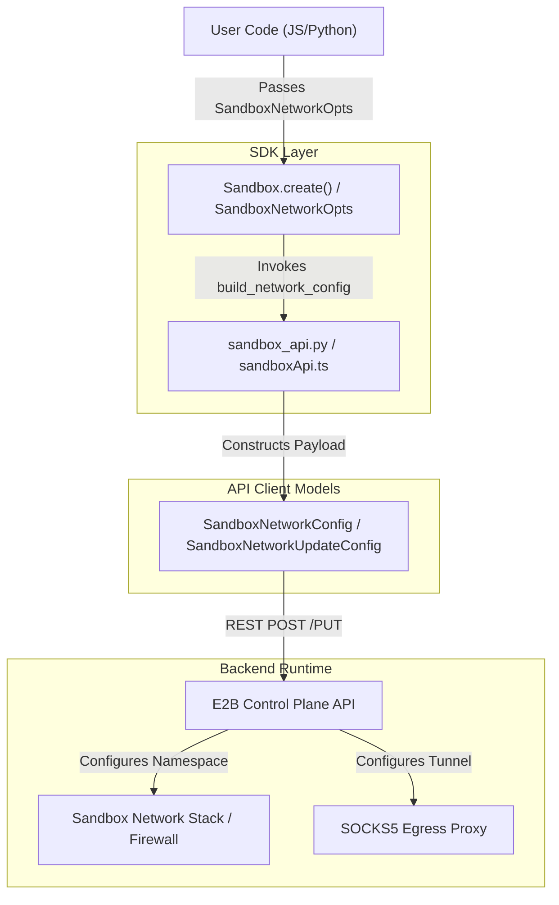

<!-- source: DeepWiki mcp.deepwiki.com · repo e2b-dev/E2B · page 10.2 Network Egress Control · fetched 2026-10-29 -->

# Network Egress Control

<details>
<summary>Relevant source files</summary>

The following files were used as context for generating this wiki page:

- [packages/js-sdk/tests/sandbox/egressProxy.test.ts](packages/js-sdk/tests/sandbox/egressProxy.test.ts)
- [packages/js-sdk/tests/sandbox/host.test.ts](packages/js-sdk/tests/sandbox/host.test.ts)
- [packages/js-sdk/tests/sandbox/lifecyclePayload.test.ts](packages/js-sdk/tests/sandbox/lifecyclePayload.test.ts)
- [packages/js-sdk/tests/sandbox/network.test.ts](packages/js-sdk/tests/sandbox/network.test.ts)
- [packages/js-sdk/tests/sandbox/snapshot.test.ts](packages/js-sdk/tests/sandbox/snapshot.test.ts)
- [packages/js-sdk/tests/setup.ts](packages/js-sdk/tests/setup.ts)
- [packages/python-sdk/e2b/api/client/models/sandbox_network_config.py](packages/python-sdk/e2b/api/client/models/sandbox_network_config.py)
- [packages/python-sdk/e2b/api/client/models/sandbox_network_update_config.py](packages/python-sdk/e2b/api/client/models/sandbox_network_update_config.py)
- [packages/python-sdk/tests/async/sandbox_async/test_network.py](packages/python-sdk/tests/async/sandbox_async/test_network.py)
- [packages/python-sdk/tests/conftest.py](packages/python-sdk/tests/conftest.py)
- [packages/python-sdk/tests/shared/sandbox/test_egress_proxy.py](packages/python-sdk/tests/shared/sandbox/test_egress_proxy.py)
- [packages/python-sdk/tests/sync/sandbox_sync/test_network.py](packages/python-sdk/tests/sync/sandbox_sync/test_network.py)

</details>


This page details the `SandboxNetworkOpts` system, which provides granular control over outbound network traffic from E2B sandboxes. This includes defining rules for allowing or denying traffic to specific CIDR blocks or hostnames, injecting custom headers into HTTP/HTTPS requests for particular domains, routing outbound TCP through a SOCKS5 egress proxy, configuring HTTPS ports, and performing atomic network updates.

## Purpose and Scope

The `SandboxNetworkOpts` system allows users to configure network egress policies for sandboxes. This is crucial for security, compliance, and controlling resource access. It enables scenarios such as:
* Whitelisting specific external services or IP ranges a sandbox can communicate with.
* Blacklisting malicious or unwanted destinations via CIDR blocks.
* Routing all outbound TCP traffic through a SOCKS5 egress proxy with optional authentication.
* Injecting authentication tokens or other metadata into requests to external APIs using per-domain header transforms.
* Designating specific ports inside the sandbox as serving HTTPS rather than plaintext HTTP.
* Restricting or permitting public access to sandbox-hosted services.

## Core Concepts

Network egress control is managed through the `SandboxNetworkOpts` configuration object, which is passed during sandbox creation or modified via network update methods.

### `SandboxNetworkOpts` Structure

The `SandboxNetworkOpts` type defines the following properties:
* `allowOut`: Specifies allowed outbound traffic (CIDR blocks, IP addresses, or domain names). Allowed entries take precedence over denied entries [packages/python-sdk/e2b/api/client/models/sandbox_network_config.py:25-27]().
* `denyOut`: Specifies denied outbound traffic (CIDR blocks or IP addresses). Domain names are not supported for deny rules [packages/python-sdk/e2b/api/client/models/sandbox_network_config.py:28-29]().
* `egressProxy`: Configures a SOCKS5 proxy for sandbox egress. Outbound TCP is tunneled through the proxy after allow/deny filtering; domain-matched flows use remote DNS (`ATYP=domain`) [packages/python-sdk/e2b/api/client/models/sandbox_network_config.py:30-32]().
* `https_ports`: Designates sandbox ports that serve HTTPS rather than plaintext HTTP, affecting how the proxy reaches the guest service [packages/python-sdk/e2b/api/client/models/sandbox_network_config.py:34-36]().
* `rules`: Defines per-domain transform rules applied to matching outbound HTTPS requests [packages/python-sdk/e2b/api/client/models/sandbox_network_config.py:37-43]().
* `allowPublicTraffic`: Controls public accessibility of sandbox URLs [packages/python-sdk/e2b/api/client/models/sandbox_network_config.py:23-24]().
* `maskRequestHost`: Specifies a custom host mask for sandbox requests [packages/python-sdk/e2b/api/client/models/sandbox_network_config.py:33-33]().

### `SandboxNetworkSelector` and `ALL_TRAFFIC`

Both `allowOut` and `denyOut` accept either a static array of strings or a callback function receiving a context object. The context provides the `allTraffic` sentinel value, which maps to `'0.0.0.0/0'` [packages/js-sdk/src/sandbox/network.ts:1-1](), [packages/python-sdk/e2b/sandbox/network.py:1-1]().

Sources:
* [packages/js-sdk/src/sandbox/sandboxApi.ts:104-169]()
* [packages/python-sdk/e2b/sandbox/sandbox_api.py:147-205]()
* [packages/python-sdk/e2b/api/client/models/sandbox_network_config.py:23-44]()

## Implementation Details

Network configuration objects pass through client-side builders before being dispatched to the E2B control plane REST API.

### Data Flow and Code Entity Mapping

The following diagram bridges the natural language concepts of network egress configuration to the concrete code entities across the SDK and API client layers.

Title: "Network Egress Configuration Code Entity Flow"


Sources:
* [packages/python-sdk/e2b/api/client/models/sandbox_network_config.py:20-53]()
* [packages/python-sdk/e2b/api/client/models/sandbox_network_update_config.py:22-51]()
* [packages/python-sdk/e2b/sandbox/sandbox_api.py:30-43]()

### Network Update API

For running sandboxes, network rules can be updated dynamically via `sandbox.updateNetwork()` or `Sandbox.updateNetwork()`. This issues a `PUT` request to `/sandboxes/{sandboxID}/network` using a `SandboxNetworkUpdateConfig` payload [packages/python-sdk/e2b/api/client/models/sandbox_network_update_config.py:22-44](). Note that network updates replace the current egress rules atomically; omitted fields are cleared.

Title: "Network Update Sequence"

```mermaid
graph TD
    Client["SDK Client"] -->|PUT /sandboxes/{sandboxID}/network| RestAPI["Rest API Endpoint"]
    RestAPI -->|SandboxNetworkUpdateConfig| UpdateHandler["Network Manager"]
    UpdateHandler -->|Replace Rules| Namespace["Sandbox Firewall / Proxy State"]
```
Sources:
* [packages/python-sdk/e2b/api/client/models/sandbox_network_update_config.py:22-44]()
* [packages/js-sdk/tests/sandbox/egressProxy.test.ts:23-26]()

## Usage Examples

### Allowing Specific IPs and Denying All Other Traffic

```typescript
// packages/js-sdk/tests/sandbox/network.test.ts:13-21
sandboxTest.override({
  sandboxOpts: {
    network: {
      denyOut: ({ allTraffic }) => [allTraffic],
      allowOut: ['1.1.1.1'],
    },
  },
})
```
Sources:
* [packages/js-sdk/tests/sandbox/network.test.ts:13-21]()

### Configuring a SOCKS5 Egress Proxy

```python
# packages/python-sdk/tests/shared/sandbox/test_egress_proxy.py:19-26
network: SandboxNetworkOpts = {
    "egress_proxy": {
        "address": "proxy.example.com:1080",
        "username": "proxy-user",
        "password": "proxy-password",
    },
}
```
Sources:
* [packages/python-sdk/tests/shared/sandbox/test_egress_proxy.py:19-26]()

### Injecting Headers for Specific Domains

```typescript
// packages/js-sdk/tests/sandbox/network.test.ts:222-233
sandbox = await Sandbox.create(template, {
  metadata: { sandboxTestId },
  network: {
    rules: {
      [httpbinHost]: [
        {
          transform: {
            headers: {
              [injectedHeader]: injectedValue,
            },
          },
        },
      ],
    },
    allowOut: ({ rules }) => [...rules.keys()],
  },
})
```
Sources:
* [packages/js-sdk/tests/sandbox/network.test.ts:222-233]()

### Controlling Public Traffic Access

```typescript
// packages/js-sdk/tests/sandbox/network.test.ts:130-137
sandboxTest.override({
  sandboxOpts: {
    network: {
      allowPublicTraffic: false,
    },
  },
})
```
Sources:
* [packages/js-sdk/tests/sandbox/network.test.ts:130-137]()

---

