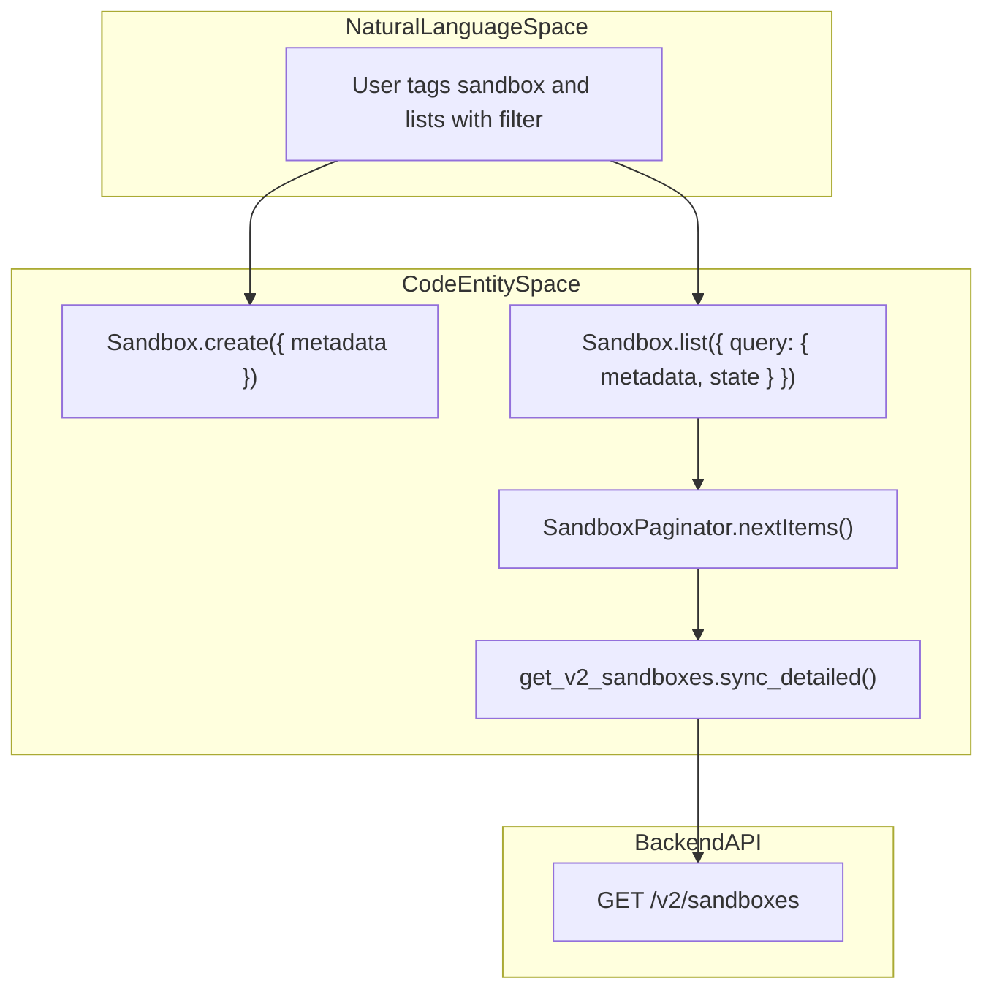
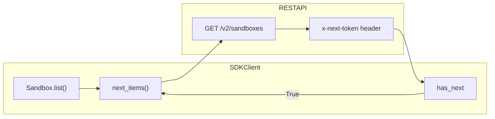

<!-- source: DeepWiki mcp.deepwiki.com · repo e2b-dev/E2B · page 10.3 Metadata, Listing and Filtering · fetched 2026-10-29 -->

# Metadata, Listing and Filtering

<details>
<summary>Relevant source files</summary>

The following files were used as context for generating this wiki page:

- [packages/js-sdk/tests/api/info.test.ts](packages/js-sdk/tests/api/info.test.ts)
- [packages/js-sdk/tests/api/list.test.ts](packages/js-sdk/tests/api/list.test.ts)
- [packages/python-sdk/e2b/sandbox_async/paginator.py](packages/python-sdk/e2b/sandbox_async/paginator.py)
- [packages/python-sdk/e2b/sandbox_sync/paginator.py](packages/python-sdk/e2b/sandbox_sync/paginator.py)
- [packages/python-sdk/tests/async/api_async/test_sbx_info.py](packages/python-sdk/tests/async/api_async/test_sbx_info.py)
- [packages/python-sdk/tests/async/api_async/test_sbx_list.py](packages/python-sdk/tests/async/api_async/test_sbx_list.py)
- [packages/python-sdk/tests/sync/api_sync/test_sbx_info.py](packages/python-sdk/tests/sync/api_sync/test_sbx_info.py)
- [packages/python-sdk/tests/sync/api_sync/test_sbx_list.py](packages/python-sdk/tests/sync/api_sync/test_sbx_list.py)

</details>


This page documents the metadata, env vars, paginated listing, info APIs, and filtering/sorting capabilities for E2B sandboxes and templates. Metadata allows developers to attach custom key-value pairs to sandboxes for organization, identification, and configuration. Filtering and pagination enable robust querying of active and paused sandboxes.

For information about sandbox lifecycle and state transitions, see [Lifecycle, Persistence and Snapshots](10.1). For information about network configurations, see [Network Egress Control](10.2).

---

## Overview

Sandbox metadata and filtering provide organizational capabilities for managing multiple sandboxes. The system supports:

- **Metadata Assignment**: Attach arbitrary string key-value pairs to sandboxes during creation.
- **Metadata Retrieval**: Access metadata through `Sandbox.getInfo()` or `AsyncSandbox.get_info()`.
- **Filtering by Metadata & State**: Query sandboxes matching specific metadata criteria or states (`running`, `paused`).
- **Pagination**: Navigate large result sets using cursors (`next_token` / `nextToken`).
- **Sorting**: Order results in ascending or descending direction.

---

## Metadata Structure

### Data Model

Sandbox metadata is represented as a dictionary/record of string key-value pairs:

- **JavaScript SDK**: `Record<string, string>` [packages/js-sdk/src/sandbox/sandboxApi.ts:102]()
- **Python SDK**: `Dict[str, str]` [packages/python-sdk/e2b/sandbox/sandbox_api.py:116]()

### Metadata Properties

| Property | Type | Description |
|----------|------|-------------|
| Keys | `string` | Arbitrary string keys identifying metadata attributes |
| Values | `string` | String values associated with each key |
| Storage | Persistent | Metadata persists for the sandbox lifetime |
| Mutability | Immutable | Cannot be modified after sandbox creation |

Sources: [packages/js-sdk/src/sandbox/sandboxApi.ts:96-102](), [packages/python-sdk/e2b/sandbox/sandbox_api.py:110-120]()

---

## Setting Metadata on Creation

### JavaScript SDK

Metadata is specified via the `metadata` option in `SandboxOpts` [packages/js-sdk/src/sandbox/sandboxApi.ts:102]().

```typescript
const sandbox = await Sandbox.create({
  metadata: {
    userId: 'user-123',
    environment: 'production'
  }
})
```

Sources: [packages/js-sdk/src/sandbox/sandboxApi.ts:96-102](), [packages/js-sdk/src/sandbox/sandboxApi.ts:707-761]()

### Python SDK

Metadata is specified via the `metadata` parameter in `Sandbox.create()` or `AsyncSandbox.create()`.

```python
sandbox = Sandbox.create(
    metadata={
        "user_id": "user-123",
        "environment": "production"
    }
)
```

Sources: [packages/python-sdk/e2b/sandbox_sync/main.py:163-175](), [packages/python-sdk/e2b/sandbox_async/main.py:164-177]()

---

## Metadata and Listing Flow

Title: Sandbox Metadata Tagging and Listing Architecture



Sources: [packages/js-sdk/tests/api/list.test.ts:9-18](), [packages/python-sdk/e2b/sandbox_sync/paginator.py:37-88]()

---

## Filtering, Sorting and Paginated Listing APIs

### Filter Options

Sandboxes can be filtered when listing by:
- **Metadata**: Key-value pairs that must match.
- **State**: Sandbox state (`running`, `paused`).
- **Started After**: Filter by creation timestamp (`started_after`).

### JavaScript SDK Listing & Filtering

The `Sandbox.list` method returns a paginator supporting limits, states, ordering, and metadata queries [packages/js-sdk/tests/api/list.test.ts:44-59]().

```typescript
const paginator = Sandbox.list({
  limit: 10,
  order: 'asc',
  query: {
    metadata: { sandboxTestId: 'test-123' },
    state: ['running', 'paused']
  }
})

while (paginator.hasNext) {
  const sandboxes = await paginator.nextItems()
}
```

Sources: [packages/js-sdk/tests/api/list.test.ts:44-122](), [packages/js-sdk/tests/api/list.test.ts:184-201]()

### Python SDK Listing & Filtering

Both synchronous (`Sandbox.list`) and asynchronous (`AsyncSandbox.list`) methods utilize `SandboxQuery` and return paginators [packages/python-sdk/e2b/sandbox_sync/paginator.py:23-88](), [packages/python-sdk/e2b/sandbox_async/paginator.py:23-88]().

```python
paginator = Sandbox.list(
    limit=10,
    order="asc",
    query=SandboxQuery(
        metadata={"sandbox_test_id": "test-123"},
        state=[SandboxState.RUNNING, SandboxState.PAUSED]
    )
)

while paginator.has_next:
    sandboxes = paginator.next_items()
```

Sources: [packages/python-sdk/e2b/sandbox_sync/paginator.py:23-102](), [packages/python-sdk/tests/sync/api_sync/test_sbx_list.py:31-64]()

---

## Pagination Implementation

Title: Paginator Cursor Iteration Sequence



Sources: [packages/python-sdk/e2b/sandbox_sync/paginator.py:37-94](), [packages/python-sdk/e2b/sandbox_async/paginator.py:37-94]()

---

## Sandbox Info API

To fetch detailed runtime metadata and state for a specific sandbox instance by its ID, the SDKs provide `Sandbox.getInfo()` and `AsyncSandbox.get_info()` [packages/js-sdk/tests/api/info.test.ts:6-10](), [packages/python-sdk/tests/sync/api_sync/test_sbx_info.py:7-9]().

**JavaScript SDK**:
```typescript
const info = await Sandbox.getInfo(sandboxId)
```

**Python SDK**:
```python
info = Sandbox.get_info(sandbox_id)
```

Sources: [packages/js-sdk/tests/api/info.test.ts:6-10](), [packages/python-sdk/tests/sync/api_sync/test_sbx_info.py:7-9](), [packages/python-sdk/tests/async/api_async/test_sbx_info.py:7-9]()

---

