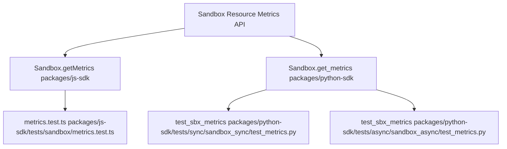
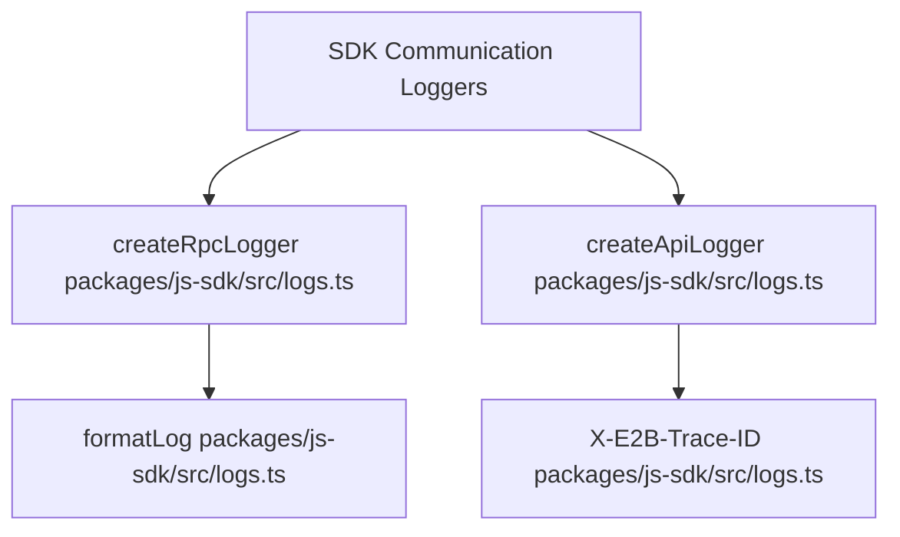

<!-- source: DeepWiki mcp.deepwiki.com · repo e2b-dev/E2B · page 10.4 Metrics, Logs and Observability · fetched 2026-10-29 -->

# Metrics, Logs and Observability

Relevant source files

The following files were used as context for generating this wiki page:

- [packages/js-sdk/src/logs.ts](packages/js-sdk/src/logs.ts)
- [packages/js-sdk/tests/logs.test.ts](packages/js-sdk/tests/logs.test.ts)
- [packages/js-sdk/tests/sandbox/metrics.test.ts](packages/js-sdk/tests/sandbox/metrics.test.ts)
- [packages/python-sdk/e2b/api/client/api/sandboxes/get_v_2_sandboxes_sandbox_id_logs.py](packages/python-sdk/e2b/api/client/api/sandboxes/get_v_2_sandboxes_sandbox_id_logs.py)
- [packages/python-sdk/e2b/api/client/api/sandboxes/post_sandboxes_sandbox_id_snapshots.py](packages/python-sdk/e2b/api/client/api/sandboxes/post_sandboxes_sandbox_id_snapshots.py)
- [packages/python-sdk/e2b/api/client/api/tags/get_templates_template_id_tags.py](packages/python-sdk/e2b/api/client/api/tags/get_templates_template_id_tags.py)
- [packages/python-sdk/e2b/api/client/api/volumes/delete_volumes_volume_id.py](packages/python-sdk/e2b/api/client/api/volumes/delete_volumes_volume_id.py)
- [packages/python-sdk/e2b/api/client/api/volumes/get_volumes.py](packages/python-sdk/e2b/api/client/api/volumes/get_volumes.py)
- [packages/python-sdk/e2b/api/client/api/volumes/get_volumes_volume_id.py](packages/python-sdk/e2b/api/client/api/volumes/get_volumes_volume_id.py)
- [packages/python-sdk/e2b/api/client/api/volumes/post_volumes.py](packages/python-sdk/e2b/api/client/api/volumes/post_volumes.py)
- [packages/python-sdk/tests/async/sandbox_async/test_metrics.py](packages/python-sdk/tests/async/sandbox_async/test_metrics.py)
- [packages/python-sdk/tests/sync/sandbox_sync/test_metrics.py](packages/python-sdk/tests/sync/sandbox_sync/test_metrics.py)

## Purpose and Scope

This page documents the observability, logging, and metrics capabilities of E2B sandboxes. It details how resource metrics (CPU, memory, disk) are collected and queried via the SDKs, how internal SDK and Connect-RPC logging is implemented, and how sandbox logs are retrieved via the control plane REST API and CLI.

Sources: [packages/js-sdk/src/logs.ts:1-85](), [packages/python-sdk/tests/sync/sandbox_sync/test_metrics.py:1-62]()

---

## 1. Resource Metrics Collection

Sandboxes collect hardware utilization data, which is exposed through the `getMetrics()` method in JavaScript [packages/js-sdk/tests/sandbox/metrics.test.ts:13]() and `get_metrics()` in Python [packages/python-sdk/tests/sync/sandbox_sync/test_metrics.py:15]().

Each metric entry includes:
- **CPU**: `cpuCount` (total cores) and `cpuUsedPct` (utilization percentage).
- **Memory**: `memTotal` and `memUsed` (in bytes).
- **Disk**: `diskTotal` and `diskUsed` (in bytes).
- **Timestamp**: Measurement timestamp aligned to collection buckets.

### Metric Collection Mapping
The following diagram associates natural language concepts of metric retrieval with the exact test and SDK code entities in the monorepo:

Sources: [packages/js-sdk/tests/sandbox/metrics.test.ts:1-29](), [packages/python-sdk/tests/sync/sandbox_sync/test_metrics.py:9-30](), [packages/python-sdk/tests/async/sandbox_async/test_metrics.py:9-29]()

### Time-Range Filtering
Metrics can be queried over specific time windows using `start` and `end` parameters [packages/js-sdk/tests/sandbox/metrics.test.ts:42](), [packages/python-sdk/tests/sync/sandbox_sync/test_metrics.py:42](). Timestamps are aligned to collection buckets (currently 5 seconds), and queries incorporate a ~10-second slack window [packages/js-sdk/tests/sandbox/metrics.test.ts:52-54](), [packages/python-sdk/tests/sync/sandbox_sync/test_metrics.py:50-52]().

Sources: [packages/js-sdk/tests/sandbox/metrics.test.ts:31-69](), [packages/python-sdk/tests/sync/sandbox_sync/test_metrics.py:31-62]()

---

## 2. SDK and Connect-RPC Logging

The JavaScript SDK provides structured logging mechanisms via the `Logger` interface [packages/js-sdk/src/logs.ts:7-24](). It includes interceptors for gRPC/Connect-RPC (`createRpcLogger`) and middleware for OpenAPI fetches (`createApiLogger`) [packages/js-sdk/src/logs.ts:36-85]().

### RPC Interceptor and BigInt Serialization
The `createRpcLogger` interceptor logs requests and response streams [packages/js-sdk/src/logs.ts:36-59](). To support Protobuf `int64` fields represented as `bigint` in JavaScript without causing serialization exceptions, `formatLog` converts `bigint` values to strings using `JSON.stringify` with a custom replacer [packages/js-sdk/src/logs.ts:26-34]().

### SDK Logging Code Mapping

Sources: [packages/js-sdk/src/logs.ts:7-85](), [packages/js-sdk/tests/logs.test.ts:1-105]()

---

## 3. Sandbox Logs REST API

Sandbox-internal logs are accessible via the control plane REST API endpoint `/v2/sandboxes/{sandbox_id}/logs` [packages/python-sdk/e2b/api/client/api/sandboxes/get_v_2_sandboxes_sandbox_id_logs.py:48](). 

The `_get_kwargs` function constructs query parameters for log pagination and filtering [packages/python-sdk/e2b/api/client/api/sandboxes/get_v_2_sandboxes_sandbox_id_logs.py:15-23]():
- `cursor`: Pagination cursor [packages/python-sdk/e2b/api/client/api/sandboxes/get_v_2_sandboxes_sandbox_id_logs.py:18]()
- `limit`: Maximum number of log entries (default `1000`) [packages/python-sdk/e2b/api/client/api/sandboxes/get_v_2_sandboxes_sandbox_id_logs.py:19]()
- `direction`: `LogsDirection` enumeration specifying log order [packages/python-sdk/e2b/api/client/api/sandboxes/get_v_2_sandboxes_sandbox_id_logs.py:20]()
- `level`: `LogLevel` severity filter [packages/python-sdk/e2b/api/client/api/sandboxes/get_v_2_sandboxes_sandbox_id_logs.py:21]()
- `search`: Substring search query [packages/python-sdk/e2b/api/client/api/sandboxes/get_v_2_sandboxes_sandbox_id_logs.py:22]()

Sources: [packages/python-sdk/e2b/api/client/api/sandboxes/get_v_2_sandboxes_sandbox_id_logs.py:1-52]()

---

