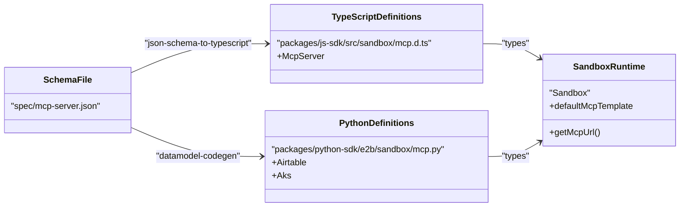
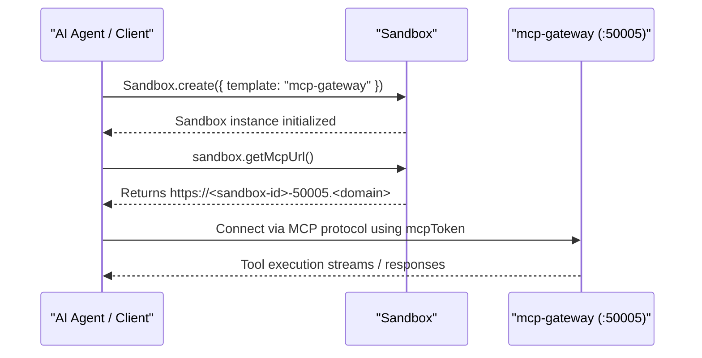

<!-- source: DeepWiki mcp.deepwiki.com · repo e2b-dev/E2B · page 10.5 MCP Integration · fetched 2026-10-29 -->

# MCP Integration

Relevant source files

The following files were used as context for generating this wiki page:

- [packages/js-sdk/src/sandbox/index.ts](packages/js-sdk/src/sandbox/index.ts)
- [packages/js-sdk/src/sandbox/mcp.d.ts](packages/js-sdk/src/sandbox/mcp.d.ts)
- [packages/python-sdk/e2b/sandbox/main.py](packages/python-sdk/e2b/sandbox/main.py)
- [packages/python-sdk/e2b/sandbox/mcp.py](packages/python-sdk/e2b/sandbox/mcp.py)
- [spec/mcp-server.json](spec/mcp-server.json)

This page details the Model Context Protocol (MCP) support within E2B sandboxes. It covers the `mcp-gateway` sandbox template, JSON schema specifications in `spec/mcp-server.json`, generated type definitions (`McpServer` and `GitHubMcpServer`), and methods for URL and token retrieval (`getMcpUrl` / `get_mcp_url`).

## Overview of MCP Support in E2B

The Model Context Protocol (MCP) enables LLM-powered agents inside sandboxes to securely interact with external services, databases, and APIs through standardized tool interfaces. E2B provides native support via the `mcp-gateway` template, which runs an MCP gateway proxying traffic to specialized containers or internal tool modules.

The core client classes define default properties for MCP templates and communication ports:
- JavaScript SDK defines `defaultMcpTemplate` as `'mcp-gateway'` and `mcpPort` as `50005` [packages/js-sdk/src/sandbox/index.ts:77](), [packages/js-sdk/src/sandbox/index.ts:115]().
- Python SDK defines `default_mcp_template` as `"mcp-gateway"` and `mcp_port` as `50005` [packages/python-sdk/e2b/sandbox/main.py:28](), [packages/python-sdk/e2b/sandbox/main.py:33]().

Sources:
- [packages/js-sdk/src/sandbox/index.ts:77]()
- [packages/js-sdk/src/sandbox/index.ts:115]()
- [packages/python-sdk/e2b/sandbox/main.py:28]()
- [packages/python-sdk/e2b/sandbox/main.py:33]()

---

## Template and Schema Architecture

MCP server definitions and configurations are generated from a central JSON schema specification located at `spec/mcp-server.json`. This specification determines the valid configuration payloads for third-party tools such as Airtable, Kubernetes (AKS), and GitHub (`GitHubMcpServer`).

### Natural Language Space to Code Entity Space: MCP Configuration

Sources:
- [spec/mcp-server.json]()
- [packages/js-sdk/src/sandbox/mcp.d.ts:8]()
- [packages/python-sdk/e2b/sandbox/mcp.py:11]()
- [packages/js-sdk/src/sandbox/index.ts:77]()

---

## Gateway URL and Token Retrieval

When creating an MCP-enabled sandbox using the `mcp-gateway` template, clients must retrieve the correct routing endpoint and authentication tokens to communicate with the internal MCP server running on port `50005`.

The Python base class manages internal MCP tokens using private properties (`_mcp_token`), while the SDK exposes methods to obtain the gateway URL (`getMcpUrl()` in JS / `get_mcp_url()` in Python).

### MCP Connection Sequence

Sources:
- [packages/js-sdk/src/sandbox/index.ts:115]()
- [packages/python-sdk/e2b/sandbox/main.py:28]()
- [packages/python-sdk/e2b/sandbox/main.py:56]()

---

