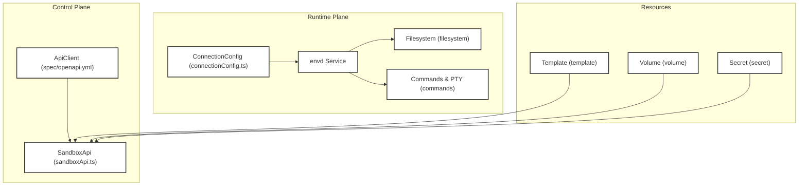
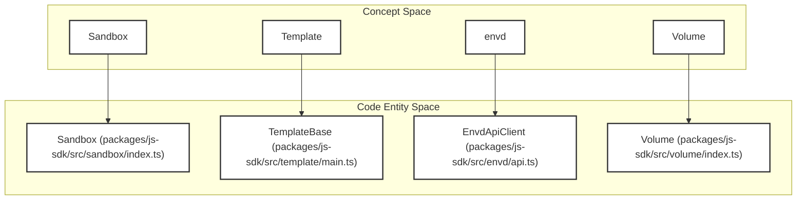

<!-- source: DeepWiki mcp.deepwiki.com · repo e2b-dev/E2B · page 11 Glossary · fetched 2026-10-29 -->

# Glossary

Relevant source files

The following files were used as context for generating this wiki page:

- [CONTRIBUTING.md](CONTRIBUTING.md)
- [README.md](README.md)
- [packages/cli/README.md](packages/cli/README.md)
- [packages/js-sdk/README.md](packages/js-sdk/README.md)
- [packages/js-sdk/src/api/schema.gen.ts](packages/js-sdk/src/api/schema.gen.ts)
- [packages/js-sdk/src/index.ts](packages/js-sdk/src/index.ts)
- [packages/js-sdk/src/sandbox/sandboxApi.ts](packages/js-sdk/src/sandbox/sandboxApi.ts)
- [packages/python-sdk/README.md](packages/python-sdk/README.md)
- [packages/python-sdk/e2b/__init__.py](packages/python-sdk/e2b/__init__.py)
- [packages/python-sdk/e2b/api/client/models/__init__.py](packages/python-sdk/e2b/api/client/models/__init__.py)
- [packages/python-sdk/e2b/sandbox/sandbox_api.py](packages/python-sdk/e2b/sandbox/sandbox_api.py)
- [packages/python-sdk/e2b/sandbox_async/main.py](packages/python-sdk/e2b/sandbox_async/main.py)
- [packages/python-sdk/e2b/sandbox_async/sandbox_api.py](packages/python-sdk/e2b/sandbox_async/sandbox_api.py)
- [packages/python-sdk/e2b/sandbox_sync/main.py](packages/python-sdk/e2b/sandbox_sync/main.py)
- [packages/python-sdk/e2b/sandbox_sync/sandbox_api.py](packages/python-sdk/e2b/sandbox_sync/sandbox_api.py)
- [spec/openapi.yml](spec/openapi.yml)

## Purpose and Scope
This page defines codebase-specific terms, jargon, abbreviations, and domain-specific concepts used within the E2B repository (`https://github.com/e2b-dev/E2B`). It provides direct code pointers for terms covering sandboxes, templates, internal runtime components (`envd`), communication layers, client factories, storage, and build/infrastructure tooling.

---

## Core Concepts

### Sandbox
A Sandbox is a secure, isolated cloud environment where AI agents can execute code, interact with a Linux OS, manage files, and perform network operations. It serves as the fundamental unit of computation in E2B. Sandboxes are ephemeral by default but support pausing, resuming, and forking.
Sources: [packages/js-sdk/src/sandbox/sandboxApi.ts:23-44](), [packages/python-sdk/e2b/sandbox_sync/main.py:49-70](), [packages/python-sdk/e2b/sandbox_async/main.py:50-71]()

### Template
A Template defines the initial state and configuration of a Sandbox, specifying the base image, environment variables, and setup instructions. Templates are built via a fluent builder pattern and can be published or instantiated into Sandboxes.
Sources: [packages/js-sdk/src/index.ts:166-166]()

### envd
`envd` is the internal service running inside each Sandbox that handles low-level runtime operations like filesystem access, command execution, and PTY interaction. Communication with `envd` is performed using ConnectRPC over HTTP/2.
Sources: [packages/js-sdk/src/index.ts:1-1](), [packages/python-sdk/e2b/sandbox_sync/main.py:110-129]()

### ConnectRPC
ConnectRPC is a protocol utilized for communication between the E2B client SDKs and the `envd` service inside Sandboxes. It operates over HTTP/2 and leverages Protocol Buffers for structured message serialization.
Sources: [packages/js-sdk/src/index.ts:1-1]()

### E2B client
The `E2B` client class provides explicit configuration binding (such as API keys and base domains) for multi-tenant or customized runtime environments, isolating state from environment-variable defaults.
Sources: [packages/js-sdk/src/client.ts:1-1](), [packages/python-sdk/e2b/client.py:1-1]()

### ClientFactory
A factory mechanism responsible for binding configuration profiles to resource classes (`Sandbox`, `Volume`, `Template`, `Secret`) when instantiating through an `E2B` client instance.
Sources: [packages/js-sdk/src/client.ts:1-1]()

### Volume
A Volume represents persistent storage that can be attached to or detached from Sandboxes, allowing data to outlive individual sandbox lifecycles.
Sources: [packages/js-sdk/src/volume/index.ts:1-1](), [packages/python-sdk/e2b/volume/volume_sync.py:1-1]()

### Secret
The Secret resource provides team-scoped, write-only configuration storage that is resolved securely at egress or runtime without leaking plain-text values.
Sources: [packages/js-sdk/src/secret.ts:1-1](), [packages/python-sdk/e2b/secret.py:1-1]()

### Snapshot
A Snapshot captures the saved state of a Sandbox (including filesystem and memory configuration) to enable rapid restoration or spawning of new child sandboxes.
Sources: [packages/js-sdk/src/sandbox/sandboxApi.ts:91-95]()

### Fork
Forking creates a new Sandbox instance directly from an existing running or paused sandbox's state, preserving filesystem and memory layers for experimental branching.
Sources: [packages/js-sdk/src/sandbox/sandboxApi.ts:65]()

### PTY (Pseudo-Terminal)
PTY provides an interactive terminal session interface inside the Sandbox, supporting real-time shell execution, input streaming, and dynamic terminal resizing.
Sources: [packages/js-sdk/src/sandbox/commands/commandHandle.ts:55-57](), [packages/python-sdk/e2b/__init__.py:61-68]()

### WatchHandle
A `WatchHandle` manages the active lifecycle of asynchronous filesystem event observation (e.g., file creation, modification, deletion) within a Sandbox.
Sources: [packages/js-sdk/src/sandbox/filesystem/watchHandle.ts:44-48]()

---

## API and SDK Components

### SandboxApi
`SandboxApi` is the core base class implementing high-level sandbox control-plane operations such as creation, listing, termination, pausing, and resuming.
Sources: [packages/js-sdk/src/sandbox/sandboxApi.ts:1-1](), [packages/python-sdk/e2b/sandbox_sync/sandbox_api.py:69-70]()

### ConnectionConfig
`ConnectionConfig` encapsulates all connection parameters, including API keys, custom domains, proxy setups, debug flags, and request timeouts utilized across API clients and `envd` channels.
Sources: [packages/js-sdk/src/connectionConfig.ts:1-1](), [packages/python-sdk/e2b/connection_config.py:1-1]()

### ApiClient
`ApiClient` handles communication with the E2B control-plane REST API for lifecycle management, template operations, and metadata queries.
Sources: [packages/js-sdk/src/api/index.ts:1-1](), [packages/python-sdk/e2b/api/__init__.py:1-1]()

---

## Infrastructure and Advanced Configuration

### pool shards
Pool shards refer to distributed backend orchestrator partitions that manage sandbox instance allocation across cloud provider regions and scaling groups.
Sources: [spec/openapi.yml:41-48]()

### ALL_TRAFFIC
`ALL_TRAFFIC` is a sentinel value (`'0.0.0.0/0'`) used in network egress rules to target all external network destinations.
Sources: [packages/js-sdk/src/sandbox/network.ts:1-1](), [packages/python-sdk/e2b/sandbox/network.ts:1-1]()

### envdAccessToken
An authentication token passed to `envd` to authorize runtime API requests and secure intra-sandbox communication channels.
Sources: [packages/js-sdk/src/sandbox/index.ts:116](), [packages/python-sdk/e2b/sandbox/main.py:34]()

### ReadyCmd
A set of conditions or commands (such as waiting for ports, URLs, processes, or files) required before a Sandbox build or startup is deemed ready for use.
Sources: [packages/js-sdk/src/template/readycmd.ts:1-1](), [packages/python-sdk/e2b/template/readycmd.py:1-1]()

### SandboxLifecycle
`SandboxLifecycle` defines configuration for state transitions and timeout handling, including actions on timeout (`pause` vs `kill`) and auto-resume behaviors.
Sources: [packages/js-sdk/src/sandbox/sandboxApi.ts:88-90](), [packages/python-sdk/e2b/sandbox/sandbox_api.py:53]()

### autoPause/autoResume
Settings governing automatic pausing of idle sandboxes upon timeout and subsequent transparent restoration when new connection requests arrive.
Sources: [packages/js-sdk/src/sandbox/sandboxApi.ts:67](), [packages/python-sdk/e2b/sandbox/sandbox_api.py:26-30]()

### keepMemory
A lifecycle option controlling whether memory state is preserved during a pause operation to enable fast warm-resumption vs cold booting.
Sources: [packages/js-sdk/src/sandbox/sandboxApi.ts:220]()

### IAM token
Workload identity tokens injected securely into network request transforms via the egress proxy to authenticate against external cloud services.
Sources: [packages/js-sdk/src/sandbox/sandboxApi.ts:63-79](), [packages/python-sdk/e2b/sandbox/sandbox_api.py:50-57]()

### Signature
Cryptographic parameters used to verify signed file upload and download URLs originating from sandbox volumes or filesystems.
Sources: [packages/js-sdk/src/sandbox/signature.ts:1-1](), [packages/python-sdk/e2b/sandbox/signature.py:1-1]()

### Rig
An orchestrator node pool backend mapped to a cloud auto-scaling group (e.g., AWS ASG or GCP MIG).
Sources: [spec/openapi.yml:230-235]()

### Node
An individual compute worker instance within a Rig that hosts active sandboxes.
Sources: [spec/openapi.yml:80-85]()

### Changeset
A monorepo versioning mechanism used to track package updates, manage changelogs, and automate release cycles.
Sources: [package.json:16]()

### Copybara
A tool utilized for mirroring code changes and synchronizing definitions across internal and external repositories.
Sources: [packages/js-sdk/package.json:31]()

### testground
An integration and backend testing harness used to validate CLI behavior, concurrency, and multi-service workflows.
Sources: [packages/cli/README.md:1-1]()

---

## System Architecture

Sources: [packages/js-sdk/src/api/schema.gen.ts:1-50](), [packages/js-sdk/src/sandbox/sandboxApi.ts:1-100](), [packages/js-sdk/src/connectionConfig.ts:1-50]()

---

## Code Entity to Concept Mapping

Sources: [packages/js-sdk/src/index.ts:1-170](), [packages/js-sdk/src/client.ts:1-60]()