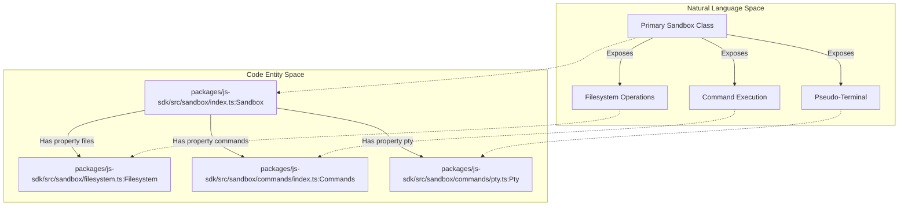
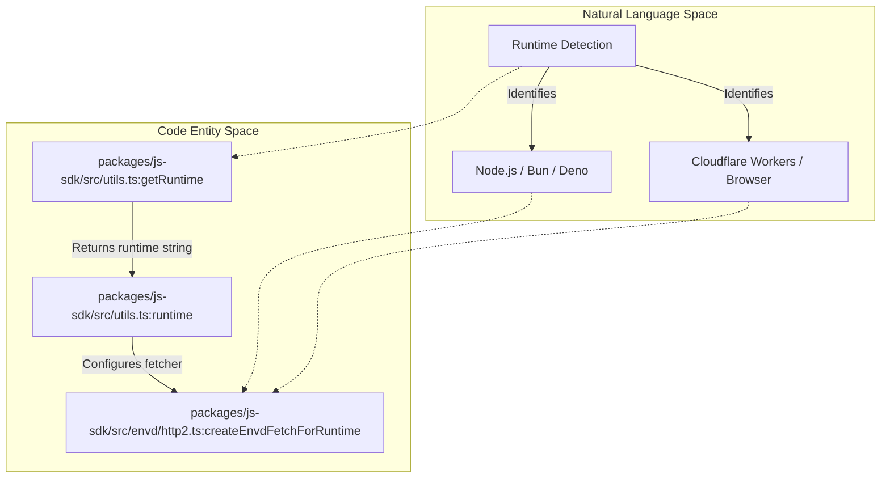

<!-- source: DeepWiki mcp.deepwiki.com · repo e2b-dev/E2B · page 2 JavaScript SDK · fetched 2026-10-29 -->

# JavaScript SDK

Relevant source files

The following files were used as context for generating this wiki page:

- [packages/js-sdk/src/api/http2.ts](packages/js-sdk/src/api/http2.ts)
- [packages/js-sdk/src/envd/http2.ts](packages/js-sdk/src/envd/http2.ts)
- [packages/js-sdk/src/sandbox/index.ts](packages/js-sdk/src/sandbox/index.ts)
- [packages/js-sdk/src/undici.ts](packages/js-sdk/src/undici.ts)
- [packages/js-sdk/src/utils.ts](packages/js-sdk/src/utils.ts)
- [packages/js-sdk/tests/api/http2.test.ts](packages/js-sdk/tests/api/http2.test.ts)
- [packages/js-sdk/tests/envd/http2.test.ts](packages/js-sdk/tests/envd/http2.test.ts)
- [packages/js-sdk/tests/undici.test.ts](packages/js-sdk/tests/undici.test.ts)
- [packages/js-sdk/tests/utils.test.ts](packages/js-sdk/tests/utils.test.ts)
- [packages/js-sdk/vitest.config.mts](packages/js-sdk/vitest.config.mts)
- [packages/python-sdk/e2b/sandbox/main.py](packages/python-sdk/e2b/sandbox/main.py)

The JavaScript SDK (`e2b`) provides a TypeScript and JavaScript client library for creating and managing isolated cloud sandboxes, executing shell commands, operating on remote filesystems, and integrating with AI workflows. This parent page provides a high-level overview of the SDK's resource classes, module exports, multi-runtime support, and architecture. For deep technical details, refer to the child sections linked below.

Sources: [packages/js-sdk/src/sandbox/index.ts:38-78]()

## Module Exports and Resource Classes

The core entry point for the SDK is the `Sandbox` class, which extends `SandboxApi` [packages/js-sdk/src/sandbox/index.ts:75-76](). It aggregates specialized resource modules such as `Filesystem`, `Commands`, `Pty`, and `Git` [packages/js-sdk/src/sandbox/index.ts:83-97](). Communication with sandboxes leverages a dual-protocol architecture: REST APIs handle lifecycle management via `EnvdApiClient` [packages/js-sdk/src/sandbox/index.ts:10-121](), while ConnectRPC/HTTP2 transports manage runtime streams and RPCs via `createConnectTransport` [packages/js-sdk/src/sandbox/index.ts:1-169]().

Sources: [packages/js-sdk/src/sandbox/index.ts:75-97]()

## Runtime Support

The SDK is designed to run across multiple JavaScript runtimes including Node.js, Bun, Deno, Cloudflare Workers (`workerd`), Vercel Edge, and browsers. The runtime detection utility identifies the active execution environment and configures appropriate transport layers, HTTP/2 dispatchers (such as `undici` in Node.js environments), and WebCrypto APIs [packages/js-sdk/src/utils.ts:16-61]().

Sources: [packages/js-sdk/src/utils.ts:16-52](), [packages/js-sdk/src/envd/http2.ts:25-37]()

## Child Pages Overview

- **Sandbox Management**: See [Sandbox Management](#2.1) for details on the `Sandbox` class and `SandboxApi` lifecycle methods (create, connect, fork, pause/resume, kill, snapshots, timeouts, network options, and MCP integration).
- **Filesystem Operations**: See [Filesystem Operations](#2.2) for details on the `Filesystem` module covering file reading/writing, streams, blobs, multipart uploads, gzip compression, and watch handles.
- **Command Execution and PTY**: See [Command Execution and PTY](#2.3) for details on running shell commands, `CommandHandle`, streaming stdout/stderr, stdin piping, and `Pty` terminal management.
- **Error Handling and Types**: See [Error Handling and Types](#2.4) for the error hierarchy (`SandboxError`, `TimeoutError`, `AuthenticationError`, `RateLimitError`, `ServiceBusyError`) and exception mapping.
- **Connection Configuration and the E2B Client**: See [Connection Configuration and the E2B Client](#2.5) for `ConnectionConfig`, `ClientFactory`, API parameters precedence, timeouts, proxies, and retry mechanisms.
- **Git Integration**: See [Git Integration](#2.6) for repository operations inside sandboxes using the `Git` module.

Sources: [packages/js-sdk/src/sandbox/index.ts:75-98]()

---

