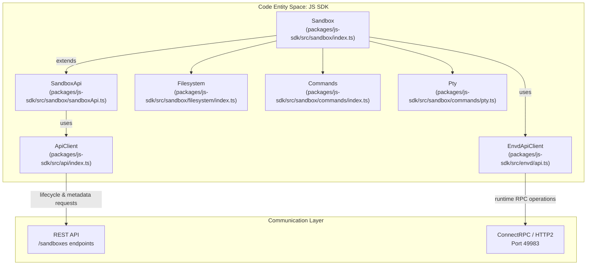
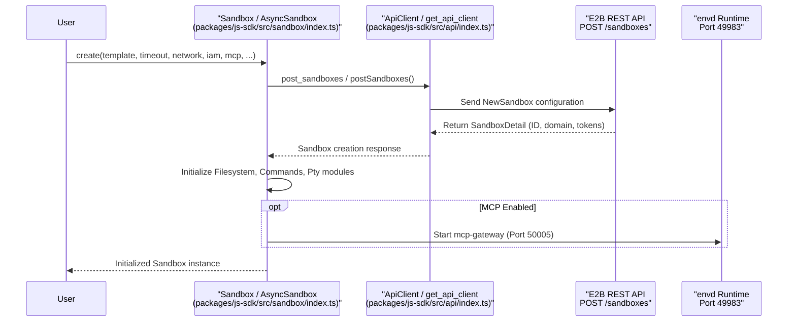
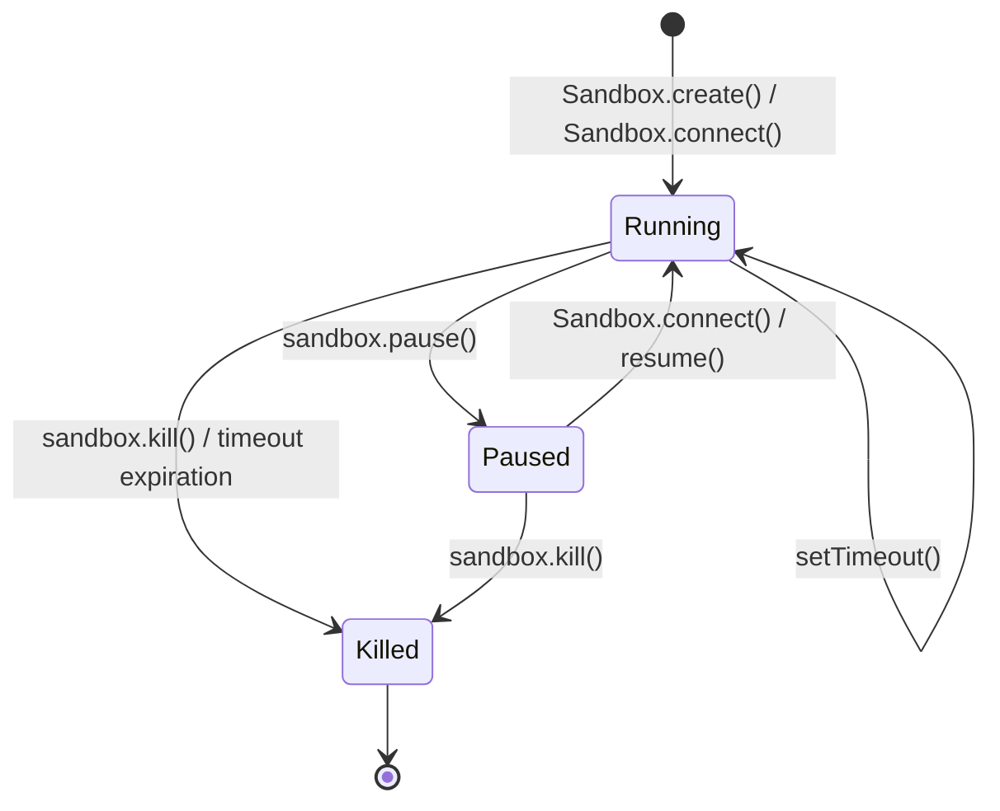

<!-- source: DeepWiki mcp.deepwiki.com · repo e2b-dev/E2B · page 2.1 Sandbox Management · fetched 2026-10-29 -->

# Sandbox Management

<details>
<summary>Relevant source files</summary>

The following files were used as context for generating this wiki page:

- [packages/js-sdk/src/index.ts](packages/js-sdk/src/index.ts)
- [packages/js-sdk/src/sandbox/index.ts](packages/js-sdk/src/sandbox/index.ts)
- [packages/js-sdk/src/sandbox/sandboxApi.ts](packages/js-sdk/src/sandbox/sandboxApi.ts)
- [packages/python-sdk/e2b/__init__.py](packages/python-sdk/e2b/__init__.py)
- [packages/python-sdk/e2b/sandbox/main.py](packages/python-sdk/e2b/sandbox/main.py)
- [packages/python-sdk/e2b/sandbox/sandbox_api.py](packages/python-sdk/e2b/sandbox/sandbox_api.py)
- [packages/python-sdk/e2b/sandbox_async/main.py](packages/python-sdk/e2b/sandbox_async/main.py)
- [packages/python-sdk/e2b/sandbox_async/paginator.py](packages/python-sdk/e2b/sandbox_async/paginator.py)
- [packages/python-sdk/e2b/sandbox_async/sandbox_api.py](packages/python-sdk/e2b/sandbox_async/sandbox_api.py)
- [packages/python-sdk/e2b/sandbox_sync/main.py](packages/python-sdk/e2b/sandbox_sync/main.py)
- [packages/python-sdk/e2b/sandbox_sync/paginator.py](packages/python-sdk/e2b/sandbox_sync/paginator.py)
- [packages/python-sdk/e2b/sandbox_sync/sandbox_api.py](packages/python-sdk/e2b/sandbox_sync/sandbox_api.py)

</details>


This document covers the `Sandbox` class and `SandboxApi` layer across the JavaScript/TypeScript and Python SDKs. These modules provide the primary programming interface for creating, connecting to, forking, monitoring, and managing secure cloud environments (`Sandbox` in JS [packages/js-sdk/src/sandbox/index.ts:75-78](), `Sandbox` / `AsyncSandbox` in Python [packages/python-sdk/e2b/sandbox_sync/main.py:49-52](), [packages/python-sdk/e2b/sandbox_async/main.py:50-53]()). The management system coordinates instance-level runtime operations with `envd` via ConnectRPC/HTTP2 and global lifecycle workflows through control-plane REST endpoints via `SandboxApi` [packages/js-sdk/src/sandbox/sandboxApi.ts:1-21](), [packages/python-sdk/e2b/sandbox_async/sandbox_api.py:70-73]().

## Core Architecture and Class Hierarchy

The sandbox management system separates high-level instance operations (`Sandbox`, `AsyncSandbox`) from low-level API orchestration (`SandboxApi`). 

### Class Hierarchy and Communication Flow

The following diagram bridges natural language descriptions to code entities, showing how the `Sandbox` class utilizes `SandboxApi`, `ApiClient`, and `EnvdApiClient` to communicate over REST and ConnectRPC channels.



**Sources:** [packages/js-sdk/src/sandbox/index.ts:75-122](), [packages/js-sdk/src/sandbox/sandboxApi.ts:1-21]()

### Key Properties Table

| Property Name | JS Type | Python Type | Description & Code Pointer |
| :--- | :--- | :--- | :--- |
| `sandboxId` | `string` | `str` | Unique sandbox identifier [packages/js-sdk/src/sandbox/index.ts:102](), [packages/python-sdk/e2b/sandbox/main.py:96-100]() |
| `sandboxDomain` | `string` | `str` | Host domain for sandbox connections [packages/js-sdk/src/sandbox/index.ts:107](), [packages/python-sdk/e2b/sandbox/main.py:84-86]() |
| `files` | `Filesystem` | `Filesystem` | Filesystem operations module [packages/js-sdk/src/sandbox/index.ts:83](), [packages/python-sdk/e2b/sandbox_sync/main.py:73-77]() |
| `commands` | `Commands` | `Commands` | Process execution module [packages/js-sdk/src/sandbox/index.ts:87](), [packages/python-sdk/e2b/sandbox_sync/main.py:80-84]() |
| `pty` | `Pty` | `Pty` | Pseudo-terminal control module [packages/js-sdk/src/sandbox/index.ts:91](), [packages/python-sdk/e2b/sandbox_sync/main.py:87-91]() |
| `envdAccessToken` | `string?` | `str?` | Secure `envd` authentication token [packages/js-sdk/src/sandbox/index.ts:118](), [packages/python-sdk/e2b/sandbox/main.py:59-62]() |
| `trafficAccessToken` | `string?` | `str?` | Restricted traffic access token [packages/js-sdk/src/sandbox/index.ts:112](), [packages/python-sdk/e2b/sandbox/main.py:80-82]() |

**Sources:** [packages/js-sdk/src/sandbox/index.ts:100-120](), [packages/python-sdk/e2b/sandbox/main.py:58-100]()

---

## Sandbox Creation and Initialization

Creating a sandbox involves validating template references, allocating infrastructure via the control-plane REST API, setting up authentication tokens, and instantiating runtime communication stubs.

### Creation Sequence



**Sources:** [packages/python-sdk/e2b/sandbox_sync/sandbox_api.py:209-230](), [packages/python-sdk/e2b/sandbox_async/sandbox_api.py:210-231]()

### Configuration Options (`SandboxOpts`)

When invoking `Sandbox.create()` (JS) or `Sandbox.create()` / `AsyncSandbox.create()` (Python), several options control execution parameters:
- **`template`**: Template name or ID (defaults to `'base'` or `'mcp-gateway'` if MCP servers are configured) [packages/js-sdk/src/sandbox/index.ts:76-77](), [packages/python-sdk/e2b/sandbox/main.py:32-33]().
- **`timeout`** / **`timeoutMs`**: Sandbox lifetime in seconds or milliseconds (default: `300` seconds / `300000` ms) [packages/js-sdk/src/sandbox/index.ts:78](), [packages/python-sdk/e2b/sandbox/main.py:30]().
- **`metadata`**: Custom string key-value pairs assigned to the sandbox for filtering [packages/python-sdk/e2b/sandbox_sync/main.py:171-172]().
- **`envs`**: Custom environment variables injected into the sandbox environment [packages/python-sdk/e2b/sandbox_sync/main.py:173-174]().
- **`secure`**: Boolean indicating whether `envd` requires access tokens (`true` by default) [packages/python-sdk/e2b/sandbox_sync/main.py:175-176]().
- **`allowInternetAccess`**: Boolean toggle for internet access (equivalent to configuring `denyOut` with `['0.0.0.0/0']` when `false`) [packages/python-sdk/e2b/sandbox_sync/main.py:177-178]().

**Sources:** [packages/js-sdk/src/sandbox/sandboxApi.ts:1-50](), [packages/python-sdk/e2b/sandbox_sync/main.py:167-183]()

---

## Lifecycle Management and Operations

Sandboxes move through distinct lifecycle states: `running`, `paused`, and `killed`.



**Sources:** [packages/python-sdk/e2b/sandbox/sandbox_api.py:20-23](), [packages/python-sdk/e2b/sandbox_sync/sandbox_api.py:135-159]()

### Lifecycle Methods

- **`connect()` / `Sandbox.connect(sandboxId)`**: Attaches to an existing running or paused sandbox instance. Resumes paused sandboxes automatically [packages/python-sdk/e2b/sandbox_sync/sandbox_api.py:19-21]().
- **`pause()`**: Suspends execution of the sandbox, saving its filesystem and optionally memory state [packages/python-sdk/e2b/sandbox_sync/sandbox_api.py:21-22]().
- **`kill()`**: Terminating method that destroys the sandbox instance and releases all underlying container and network resources (`DELETE /sandboxes/{sandbox_id}`) [packages/python-sdk/e2b/sandbox_sync/sandbox_api.py:135-159]().
- **`setTimeout(timeout)`**: Extends or updates the active timeout duration of the sandbox (`POST /sandboxes/{sandbox_id}/timeout`) [packages/python-sdk/e2b/sandbox_sync/sandbox_api.py:161-185]().
- **`fork()`**: Clones an existing sandbox state into a new isolated sandbox instance (`POST /sandboxes/{sandbox_id}/fork`) [packages/python-sdk/e2b/sandbox_sync/sandbox_api.py:20-21]().
- **`snapshot()`**: Creates a reusable template snapshot from the sandbox filesystem state (`POST /sandboxes/{sandbox_id}/snapshots`) [packages/python-sdk/e2b/sandbox_sync/sandbox_api.py:21-22]().

**Sources:** [packages/python-sdk/e2b/sandbox_sync/sandbox_api.py:14-25](), [packages/python-sdk/e2b/sandbox_async/sandbox_api.py:14-25]()

---

## Network Egress Control and IAM Options

E2B supports sophisticated network egress filtering and workload identity management.

### Network Configuration (`SandboxNetworkOpts`)

Outbound traffic can be restricted using `SandboxNetworkOpts`:
- **`allowOut` / `denyOut`**: Static CIDR lists or dynamic callables receiving `SandboxNetworkSelectorContext` (`all_traffic`, `rules`) [packages/js-sdk/src/sandbox/sandboxApi.ts:134-149](), [packages/python-sdk/e2b/sandbox/sandbox_api.py:197-219]().
- **`rules`**: Per-domain request transforms (`SandboxNetworkRules`). Rules support header injection and placeholder evaluation via `SandboxNetworkTransformContext` [packages/js-sdk/src/sandbox/sandboxApi.ts:47-121](), [packages/python-sdk/e2b/sandbox/sandbox_api.py:104-184]().
- **`egressProxy`**: Configuration for tunneling sandbox TCP connections through an external SOCKS5 proxy (`SandboxEgressProxyOpts`) [packages/js-sdk/src/sandbox/sandboxApi.ts:176-200](), [packages/python-sdk/e2b/sandbox/sandbox_api.py:221-250]().

### Workload Identity (`SandboxIamOpts`)

IAM options allow registering workload identity tokens (e.g., AWS IAM tokens) that are securely minted and injected by the egress proxy upon request matching [packages/js-sdk/src/sandbox/sandboxApi.ts:63-80](), [packages/python-sdk/e2b/sandbox/sandbox_api.py:117-144]().

**Sources:** [packages/js-sdk/src/sandbox/sandboxApi.ts:47-202](), [packages/python-sdk/e2b/sandbox/sandbox_api.py:104-250]()

---

## Model Context Protocol (MCP) Integration

The SDK supports configuring Model Context Protocol servers natively during sandbox creation.

- **`McpServer`**: Combines base MCP server definitions with dynamic GitHub-based MCP servers (`GitHubMcpServer`) [packages/js-sdk/src/sandbox/sandboxApi.ts:23-44](), [packages/python-sdk/e2b/sandbox/sandbox_api.py:76-101]().
- **Gateway Template**: When MCP servers are requested, the sandbox defaults to the `mcp-gateway` template [packages/js-sdk/src/sandbox/index.ts:77](), [packages/python-sdk/e2b/sandbox/main.py:33]().
- **Token Management**: A gateway access token (`GATEWAY_ACCESS_TOKEN`) is automatically provisioned and managed inside the sandbox at `/etc/mcp-gateway/.token`.

**Sources:** [packages/js-sdk/src/sandbox/sandboxApi.ts:23-44](), [packages/python-sdk/e2b/sandbox/sandbox_api.py:76-101]()

---

## Paginated Listing and Metrics APIs

### Paginated Listing (`SandboxPaginator` / `AsyncSandboxPaginator`)

Sandboxes can be queried and listed using paginator classes supporting filtering by state, metadata, and creation timestamp (`get_v2_sandboxes`) [packages/python-sdk/e2b/sandbox_sync/paginator.py:23-103](), [packages/python-sdk/e2b/sandbox_async/paginator.py:23-103]().

```python
paginator = Sandbox.list(query=SandboxQuery(state=[SandboxState.RUNNING]))
while paginator.has_next:
    sandboxes = paginator.next_items()
```

### Metrics (`getMetrics()`)

Sandbox resource usage metrics are retrieved via `getMetrics()` (`GET /sandboxes/{sandbox_id}/metrics`), returning CPU percentage, memory consumption in bytes, and disk usage [packages/python-sdk/e2b/sandbox_async/sandbox_api.py:17-18]().

**Sources:** [packages/python-sdk/e2b/sandbox_sync/paginator.py:23-103](), [packages/python-sdk/e2b/sandbox_async/paginator.py:23-103]()

---

