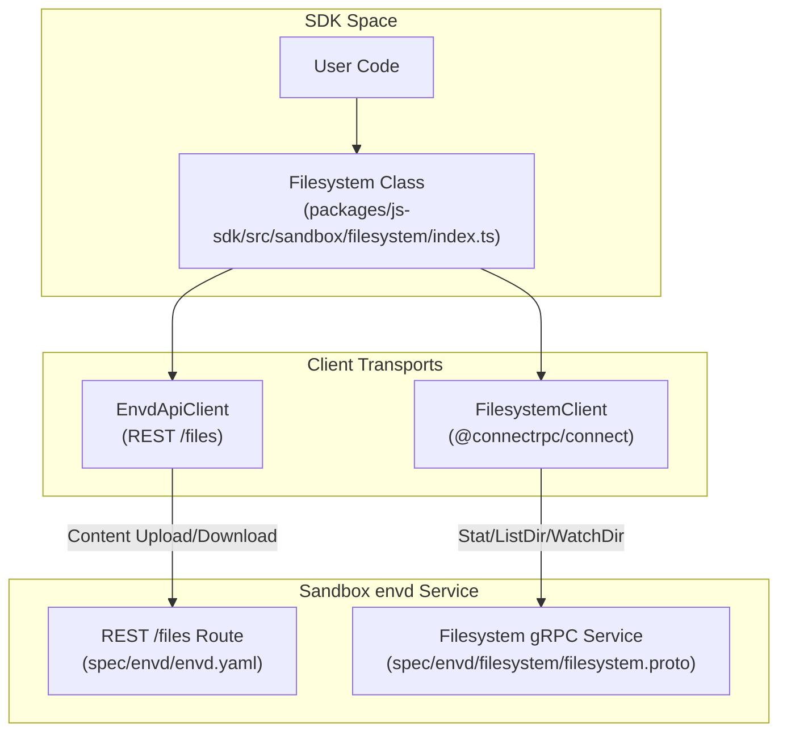
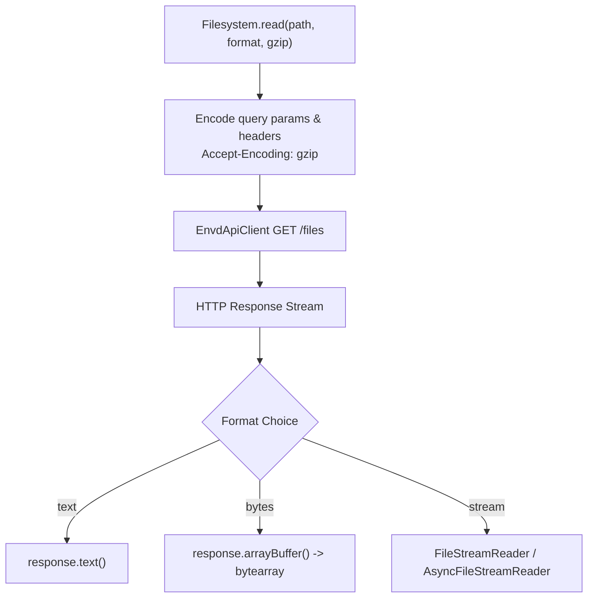
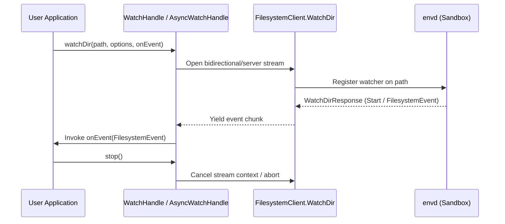

<!-- source: DeepWiki mcp.deepwiki.com · repo e2b-dev/E2B · page 2.2 Filesystem Operations · fetched 2026-10-29 -->

# Filesystem Operations

Relevant source files

The following files were used as context for generating this wiki page:

- [packages/js-sdk/src/envd/filesystem/filesystem_pb.ts](packages/js-sdk/src/envd/filesystem/filesystem_pb.ts)
- [packages/js-sdk/src/envd/schema.gen.ts](packages/js-sdk/src/envd/schema.gen.ts)
- [packages/js-sdk/src/sandbox/filesystem/index.ts](packages/js-sdk/src/sandbox/filesystem/index.ts)
- [packages/js-sdk/src/sandbox/filesystem/watchHandle.ts](packages/js-sdk/src/sandbox/filesystem/watchHandle.ts)
- [packages/js-sdk/tests/sandbox/commands/envVars.test.ts](packages/js-sdk/tests/sandbox/commands/envVars.test.ts)
- [packages/js-sdk/tests/sandbox/files/signing.test.ts](packages/js-sdk/tests/sandbox/files/signing.test.ts)
- [packages/js-sdk/tests/sandbox/files/write.test.ts](packages/js-sdk/tests/sandbox/files/write.test.ts)
- [packages/js-sdk/tests/sandbox/internetAccess.test.ts](packages/js-sdk/tests/sandbox/internetAccess.test.ts)
- [packages/js-sdk/tests/sandbox/secure.test.ts](packages/js-sdk/tests/sandbox/secure.test.ts)
- [packages/python-sdk/e2b/sandbox/filesystem/filesystem.py](packages/python-sdk/e2b/sandbox/filesystem/filesystem.py)
- [packages/python-sdk/e2b/sandbox/filesystem/watch_handle.py](packages/python-sdk/e2b/sandbox/filesystem/watch_handle.py)
- [packages/python-sdk/e2b/sandbox_async/filesystem/filesystem.py](packages/python-sdk/e2b/sandbox_async/filesystem/filesystem.py)
- [packages/python-sdk/e2b/sandbox_sync/filesystem/filesystem.py](packages/python-sdk/e2b/sandbox_sync/filesystem/filesystem.py)
- [packages/python-sdk/tests/async/sandbox_async/commands/test_env_vars.py](packages/python-sdk/tests/async/sandbox_async/commands/test_env_vars.py)
- [packages/python-sdk/tests/async/sandbox_async/files/test_write.py](packages/python-sdk/tests/async/sandbox_async/files/test_write.py)
- [packages/python-sdk/tests/sync/sandbox_sync/commands/test_env_vars.py](packages/python-sdk/tests/sync/sandbox_sync/commands/test_env_vars.py)
- [packages/python-sdk/tests/sync/sandbox_sync/files/test_write.py](packages/python-sdk/tests/sync/sandbox_sync/files/test_write.py)
- [spec/envd/envd.yaml](spec/envd/envd.yaml)
- [spec/envd/filesystem/filesystem.proto](spec/envd/filesystem/filesystem.proto)

The Filesystem module provides comprehensive capabilities for reading, writing, watching, and managing files and directories within E2B sandboxes. It implements a dual-protocol communication model: REST endpoints handle high-throughput file content transfers (`/files`), while ConnectRPC services handle structured metadata operations, directory management, and real-time event streaming (`filesystem.Filesystem`).

## Architecture and Communication Protocols

The Filesystem module delegates operations between REST and gRPC/ConnectRPC depending on whether the payload is content data or metadata.

**Diagram: Filesystem Protocol Routing**

**Protocol Operation Routing Table**

| Operation | Protocol | Code Entity / Route | Purpose |
|-----------|----------|---------------------|---------|
| Read File | REST (GET) | `GET /files` | Streaming file contents |
| Write File | REST (POST) | `POST /files` | Multipart/octet-stream uploads with parent directory auto-creation |
| Stat / Exists | gRPC | `Filesystem.Stat` | Low-latency file/directory metadata query |
| List Directory | gRPC | `Filesystem.ListDir` | Recursive or flat directory listing |
| Make Directory | gRPC | `Filesystem.MakeDir` | Create directory structure |
| Remove / Move | gRPC | `Filesystem.Remove`, `Filesystem.Move` | File manipulation |
| Watch Directory | gRPC Stream | `Filesystem.WatchDir` | Real-time filesystem events |

Sources: `[packages/js-sdk/src/sandbox/filesystem/index.ts:1-37]`, `[spec/envd/filesystem/filesystem.proto:7-20]`, `[spec/envd/envd.yaml:43-125]`

---

## File Content Operations

File contents are transferred via REST to leverage standard HTTP chunked streaming, compression, and multipart form encoding.

### Reading Files

The `read()` method supports multiple return formats (`text`, `bytes`, and `stream`) and options for gzip compression and idle timeouts.

**Diagram: Read Request Flow**

- **Formats**: 
  - `text`: Returns a UTF-8 string `[packages/python-sdk/e2b/sandbox_sync/filesystem/filesystem.py:105-115]()`.
  - `bytes`: Returns raw byte arrays `[packages/python-sdk/e2b/sandbox_sync/filesystem/filesystem.py:135-146]()`.
  - `stream`: Returns a managed iterator (`FileStreamReader` or `AsyncFileStreamReader`) that cleans up connection pools upon completion or error `[packages/python-sdk/e2b/sandbox/filesystem/filesystem.py:158-224]()`.
- **Gzip**: Passing `gzip: true` sets the `Accept-Encoding: gzip` header `[packages/python-sdk/e2b/sandbox_sync/filesystem/filesystem.py:201-203]()`.

Sources: `[packages/js-sdk/src/sandbox/filesystem/index.ts:197-288]`, `[packages/python-sdk/e2b/sandbox_sync/filesystem/filesystem.py:105-230]`, `[packages/python-sdk/e2b/sandbox/filesystem/filesystem.py:158-224]`

### Writing Files and Uploads

The SDK supports single file writes, multi-file batch uploads (`write_files`), and streaming uploads.

- **Data normalization**: Inputs like `string`, `ArrayBuffer`, `Blob`, `ReadableStream`, `io.BytesIO`, and `io.StringIO` are automatically handled `[packages/python-sdk/e2b/sandbox/filesystem/filesystem.py:44-55]()`, `[packages/js-sdk/src/utils.ts]`.
- **Multipart and Octet-Stream**: Uploads can use standard multipart form-data or direct binary uploads (`use_octet_stream: true`) `[packages/python-sdk/tests/sync/sandbox_sync/files/test_write.py:179-184]()`.
- **Gzip Uploads**: Payload compression can be enabled via `gzip: true` in write options `[packages/python-sdk/tests/sync/sandbox_sync/files/test_write.py:207-213]()`.

Sources: `[packages/python-sdk/tests/sync/sandbox_sync/files/test_write.py:1-219]`, `[packages/js-sdk/tests/sandbox/files/write.test.ts:1-128]`, `[packages/js-sdk/src/envd/schema.gen.ts:78-125]`

---

## Metadata and Directory Operations

Structured operations are carried out via gRPC stubs defined in `filesystem.proto`.

### Entry Information and Extended Attributes (xattrs)

Files and directories carry detailed metadata, including POSIX permission bits, owners, modification timestamps, and extended attributes stored under the `user.e2b.*` namespace.

- **Metadata Validation**: Keys and values are validated against RFC 7230 token rules and printable US-ASCII requirements (`METADATA_KEY_REGEX`, `METADATA_VALUE_REGEX`) `[packages/js-sdk/src/sandbox/filesystem/index.ts:203-224]()`.
- **Metadata Headers**: Upload requests transmit metadata via `X-Metadata-<key>` HTTP headers `[packages/js-sdk/src/sandbox/filesystem/index.ts:226-235]()`.
- **Mapping**: Protobuf `EntryInfo` responses are mapped into SDK-native objects via `mapEntryInfo` / `map_entry_info` `[packages/js-sdk/src/sandbox/filesystem/index.ts:240-254]`, `[packages/python-sdk/e2b/sandbox/filesystem/filesystem.py:129-146]()`.

Sources: `[spec/envd/filesystem/filesystem.proto:53-69]`, `[packages/js-sdk/src/sandbox/filesystem/index.ts:111-164]`, `[packages/python-sdk/e2b/sandbox/filesystem/filesystem.py:56-146]`

---

## Filesystem Watching

Real-time monitoring of file and directory changes is supported through server-side gRPC streams (`WatchDir`).

**Diagram: Watch Handle Event Lifecycle**

- **Event Types (`FilesystemEventType`)**: `CHMOD`, `CREATE`, `REMOVE`, `RENAME`, `WRITE` `[packages/js-sdk/src/sandbox/filesystem/watchHandle.ts:14-35]()`.
- **Options**: Supports recursive watching (`recursive`), entry info inclusion (`include_entry`), and network mount allowance (`allow_network_mounts`) `[spec/envd/filesystem/filesystem.proto:87-95]()`.

Sources: `[spec/envd/filesystem/filesystem.proto:87-153]`, `[packages/js-sdk/src/sandbox/filesystem/watchHandle.ts:1-152]`

---

## Signed Upload/Download URLs and Security

For secure delegation or out-of-band access, file operations accept cryptographic signatures and expiration timestamps.

- **Parameters**: `signature` and `signature_expiration` can be passed as query parameters to `/files` requests `[packages/js-sdk/src/envd/schema.gen.ts:50-62]()`.
- **Secure Access Token**: When `secure: true` is configured, `envd` access tokens are injected into requests to authenticate communication within hardened sandbox enclaves `[packages/python-sdk/tests/sync/sandbox_sync/files/test_write.py:127-143]()`.

Sources: `[packages/js-sdk/src/envd/schema.gen.ts:50-76]`, `[packages/python-sdk/tests/sync/sandbox_sync/files/test_write.py:127-143]`

---

