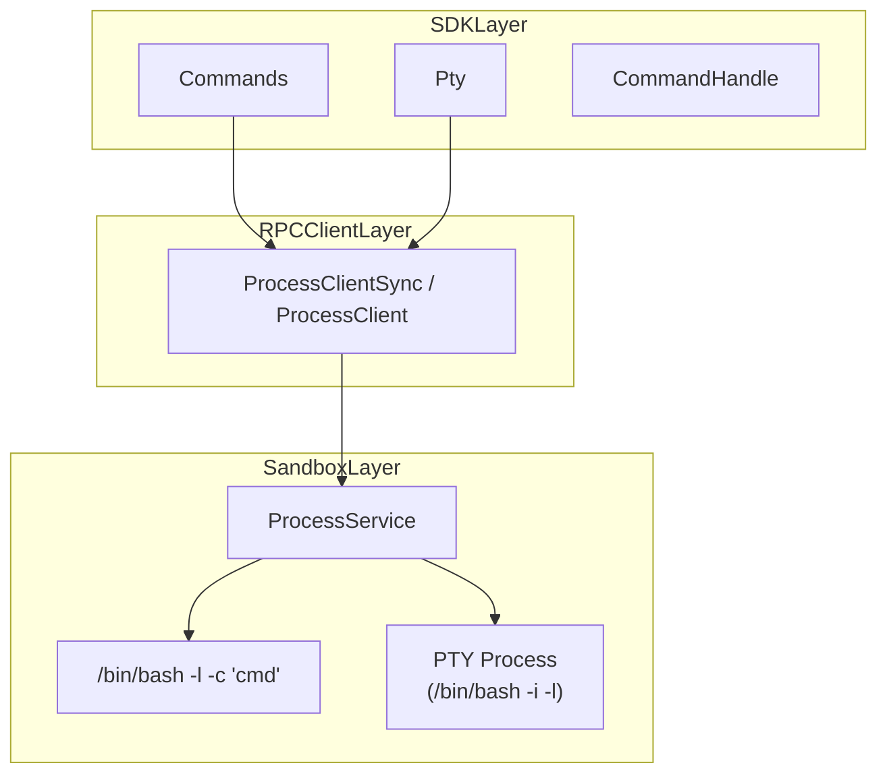
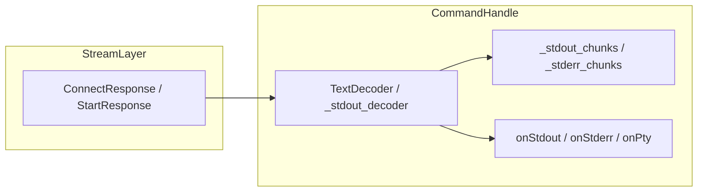

<!-- source: DeepWiki mcp.deepwiki.com · repo e2b-dev/E2B · page 2.3 Command Execution and PTY · fetched 2026-10-29 -->

# Command Execution and PTY

Relevant source files

The following files were used as context for generating this wiki page:

- [packages/js-sdk/src/sandbox/commands/commandHandle.ts](packages/js-sdk/src/sandbox/commands/commandHandle.ts)
- [packages/js-sdk/src/sandbox/commands/index.ts](packages/js-sdk/src/sandbox/commands/index.ts)
- [packages/js-sdk/src/sandbox/commands/pty.ts](packages/js-sdk/src/sandbox/commands/pty.ts)
- [packages/js-sdk/tests/sandbox/commands/commandHandle.test.ts](packages/js-sdk/tests/sandbox/commands/commandHandle.test.ts)
- [packages/js-sdk/tests/sandbox/commands/kill.test.ts](packages/js-sdk/tests/sandbox/commands/kill.test.ts)
- [packages/js-sdk/tests/sandbox/pty/ptyCreate.test.ts](packages/js-sdk/tests/sandbox/pty/ptyCreate.test.ts)
- [packages/js-sdk/tests/sandbox/pty/resize.test.ts](packages/js-sdk/tests/sandbox/pty/resize.test.ts)
- [packages/js-sdk/tests/sandbox/pty/sendInput.test.ts](packages/js-sdk/tests/sandbox/pty/sendInput.test.ts)
- [packages/python-sdk/e2b/sandbox_async/commands/command.py](packages/python-sdk/e2b/sandbox_async/commands/command.py)
- [packages/python-sdk/e2b/sandbox_async/commands/command_handle.py](packages/python-sdk/e2b/sandbox_async/commands/command_handle.py)
- [packages/python-sdk/e2b/sandbox_async/commands/pty.py](packages/python-sdk/e2b/sandbox_async/commands/pty.py)
- [packages/python-sdk/e2b/sandbox_sync/commands/command.py](packages/python-sdk/e2b/sandbox_sync/commands/command.py)
- [packages/python-sdk/e2b/sandbox_sync/commands/command_handle.py](packages/python-sdk/e2b/sandbox_sync/commands/command_handle.py)
- [packages/python-sdk/e2b/sandbox_sync/commands/pty.py](packages/python-sdk/e2b/sandbox_sync/commands/pty.py)
- [packages/python-sdk/tests/async/sandbox_async/pty/test_pty_create.py](packages/python-sdk/tests/async/sandbox_async/pty/test_pty_create.py)
- [packages/python-sdk/tests/async/sandbox_async/pty/test_resize.py](packages/python-sdk/tests/async/sandbox_async/pty/test_resize.py)
- [packages/python-sdk/tests/sync/sandbox_sync/pty/test_pty.py](packages/python-sdk/tests/sync/sandbox_sync/pty/test_pty.py)
- [packages/python-sdk/tests/sync/sandbox_sync/pty/test_resize.py](packages/python-sdk/tests/sync/sandbox_sync/pty/test_resize.py)
- [packages/python-sdk/tests/sync/sandbox_sync/test_sync_client_lifecycle.py](packages/python-sdk/tests/sync/sandbox_sync/test_sync_client_lifecycle.py)
- [packages/python-sdk/tests/test_command_handle.py](packages/python-sdk/tests/test_command_handle.py)

This document covers the command execution and pseudoterminal (PTY) capabilities in the E2B SDKs. These modules enable process management, command execution with stdout/stderr/stdin handling, background task execution, and interactive terminal sessions within sandboxes.

## Overview and Architecture

The command execution system is split into two primary modules:
- **`Commands`**: Executes shell commands, lists running processes, and manages non-interactive or background subprocesses.
- **`Pty`**: Creates and manages pseudoterminal (PTY) sessions for interactive shell access.

Both modules rely on Connect-RPC streaming clients communicating with the `envd` service running inside the sandbox. Commands execute through `/bin/bash` by default to ensure profile and environment loading.

Sources: [packages/js-sdk/src/sandbox/commands/index.ts:135-151](), [packages/python-sdk/e2b/sandbox_sync/commands/command.py:31-50]()

## Commands Module

The `Commands` class provides high-level methods for executing shell commands and inspecting active processes.

### Execution Flow and Options

When a command is initiated (via `run()` in Python or `start()` in JS), the SDK establishes a bidirectional streaming connection with `envd`:
1. **Start Request**: A `StartRequest` payload is sent containing the executable command, arguments, environment overrides (`envs`), working directory (`cwd`), and user context (`user`) [packages/python-sdk/e2b/sandbox_sync/commands/pty.py:137-148]().
2. **PID Extraction**: The first stream response yields the process ID (`pid`) via `handleProcessStartEvent` [packages/js-sdk/src/sandbox/commands/index.ts:21-22](), [packages/python-sdk/e2b/sandbox_sync/commands/command.py:20-21]().
3. **Output & Data Streaming**: Subsequent chunks stream `stdout`, `stderr`, or `pty` data.
4. **Termination**: An `end` event supplies the final `exitCode` and execution error details.

### Process Information (`ProcessInfo`)

Active commands and PTY sessions can be inspected using `list()`, returning objects conforming to `ProcessInfo`:

| Field | Type | Description |
| :--- | :--- | :--- |
| `pid` | `number` | Unique process ID within the sandbox. |
| `tag` | `string?` | Optional tag identifying special processes (e.g., template startup commands). |
| `cmd` | `string` | The command string executed. |
| `args` | `string[]` | Arguments supplied to the process. |
| `envs` | `Record<string, string>` | Environment variables active for the process. |
| `cwd` | `string?` | Working directory path. |

Sources: [packages/js-sdk/src/sandbox/commands/index.ts:105-131](), [packages/python-sdk/e2b/sandbox_sync/commands/command.py:55-88]()

## Command Handles

A `CommandHandle` (or `AsyncCommandHandle`) acts as a proxy for managing a running or completed process.

### Data Flow and UTF-8 Decoding

Raw byte chunks from the gRPC stream are decoded into UTF-8 strings using incremental decoders (`TextDecoder` in JavaScript, `codecs.getincrementaldecoder` in Python) to safely process multi-byte characters split across network chunks.

Sources: [packages/js-sdk/src/sandbox/commands/commandHandle.ts:91-125](), [packages/python-sdk/e2b/sandbox_sync/commands/command_handle.py:53-120]()

### Key Methods and Properties

- **`wait()`**: Awaits process completion and returns a `CommandResult`. Throws `CommandExitError` (JS) or `CommandExitException` (Python) if `exitCode !== 0`.
- **`kill()`**: Sends a `SIGKILL` signal to the process.
- **`disconnect()`**: Drops the event stream locally without terminating the remote process.
- **`sendStdin(data)`**: Sends text or binary input to the process standard input (requires `stdin: true` during start).
- **`closeStdin()`**: Sends an EOF signal to the process standard input (requires `envd` support).

Sources: [packages/js-sdk/src/sandbox/commands/commandHandle.ts:166-247](), [packages/python-sdk/e2b/sandbox_sync/commands/command_handle.py:151-224]()

## PTY (Pseudoterminal)

The `Pty` module manages interactive pseudo-terminal sessions.

### Configuration and Environment

When creating a PTY with `create()`, dimensions (`cols`, `rows`) must be specified alongside optional environment overrides and working directory. The SDK automatically sets default terminal environment variables:
- `TERM`: `xterm-256color`
- `LANG`: `C.UTF-8`
- `LC_ALL`: `C.UTF-8`

Sources: [packages/js-sdk/src/sandbox/commands/pty.ts:108-115](), [packages/python-sdk/e2b/sandbox_sync/commands/pty.py:132-136]()

### Resizing and Input

The terminal size can be updated dynamically via `resize()`, which propagates window dimension changes to `envd`. Input is sent using `sendInput()`.

Sources: [packages/js-sdk/tests/sandbox/pty/resize.test.ts:33-41](), [packages/python-sdk/e2b/sandbox_sync/commands/pty.py:83-110]()

## Implementation Details

### Stdin Closing and Version Gating

Closing standard input requires checking the sandbox `envd` version against `ENVD_ENVD_CLOSE` to ensure protocol compatibility.

Sources: [packages/js-sdk/src/sandbox/commands/index.ts:157-159](), [packages/python-sdk/e2b/sandbox_sync/commands/command.py:164-168]()

### Keep-Alive and Health Checks

Long-running command streams inject keep-alive headers (`KEEPALIVE_PING_HEADER` at `KEEPALIVE_PING_INTERVAL_SEC` intervals) to prevent timeouts by network intermediaries. RPC failures invoke `checkSandboxHealth` to differentiate network disconnects from process errors.

Sources: [packages/js-sdk/src/connectionConfig.ts:13-17](), [packages/js-sdk/src/envd/rpc.ts:29-31]()

---

