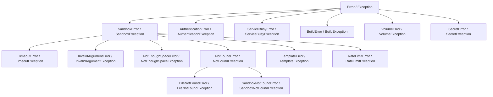
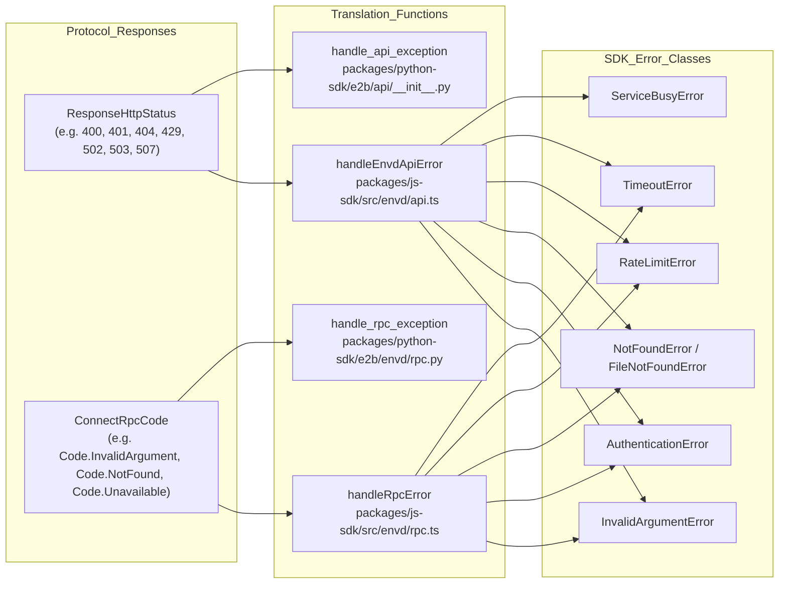
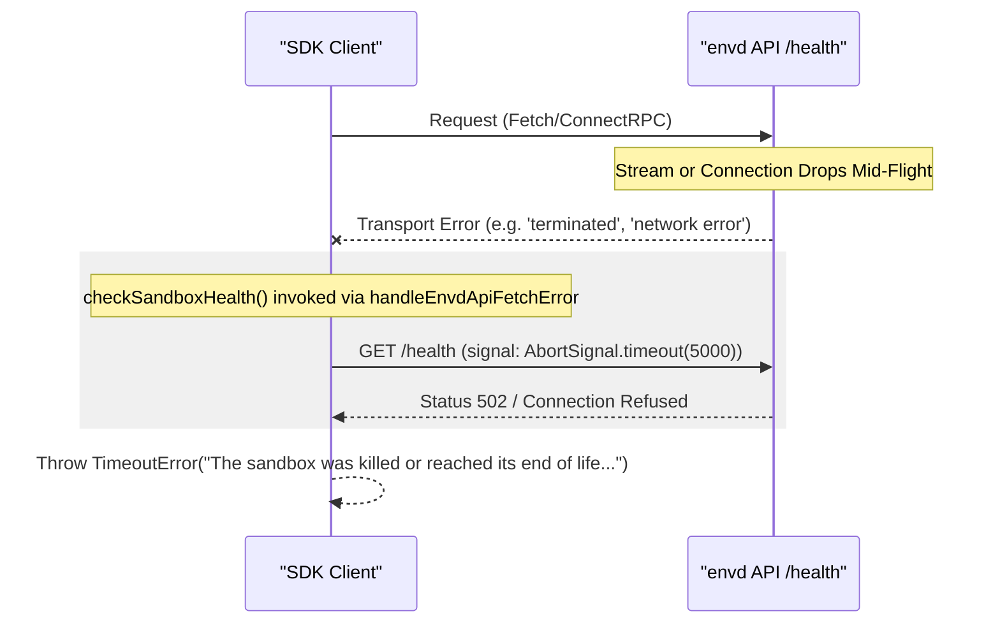

<!-- source: DeepWiki mcp.deepwiki.com · repo e2b-dev/E2B · page 2.4 Error Handling and Types · fetched 2026-10-29 -->

# Error Handling and Types

Relevant source files

The following files were used as context for generating this wiki page:

- [packages/js-sdk/src/envd/api.ts](packages/js-sdk/src/envd/api.ts)
- [packages/js-sdk/src/envd/rpc.ts](packages/js-sdk/src/envd/rpc.ts)
- [packages/js-sdk/src/errors.ts](packages/js-sdk/src/errors.ts)
- [packages/js-sdk/tests/api/handleApiError.test.ts](packages/js-sdk/tests/api/handleApiError.test.ts)
- [packages/js-sdk/tests/envd/handleEnvdApiError.test.ts](packages/js-sdk/tests/envd/handleEnvdApiError.test.ts)
- [packages/js-sdk/tests/envd/handleRpcError.test.ts](packages/js-sdk/tests/envd/handleRpcError.test.ts)
- [packages/js-sdk/tests/runtime.test.ts](packages/js-sdk/tests/runtime.test.ts)
- [packages/python-sdk/e2b/exceptions.py](packages/python-sdk/e2b/exceptions.py)
- [packages/python-sdk/tests/test_api_exception.py](packages/python-sdk/tests/test_api_exception.py)

This wiki page documents the error handling system and type hierarchy in the E2B SDKs. It covers exception classes, protocol-level error mapping from REST and gRPC (`envd`) responses to SDK exceptions, connection termination handling, and cross-runtime diagnostics.

Sources: `[packages/js-sdk/src/errors.ts:1-256]()`, `[packages/python-sdk/e2b/exceptions.py:1-197]()`

---

## 1. Error Class Hierarchy

The E2B SDKs implement a structured inheritance tree for errors. In TypeScript/JavaScript, `SandboxError` extends the built-in `Error` [packages/js-sdk/src/errors.ts:13-23](). In Python, `SandboxException` extends `Exception` [packages/python-sdk/e2b/exceptions.py:16-32](). Certain system-level errors—such as `AuthenticationError` and `ServiceBusyError`—inherit directly from base error types because they apply globally across any operation.

Sources: `[packages/js-sdk/src/errors.ts:9-250]()`, `[packages/python-sdk/e2b/exceptions.py:16-197]()`

---

## 2. Protocol Mapping Logic (REST and gRPC)

Both the JavaScript and Python SDKs communicate with the sandbox control plane and the runtime agent (`envd`) using HTTP/REST for lifecycle/file transfers and ConnectRPC/gRPC over HTTP/2 for runtime commands and filesystem operations. The translation layers map status codes and gRPC codes into typed SDK exceptions.

### Protocol Translation Mapping Architecture

Sources: `[packages/js-sdk/src/envd/api.ts:24-141]()`, `[packages/js-sdk/src/envd/rpc.ts:71-117]()`, `[packages/python-sdk/e2b/exceptions.py:1-153]()`

### Default Status Code and gRPC Code Mappings

| HTTP Status / gRPC Code | Error Factory / SDK Exception Class | Description |
| :--- | :--- | :--- |
| `400` / `InvalidArgument` | `InvalidArgumentError` / `InvalidArgumentException` | Invalid request parameter or argument format [packages/js-sdk/src/envd/api.ts:25](), [packages/js-sdk/src/envd/rpc.ts:72]() |
| `401` / `Unauthenticated` | `AuthenticationError` / `AuthenticationException` | Invalid or missing API key or token [packages/js-sdk/src/envd/api.ts:26](), [packages/js-sdk/src/envd/rpc.ts:73]() |
| `404` / `NotFound` | `NotFoundError` / `NotFoundException` | Target file, directory, or sandbox missing [packages/js-sdk/src/envd/api.ts:27](), [packages/js-sdk/src/envd/rpc.ts:74]() |
| `429` / `ResourceExhausted` | `RateLimitError` / `RateLimitException` | API rate limit exceeded [packages/js-sdk/src/envd/api.ts:28](), [packages/js-sdk/src/envd/rpc.ts:75-78]() |
| `502` / `Unavailable` | `TimeoutError` / `TimeoutException` | Sandbox EOL, timeout, or bad gateway via `formatSandboxTimeoutError` [packages/js-sdk/src/envd/api.ts:30](), [packages/js-sdk/src/envd/rpc.ts:79]() |
| `503` | `ServiceBusyError` / `ServiceBusyException` | Service temporarily busy or node lacks capacity [packages/js-sdk/tests/api/handleApiError.test.ts:72-77]() |
| `507` | `NotEnoughSpaceError` / `NotEnoughSpaceException` | Disk storage quota exceeded inside sandbox [packages/js-sdk/src/envd/api.ts:31]() |
| N/A / `Canceled` | `TimeoutError` / `TimeoutException` | Request timeout exceeded (`requestTimeoutMs`) [packages/js-sdk/src/envd/rpc.ts:80-83]() |
| N/A / `DeadlineExhausted` | `TimeoutError` / `TimeoutException` | Long-running operation timeout exceeded (`timeoutMs`) [packages/js-sdk/src/envd/rpc.ts:84-87]() |

Sources: `[packages/js-sdk/src/envd/api.ts:24-32]`, `[packages/js-sdk/src/envd/rpc.ts:71-88]`, `[packages/python-sdk/e2b/exceptions.py:34-152]`

---

## 3. Connection Termination and Health Probes

When an HTTP/2 stream or fetch request drops mid-body, various JavaScript runtimes throw runtime-specific transport errors. The SDK uses `isConnectionTerminatedMessage` to identify these network drops and executes `checkSandboxHealth` to determine if the sandbox was terminated [packages/js-sdk/src/envd/api.ts:42-91](), [packages/js-sdk/src/envd/rpc.ts:34-56]().

### Connection Termination Handling Flow

### Runtime-Specific Terminated Message Strings

The JavaScript SDK matches socket and fetch termination errors across diverse execution environments:
* **Node.js (undici)**: `terminated` [packages/js-sdk/src/envd/rpc.ts:28]()
* **Bun**: `The socket connection was closed unexpectedly` [packages/js-sdk/src/envd/rpc.ts:29]()
* **Deno**: `error reading a body from connection` [packages/js-sdk/src/envd/rpc.ts:30]()
* **Cloudflare Workers**: `Network connection lost` [packages/js-sdk/src/envd/rpc.ts:31]()
* **Browser**: `network error` [packages/js-sdk/src/envd/rpc.ts:32]()

Sources: `[packages/js-sdk/src/envd/api.ts:42-91]`, `[packages/js-sdk/src/envd/rpc.ts:33-147]`

---

## 4. ServiceBusyError Behavior

The `ServiceBusyError` (JavaScript) and `ServiceBusyException` (Python) represent HTTP status code `503` [packages/js-sdk/src/errors.ts:169-179](), [packages/python-sdk/e2b/exceptions.py:134-152](). 

Key characteristics:
* Raised when the API refuses an operation because the control plane or sandbox node is temporarily busy (e.g., persisting state during a pause or lacking placement capacity).
* Unlike other API errors, `ServiceBusyError` is **not** a subclass of `SandboxError` / `SandboxException`; it inherits directly from `Error` / `Exception` [packages/js-sdk/src/errors.ts:169](), [packages/python-sdk/e2b/exceptions.py:134]().
* Operations that receive a `503` guarantee that nothing was changed by the refused call (e.g., a refused pause leaves the sandbox running with its state intact), making it safe to retry after a short delay.

Sources: `[packages/js-sdk/src/errors.ts:169-179]`, `[packages/python-sdk/e2b/exceptions.py:134-152]`, `[packages/js-sdk/tests/api/handleApiError.test.ts:72-89]()`

---

