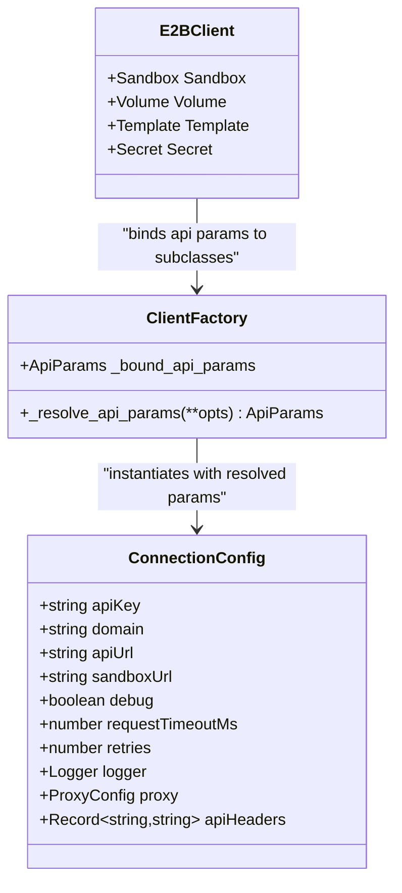
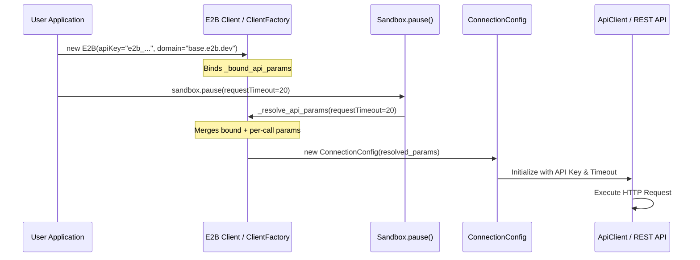
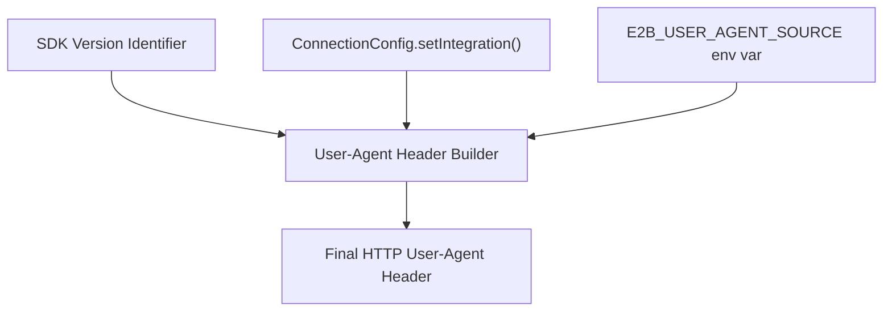
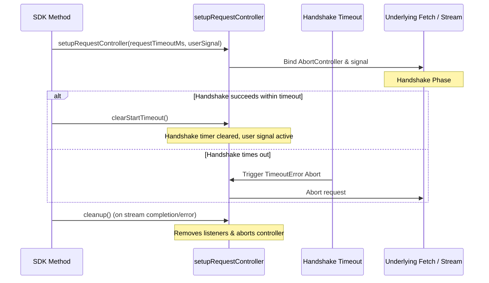

<!-- source: DeepWiki mcp.deepwiki.com · repo e2b-dev/E2B · page 2.5 Connection Configuration and the E2B Client · fetched 2026-10-29 -->

# Connection Configuration and the E2B Client

Relevant source files

The following files were used as context for generating this wiki page:

- [packages/js-sdk/src/api/index.ts](packages/js-sdk/src/api/index.ts)
- [packages/js-sdk/src/api/inflight.ts](packages/js-sdk/src/api/inflight.ts)
- [packages/js-sdk/src/connectionConfig.ts](packages/js-sdk/src/connectionConfig.ts)
- [packages/js-sdk/src/is.ts](packages/js-sdk/src/is.ts)
- [packages/js-sdk/tests/api/inflight.test.ts](packages/js-sdk/tests/api/inflight.test.ts)
- [packages/js-sdk/tests/connectionConfig.test.ts](packages/js-sdk/tests/connectionConfig.test.ts)
- [packages/js-sdk/tests/foreignPlatformObjects.ts](packages/js-sdk/tests/foreignPlatformObjects.ts)
- [packages/js-sdk/tests/is.test.ts](packages/js-sdk/tests/is.test.ts)
- [packages/js-sdk/tests/sandbox/configPropagation.test.ts](packages/js-sdk/tests/sandbox/configPropagation.test.ts)
- [packages/js-sdk/tests/sandbox/rpcHeaders.test.ts](packages/js-sdk/tests/sandbox/rpcHeaders.test.ts)
- [packages/python-sdk/e2b/api/__init__.py](packages/python-sdk/e2b/api/__init__.py)
- [packages/python-sdk/e2b/connection_config.py](packages/python-sdk/e2b/connection_config.py)
- [packages/python-sdk/tests/async/sandbox_async/test_config_propagation.py](packages/python-sdk/tests/async/sandbox_async/test_config_propagation.py)
- [packages/python-sdk/tests/sync/sandbox_sync/test_config_propagation.py](packages/python-sdk/tests/sync/sandbox_sync/test_config_propagation.py)
- [packages/python-sdk/tests/test_connection_config.py](packages/python-sdk/tests/test_connection_config.py)

This page documents connection configuration mechanics, options precedence, the E2B client class and `ClientFactory` binding, integration tagging, timeouts, proxies, retries, and stream cleanup across the JavaScript and Python SDKs.

For related error handling mechanics, see [Error Handling and Types](#2.4). For underlying network communication protocols, see [REST API and OpenAPI Spec](#6.1) and [envd Protocol and RPC Layer](#6.2).

**Sources:** [packages/js-sdk/src/connectionConfig.ts:1-103](), [packages/python-sdk/e2b/connection_config.py:1-152]()

---

## 1. Overview of `ConnectionConfig` and Options Precedence

Both SDKs provide a centralized configuration structure (`ConnectionOpts` in TypeScript [packages/js-sdk/src/connectionConfig.ts:19-103](), `ApiParams` in Python [packages/python-sdk/e2b/connection_config.py:43-91]()) that governs how requests are authenticated, timed out, routed, proxied, and retried. 

Configuration resolution follows a strict precedence hierarchy:
1. **Per-Call Parameters / Constructor Options**: Explicitly passed arguments when instantiating or calling a resource method.
2. **Bound Parameters (`ClientFactory`)**: Parameters inherited from an instantiated `E2B` client wrapper.
3. **Environment Variables**: Process-level settings (e.g., `E2B_API_KEY`, `E2B_DOMAIN`, `E2B_DEBUG`).
4. **Hardcoded Defaults**: Built-in fallbacks (e.g., `e2b.app` domain, 60-second request timeout, 3 retries).

### Configuration Precedence Flow

**Sources:** [packages/js-sdk/src/connectionConfig.ts:17-103](), [packages/python-sdk/e2b/connection_config.py:104-152]()

---

## 2. The E2B Client and `ClientFactory` Binding

In the Python SDK (and conceptually across SDK patterns), resource classes inherit from `ClientFactory` [packages/python-sdk/e2b/connection_config.py:125-152](). When an application instantiates an `E2B` client with specific credentials or domain parameters, `ClientFactory` binds these options to all underlying resource subclasses (`Sandbox`, `Volume`, `Template`, `Secret`) [packages/python-sdk/e2b/connection_config.py:125-134]().

When per-call methods (such as `Sandbox.create()` or `Sandbox.pause()`) are invoked, `merge_api_params` combines the bound parameters with per-call overrides [packages/python-sdk/e2b/connection_config.py:104-123](). Per-call options explicitly set to `None` are ignored so they correctly fall back to bound client values instead of clearing them [packages/python-sdk/e2b/connection_config.py:110-113]().

### Configuration Propagation Sequence

**Sources:** [packages/python-sdk/e2b/connection_config.py:104-152](), [packages/python-sdk/tests/sync/sandbox_sync/test_config_propagation.py:42-78]()

---

## 3. User-Agent and Integration Tagging

To identify traffic originating from wrappers or higher-level integrations (such as `@e2b/code-interpreter`), the SDK supports process-wide integration attribution via `ConnectionConfig.setIntegration` [packages/python-sdk/e2b/connection_config.py:164-178](), [packages/js-sdk/src/connectionConfig.ts]().

### User-Agent Assembly Rules
* **Base SDK Identification**: Starts with `e2b-js-sdk/<version>` or `e2b-python-sdk/<version>`.
* **Integration Tag**: If registered via `setIntegration`, the integration string (e.g. `"e2b-code-interpreter/0.1.0"`) is appended.
* **Traffic Source (`E2B_USER_AGENT_SOURCE`)**: Environment variable `E2B_USER_AGENT_SOURCE` can append a source tag (such as `source/ci`), provided the value contains no unsafe control characters or newlines [packages/js-sdk/tests/connectionConfig.test.ts:189-203](), [packages/python-sdk/tests/test_connection_config.py:131-145]().
* **Custom Headers**: If `api_headers` / `apiHeaders` explicitly sets a `User-Agent`, it takes precedence over automated tags [packages/python-sdk/tests/test_connection_config.py:147-159]().

**Sources:** [packages/js-sdk/tests/connectionConfig.test.ts:181-224](), [packages/python-sdk/tests/test_connection_config.py:117-159]()

---

## 4. Timeouts, Proxies, and Retries

### Request Timeouts
* **JavaScript**: Controlled by `requestTimeoutMs` (default `60_000` ms) [packages/js-sdk/src/connectionConfig.ts:9-62]().
* **Python**: Controlled by `request_timeout` (default `60.0` seconds) [packages/python-sdk/e2b/connection_config.py:24-51]().

### Retries
Control-plane HTTP requests automatically retry on `429 Too Many Requests` responses when accompanied by a valid, non-negative integer `Retry-After` header delta-seconds value [packages/js-sdk/src/connectionConfig.ts:64-71](), [packages/python-sdk/e2b/connection_config.py:53-61]().
* **Default Retries**: `3` attempts [packages/js-sdk/src/connectionConfig.ts:10](), [packages/python-sdk/e2b/connection_config.py:25]().
* **Environment Configuration**: In Python, default retries can be overridden via `E2B_CONNECTION_RETRIES` [packages/python-sdk/e2b/api/__init__.py:96]().
* **Retry Constraint**: Retries are skipped if the estimated wait time would exceed the configured request timeout.

### Proxy Configuration
The `proxy` option accepts URL strings, `httpx.URL`, or `httpx.Proxy` objects in Python [packages/python-sdk/e2b/connection_config.py:14-22](), and proxy URL strings in JavaScript [packages/js-sdk/src/connectionConfig.ts:85-90](). In Python, proxies are normalized via `proxy_to_config` into hashable `ProxyConfig` tuples that key `pyqwest` transport caches efficiently [packages/python-sdk/e2b/api/__init__.py:128-166]().

**Sources:** [packages/js-sdk/src/connectionConfig.ts:9-90](), [packages/python-sdk/e2b/connection_config.py:24-87](), [packages/python-sdk/e2b/api/__init__.py:96-166]()

---

## 5. Stream Cleanup and Request Controller Management

For long-running streams, file uploads/downloads, and interactive commands, the JavaScript SDK implements `setupRequestController` to manage startup timeouts (handshakes) separately from ongoing idle stream durations [packages/js-sdk/src/connectionConfig.ts:154-204]().

### Request Controller Lifecycle

**Sources:** [packages/js-sdk/src/connectionConfig.ts:154-204]()

---

