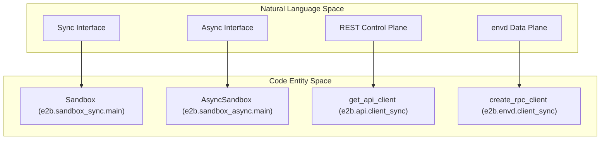
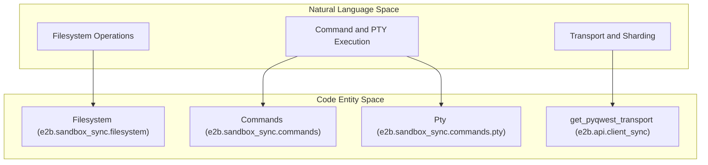

<!-- source: DeepWiki mcp.deepwiki.com · repo e2b-dev/E2B · page 3 Python SDK · fetched 2026-10-29 -->

# Python SDK

Relevant source files

The following files were used as context for generating this wiki page:

- [.github/assets/envd-pool-sharding-benchmark.svg](.github/assets/envd-pool-sharding-benchmark.svg)
- [packages/js-sdk/src/index.ts](packages/js-sdk/src/index.ts)
- [packages/js-sdk/src/sandbox/sandboxApi.ts](packages/js-sdk/src/sandbox/sandboxApi.ts)
- [packages/python-sdk/e2b/__init__.py](packages/python-sdk/e2b/__init__.py)
- [packages/python-sdk/e2b/api/client_async/__init__.py](packages/python-sdk/e2b/api/client_async/__init__.py)
- [packages/python-sdk/e2b/api/client_sync/__init__.py](packages/python-sdk/e2b/api/client_sync/__init__.py)
- [packages/python-sdk/e2b/envd/client_async/__init__.py](packages/python-sdk/e2b/envd/client_async/__init__.py)
- [packages/python-sdk/e2b/envd/client_sync/__init__.py](packages/python-sdk/e2b/envd/client_sync/__init__.py)
- [packages/python-sdk/e2b/sandbox/sandbox_api.py](packages/python-sdk/e2b/sandbox/sandbox_api.py)
- [packages/python-sdk/e2b/sandbox_async/main.py](packages/python-sdk/e2b/sandbox_async/main.py)
- [packages/python-sdk/e2b/sandbox_async/sandbox_api.py](packages/python-sdk/e2b/sandbox_async/sandbox_api.py)
- [packages/python-sdk/e2b/sandbox_sync/main.py](packages/python-sdk/e2b/sandbox_sync/main.py)
- [packages/python-sdk/e2b/sandbox_sync/sandbox_api.py](packages/python-sdk/e2b/sandbox_sync/sandbox_api.py)
- [packages/python-sdk/tests/envd_frame_server.py](packages/python-sdk/tests/envd_frame_server.py)
- [packages/python-sdk/tests/test_api_client_transport.py](packages/python-sdk/tests/test_api_client_transport.py)
- [packages/python-sdk/tests/test_env_var_parsing.py](packages/python-sdk/tests/test_env_var_parsing.py)

The Python SDK (`e2b` package) provides a programmatic interface for creating, managing, and interacting with E2B sandboxes from Python applications. It supports both synchronous (`Sandbox`) and asynchronous (`AsyncSandbox`) programming patterns and offers functionality for sandbox lifecycle management, filesystem operations, process execution, and HTTP transport.

For details on package structure, installation, and general usage patterns, see the overview below. For specific implementation details, refer to the child pages covering [Sandbox Management (Sync and Async)](#3.1), [Filesystem, Commands and PTY](#3.2), [HTTP Transport and Generated API Client](#3.3), and [Dependencies and Environment](#3.4).

## Architecture and Interface Mapping

The Python SDK exposes dual interfaces to accommodate both synchronous and asynchronous application designs while leveraging shared underlying transport and client machinery.

### System-to-Code Mapping: Communication and Client Classes

Sources: [packages/python-sdk/e2b/sandbox_sync/main.py:49-110](), [packages/python-sdk/e2b/sandbox_async/main.py:50-112](), [packages/python-sdk/e2b/api/client_sync/__init__.py:24-29](), [packages/python-sdk/e2b/envd/client_sync/__init__.py:56-91]()

## Package Layout under `e2b/`

The codebase under `e2b/` is organized into distinct functional submodules supporting core sandbox behaviors, API communication, and template management:

| Module Path | Purpose | Key Classes/Entities |
|-------------|---------|----------------------|
| `e2b/sandbox_sync/` | Synchronous sandbox implementation | `Sandbox`, `Commands`, `Pty`, `Filesystem`, `Git` |
| `e2b/sandbox_async/` | Asynchronous sandbox implementation | `AsyncSandbox`, `AsyncCommands`, `AsyncPty`, `AsyncFilesystem` |
| `e2b/api/` | Generated REST API client and transports | `ApiClient`, `AsyncApiClient`, `get_api_client` |
| `e2b/envd/` | gRPC/ConnectRPC client stubs and transport wrappers | `PlainHTTPErrorTransport`, `create_rpc_client` |
| `e2b/volume/` | Persistent storage management | `Volume`, `AsyncVolume` |

Sources: [packages/python-sdk/e2b/__init__.py:28-162](), [packages/python-sdk/e2b/sandbox_sync/main.py:35-42]()

### System-to-Code Mapping: Modules and Runtime Operations

Sources: [packages/python-sdk/e2b/sandbox_sync/main.py:73-92](), [packages/python-sdk/e2b/api/client_sync/__init__.py:77-129]()

## Core Sub-Topics

### 3.1. Sandbox Management (Sync and Async)
The `Sandbox` and `AsyncSandbox` classes (inheriting from `SandboxBase`) manage the complete sandbox lifecycle including creation, connection, pausing, resuming, killing, and snapshotting. For details, see [Sandbox Management (Sync and Async)](#3.1).

Sources: [packages/python-sdk/e2b/sandbox_sync/main.py:49-183](), [packages/python-sdk/e2b/sandbox_async/main.py:50-187]()

### 3.2. Filesystem, Commands and PTY
Sandbox interactions rely on specialized modules for file I/O (`Filesystem`), process execution (`Commands`), and interactive terminal streaming (`Pty`), backed by `envd` ConnectRPC stubs. For details, see [Filesystem, Commands and PTY](#3.2).

Sources: [packages/python-sdk/e2b/sandbox_sync/main.py:73-92](), [packages/python-sdk/e2b/sandbox_async/main.py:73-94]()

### 3.3. HTTP Transport and Generated API Client
Communication with control and data planes utilizes `pyqwest`-backed transports (`get_pyqwest_transport`) and generated OpenAPI endpoints under `e2b/api/client`. For details, see [HTTP Transport and Generated API Client](#3.3).

Sources: [packages/python-sdk/e2b/api/client_sync/__init__.py:77-129](), [packages/python-sdk/e2b/api/client_async/__init__.py:78-130]()

### 3.4. Dependencies and Environment
Build tooling, configuration files (`pyproject.toml`, `uv.lock`), Makefile automation, and test fixtures govern the Python SDK environment. For details, see [Dependencies and Environment](#3.4).

Sources: [packages/python-sdk/tests/test_api_client_transport.py:1-40]()

---

